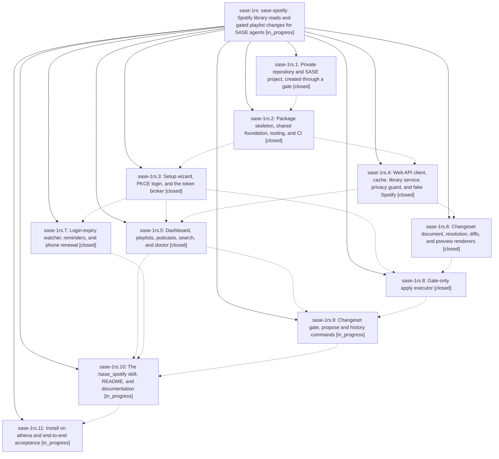

# Bead: sase-1rs — sase-spotify: Spotify library reads and gated playlist changes for SASE agents

[Bead Pages](../README.md) / sase-1rs

**Status:** ◐ in_progress · **Type:** ▸ plan · **Tier:** epic
**Owner:** `bryanbugyi34@gmail.com` · **Created by:** [bbugyi200.athena.19n](https://github.com/sase-org/sase--agents/blob/main/sessions/bbugyi200.athena.19n.md) · **Assignee:** `sase-1rs.land`
**Created:** 2026-11-07 10:55:59 EST
**Plan:** [202611/spotify\_agent\_access.md](https://github.com/sase-org/sase--plans/blob/main/202611/spotify_agent_access.md)

<!-- sase:links:start -->

## Links

| Relation | Artifact | Why |
| --- | --- | --- |
| implemented-by | [plan:202611/spotify_agent_access.md][1] | derived from the plan's `bead_id:` frontmatter field |

_Plus 5 automatic references — see [Referenced By](#referenced-by)._

[1]: https://github.com/sase-org/sase--plans/blob/main/202611/spotify_agent_access.md

<!-- sase:links:end -->

## Description

SASE agents of any provider can read Bryan's Spotify library through `sase spotify` and a `/sase_spotify` skill: every playlist, the songs in owned and collaborative playlists and Liked Songs, followed podcasts, and their recent episodes. Library data never reaches a publicly published agent chat, because the CLI enforces that boundary itself. Agents change playlists only by proposing one declarative changeset per task. Bryan reviews it as a PR-style SASE gate in the TUI or on Telegram, and only the option he approves writes to Spotify; that write is re-checked, journaled, reconciled, and verified. The new private sase-org/sase-spotify plugin ships with excellent docs, a strict test suite, and CI. It is installed and accepted end to end on athena.

## Phases

| Bead | Title | Status | Size | Created | Agents | Commits |
|---|---|---|---|---|---:|---:|
| [sase-1rs.1](sase-1rs.1.md) | Private repository and SASE project, created through a gate | ✓ closed | small | 2026-11-07 | 1 | 0 |
| [sase-1rs.10](sase-1rs.10.md) | The /sase\_spotify skill, README, and documentation | ◐ in_progress | medium | 2026-11-07 | 1 | 0 |
| [sase-1rs.11](sase-1rs.11.md) | Install on athena and end-to-end acceptance | ◐ in_progress | small | 2026-11-07 | 1 | 0 |
| [sase-1rs.2](sase-1rs.2.md) | Package skeleton, shared foundation, tooling, and CI | ✓ closed | medium | 2026-11-07 | 1 | 0 |
| [sase-1rs.3](sase-1rs.3.md) | Setup wizard, PKCE login, and the token broker | ✓ closed | medium | 2026-11-07 | 1 | 0 |
| [sase-1rs.4](sase-1rs.4.md) | Web API client, cache, library service, privacy guard, and fake Spotify | ✓ closed | medium | 2026-11-07 | 1 | 0 |
| [sase-1rs.5](sase-1rs.5.md) | Dashboard, playlists, podcasts, search, and doctor | ✓ closed | medium | 2026-11-07 | 1 | 0 |
| [sase-1rs.6](sase-1rs.6.md) | Changeset document, resolution, diffs, and preview renderers | ✓ closed | medium | 2026-11-07 | 1 | 0 |
| [sase-1rs.7](sase-1rs.7.md) | Login-expiry watcher, reminders, and phone renewal | ✓ closed | small | 2026-11-07 | 1 | 0 |
| [sase-1rs.8](sase-1rs.8.md) | Gate-only apply executor | ✓ closed | medium | 2026-11-07 | 1 | 0 |
| [sase-1rs.9](sase-1rs.9.md) | Changeset gate, propose and history commands | ◐ in_progress | medium | 2026-11-07 | 1 | 0 |

## Lineage

## Agents

| Agent | Bead | Commits |
|---|---|---:|
| [bbugyi200.athena.sase-1rs.1](https://github.com/sase-org/sase--agents/blob/main/sessions/bbugyi200.athena.sase-1rs.1.md) | [sase-1rs.1](sase-1rs.1.md) | 0 |
| [bbugyi200.athena.sase-1rs.10](https://github.com/sase-org/sase--agents/blob/main/agents/bbugyi200.athena.sase-1rs.10/README.md) | [sase-1rs.10](sase-1rs.10.md) | 0 |
| [bbugyi200.athena.sase-1rs.11](https://github.com/sase-org/sase--agents/blob/main/agents/bbugyi200.athena.sase-1rs.11/README.md) | [sase-1rs.11](sase-1rs.11.md) | 0 |
| [bbugyi200.athena.sase-1rs.2](https://github.com/sase-org/sase--agents/blob/main/agents/bbugyi200.athena.sase-1rs.2/README.md) | [sase-1rs.2](sase-1rs.2.md) | 0 |
| [bbugyi200.athena.sase-1rs.3](https://github.com/sase-org/sase--agents/blob/main/agents/bbugyi200.athena.sase-1rs.3/README.md) | [sase-1rs.3](sase-1rs.3.md) | 0 |
| [bbugyi200.athena.sase-1rs.4](https://github.com/sase-org/sase--agents/blob/main/agents/bbugyi200.athena.sase-1rs.4/README.md) | [sase-1rs.4](sase-1rs.4.md) | 0 |
| [bbugyi200.athena.sase-1rs.5](https://github.com/sase-org/sase--agents/blob/main/agents/bbugyi200.athena.sase-1rs.5/README.md) | [sase-1rs.5](sase-1rs.5.md) | 0 |
| [bbugyi200.athena.sase-1rs.6](https://github.com/sase-org/sase--agents/blob/main/agents/bbugyi200.athena.sase-1rs.6/README.md) | [sase-1rs.6](sase-1rs.6.md) | 0 |
| [bbugyi200.athena.sase-1rs.7](https://github.com/sase-org/sase--agents/blob/main/agents/bbugyi200.athena.sase-1rs.7/README.md) | [sase-1rs.7](sase-1rs.7.md) | 0 |
| [bbugyi200.athena.sase-1rs.8](https://github.com/sase-org/sase--agents/blob/main/agents/bbugyi200.athena.sase-1rs.8/README.md) | [sase-1rs.8](sase-1rs.8.md) | 0 |
| [bbugyi200.athena.sase-1rs.9](https://github.com/sase-org/sase--agents/blob/main/agents/bbugyi200.athena.sase-1rs.9/README.md) | [sase-1rs.9](sase-1rs.9.md) | 0 |
| [bbugyi200.athena.sase-1rs.land](https://github.com/sase-org/sase--agents/blob/main/agents/bbugyi200.athena.sase-1rs.land/README.md) | [sase-1rs](README.md) | 0 |

<!-- sase:referenced-by:start -->

## Referenced By

| Relation | Artifact | Why | Uses |
| --- | --- | --- | ---: |
| read-by | [agent:sase-1rs.3][1] | Check sibling phase statuses and notes for auth/api seam coordination | 1 |
| read-by | [agent:sase-1rs.4][2] | Need epic context and phase notes | 1 |
| read-by | [agent:sase-1rs.5][3] | Check epic notes and phase states | 1 |
| read-by | [agent:sase-1rs.6][4] | Check sibling phase status and notes for changesets phase | 1 |
| read-by | [agent:sase-1rs.7][5] | Need the epic context and sibling phases | 2 |

[1]: https://github.com/sase-org/sase--agents/blob/main/agents/bbugyi200.athena.sase-1rs.3/README.md
[2]: https://github.com/sase-org/sase--agents/blob/main/agents/bbugyi200.athena.sase-1rs.4/README.md
[3]: https://github.com/sase-org/sase--agents/blob/main/agents/bbugyi200.athena.sase-1rs.5/README.md
[4]: https://github.com/sase-org/sase--agents/blob/main/agents/bbugyi200.athena.sase-1rs.6/README.md
[5]: https://github.com/sase-org/sase--agents/blob/main/agents/bbugyi200.athena.sase-1rs.7/README.md

<!-- sase:referenced-by:end -->
