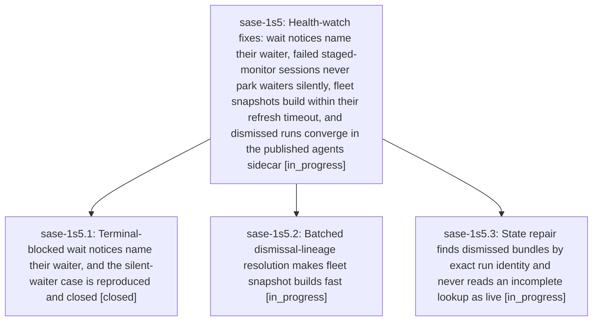

# Bead: sase-1s5 — Health-watch fixes: wait notices name their waiter, failed staged-monitor sessions never park waiters silently, fleet snapshots build within their refresh timeout, and dismissed runs converge in the published agents sidecar

[Bead Pages](../README.md) / sase-1s5

**Status:** ◐ in_progress · **Type:** ▸ plan · **Tier:** epic
**Owner:** `bryanbugyi34@gmail.com` · **Created by:** `bbugyi200.apollo.cy--6` · **Assignee:** `sase-1s5.land`
**Created:** 2026-11-08 06:51:27 EST
**Plan:** [202611/health\_watch\_fixes.md](https://github.com/sase-org/sase--plans/blob/main/202611/health_watch_fixes.md)

<!-- sase:links:start -->

## Links

| Relation | Artifact | Why |
| --- | --- | --- |
| implemented-by | [plan:202611/health_watch_fixes.md][1] | derived from the plan's `bead_id:` frontmatter field |

[1]: https://github.com/sase-org/sase--plans/blob/main/202611/health_watch_fixes.md

<!-- sase:links:end -->

## Description

Every "Wait dependency can never self-resolve" notice names the blocked agent (never a project key). An agent waiting on a session whose root turn and monitor both failed is flagged within one wait_checks pass instead of waiting silently. apollo's presentation fleet snapshot builds in well under the gateway's 4 s refresh timeout, so remote fleet readers stop receiving stale "timeout" snapshots every minute. agent_state_refresh finds each run's dismissed bundle by exact identity, so dismissed runs stop being published as active or waiting forever, and an incomplete dismissal lookup is never reported as live.

## Phases

| Bead | Title | Status | Size | Created | Agents | Commits |
|---|---|---|---|---|---:|---:|
| [sase-1s5.1](sase-1s5.1.md) | Terminal-blocked wait notices name their waiter, and the silent-waiter case is reproduced and closed | ✓ closed | medium | 2026-11-08 | 1 | 1 |
| [sase-1s5.2](sase-1s5.2.md) | Batched dismissal-lineage resolution makes fleet snapshot builds fast | ◐ in_progress | medium | 2026-11-08 | 1 | 0 |
| [sase-1s5.3](sase-1s5.3.md) | State repair finds dismissed bundles by exact run identity and never reads an incomplete lookup as live | ◐ in_progress | medium | 2026-11-08 | 1 | 0 |

## Lineage

## Agents

| Agent | Bead | Commits |
|---|---|---:|
| [bbugyi200.athena.sase-1s5.1](https://github.com/sase-org/sase--agents/blob/main/agents/bbugyi200.athena.sase-1s5.1/README.md) | [sase-1s5.1](sase-1s5.1.md) | 1 |
| [bbugyi200.athena.sase-1s5.2](https://github.com/sase-org/sase--agents/blob/main/agents/bbugyi200.athena.sase-1s5.2/README.md) | [sase-1s5.2](sase-1s5.2.md) | 0 |
| [bbugyi200.athena.sase-1s5.3](https://github.com/sase-org/sase--agents/blob/main/agents/bbugyi200.athena.sase-1s5.3/README.md) | [sase-1s5.3](sase-1s5.3.md) | 0 |
| [bbugyi200.athena.sase-1s5.land](https://github.com/sase-org/sase--agents/blob/main/agents/bbugyi200.athena.sase-1s5.land/README.md) | [sase-1s5](README.md) | 0 |

## Commits

| Repo | Commit | Subject | Bead | Committed |
|---|---|---|---|---|
| sase | [`ed534b0`](https://github.com/sase-org/sase/commit/ed534b0a9f681842997bb07e38a02e0dcf478e1f) | fix(wait-checks): name waiter from agent\_meta and close silent-waiter gap | [sase-1s5.1](sase-1s5.1.md) | 2026-11-08 07:25:44 EST |
