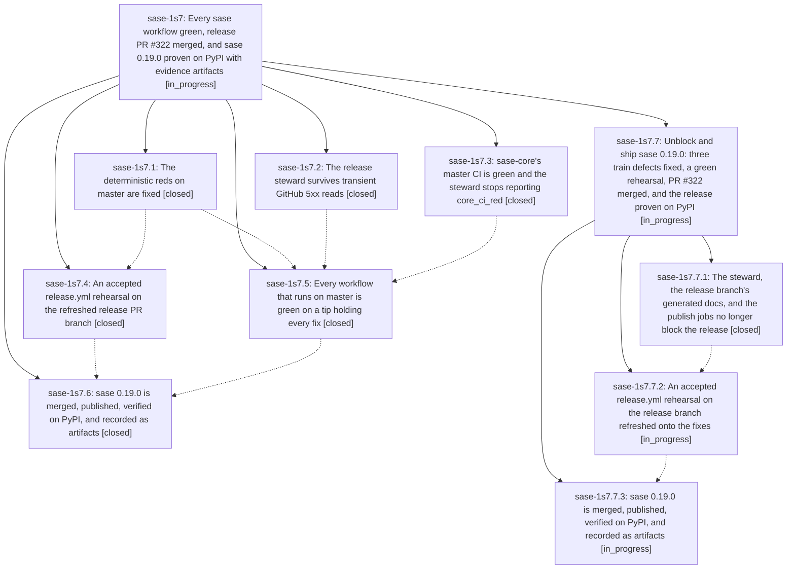

# Bead: sase-1s7 — Every sase workflow green, release PR #322 merged, and sase 0.19.0 proven on PyPI with evidence artifacts

[Bead Pages](../README.md) / sase-1s7

**Status:** ◐ in_progress · **Type:** ▸ plan · **Tier:** epic
**Owner:** `bryanbugyi34@gmail.com` · **Created by:** [bbugyi200.athena.1b0](https://github.com/sase-org/sase--agents/blob/main/sessions/bbugyi200.athena.1b0.md) · **Assignee:** `sase-1s7.land`
**Created:** 2026-11-10 14:38:15 EST
**Plan:** [202611/ci\_green\_v0\_19\_0\_pypi\_release.md](https://github.com/sase-org/sase--plans/blob/main/202611/ci_green_v0_19_0_pypi_release.md)

<!-- sase:links:start -->

## Links

| Relation | Artifact | Why |
| --- | --- | --- |
| implemented-by | [plan:202611/ci_green_v0_19_0_pypi_release.md][1] | derived from the plan's `bead_id:` frontmatter field |

[1]: https://github.com/sase-org/sase--plans/blob/main/202611/ci_green_v0_19_0_pypi_release.md

<!-- sase:links:end -->

## Description

Master Gate, Full CI, CI Telemetry, and the Release steward are green on a master tip that holds every fix, and sase-core's master CI is green. The release steward reports the open release-please PR as releasable, the PR is merged, the steward's release.yml train publishes the version to PyPI, and the published files are verified against the sealed manifest, attested, and installable. The proof is registered as SASE artifacts.

## Notes

[2026-11-11T08:17:31Z · sase-1s7.land] LANDING AUDIT (sase-1s7.land, 2026-11-11): NOT READY TO CLOSE.

Verified:
- 8105ca2818 (.2), 1df3ade04d (.1), 39cdbd548a, 1a5bb8097b and b0f947b91d (.5) are on origin/master and match their phase reports in source.
- No non-epic commit has landed on master since c7f6cdce75, so there is nothing to integrate.
- Phases .4, .5 and .6 closed canceled. PR #322 is still open (head 76465de42e) and PyPI has no sase 0.19.0, so the epic's goal is unmet.

Remaining epic work: three release-blocking defects, all found in this landing.
1. Steward perpetual waiting: tools/_release_watch_facts.py sets pin_changed when the PR's exact sase-core-rs pin differs from master's.
   - publish.yml sync-release-metadata only ever ratchets that pin on the release branch (0.44.2 vs master 0.43.2), so the steward re-proposes dispatch_publish_metadata forever.
   - A read-only simulated tick with pin_changed limited to the source pin passed the gate, PR-check and core-ensure-pin clauses, and stopped only at the cadence window ("before 09:00 UTC").
2. The release branch leaves docs/overrides/generated/release_announce.html stale.
   - tools/render_applicability renders it from .release-please-manifest.json, which release-please bumps without regenerating the file.
   - This makes blocking lint fmt-docs-check red (rehearse 42897628895).
3. release.yml publish and confirm jobs call uv with no astral-sh/setup-uv step: "uv: command not found" in rehearse 42897628895.
These need a master fix, a branch refresh, a fresh rehearsal and the release, so they go to a child epic.

Follow-up triage:
- .2 #1 registry node: +1 on sase-1em (ToolRun 87fdcdeb confirms node _pending_claim).
- .2 #1 test_core_rust: declined, resolved by 1df3ade04d. sase-1s6 closed done.
- .4 #6 release_announce stale: declined as a task, it is remaining epic work (child epic).
- .4 #7 tool_runs_card drift: new flake task sase-1s9.
- .5 #4 and #8 leak detector: declined, resolved by b0f947b91d (0 poisonings on 42966178009).
- .5 #5, #7, #10 and #14 contention-test 90m: DISCOVERED ISSUE on active epic sase-1rq.2.1.4.1.5.3.1. Per-run notes are already on .3.
- .5 #11 coverage-contexts: new flake task sase-1s8.
- .5 #13 test-cost hard budgets: DISCOVERED ISSUE on active epic sase-1rq.2.1, which already holds .3 proposals #7/#8.
- .5 #15 gate_turns_narrow: +1 on sase-1s1.

## Phases

| Bead | Title | Status | Size | Created | Agents | Commits |
|---|---|---|---|---|---:|---:|
| [sase-1s7.1](sase-1s7.1.md) | The deterministic reds on master are fixed | ✓ closed | medium | 2026-11-10 | 1 | 1 |
| [sase-1s7.2](sase-1s7.2.md) | The release steward survives transient GitHub 5xx reads | ✓ closed | small | 2026-11-10 | 1 | 1 |
| [sase-1s7.3](sase-1s7.3.md) | sase-core's master CI is green and the steward stops reporting core\_ci\_red | ✓ closed | small | 2026-11-10 | 1 | 0 |
| [sase-1s7.4](sase-1s7.4.md) | An accepted release.yml rehearsal on the refreshed release PR branch | ✓ closed | small | 2026-11-10 | 1 | 0 |
| [sase-1s7.5](sase-1s7.5.md) | Every workflow that runs on master is green on a tip holding every fix | ✓ closed | medium | 2026-11-10 | 1 | 3 |
| [sase-1s7.6](sase-1s7.6.md) | sase 0.19.0 is merged, published, verified on PyPI, and recorded as artifacts | ✓ closed | small | 2026-11-10 | 1 | 0 |

## Lineage

## Agents

| Agent | Bead | Commits |
|---|---|---:|
| [bbugyi200.athena.sase-1s7.1](https://github.com/sase-org/sase--agents/blob/main/sessions/bbugyi200.athena.sase-1s7.1.md) | [sase-1s7.1](sase-1s7.1.md) | 1 |
| [bbugyi200.athena.sase-1s7.2](https://github.com/sase-org/sase--agents/blob/main/agents/bbugyi200.athena.sase-1s7.2/README.md) | [sase-1s7.2](sase-1s7.2.md) | 1 |
| [bbugyi200.athena.sase-1s7.3](https://github.com/sase-org/sase--agents/blob/main/sessions/bbugyi200.athena.sase-1s7.3.md) | [sase-1s7.3](sase-1s7.3.md) | 0 |
| [bbugyi200.athena.sase-1s7.4](https://github.com/sase-org/sase--agents/blob/main/sessions/bbugyi200.athena.sase-1s7.4.md) | [sase-1s7.4](sase-1s7.4.md) | 0 |
| [bbugyi200.athena.sase-1s7.5](https://github.com/sase-org/sase--agents/blob/main/sessions/bbugyi200.athena.sase-1s7.5.md) | [sase-1s7.5](sase-1s7.5.md) | 3 |
| [bbugyi200.athena.sase-1s7.6](https://github.com/sase-org/sase--agents/blob/main/sessions/bbugyi200.athena.sase-1s7.6.md) | [sase-1s7.6](sase-1s7.6.md) | 0 |
| [bbugyi200.athena.sase-1s7.7.1](https://github.com/sase-org/sase--agents/blob/main/agents/bbugyi200.athena.sase-1s7.7.1/README.md) | [sase-1s7.7.1](sase-1s7.7.1.md) | 1 |
| [bbugyi200.athena.sase-1s7.7.2](https://github.com/sase-org/sase--agents/blob/main/agents/bbugyi200.athena.sase-1s7.7.2/README.md) | [sase-1s7.7.2](sase-1s7.7.2.md) | 0 |
| [bbugyi200.athena.sase-1s7.7.3](https://github.com/sase-org/sase--agents/blob/main/agents/bbugyi200.athena.sase-1s7.7.3/README.md) | [sase-1s7.7.3](sase-1s7.7.3.md) | 0 |
| [bbugyi200.athena.sase-1s7.7.land](https://github.com/sase-org/sase--agents/blob/main/agents/bbugyi200.athena.sase-1s7.7.land/README.md) | [sase-1s7.7](sase-1s7.7.md) | 0 |
| [bbugyi200.athena.sase-1s7.land](https://github.com/sase-org/sase--agents/blob/main/sessions/bbugyi200.athena.sase-1s7.land.md) | [sase-1s7](README.md) | 0 |

## Commits

| Repo | Commit | Subject | Bead | Committed |
|---|---|---|---|---|
| sase | [`8105ca2`](https://github.com/sase-org/sase/commit/8105ca28185279299951b9e743649800edf68cba) | feat(release-watch): retry transient GitHub reads | [sase-1s7.2](sase-1s7.2.md) | 2026-11-10 15:04:33 EST |
| sase | [`1df3ade`](https://github.com/sase-org/sase/commit/1df3ade04d8fe9c315d5491c816b9b46f21967cf) | fix(ci): clear master reds and stabilize archive goldens | [sase-1s7.1](sase-1s7.1.md) | 2026-11-10 15:25:38 EST |
| sase | [`39cdbd5`](https://github.com/sase-org/sase/commit/39cdbd548aa4f46e23083058d52c8f66cb59e53d) | fix(release-watch): match exact PR core-smoke check name | [sase-1s7.5](sase-1s7.5.md) | 2026-11-10 19:58:00 EST |
| sase | [`1a5bb80`](https://github.com/sase-org/sase/commit/1a5bb8097b4c4252c788e6af0038c73f1d00c6f2) | fix(ci): publish Telemetry leak-detector nodeids | [sase-1s7.5](sase-1s7.5.md) | 2026-11-10 21:56:34 EST |
| sase | [`b0f947b`](https://github.com/sase-org/sase/commit/b0f947b91df1ea054d6f52818af92895e5e4880e) | fix(tests): drain config-token refresh before leak snapshots | [sase-1s7.5](sase-1s7.5.md) | 2026-11-11 00:29:29 EST |
| sase | [`474b11f`](https://github.com/sase-org/sase/commit/474b11f90de686290cecdef95644fbea247c736d) | fix(release-train): steward pin check, release-branch docs, and train uv setup | [sase-1s7.7.1](sase-1s7.7.1.md) | 2026-11-11 03:44:47 EST |
