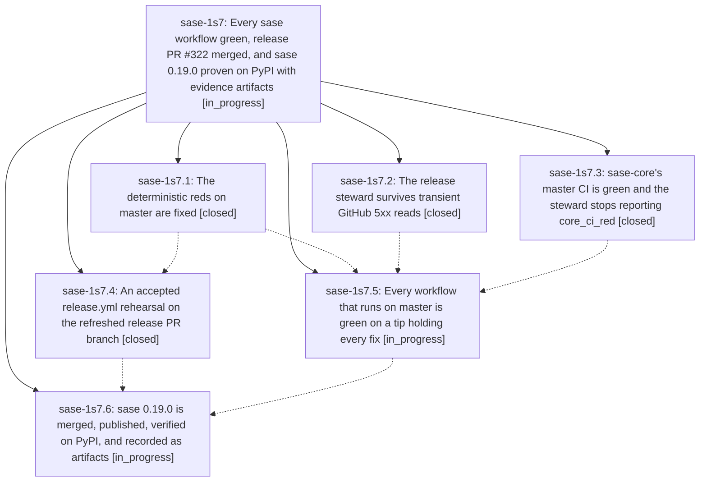

# Bead: sase-1s7 — Every sase workflow green, release PR #322 merged, and sase 0.19.0 proven on PyPI with evidence artifacts

[Bead Pages](../README.md) / sase-1s7

**Status:** ◐ in_progress · **Type:** ▸ plan · **Tier:** epic
**Owner:** `bryanbugyi34@gmail.com` · **Created by:** [bbugyi200.athena.1b0](https://github.com/sase-org/sase--agents/blob/main/sessions/bbugyi200.athena.1b0.md) · **Assignee:** `sase-1s7.land`
**Created:** 2026-11-10 14:38:15 EST
**Plan:** [202611/ci\_green\_v0\_19\_0\_pypi\_release.md](https://github.com/sase-org/sase--plans/blob/main/202611/ci_green_v0_19_0_pypi_release.md)

<!-- sase:links:start -->

## Links

| Relation | Artifact | Why |
| --- | --- | --- |
| implemented-by | [plan:202611/ci_green_v0_19_0_pypi_release.md][1] | derived from the plan's `bead_id:` frontmatter field |

[1]: https://github.com/sase-org/sase--plans/blob/main/202611/ci_green_v0_19_0_pypi_release.md

<!-- sase:links:end -->

## Description

Master Gate, Full CI, CI Telemetry, and the Release steward are green on a master tip that holds every fix, and sase-core's master CI is green. The release steward reports the open release-please PR as releasable, the PR is merged, the steward's release.yml train publishes the version to PyPI, and the published files are verified against the sealed manifest, attested, and installable. The proof is registered as SASE artifacts.

## Phases

| Bead | Title | Status | Size | Created | Agents | Commits |
|---|---|---|---|---|---:|---:|
| [sase-1s7.1](sase-1s7.1.md) | The deterministic reds on master are fixed | ✓ closed | medium | 2026-11-10 | 1 | 1 |
| [sase-1s7.2](sase-1s7.2.md) | The release steward survives transient GitHub 5xx reads | ✓ closed | small | 2026-11-10 | 1 | 1 |
| [sase-1s7.3](sase-1s7.3.md) | sase-core's master CI is green and the steward stops reporting core\_ci\_red | ✓ closed | small | 2026-11-10 | 1 | 0 |
| [sase-1s7.4](sase-1s7.4.md) | An accepted release.yml rehearsal on the refreshed release PR branch | ✓ closed | small | 2026-11-10 | 1 | 0 |
| [sase-1s7.5](sase-1s7.5.md) | Every workflow that runs on master is green on a tip holding every fix | ◐ in_progress | medium | 2026-11-10 | 1 | 2 |
| [sase-1s7.6](sase-1s7.6.md) | sase 0.19.0 is merged, published, verified on PyPI, and recorded as artifacts | ◐ in_progress | small | 2026-11-10 | 1 | 0 |

## Lineage

## Agents

| Agent | Bead | Commits |
|---|---|---:|
| [bbugyi200.athena.sase-1s7.1](https://github.com/sase-org/sase--agents/blob/main/sessions/bbugyi200.athena.sase-1s7.1.md) | [sase-1s7.1](sase-1s7.1.md) | 1 |
| [bbugyi200.athena.sase-1s7.2](https://github.com/sase-org/sase--agents/blob/main/agents/bbugyi200.athena.sase-1s7.2/README.md) | [sase-1s7.2](sase-1s7.2.md) | 1 |
| [bbugyi200.athena.sase-1s7.3](https://github.com/sase-org/sase--agents/blob/main/sessions/bbugyi200.athena.sase-1s7.3.md) | [sase-1s7.3](sase-1s7.3.md) | 0 |
| [bbugyi200.athena.sase-1s7.4](https://github.com/sase-org/sase--agents/blob/main/sessions/bbugyi200.athena.sase-1s7.4.md) | [sase-1s7.4](sase-1s7.4.md) | 0 |
| [bbugyi200.athena.sase-1s7.5](https://github.com/sase-org/sase--agents/blob/main/sessions/bbugyi200.athena.sase-1s7.5.md) | [sase-1s7.5](sase-1s7.5.md) | 2 |
| [bbugyi200.athena.sase-1s7.6](https://github.com/sase-org/sase--agents/blob/main/agents/bbugyi200.athena.sase-1s7.6/README.md) | [sase-1s7.6](sase-1s7.6.md) | 0 |
| [bbugyi200.athena.sase-1s7.land](https://github.com/sase-org/sase--agents/blob/main/agents/bbugyi200.athena.sase-1s7.land/README.md) | [sase-1s7](README.md) | 0 |

## Commits

| Repo | Commit | Subject | Bead | Committed |
|---|---|---|---|---|
| sase | [`8105ca2`](https://github.com/sase-org/sase/commit/8105ca28185279299951b9e743649800edf68cba) | feat(release-watch): retry transient GitHub reads | [sase-1s7.2](sase-1s7.2.md) | 2026-11-10 15:04:33 EST |
| sase | [`1df3ade`](https://github.com/sase-org/sase/commit/1df3ade04d8fe9c315d5491c816b9b46f21967cf) | fix(ci): clear master reds and stabilize archive goldens | [sase-1s7.1](sase-1s7.1.md) | 2026-11-10 15:25:38 EST |
| sase | [`39cdbd5`](https://github.com/sase-org/sase/commit/39cdbd548aa4f46e23083058d52c8f66cb59e53d) | fix(release-watch): match exact PR core-smoke check name | [sase-1s7.5](sase-1s7.5.md) | 2026-11-10 19:58:00 EST |
| sase | [`1a5bb80`](https://github.com/sase-org/sase/commit/1a5bb8097b4c4252c788e6af0038c73f1d00c6f2) | fix(ci): publish Telemetry leak-detector nodeids | [sase-1s7.5](sase-1s7.5.md) | 2026-11-10 21:56:34 EST |
