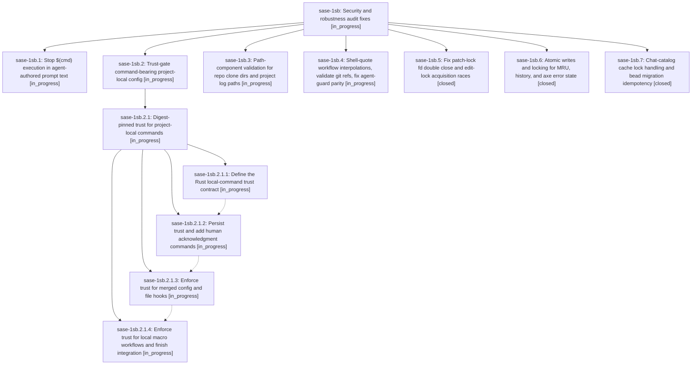

# Bead: sase-1sb — Security and robustness audit fixes

[Bead Pages](../README.md) / sase-1sb

**Status:** ◐ in_progress · **Type:** ▸ plan · **Tier:** epic
**Owner:** `bryanbugyi34@gmail.com` · **Created by:** [bbugyi200.athena.1bk](https://github.com/sase-org/sase--agents/blob/main/sessions/bbugyi200.athena.1bk.md) · **Assignee:** `sase-1sb.land`
**Created:** 2026-11-11 17:38:52 EST
**Plan:** [202611/security\_bug\_audit\_fixes.md](https://github.com/sase-org/sase--plans/blob/main/202611/security_bug_audit_fixes.md)

<!-- sase:links:start -->

## Links

| Relation | Artifact | Why |
| --- | --- | --- |
| implemented-by | [plan:202611/security_bug_audit_fixes.md][1] | derived from the plan's `bead_id:` frontmatter field |

[1]: https://github.com/sase-org/sase--plans/blob/main/202611/security_bug_audit_fixes.md

<!-- sase:links:end -->

## Description

Verified injection, traversal, privilege-gap, and state-corruption bugs from the codebase audit are fixed with regression tests

## Phases

| Bead | Title | Status | Size | Created | Agents | Commits |
|---|---|---|---|---|---:|---:|
| [sase-1sb.1](sase-1sb.1.md) | Stop $(cmd) execution in agent-authored prompt text | ◐ in_progress | medium | 2026-11-11 | 1 | 0 |
| [sase-1sb.2](sase-1sb.2.md) | Trust-gate command-bearing project-local config | ◐ in_progress | large | 2026-11-11 | 1 | 0 |
| [sase-1sb.3](sase-1sb.3.md) | Path-component validation for repo clone dirs and project log paths | ◐ in_progress | medium | 2026-11-11 | 1 | 0 |
| [sase-1sb.4](sase-1sb.4.md) | Shell-quote workflow interpolations, validate git refs, fix agent-guard parity | ◐ in_progress | medium | 2026-11-11 | 1 | 0 |
| [sase-1sb.5](sase-1sb.5.md) | Fix patch-lock fd double close and edit-lock acquisition races | ✓ closed | small | 2026-11-11 | 1 | 1 |
| [sase-1sb.6](sase-1sb.6.md) | Atomic writes and locking for MRU, history, and axe error state | ✓ closed | medium | 2026-11-11 | 1 | 1 |
| [sase-1sb.7](sase-1sb.7.md) | Chat-catalog cache lock handling and bead migration idempotency | ✓ closed | small | 2026-11-11 | 1 | 1 |

## Lineage

## Agents

| Agent | Bead | Commits |
|---|---|---:|
| [bbugyi200.athena.sase-1sb.1](https://github.com/sase-org/sase--agents/blob/main/agents/bbugyi200.athena.sase-1sb.1/README.md) | [sase-1sb.1](sase-1sb.1.md) | 0 |
| [bbugyi200.athena.sase-1sb.2](https://github.com/sase-org/sase--agents/blob/main/sessions/bbugyi200.athena.sase-1sb.2.md) | [sase-1sb.2](sase-1sb.2.md) | 0 |
| [bbugyi200.athena.sase-1sb.2.1.1](https://github.com/sase-org/sase--agents/blob/main/agents/bbugyi200.athena.sase-1sb.2.1.1/README.md) | [sase-1sb.2.1.1](sase-1sb.2.1.1.md) | 0 |
| [bbugyi200.athena.sase-1sb.2.1.2](https://github.com/sase-org/sase--agents/blob/main/agents/bbugyi200.athena.sase-1sb.2.1.2/README.md) | [sase-1sb.2.1.2](sase-1sb.2.1.2.md) | 0 |
| [bbugyi200.athena.sase-1sb.2.1.3](https://github.com/sase-org/sase--agents/blob/main/agents/bbugyi200.athena.sase-1sb.2.1.3/README.md) | [sase-1sb.2.1.3](sase-1sb.2.1.3.md) | 0 |
| [bbugyi200.athena.sase-1sb.2.1.4](https://github.com/sase-org/sase--agents/blob/main/agents/bbugyi200.athena.sase-1sb.2.1.4/README.md) | [sase-1sb.2.1.4](sase-1sb.2.1.4.md) | 0 |
| [bbugyi200.athena.sase-1sb.2.1.land](https://github.com/sase-org/sase--agents/blob/main/agents/bbugyi200.athena.sase-1sb.2.1.land/README.md) | [sase-1sb.2.1](sase-1sb.2.1.md) | 0 |
| [bbugyi200.athena.sase-1sb.3](https://github.com/sase-org/sase--agents/blob/main/agents/bbugyi200.athena.sase-1sb.3/README.md) | [sase-1sb.3](sase-1sb.3.md) | 0 |
| [bbugyi200.athena.sase-1sb.4](https://github.com/sase-org/sase--agents/blob/main/sessions/bbugyi200.athena.sase-1sb.4.md) | [sase-1sb.4](sase-1sb.4.md) | 0 |
| [bbugyi200.athena.sase-1sb.5](https://github.com/sase-org/sase--agents/blob/main/agents/bbugyi200.athena.sase-1sb.5/README.md) | [sase-1sb.5](sase-1sb.5.md) | 1 |
| [bbugyi200.athena.sase-1sb.6](https://github.com/sase-org/sase--agents/blob/main/agents/bbugyi200.athena.sase-1sb.6/README.md) | [sase-1sb.6](sase-1sb.6.md) | 1 |
| [bbugyi200.athena.sase-1sb.7](https://github.com/sase-org/sase--agents/blob/main/sessions/bbugyi200.athena.sase-1sb.7.md) | [sase-1sb.7](sase-1sb.7.md) | 1 |
| [bbugyi200.athena.sase-1sb.land](https://github.com/sase-org/sase--agents/blob/main/agents/bbugyi200.athena.sase-1sb.land/README.md) | [sase-1sb](README.md) | 0 |

## Commits

| Repo | Commit | Subject | Bead | Committed |
|---|---|---|---|---|
| sase | [`6cdb74c`](https://github.com/sase-org/sase/commit/6cdb74c3e673c786a5d345985b1a9e9816e270d2) | fix(ace): make patch and edit locks race-safe | [sase-1sb.5](sase-1sb.5.md) | 2026-11-11 20:53:32 EST |
| sase | [`6a6549c`](https://github.com/sase-org/sase/commit/6a6549cf65140a1aac54083c45836ff0bcc1a33c) | fix(state): make history and axe JSON writes atomic | [sase-1sb.6](sase-1sb.6.md) | 2026-11-11 20:54:47 EST |
| sase | [`b9572a8`](https://github.com/sase-org/sase/commit/b9572a8d59b73123199c256c7da7be473bf41ccb) | fix(history): keep catalog cache on lock and make bead type migration restartable | [sase-1sb.7](sase-1sb.7.md) | 2026-11-11 21:18:13 EST |
