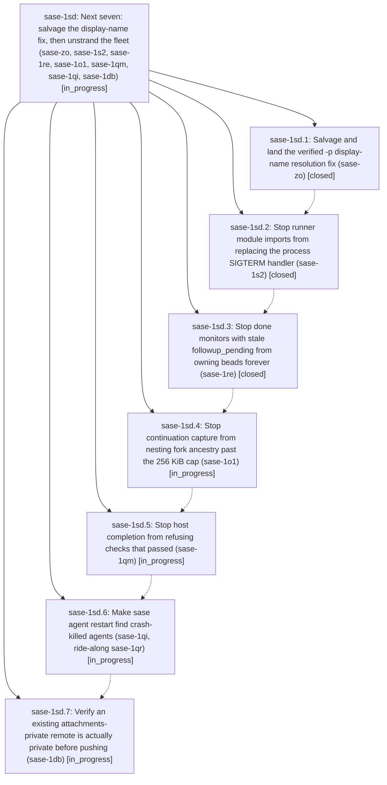

# Bead: sase-1sd — Next seven: salvage the display-name fix, then unstrand the fleet (sase-zo, sase-1s2, sase-1re, sase-1o1, sase-1qm, sase-1qi, sase-1db)

[Bead Pages](../README.md) / sase-1sd

**Status:** ◐ in_progress · **Type:** ▸ plan · **Tier:** epic
**Owner:** `bryanbugyi34@gmail.com` · **Created by:** [bbugyi200.athena.1bp](https://github.com/sase-org/sase--agents/blob/main/sessions/bbugyi200.athena.1bp.md) · **Assignee:** `sase-1sd.land`
**Created:** 2026-11-12 05:26:15 EST
**Plan:** [202611/next\_seven\_salvage\_and\_unstrand.md](https://github.com/sase-org/sase--plans/blob/main/202611/next_seven_salvage_and_unstrand.md)

<!-- sase:links:start -->

## Links

| Relation | Artifact | Why |
| --- | --- | --- |
| implemented-by | [plan:202611/next_seven_salvage_and_unstrand.md][1] | derived from the plan's `bead_id:` frontmatter field |

[1]: https://github.com/sase-org/sase--plans/blob/main/202611/next_seven_salvage_and_unstrand.md

<!-- sase:links:end -->

## Description

Complete and close the seven ready task beads ranked by the 202611 next-seven research report, running the phases strictly one at a time.

## Phases

| Bead | Title | Status | Size | Created | Agents | Commits |
|---|---|---|---|---|---:|---:|
| [sase-1sd.1](sase-1sd.1.md) | Salvage and land the verified -p display-name resolution fix (sase-zo) | ✓ closed | medium | 2026-11-12 | 1 | 1 |
| [sase-1sd.2](sase-1sd.2.md) | Stop runner module imports from replacing the process SIGTERM handler (sase-1s2) | ✓ closed | small | 2026-11-12 | 1 | 1 |
| [sase-1sd.3](sase-1sd.3.md) | Stop done monitors with stale followup\_pending from owning beads forever (sase-1re) | ✓ closed | medium | 2026-11-12 | 1 | 2 |
| [sase-1sd.4](sase-1sd.4.md) | Stop continuation capture from nesting fork ancestry past the 256 KiB cap (sase-1o1) | ◐ in_progress | large | 2026-11-12 | 1 | 2 |
| [sase-1sd.5](sase-1sd.5.md) | Stop host completion from refusing checks that passed (sase-1qm) | ◐ in_progress | large | 2026-11-12 | 1 | 0 |
| [sase-1sd.6](sase-1sd.6.md) | Make sase agent restart find crash-killed agents (sase-1qi, ride-along sase-1qr) | ◐ in_progress | medium | 2026-11-12 | 1 | 0 |
| [sase-1sd.7](sase-1sd.7.md) | Verify an existing attachments-private remote is actually private before pushing (sase-1db) | ◐ in_progress | medium | 2026-11-12 | 1 | 0 |

## Lineage

## Agents

| Agent | Bead | Commits |
|---|---|---:|
| [bbugyi200.athena.sase-1sd.1](https://github.com/sase-org/sase--agents/blob/main/sessions/bbugyi200.athena.sase-1sd.1.md) | [sase-1sd.1](sase-1sd.1.md) | 1 |
| [bbugyi200.athena.sase-1sd.2](https://github.com/sase-org/sase--agents/blob/main/sessions/bbugyi200.athena.sase-1sd.2.md) | [sase-1sd.2](sase-1sd.2.md) | 1 |
| [bbugyi200.athena.sase-1sd.3](https://github.com/sase-org/sase--agents/blob/main/agents/bbugyi200.athena.sase-1sd.3/README.md) | [sase-1sd.3](sase-1sd.3.md) | 2 |
| [bbugyi200.athena.sase-1sd.4](https://github.com/sase-org/sase--agents/blob/main/sessions/bbugyi200.athena.sase-1sd.4.md) | [sase-1sd.4](sase-1sd.4.md) | 2 |
| [bbugyi200.athena.sase-1sd.5](https://github.com/sase-org/sase--agents/blob/main/agents/bbugyi200.athena.sase-1sd.5/README.md) | [sase-1sd.5](sase-1sd.5.md) | 0 |
| [bbugyi200.athena.sase-1sd.6](https://github.com/sase-org/sase--agents/blob/main/agents/bbugyi200.athena.sase-1sd.6/README.md) | [sase-1sd.6](sase-1sd.6.md) | 0 |
| [bbugyi200.athena.sase-1sd.7](https://github.com/sase-org/sase--agents/blob/main/agents/bbugyi200.athena.sase-1sd.7/README.md) | [sase-1sd.7](sase-1sd.7.md) | 0 |
| [bbugyi200.athena.sase-1sd.land](https://github.com/sase-org/sase--agents/blob/main/agents/bbugyi200.athena.sase-1sd.land/README.md) | [sase-1sd](README.md) | 0 |

## Commits

| Repo | Commit | Subject | Bead | Committed |
|---|---|---|---|---|
| sase | [`e072729`](https://github.com/sase-org/sase/commit/e07272959937e0a39e1b7c31254b252e657978be) | fix(repo): resolve -p project ref through registry display names and aliases | [sase-1sd.1](sase-1sd.1.md) | 2026-11-12 06:01:49 EST |
| sase | [`063c982`](https://github.com/sase-org/sase/commit/063c98293b69f23543c91d66709a2b28eaa310a1) | fix(axe): install SIGTERM handlers in runner main, not at import | [sase-1sd.2](sase-1sd.2.md) | 2026-11-12 06:59:06 EST |
| sase-core | [`sase-core@afc64b1`](https://github.com/sase-org/sase-core/commit/afc64b102dcdaf3cbb10cfd9c3b741b35fc94fb6) | fix(stranded\_work): stop dead monitors with stale followup\_pending from owning beads | [sase-1sd.3](sase-1sd.3.md) | 2026-11-12 09:37:23 EST |
| sase | [`8eef093`](https://github.com/sase-org/sase/commit/8eef093fa99e3c2a96df6efb2d60ae0846e63848) | fix(turns): record suppressed follow-up outcome on a stopped shell | [sase-1sd.3](sase-1sd.3.md) | 2026-11-12 09:38:51 EST |
| sase-core | [`sase-core@fae59b4`](https://github.com/sase-org/sase-core/commit/fae59b46a9db7e7c37656bea7d1e7fa98ebaabc6) | fix(continuation): report authored request byte limits | [sase-1sd.4](sase-1sd.4.md) | 2026-11-12 12:10:02 EST |
| sase | [`1087ccd`](https://github.com/sase-org/sase/commit/1087ccd7f15f09f9cd2267a4cef598a1219432ca) | fix(continuation): preserve local request provenance | [sase-1sd.4](sase-1sd.4.md) | 2026-11-12 12:11:33 EST |
