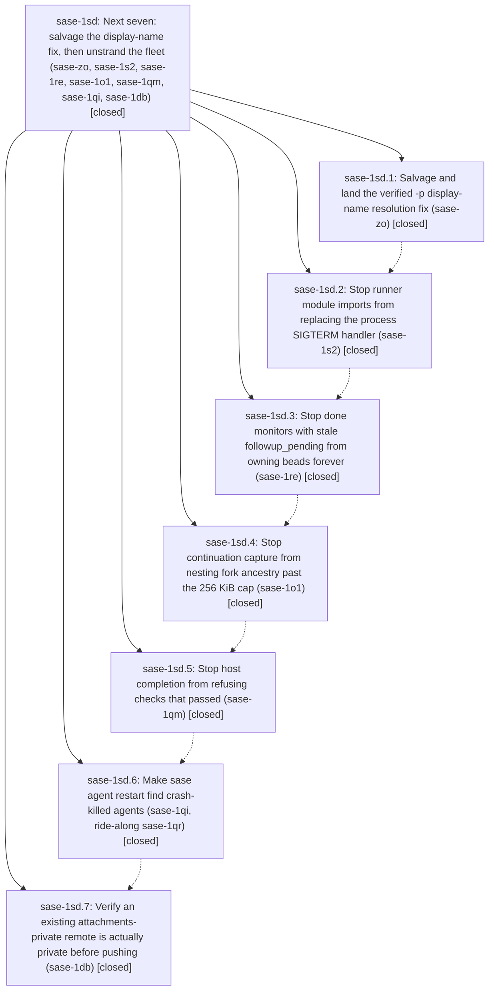

# Bead: sase-1sd — Next seven: salvage the display-name fix, then unstrand the fleet (sase-zo, sase-1s2, sase-1re, sase-1o1, sase-1qm, sase-1qi, sase-1db)

[Bead Pages](../README.md) / sase-1sd

**Status:** ✓ closed · **Resolution:** done · **Type:** ▸ plan · **Tier:** epic
**Owner:** `bryanbugyi34@gmail.com` · **Created by:** [bbugyi200.athena.1bp](https://github.com/sase-org/sase--agents/blob/main/sessions/bbugyi200.athena.1bp.md) · **Assignee:** `sase-1sd.land`
**Created:** 2026-11-12 05:26:15 EST · **Closed:** 2026-11-12 19:17:58 EST
**Plan:** [202611/next\_seven\_salvage\_and\_unstrand.md](https://github.com/sase-org/sase--plans/blob/main/202611/next_seven_salvage_and_unstrand.md)

<!-- sase:links:start -->

## Links

| Relation | Artifact | Why |
| --- | --- | --- |
| implemented-by | [plan:202611/next_seven_salvage_and_unstrand.md][1] | derived from the plan's `bead_id:` frontmatter field |

_Plus 1 automatic references — see [Referenced By](#referenced-by)._

[1]: https://github.com/sase-org/sase--plans/blob/main/202611/next_seven_salvage_and_unstrand.md

<!-- sase:links:end -->

## Description

Complete and close the seven ready task beads ranked by the 202611 next-seven research report, running the phases strictly one at a time.

## Notes

[2026-11-13T00:17:58Z · sase-1sd.land] LANDED (sase-1sd.land). VERIFY: all 7 phases closed, and every child note was read. Each TASK RESOLVED claim was checked against source and commits:
- .1 e072729599: sase repo list -p sase / SASE / gh_sase-org__sase all exit 0 on master 03b3a01dc9; canonicalization plus workspace_handler suites pass 28/28.
- .2 063c98293b: SIGTERM install is now in main() only.
- .3 core afc64b10 + 8eef093fa9: live-bounded owner_kind; stopped shells record suppressed.
- .4 1087ccd7f1 + core fae59b46: local authored request provenance, a 20-cycle under-cap regression, and an explicit over-cap checkpoint resume path.
- .5 a49dac15ca + core 6111b9b5: starter_artifacts_dir threaded into monitor baseline inheritance (the confirmed protection-flag mechanism) plus per-component mismatch diagnostics.
- .6 c77ff7e8f7 + core 3416e4e2: include_dead restart lookup; process_identity projected (index schema 37).
- .7 03b3a01dc9: public existing attachments-private remotes refused at preflight and at first put; probe-derived labels.
The pin equals sase-core origin/master 3416e4e2.

DECISIONS honored: qr_ride_along=include (sase-1qr fixed in .6). sase29_salvage=sase21_only (only sase_21 landed; sase_29 state recorded in .1 note #2). reopen_guard=defer (the guard was untouched and left to sase-1ra.8).

Task beads closed with evidence: sase-zo, sase-1s2, sase-1re, sase-1o1, sase-1qm, sase-1qi, sase-1qr, sase-1db. sase-1qm closed because its confirmed mechanism was fixed, not only diagnosed.

INTEGRATE: reviewed all 13 non-epic commits since e072729599:
- sase-1se auto-restart f613149ecc / 7665654aaa / d237c84204 / 8b2f443cff / cb0a3c9a80: healer targets require done.json, so the default find_named_agent stays correct, and the healer's plan_agent_restart now benefits from include_dead.
- sase-1sb.2.1 trust 681de3542b / 2b53bb0c7f: 1sd.4 landed after them and passed check.
- 8bb7bdc231 nameless owners; the cc236079f4 / 8bb1374b5b / 26b9818ba0 / 51466616d2 splits; bdf8ae1590 GC.
No duplication or conflict, no sase-1ra work landed, and no core drift beyond the epic's 4 commits. No integration edits were needed.

FOLLOW-UPS:
- .1 #3 carried_repo reopen guard: already requested on sase-1ra for sase-1ra.8; a coordination note was added to sase-1ra. No task.
- .1 #4 five workspace_handler tests: declined; they pass on current master (28/28), so this was a local env issue.
- .1 #6 edit_lock flake: caused by active epic sase-1sb (.5 test, 6cdb74c3e6) and already its remaining work item (1); a corroborating DISCOVERED ISSUE note was added to sase-1sb.
- .3 #3 never-settled running monitor: new task sase-1so (bug, medium, ready). Root cause is the pid-None short-circuit in should_reconcile_dead_supervisor; live example gvw2ee77qc5a.
- .3 #4 sase-kp.land--mon: sase-kp is a zombie epic (12/12 phases closed, no live land agent); noted on sase-1ra.12 as an example. No recovery action (owner census).
- .7 #3 x_row_lifecycle flake: duplicate of sase-1sg (same empty full_history disk_rows signature on a sibling node); +1 recorded.

epic-symbols: none.

OWNER REMINDERS (not performed): resume sase-1ra after trimming sase-1ra.11.1's stale gates, reclaim sase-j0, keep sase-1ot owner-gated, triage the stalled-epic census (sase-kp is one example).

## Phases

| Bead | Title | Status | Size | Created | Agents | Commits |
|---|---|---|---|---|---:|---:|
| [sase-1sd.1](sase-1sd.1.md) | Salvage and land the verified -p display-name resolution fix (sase-zo) | ✓ closed | medium | 2026-11-12 | 1 | 1 |
| [sase-1sd.2](sase-1sd.2.md) | Stop runner module imports from replacing the process SIGTERM handler (sase-1s2) | ✓ closed | small | 2026-11-12 | 1 | 1 |
| [sase-1sd.3](sase-1sd.3.md) | Stop done monitors with stale followup\_pending from owning beads forever (sase-1re) | ✓ closed | medium | 2026-11-12 | 1 | 2 |
| [sase-1sd.4](sase-1sd.4.md) | Stop continuation capture from nesting fork ancestry past the 256 KiB cap (sase-1o1) | ✓ closed | large | 2026-11-12 | 1 | 2 |
| [sase-1sd.5](sase-1sd.5.md) | Stop host completion from refusing checks that passed (sase-1qm) | ✓ closed | large | 2026-11-12 | 1 | 2 |
| [sase-1sd.6](sase-1sd.6.md) | Make sase agent restart find crash-killed agents (sase-1qi, ride-along sase-1qr) | ✓ closed | medium | 2026-11-12 | 1 | 2 |
| [sase-1sd.7](sase-1sd.7.md) | Verify an existing attachments-private remote is actually private before pushing (sase-1db) | ✓ closed | medium | 2026-11-12 | 1 | 1 |

## Lineage

## Agents

| Agent | Bead | Commits |
|---|---|---:|
| [bbugyi200.athena.sase-1sd.1](https://github.com/sase-org/sase--agents/blob/main/sessions/bbugyi200.athena.sase-1sd.1.md) | [sase-1sd.1](sase-1sd.1.md) | 1 |
| [bbugyi200.athena.sase-1sd.2](https://github.com/sase-org/sase--agents/blob/main/sessions/bbugyi200.athena.sase-1sd.2.md) | [sase-1sd.2](sase-1sd.2.md) | 1 |
| [bbugyi200.athena.sase-1sd.3](https://github.com/sase-org/sase--agents/blob/main/agents/bbugyi200.athena.sase-1sd.3/README.md) | [sase-1sd.3](sase-1sd.3.md) | 2 |
| [bbugyi200.athena.sase-1sd.4](https://github.com/sase-org/sase--agents/blob/main/sessions/bbugyi200.athena.sase-1sd.4.md) | [sase-1sd.4](sase-1sd.4.md) | 2 |
| [bbugyi200.athena.sase-1sd.5](https://github.com/sase-org/sase--agents/blob/main/sessions/bbugyi200.athena.sase-1sd.5.md) | [sase-1sd.5](sase-1sd.5.md) | 2 |
| [bbugyi200.athena.sase-1sd.6](https://github.com/sase-org/sase--agents/blob/main/agents/bbugyi200.athena.sase-1sd.6/README.md) | [sase-1sd.6](sase-1sd.6.md) | 2 |
| [bbugyi200.athena.sase-1sd.7](https://github.com/sase-org/sase--agents/blob/main/agents/bbugyi200.athena.sase-1sd.7/README.md) | [sase-1sd.7](sase-1sd.7.md) | 1 |
| [bbugyi200.athena.sase-1sd.land](https://github.com/sase-org/sase--agents/blob/main/agents/bbugyi200.athena.sase-1sd.land/README.md) | [sase-1sd](README.md) | 1 |

## Commits

| Repo | Commit | Subject | Bead | Committed |
|---|---|---|---|---|
| sase | [`e072729`](https://github.com/sase-org/sase/commit/e07272959937e0a39e1b7c31254b252e657978be) | fix(repo): resolve -p project ref through registry display names and aliases | [sase-1sd.1](sase-1sd.1.md) | 2026-11-12 06:01:49 EST |
| sase | [`063c982`](https://github.com/sase-org/sase/commit/063c98293b69f23543c91d66709a2b28eaa310a1) | fix(axe): install SIGTERM handlers in runner main, not at import | [sase-1sd.2](sase-1sd.2.md) | 2026-11-12 06:59:06 EST |
| sase-core | [`sase-core@afc64b1`](https://github.com/sase-org/sase-core/commit/afc64b102dcdaf3cbb10cfd9c3b741b35fc94fb6) | fix(stranded\_work): stop dead monitors with stale followup\_pending from owning beads | [sase-1sd.3](sase-1sd.3.md) | 2026-11-12 09:37:23 EST |
| sase | [`8eef093`](https://github.com/sase-org/sase/commit/8eef093fa99e3c2a96df6efb2d60ae0846e63848) | fix(turns): record suppressed follow-up outcome on a stopped shell | [sase-1sd.3](sase-1sd.3.md) | 2026-11-12 09:38:51 EST |
| sase-core | [`sase-core@fae59b4`](https://github.com/sase-org/sase-core/commit/fae59b46a9db7e7c37656bea7d1e7fa98ebaabc6) | fix(continuation): report authored request byte limits | [sase-1sd.4](sase-1sd.4.md) | 2026-11-12 12:10:02 EST |
| sase | [`1087ccd`](https://github.com/sase-org/sase/commit/1087ccd7f15f09f9cd2267a4cef598a1219432ca) | fix(continuation): preserve local request provenance | [sase-1sd.4](sase-1sd.4.md) | 2026-11-12 12:11:33 EST |
| sase-core | [`sase-core@6111b9b`](https://github.com/sase-org/sase-core/commit/6111b9b57f30663b5dd92ca7b2550e8e0c1e15ea) | feat(continuation): report fingerprint mismatch details | [sase-1sd.5](sase-1sd.5.md) | 2026-11-12 15:16:01 EST |
| sase | [`a49dac1`](https://github.com/sase-org/sase/commit/a49dac15cafc3e6b667734f6b1e5f4b8eb7df33a) | fix(monitor): preserve completion fingerprints and diagnostics | [sase-1sd.5](sase-1sd.5.md) | 2026-11-12 15:17:38 EST |
| sase-core | [`sase-core@3416e4e`](https://github.com/sase-org/sase-core/commit/3416e4e24c84db3b6d596c6a4e4ede6d9a77c8cb) | feat(agent-scan): project process identity in scans | [sase-1sd.6](sase-1sd.6.md) | 2026-11-12 17:09:44 EST |
| sase | [`c77ff7e`](https://github.com/sase-org/sase/commit/c77ff7e8f7ed0e645d77d4892bb9745ad9b54ab4) | fix(agent): include dead agents in restart lookup | [sase-1sd.6](sase-1sd.6.md) | 2026-11-12 17:11:46 EST |
| sase | [`03b3a01`](https://github.com/sase-org/sase/commit/03b3a01dc9511cbf5be0f61f651894a90027e70f) | fix(attachments): refuse private bytes on public remotes | [sase-1sd.7](sase-1sd.7.md) | 2026-11-12 18:39:03 EST |
| sase--plans | [`sase--plans@46b9214`](https://github.com/sase-org/sase--plans/commit/46b9214eb996f56a935645373a6d0daa1d9f63d4) | chore(plans): mark next\_seven\_salvage\_and\_unstrand epic plan done | [sase-1sd](README.md) | 2026-11-12 19:20:11 EST |

<!-- sase:referenced-by:start -->

## Referenced By

| Relation | Artifact | Why | Uses |
| --- | --- | --- | ---: |
| read-by | [agent:sase-1sd.6][1] | Need parent epic notes and phase history to avoid repeating prior work | 1 |

[1]: https://github.com/sase-org/sase--agents/blob/main/agents/bbugyi200.athena.sase-1sd.6/README.md

<!-- sase:referenced-by:end -->
