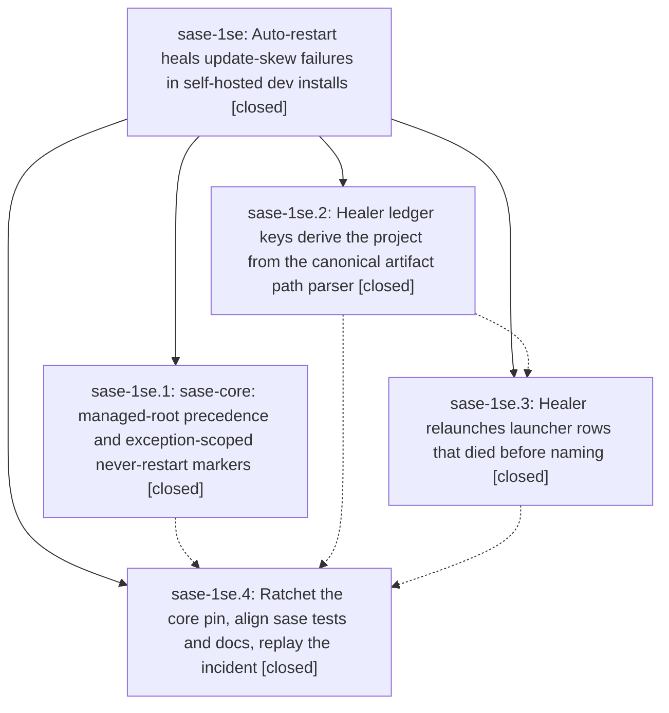

# Bead: sase-1se — Auto-restart heals update-skew failures in self-hosted dev installs

[Bead Pages](../README.md) / sase-1se

**Status:** ✓ closed · **Resolution:** done · **Type:** ▸ plan · **Tier:** epic
**Owner:** `bryanbugyi34@gmail.com` · **Created by:** [bbugyi200.athena.1bq](https://github.com/sase-org/sase--agents/blob/main/sessions/bbugyi200.athena.1bq.md) · **Assignee:** `sase-1se.land`
**Created:** 2026-11-12 06:15:58 EST · **Closed:** 2026-11-12 11:10:22 EST
**Plan:** [202611/auto\_restart\_update\_skew\_fixes.md](https://github.com/sase-org/sase--plans/blob/main/202611/auto_restart_update_skew_fixes.md)

<!-- sase:links:start -->

## Links

| Relation | Artifact | Why |
| --- | --- | --- |
| implemented-by | [plan:202611/auto_restart_update_skew_fixes.md][1] | derived from the plan's `bead_id:` frontmatter field |
| related | file:explicit:9023ae26f2429704cab3f420 | attached via sase artifact create --bead |

_Plus 1 automatic references — see [Referenced By](#referenced-by)._

[1]: https://github.com/sase-org/sase--plans/blob/main/202611/auto_restart_update_skew_fixes.md

<!-- sase:links:end -->

## Description

Agents torn apart by a `sase update` of the editable dev install are relaunched automatically again: the classifier no longer mistakes the editable checkout for agent-workspace code, incidental log strings no longer veto recovery, the at-most-once ledger key is derived correctly for day-sharded artifact layouts, and launcher rows that died before naming get a working relaunch path.

## Notes

[2026-11-12T14:33:51Z · sase-1se.land] LANDING AUDIT: NOT READY TO CLOSE. Read this epic (no prior own notes), all four children and every child note, and plan:202611/auto_restart_update_skew_fixes.md. Reviewed actual sase commits f613149ecc, 7665654aaa and cb0a3c9a80, and sase-core 47f1af1cb8fd196220098298dc1970044d4251ee. Phase .1's 81ef2192 note names its pre-host SHA; the landed classifier change is 47f1af1c, exactly the current sase-core pin. Managed-root precedence, exception-first marker scanning, canonical sharded ledger keys and leaving stale keys intact honor DECISIONS. The core and ledger implementation is present; phase .4 reports seven-row incident replay, and independent real-binding/healer verification passes.

Integration: fetched origin/master in both repos; no unseen commits. Reviewed all non-epic changes since creation: 063c98293b (SIGTERM at runner entry), cc236079f4 (config facade split and prompt-authorship test isolation), 8bb7bdc231 (nameless boot-failure bead ownership and planned-reservation cleanup). The last reveals an unhandled integration case: a row with no metadata identity can still own a planned name. The new healer resubmits unchanged raw_prompt.md without reservation handoff, so the real launch guard rejects its existing name and the healer consumes the one attempt as execute_failed. In isolated state on cb0a3c9a80, reserve_registered_name('bootstrap-agent', failed_row), _is_launcher_row=True, then validate_launch_name_requests(['%id:bootstrap-agent\nResume the requested work.']) raises AgentNameLaunchCollisionError; owner-checked release_planned_registered_name makes the guard pass with artifacts intact. The success test mocks launch_agents_from_cwd and misses this. This is remaining epic work, not a task follow-up. A stale managed_roots.py module docstring also retains the old workspace-veto wording and belongs in the repair.

Verification: ToolRun 54fa88e22a2f73d6281a602b815b71a6 passed all 37 focused core-binding, healer-claim/flow and exact preprocessing-node tests in 15.08s. No tracked source files changed during this review and no check-full ran. sase bead epic-symbols sase-1se is empty. Parent link is absent. Audit and reproducible evidence: file:explicit:9023ae26f2429704cab3f420.

FOLLOW-UP TRIAGE COMPLETE through /sase_new_task: (1) sase-1se.2 note #1 preprocessing_code_blocks proposal declined because intervening cc236079f4 clears prompt-authorship/origin/source-surface env in the autouse fixture and the exact node passes in the independent run; no new task. (2) sase-1se.3 note #1 became large flake task sase-1sg. Read retained failure 3ef55fe2698bda9fc9d5baea5015ebaf (line 274: full-history disk_rows is empty before dismissal) and unchanged isolated pass 08449bb057071dbd1e4a8e664506642d. Same-type/all-type all-status searches and last-week sweeps found no duplicate; sase-1sf owns a different pager node. Inspected active epics and plausible sase-zu/.4 and sase-j7/.4, but no causal link is established. Recorded a related link to sase-zu's shared history-loader scope; did not route an unproven cause there. Declined a blind timeout/quarantine change because the root cause is unknown.

Additional bounded epic gap confirmed after the audit snapshot: both healer_targets._project_for_artifacts_dir and history._project_for_done catch parser errors and use the positional fallback, although the approved plan permits fallback only when parsing returns None. Patching parse_agent_artifact_path to raise RuntimeError('parser unavailable') and passing /isolated/projects/gh_demo__repo/artifacts/ace-run/202611/12/20261112052956 makes BOTH helpers return project 202611. Parser/binding failures must skip/defer without creating a guessed ledger identity; retain the explicitly approved None fallback. This is part of the same repair tale, not a new task.

Proposing one validated medium tale, auto_restart_reserved_launcher_landing, to repair owned planned-name recovery and parser-error ledger identity handling, exercise the real launch guard and held-workspace path, run just check, recheck drift/symbol readiness, close sase-1se normally, run just symvision and mark plan:202611/auto_restart_update_skew_fixes.md done in the same coding turn. No step waits for the repair's own commit or CI. Keep the epic and its original plan unfinished until that acceptance succeeds.

[2026-11-12T16:10:22Z · sase-1se.land--1] Landing verified: launcher resubmission releases only the failed row's owned planned reservation (owner-checked) and revalidates with the real launch-name guard so foreign names are never stolen and races fail closed; parser/binding failures in _project_for_artifacts_dir/_project_for_done propagate instead of guessing month-keyed ledger identities and history skips poisoned rows. Added tests/test_agent_auto_restart_launcher_reservation.py (11 tests: owned release with real guard, foreign preservation, race fail-closed, invalid-prompt non-mutation, failed-spawn terminality, workspace-slot coexistence, parser-error/None/exception identity). Focused suites green (35 healer + 36 launch-validation + new file); sase tool run check 0769d0b344ed9da80bc53de09355b182 exit 0, verdict pass, KNOWN 0 FLAKY 0 (core-floor probe still reports blocked_unpublished advisory for local-command trust capabilities without failing the gate). Follow-up triage recorded in epic landing note #1 and file:explicit:9023ae26f2429704cab3f420 (1se.2 preprocessing proposal declined, 1se.3 flake filed as sase-1sg). sase bead epic-symbols sase-1se empty; no stale symbols. Integration: sase commits since cb0a3c9a80 are d237c84 (this repair), 8eef093 (turns settlement) and 8bb1374b (macro split) with no auto-restart conflicts; sase-core since 47f1af1c is only afc64b10 (stranded_work monitor ownership), pin already at afc64b10.

## Phases

| Bead | Title | Status | Size | Created | Agents | Commits |
|---|---|---|---|---|---:|---:|
| [sase-1se.1](sase-1se.1.md) | sase-core: managed-root precedence and exception-scoped never-restart markers | ✓ closed | medium | 2026-11-12 | 1 | 1 |
| [sase-1se.2](sase-1se.2.md) | Healer ledger keys derive the project from the canonical artifact path parser | ✓ closed | small | 2026-11-12 | 1 | 1 |
| [sase-1se.3](sase-1se.3.md) | Healer relaunches launcher rows that died before naming | ✓ closed | medium | 2026-11-12 | 1 | 1 |
| [sase-1se.4](sase-1se.4.md) | Ratchet the core pin, align sase tests and docs, replay the incident | ✓ closed | medium | 2026-11-12 | 1 | 1 |

## Lineage

## Agents

| Agent | Bead | Commits |
|---|---|---:|
| [bbugyi200.athena.sase-1se.1](https://github.com/sase-org/sase--agents/blob/main/agents/bbugyi200.athena.sase-1se.1/README.md) | [sase-1se.1](sase-1se.1.md) | 1 |
| [bbugyi200.athena.sase-1se.2](https://github.com/sase-org/sase--agents/blob/main/agents/bbugyi200.athena.sase-1se.2/README.md) | [sase-1se.2](sase-1se.2.md) | 1 |
| [bbugyi200.athena.sase-1se.3](https://github.com/sase-org/sase--agents/blob/main/agents/bbugyi200.athena.sase-1se.3/README.md) | [sase-1se.3](sase-1se.3.md) | 1 |
| [bbugyi200.athena.sase-1se.4](https://github.com/sase-org/sase--agents/blob/main/agents/bbugyi200.athena.sase-1se.4/README.md) | [sase-1se.4](sase-1se.4.md) | 1 |
| [bbugyi200.athena.sase-1se.land](https://github.com/sase-org/sase--agents/blob/main/sessions/bbugyi200.athena.sase-1se.land.md) | [sase-1se](README.md) | 2 |

## Commits

| Repo | Commit | Subject | Bead | Committed |
|---|---|---|---|---|
| sase-core | [`sase-core@47f1af1`](https://github.com/sase-org/sase-core/commit/47f1af1cb8fd196220098298dc1970044d4251ee) | fix(agent\_auto\_restart): managed-root precedence and exception-scoped never-restart markers | [sase-1se.1](sase-1se.1.md) | 2026-11-12 06:50:53 EST |
| sase | [`f613149`](https://github.com/sase-org/sase/commit/f613149ecce25f785f4539e023d7db9bcbfc01ed) | fix(auto\_restart): derive healer ledger project from canonical artifact path | [sase-1se.2](sase-1se.2.md) | 2026-11-12 07:08:22 EST |
| sase | [`7665654`](https://github.com/sase-org/sase/commit/7665654aaaa8987a92f485991bb3b30af7c4717e) | fix(agent\_auto\_restart): resubmit unnamed launcher prompts | [sase-1se.3](sase-1se.3.md) | 2026-11-12 08:33:07 EST |
| sase | [`cb0a3c9`](https://github.com/sase-org/sase/commit/cb0a3c9a807d692e79850c62cd9b6a493bd43748) | feat(auto-restart): ratchet core pin to 47f1af1c with tests and docs | [sase-1se.4](sase-1se.4.md) | 2026-11-12 09:06:00 EST |
| sase | [`d237c84`](https://github.com/sase-org/sase/commit/d237c842040a7bd9449359ee9c0aa8e6d3d566c7) | fix(auto-restart): hand off owned planned names in launcher resubmission; stop parser-error project guesses | [sase-1se](README.md) | 2026-11-12 10:50:54 EST |
| sase--plans | [`sase--plans@6cab294`](https://github.com/sase-org/sase--plans/commit/6cab294bcff5a391e418d05405612be1ab2e48b7) | docs(plans): mark auto\_restart\_update\_skew\_fixes done on sase-1se landing | [sase-1se](README.md) | 2026-11-12 11:12:47 EST |

<!-- sase:referenced-by:start -->

## Referenced By

| Relation | Artifact | Why | Uses |
| --- | --- | --- | ---: |
| read-by | [agent:sase-1se.1][1] | need epic scope and decisions | 1 |

[1]: https://github.com/sase-org/sase--agents/blob/main/agents/bbugyi200.athena.sase-1se.1/README.md

<!-- sase:referenced-by:end -->
