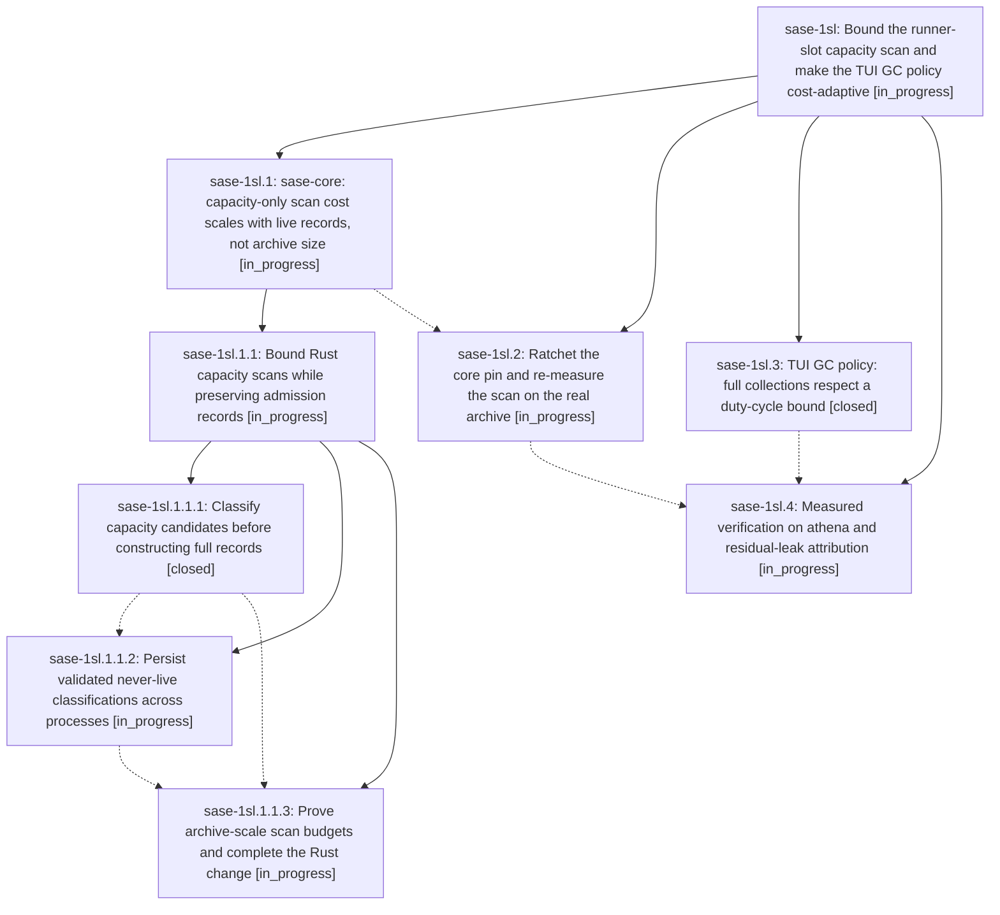

# Bead: sase-1sl — Bound the runner-slot capacity scan and make the TUI GC policy cost-adaptive

[Bead Pages](../README.md) / sase-1sl

**Status:** ◐ in_progress · **Type:** ▸ plan · **Tier:** epic
**Owner:** `bryanbugyi34@gmail.com` · **Created by:** [bbugyi200.athena.1c0](https://github.com/sase-org/sase--agents/blob/main/sessions/bbugyi200.athena.1c0.md) · **Assignee:** `sase-1sl.land`
**Created:** 2026-11-12 16:45:03 EST
**Plan:** [202611/capacity\_scan\_tui\_runaway.md](https://github.com/sase-org/sase--plans/blob/main/202611/capacity_scan_tui_runaway.md)

<!-- sase:links:start -->

## Links

| Relation | Artifact | Why |
| --- | --- | --- |
| implemented-by | [plan:202611/capacity_scan_tui_runaway.md][1] | derived from the plan's `bead_id:` frontmatter field |

[1]: https://github.com/sase-org/sase--plans/blob/main/202611/capacity_scan_tui_runaway.md

<!-- sase:links:end -->

## Description

The sase TUI and waiting agent runners stop burning CPU and memory on full-archive capacity scans: a warm capacity scan costs milliseconds instead of 23 s, the TUI holds under 15% of one core and a bounded heap on athena, and full GC collections respect a duty-cycle bound.

## Phases

| Bead | Title | Status | Size | Created | Agents | Commits |
|---|---|---|---|---|---:|---:|
| [sase-1sl.1](sase-1sl.1.md) | sase-core: capacity-only scan cost scales with live records, not archive size | ◐ in_progress | large | 2026-11-12 | 1 | 0 |
| [sase-1sl.2](sase-1sl.2.md) | Ratchet the core pin and re-measure the scan on the real archive | ◐ in_progress | small | 2026-11-12 | 1 | 0 |
| [sase-1sl.3](sase-1sl.3.md) | TUI GC policy: full collections respect a duty-cycle bound | ✓ closed | medium | 2026-11-12 | 1 | 0 |
| [sase-1sl.4](sase-1sl.4.md) | Measured verification on athena and residual-leak attribution | ◐ in_progress | medium | 2026-11-12 | 1 | 0 |

## Lineage

## Agents

| Agent | Bead | Commits |
|---|---|---:|
| [bbugyi200.athena.sase-1sl.1](https://github.com/sase-org/sase--agents/blob/main/sessions/bbugyi200.athena.sase-1sl.1.md) | [sase-1sl.1](sase-1sl.1.md) | 0 |
| [bbugyi200.athena.sase-1sl.1.1.1](https://github.com/sase-org/sase--agents/blob/main/sessions/bbugyi200.athena.sase-1sl.1.1.1.md) | [sase-1sl.1.1.1](sase-1sl.1.1.1.md) | 1 |
| [bbugyi200.athena.sase-1sl.1.1.2](https://github.com/sase-org/sase--agents/blob/main/agents/bbugyi200.athena.sase-1sl.1.1.2/README.md) | [sase-1sl.1.1.2](sase-1sl.1.1.2.md) | 0 |
| [bbugyi200.athena.sase-1sl.1.1.3](https://github.com/sase-org/sase--agents/blob/main/agents/bbugyi200.athena.sase-1sl.1.1.3/README.md) | [sase-1sl.1.1.3](sase-1sl.1.1.3.md) | 0 |
| [bbugyi200.athena.sase-1sl.1.1.land](https://github.com/sase-org/sase--agents/blob/main/agents/bbugyi200.athena.sase-1sl.1.1.land/README.md) | [sase-1sl.1.1](sase-1sl.1.1.md) | 0 |
| [bbugyi200.athena.sase-1sl.2](https://github.com/sase-org/sase--agents/blob/main/agents/bbugyi200.athena.sase-1sl.2/README.md) | [sase-1sl.2](sase-1sl.2.md) | 0 |
| [bbugyi200.athena.sase-1sl.3](https://github.com/sase-org/sase--agents/blob/main/sessions/bbugyi200.athena.sase-1sl.3.md) | [sase-1sl.3](sase-1sl.3.md) | 0 |
| [bbugyi200.athena.sase-1sl.4](https://github.com/sase-org/sase--agents/blob/main/agents/bbugyi200.athena.sase-1sl.4/README.md) | [sase-1sl.4](sase-1sl.4.md) | 0 |
| [bbugyi200.athena.sase-1sl.land](https://github.com/sase-org/sase--agents/blob/main/agents/bbugyi200.athena.sase-1sl.land/README.md) | [sase-1sl](README.md) | 0 |

## Commits

| Repo | Commit | Subject | Bead | Committed |
|---|---|---|---|---|
| sase-core | [`sase-core@1ceb6a8`](https://github.com/sase-org/sase-core/commit/1ceb6a8f619d0d5493ce541255831b6ca3fcb94a) | feat(agent-scan): add compact capacity projection and parity oracle | [sase-1sl.1.1.1](sase-1sl.1.1.1.md) | 2026-11-12 19:30:45 EST |
