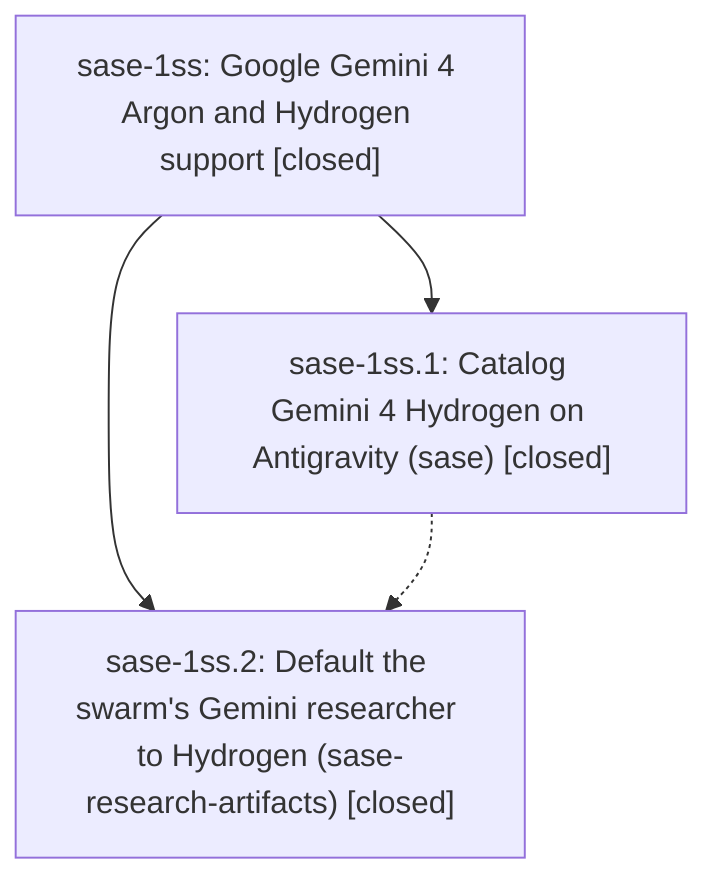

# Bead: sase-1ss — Google Gemini 4 Argon and Hydrogen support

[Bead Pages](../README.md) / sase-1ss

**Status:** ✓ closed · **Resolution:** done · **Type:** ▸ plan · **Tier:** epic
**Owner:** `bryanbugyi34@gmail.com` · **Created by:** [bbugyi200.athena.1cb](https://github.com/sase-org/sase--agents/blob/main/sessions/bbugyi200.athena.1cb.md) · **Assignee:** `sase-1ss.land`
**Created:** 2026-11-13 18:46:15 EST · **Closed:** 2026-11-13 20:46:01 EST
**Plan:** [202611/argon\_hydrogen\_support.md](https://github.com/sase-org/sase--plans/blob/main/202611/argon_hydrogen_support.md)

<!-- sase:links:start -->

## Links

| Relation | Artifact | Why |
| --- | --- | --- |
| implemented-by | [plan:202611/argon_hydrogen_support.md][1] | derived from the plan's `bead_id:` frontmatter field |
| related | file:explicit:f2c9f2cf6efe4975f5e36cbb | attached via sase artifact create --bead |

_Plus 1 automatic references — see [Referenced By](#referenced-by)._

[1]: https://github.com/sase-org/sase--plans/blob/main/202611/argon_hydrogen_support.md

<!-- sase:links:end -->

## Description

Gemini 4 Hydrogen shows up as a catalogued Antigravity model on every manifest-driven sase model completion surface. Argon's entitlement advisory and the agy tier defaults are correct again. #research_swarm's Gemini researcher defaults to agy/gemini-4-hydrogen-xhigh.

## Notes

[2026-11-14T01:46:01Z · sase-1ss.land] LANDING VERIFIED: Reviewed the epic, all six notes on sase-1ss.1 and the note on sase-1ss.2, the approved plan and its accepted research/design decisions. Both phases are closed as done; there is no bead-level DECISIONS vector. Inspected actual source and commits cf7a09f15b (sase) and fec2ab7b8854 (sase-research-artifacts). Confirmed four ordered Hydrogen slugs and unique hydrogen4x/h/m/l aliases, no Hydrogen advisory, Pro/Ultra Argon info advisories, accessible 3.8 Flash tiers, compact hydrogen display, manifest propagation to prompt/macro/picker/LSP/validity, generated docs, and the plugin researcher/image Hydrogen defaults. Existing overrides and opt-in Gemini identity remain intact; bare Hydrogen, explicit effort support, size aliases and unrelated catalog rows remain outside this epic exactly as designed. Inspected the committed 24-model PNG golden.

INTEGRATION: Fetched origin/master and reviewed history since the epic was created and since its first commit. The only unrelated post-start sase commit is e43206a91e: workflow word/agent prose and the core pin. Inspected its core range bab59781..f28ce79a (capacity-cache tests and word/agent catalog copy); it does not alter model behavior. No later main-repo commits or unrelated post-start plugin commits were present. No integration edits were needed.

VERIFICATION: Retained sase check a77026ed730c650e51675e65197cb914 is succeeded/exit 0 with complete stage evidence. Fresh focused SASE verification passed 183 tests (provider, usage, manifest, advisory, validity, picker/jumps, model-completion/LSP and compact display). Fresh plugin sase tool run check e2302c7c2e0ce2745573f707dd26be12 succeeded with exit 0 (lint plus 166 passed, 4 deselected against the local SASE/core checkouts). Live agy 1.5.8 models lists all four Hydrogen variants. sase bead epic-symbols sase-1ss is empty. No check-full was run.

FOLLOW-UP TRIAGE: Every PROPOSED FOLLOW-UP came from sase-1ss.1. Note #1 -> feature sase-1st (large), explicit agy effort with per-model/version policy. Note #2 -> independent +1 on existing sase-1l4, the same catalog-drift root cause; declined duplicate task creation, and clarified that Hydrogen/Argon visibility and tiers are already repaired. Note #3 -> feature sase-1su (medium), concrete shell model completion. Note #4 -> bug sase-1sv (small) for shipped reads/config/docs pins and bug sase-1sw (small) for linked chezmoi snippets/tmux pins; these are independently deployed scopes of the same old explicit-selector problem. Note #5 -> feature sase-1sx (large), evidence-gated Hydrogen promotion and Carbon/Orchestrator eligibility decisions; no default promotion is authorized on unproven Free-plan assumptions. All five new tasks carry independent evidence file:explicit:f2c9f2cf6efe4975f5e36cbb and related-work links, and are ready. Searched all statuses, swept all last-week tasks, and inspected active epic scopes; sase-12o/.1 concern loader freshness and deliberately preserve the candidate fast path, so they are related but not causal owners of the proposed shell candidate extension. No proposal was discarded and no epic-caused work was deferred.

## Phases

| Bead | Title | Status | Size | Created | Agents | Commits |
|---|---|---|---|---|---:|---:|
| [sase-1ss.1](sase-1ss.1.md) | Catalog Gemini 4 Hydrogen on Antigravity (sase) | ✓ closed | medium | 2026-11-13 | 1 | 1 |
| [sase-1ss.2](sase-1ss.2.md) | Default the swarm's Gemini researcher to Hydrogen (sase-research-artifacts) | ✓ closed | small | 2026-11-13 | 1 | 1 |

## Lineage

## Agents

| Agent | Bead | Commits |
|---|---|---:|
| [bbugyi200.athena.sase-1ss.1](https://github.com/sase-org/sase--agents/blob/main/sessions/bbugyi200.athena.sase-1ss.1.md) | [sase-1ss.1](sase-1ss.1.md) | 1 |
| [bbugyi200.athena.sase-1ss.2](https://github.com/sase-org/sase--agents/blob/main/agents/bbugyi200.athena.sase-1ss.2/README.md) | [sase-1ss.2](sase-1ss.2.md) | 1 |
| [bbugyi200.athena.sase-1ss.land](https://github.com/sase-org/sase--agents/blob/main/agents/bbugyi200.athena.sase-1ss.land/README.md) | [sase-1ss](README.md) | 1 |

## Commits

| Repo | Commit | Subject | Bead | Committed |
|---|---|---|---|---|
| sase | [`cf7a09f`](https://github.com/sase-org/sase/commit/cf7a09f15b485b8e1f0b9216b4707aab93f16a5b) | feat(sase-1ss.1): catalog Gemini 4 Hydrogen on Antigravity | [sase-1ss.1](sase-1ss.1.md) | 2026-11-13 19:52:07 EST |
| sase-research-artifacts | [`sase-research-artifacts@fec2ab7`](https://github.com/sase-org/sase-research-artifacts/commit/fec2ab7b8854be1de45f65001222b22f715481ae) | feat(research-swarm): default Gemini researcher to agy/gemini-4-hydrogen-xhigh | [sase-1ss.2](sase-1ss.2.md) | 2026-11-13 20:12:48 EST |
| sase--plans | [`sase--plans@7b8b4c8`](https://github.com/sase-org/sase--plans/commit/7b8b4c87e696c99517fafd05d6c11727766841c4) | docs(sase-1ss): mark verified Gemini support plan done | [sase-1ss](README.md) | 2026-11-13 20:48:50 EST |

<!-- sase:referenced-by:start -->

## Referenced By

| Relation | Artifact | Why | Uses |
| --- | --- | --- | ---: |
| read-by | [agent:sase-1ss.2][1] | need epic decisions and scope | 1 |

[1]: https://github.com/sase-org/sase--agents/blob/main/agents/bbugyi200.athena.sase-1ss.2/README.md

<!-- sase:referenced-by:end -->
