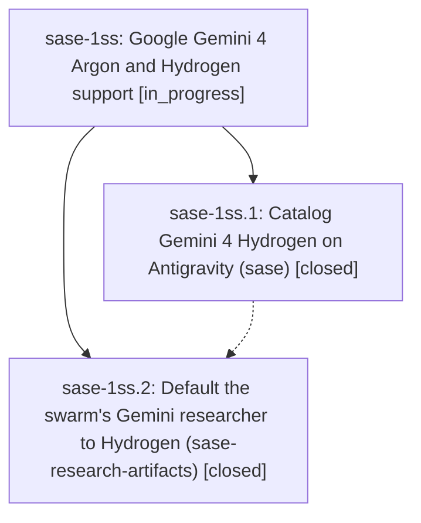

# Bead: sase-1ss — Google Gemini 4 Argon and Hydrogen support

[Bead Pages](../README.md) / sase-1ss

**Status:** ◐ in_progress · **Type:** ▸ plan · **Tier:** epic
**Owner:** `bryanbugyi34@gmail.com` · **Created by:** [bbugyi200.athena.1cb](https://github.com/sase-org/sase--agents/blob/main/sessions/bbugyi200.athena.1cb.md) · **Assignee:** `sase-1ss.land`
**Created:** 2026-11-13 18:46:15 EST
**Plan:** [202611/argon\_hydrogen\_support.md](https://github.com/sase-org/sase--plans/blob/main/202611/argon_hydrogen_support.md)

<!-- sase:links:start -->

## Links

| Relation | Artifact | Why |
| --- | --- | --- |
| implemented-by | [plan:202611/argon_hydrogen_support.md][1] | derived from the plan's `bead_id:` frontmatter field |

[1]: https://github.com/sase-org/sase--plans/blob/main/202611/argon_hydrogen_support.md

<!-- sase:links:end -->

## Description

Gemini 4 Hydrogen shows up as a catalogued Antigravity model on every manifest-driven sase model completion surface. Argon's entitlement advisory and the agy tier defaults are correct again. #research_swarm's Gemini researcher defaults to agy/gemini-4-hydrogen-xhigh.

## Phases

| Bead | Title | Status | Size | Created | Agents | Commits |
|---|---|---|---|---|---:|---:|
| [sase-1ss.1](sase-1ss.1.md) | Catalog Gemini 4 Hydrogen on Antigravity (sase) | ✓ closed | medium | 2026-11-13 | 1 | 1 |
| [sase-1ss.2](sase-1ss.2.md) | Default the swarm's Gemini researcher to Hydrogen (sase-research-artifacts) | ✓ closed | small | 2026-11-13 | 1 | 1 |

## Lineage

## Agents

| Agent | Bead | Commits |
|---|---|---:|
| [bbugyi200.athena.sase-1ss.1](https://github.com/sase-org/sase--agents/blob/main/sessions/bbugyi200.athena.sase-1ss.1.md) | [sase-1ss.1](sase-1ss.1.md) | 1 |
| [bbugyi200.athena.sase-1ss.2](https://github.com/sase-org/sase--agents/blob/main/agents/bbugyi200.athena.sase-1ss.2/README.md) | [sase-1ss.2](sase-1ss.2.md) | 1 |
| [bbugyi200.athena.sase-1ss.land](https://github.com/sase-org/sase--agents/blob/main/agents/bbugyi200.athena.sase-1ss.land/README.md) | [sase-1ss](README.md) | 0 |

## Commits

| Repo | Commit | Subject | Bead | Committed |
|---|---|---|---|---|
| sase | [`cf7a09f`](https://github.com/sase-org/sase/commit/cf7a09f15b485b8e1f0b9216b4707aab93f16a5b) | feat(sase-1ss.1): catalog Gemini 4 Hydrogen on Antigravity | [sase-1ss.1](sase-1ss.1.md) | 2026-11-13 19:52:07 EST |
| sase-research-artifacts | [`sase-research-artifacts@fec2ab7`](https://github.com/sase-org/sase-research-artifacts/commit/fec2ab7b8854be1de45f65001222b22f715481ae) | feat(research-swarm): default Gemini researcher to agy/gemini-4-hydrogen-xhigh | [sase-1ss.2](sase-1ss.2.md) | 2026-11-13 20:12:48 EST |
