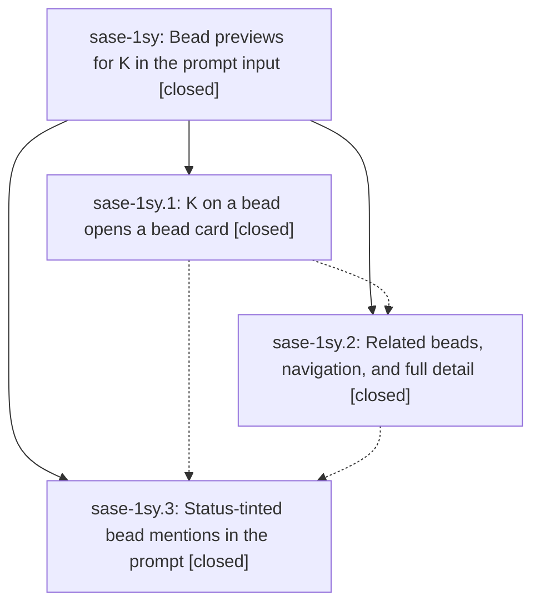

# Bead: sase-1sy — Bead previews for K in the prompt input

[Bead Pages](../README.md) / sase-1sy

**Status:** ✓ closed · **Resolution:** done · **Type:** ▸ plan · **Tier:** epic
**Owner:** `bryanbugyi34@gmail.com` · **Created by:** `bbugyi200.apollo.dy` · **Assignee:** `sase-1sy.land`
**Created:** 2026-11-14 09:04:05 EST · **Closed:** 2026-11-15 15:57:59 EST
**Plan:** [202611/bead\_k\_preview.md](https://github.com/sase-org/sase--plans/blob/main/202611/bead_k_preview.md)

<!-- sase:links:start -->

## Links

| Relation | Artifact | Why |
| --- | --- | --- |
| implemented-by | [plan:202611/bead_k_preview.md][1] | derived from the plan's `bead_id:` frontmatter field |

_Plus 2 automatic references — see [Referenced By](#referenced-by)._

[1]: https://github.com/sase-org/sase--plans/blob/main/202611/bead_k_preview.md

<!-- sase:links:end -->

## Description

Pressing K in the prompt input's NORMAL mode on a bead ID (bob-cli-kx, sase-1ss.1) or an @bead:<id> ref opens a fast, theme-aware bead card that never blocks typing. The card shows the bead's identity, status, description, phases, lineage, dependencies, and plan, and lets you drill into related beads or open the full detail. Ctrl+] opens the full bead detail too. Bead IDs that resolve get a status-tinted underline, so the K affordance is visible before you press it. Hyphenated words that are not beads keep today's word lookup.

## Notes

[2026-11-15T18:48:22Z · sase-1sy.land] LANDING AUDIT: NOT READY TO CLOSE at 0c929393a5. Read the epic (no prior notes), original plan plan:202611/bead_k_preview.md, all three children and all five child notes; all phases are closed done. Reviewed feature commits 4006ec36ad, baf23097d6 and 0c929393a5 and their current implementation, wiring, tests, docs/help. Selected decisions are honored: mention_tint=status, jump_target=detail. Phase .2 recovery is addressed (_build_bead_progress_meter private with a real in-file caller). Core card content, relations, word fallback and read-only preview loading are present. Fetched origin/master equals this tip. Reviewed intervening non-epic 974c600c6a production changes (prompt-archive grace) and wider creation-period c41c1e6337 (wait scans); neither calls, duplicates or conflicts with bead previews, so no integration edits needed.

Reproduced remaining EPIC WORK using the production methods with deterministic in-memory harnesses:
1. Cached mentions never reach fingerprint revalidation: seeded old-token status, called the visible-text trigger, observed requests=[].
2. Invalidate while mention worker awaits, publish replacement directory, queue ID, finish old worker: in_flight=True, scheduled replacement count=0, pending ID stranded.
3. With two owners sharing a prefix, _plan_bead_mention_resolution chooses only owners[0]; overlay can disagree with K's proper routing.
4. Back during a child load restores the cached parent but the child request remains current; detail requests also survive navigation. Prompt request guards accept same-cursor text replacement. Finish snapshot/generation guards and regression tests.

Verification: 60 recognition/model/index/render tests passed plus 34 widget/modal/pager tests passed. The latter reported an unawaited run_resolve coroutine from the mention-test fake worker, to clean up with the epic-owned lifecycle tests. No check-full run, no product source edits. epic-symbols returned no entries. These green existing tests lack the reproduced cases and do not justify closing.

FOLLOW-UP TRIAGE COMPLETE before proposal: sase-1sy.3 note #1's PROPOSED FOLLOW-UP was processed through /sase_new_task. Exact Axe sample-contamination duplicate sase-199 received +1 identifying .3 and its base/feature reproduction (now +3). Reviewed source, all-status search matches, last-week all-task sweep and active-epic scopes; no credible causal epic owner or new distinct task. Declined a new duplicate task. Also declined creating speculative tasks for the note's unspecified other slow-benchmark failures: no distinct named node/root-cause evidence beyond the existing Axe report. Broad benchmark repair is not remaining product work.

Proposing one medium tale, sase_plan_bead_preview_finish.md, for only these cache/routing/async gaps and this epic's concrete closeout. Its coder must run just check, resolve/re-key epic symbols, close sase-1sy normally, run just symvision and set status: done on plan:202611/bead_k_preview.md in the same final-code turn; no commit/push/CI dependency before close. No parent link was shown. Leave epic and original plan unfinished until that verification succeeds.

[2026-11-15T20:57:59Z · sase-1sy.land--1] Verified: `sase tool run check` passed (ToolRun 041a62c8b591a96992d1c6a2da763346); the 112 focused bead preview tests passed; `sase bead epic-symbols sase-1sy` returned no entries. The upstream drift review found only one newer commit, unrelated agent roster loading.

## Phases

| Bead | Title | Status | Size | Created | Agents | Commits |
|---|---|---|---|---|---:|---:|
| [sase-1sy.1](sase-1sy.1.md) | K on a bead opens a bead card | ✓ closed | medium | 2026-11-14 | 1 | 1 |
| [sase-1sy.2](sase-1sy.2.md) | Related beads, navigation, and full detail | ✓ closed | medium | 2026-11-14 | 1 | 1 |
| [sase-1sy.3](sase-1sy.3.md) | Status-tinted bead mentions in the prompt | ✓ closed | medium | 2026-11-14 | 1 | 1 |

## Lineage

## Agents

| Agent | Bead | Commits |
|---|---|---:|
| [bbugyi200.athena.sase-1sy.1](https://github.com/sase-org/sase--agents/blob/main/agents/bbugyi200.athena.sase-1sy.1/README.md) | [sase-1sy.1](sase-1sy.1.md) | 1 |
| [bbugyi200.athena.sase-1sy.2](https://github.com/sase-org/sase--agents/blob/main/sessions/bbugyi200.athena.sase-1sy.2.md) | [sase-1sy.2](sase-1sy.2.md) | 1 |
| [bbugyi200.athena.sase-1sy.3](https://github.com/sase-org/sase--agents/blob/main/agents/bbugyi200.athena.sase-1sy.3/README.md) | [sase-1sy.3](sase-1sy.3.md) | 1 |
| [bbugyi200.athena.sase-1sy.land](https://github.com/sase-org/sase--agents/blob/main/sessions/bbugyi200.athena.sase-1sy.land.md) | [sase-1sy](README.md) | 2 |

## Commits

| Repo | Commit | Subject | Bead | Committed |
|---|---|---|---|---|
| sase | [`4006ec3`](https://github.com/sase-org/sase/commit/4006ec36adf88bfc2a1691432e48b62b00018eb5) | feat(tui): preview beads with K in the prompt input | [sase-1sy.1](sase-1sy.1.md) | 2026-11-15 08:29:32 EST |
| sase | [`baf2309`](https://github.com/sase-org/sase/commit/baf23097d646611b6530c1a2970404e76f0f231e) | feat(tui): add related beads, navigation, and full detail to the K card | [sase-1sy.2](sase-1sy.2.md) | 2026-11-15 11:43:44 EST |
| sase | [`0c92939`](https://github.com/sase-org/sase/commit/0c929393a5b8451eb772a9c18dc0cf7468c1396b) | feat(tui): underline resolved bead IDs with status-tinted prompt mentions | [sase-1sy.3](sase-1sy.3.md) | 2026-11-15 13:32:10 EST |
| sase | [`082f2bc`](https://github.com/sase-org/sase/commit/082f2bc7054de7d71a86646105c863b4dd85849d) | fix(ace): complete bead preview routing and mentions | [sase-1sy](README.md) | 2026-11-15 16:03:27 EST |
| sase--plans | [`sase--plans@edf395b`](https://github.com/sase-org/sase--plans/commit/edf395baa4a8c8ab3950c9e6444078bf5e259998) | docs(plans): mark bead preview plan done | [sase-1sy](README.md) | 2026-11-15 16:04:25 EST |

<!-- sase:referenced-by:start -->

## Referenced By

| Relation | Artifact | Why | Uses |
| --- | --- | --- | ---: |
| read-by | [agent:sase-1sy.1][1] | Need parent epic status and notes before implementing peek | 1 |
| read-by | [agent:sase-1sy.3][2] | Need parent epic context and decisions | 1 |

[1]: https://github.com/sase-org/sase--agents/blob/main/agents/bbugyi200.athena.sase-1sy.1/README.md
[2]: https://github.com/sase-org/sase--agents/blob/main/agents/bbugyi200.athena.sase-1sy.3/README.md

<!-- sase:referenced-by:end -->
