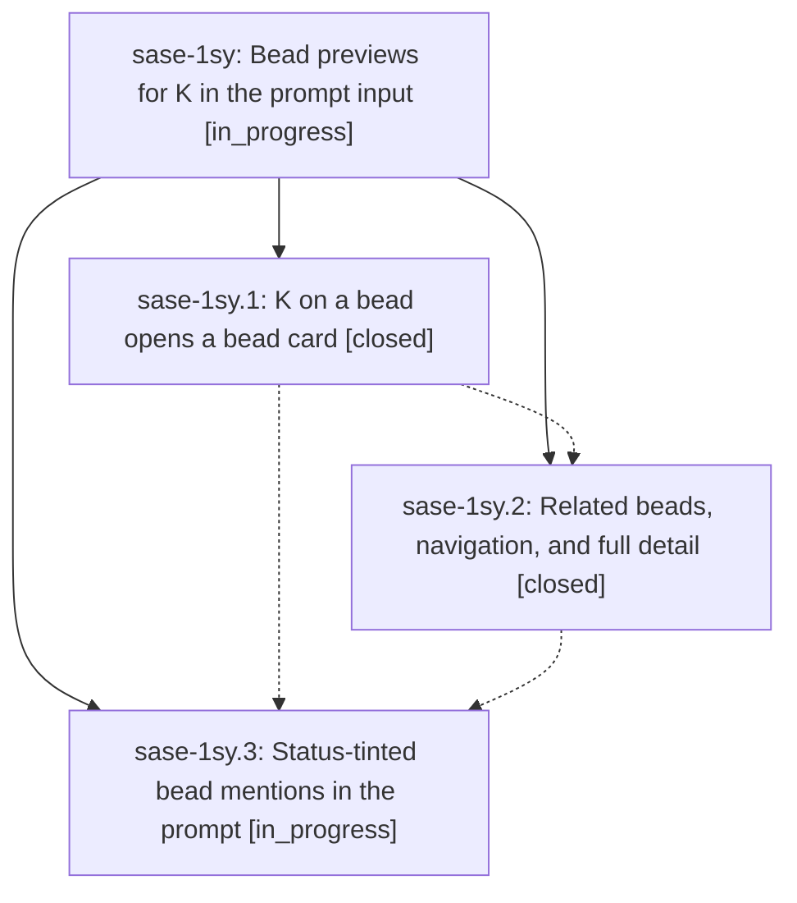

# Bead: sase-1sy — Bead previews for K in the prompt input

[Bead Pages](../README.md) / sase-1sy

**Status:** ◐ in_progress · **Type:** ▸ plan · **Tier:** epic
**Owner:** `bryanbugyi34@gmail.com` · **Created by:** `bbugyi200.apollo.dy` · **Assignee:** `sase-1sy.land`
**Created:** 2026-11-14 09:04:05 EST
**Plan:** [202611/bead\_k\_preview.md](https://github.com/sase-org/sase--plans/blob/main/202611/bead_k_preview.md)

<!-- sase:links:start -->

## Links

| Relation | Artifact | Why |
| --- | --- | --- |
| implemented-by | [plan:202611/bead_k_preview.md][1] | derived from the plan's `bead_id:` frontmatter field |

_Plus 1 automatic references — see [Referenced By](#referenced-by)._

[1]: https://github.com/sase-org/sase--plans/blob/main/202611/bead_k_preview.md

<!-- sase:links:end -->

## Description

Pressing K in the prompt input's NORMAL mode on a bead ID (bob-cli-kx, sase-1ss.1) or an @bead:<id> ref opens a fast, theme-aware bead card that never blocks typing. The card shows the bead's identity, status, description, phases, lineage, dependencies, and plan, and lets you drill into related beads or open the full detail. Ctrl+] opens the full bead detail too. Bead IDs that resolve get a status-tinted underline, so the K affordance is visible before you press it. Hyphenated words that are not beads keep today's word lookup.

## Phases

| Bead | Title | Status | Size | Created | Agents | Commits |
|---|---|---|---|---|---:|---:|
| [sase-1sy.1](sase-1sy.1.md) | K on a bead opens a bead card | ✓ closed | medium | 2026-11-14 | 1 | 1 |
| [sase-1sy.2](sase-1sy.2.md) | Related beads, navigation, and full detail | ✓ closed | medium | 2026-11-14 | 1 | 1 |
| [sase-1sy.3](sase-1sy.3.md) | Status-tinted bead mentions in the prompt | ◐ in_progress | medium | 2026-11-14 | 1 | 0 |

## Lineage

## Agents

| Agent | Bead | Commits |
|---|---|---:|
| [bbugyi200.athena.sase-1sy.1](https://github.com/sase-org/sase--agents/blob/main/agents/bbugyi200.athena.sase-1sy.1/README.md) | [sase-1sy.1](sase-1sy.1.md) | 1 |
| [bbugyi200.athena.sase-1sy.2](https://github.com/sase-org/sase--agents/blob/main/sessions/bbugyi200.athena.sase-1sy.2.md) | [sase-1sy.2](sase-1sy.2.md) | 1 |
| [bbugyi200.athena.sase-1sy.3](https://github.com/sase-org/sase--agents/blob/main/agents/bbugyi200.athena.sase-1sy.3/README.md) | [sase-1sy.3](sase-1sy.3.md) | 0 |
| [bbugyi200.athena.sase-1sy.land](https://github.com/sase-org/sase--agents/blob/main/agents/bbugyi200.athena.sase-1sy.land/README.md) | [sase-1sy](README.md) | 0 |

## Commits

| Repo | Commit | Subject | Bead | Committed |
|---|---|---|---|---|
| sase | [`4006ec3`](https://github.com/sase-org/sase/commit/4006ec36adf88bfc2a1691432e48b62b00018eb5) | feat(tui): preview beads with K in the prompt input | [sase-1sy.1](sase-1sy.1.md) | 2026-11-15 08:29:32 EST |
| sase | [`baf2309`](https://github.com/sase-org/sase/commit/baf23097d646611b6530c1a2970404e76f0f231e) | feat(tui): add related beads, navigation, and full detail to the K card | [sase-1sy.2](sase-1sy.2.md) | 2026-11-15 11:43:44 EST |

<!-- sase:referenced-by:start -->

## Referenced By

| Relation | Artifact | Why | Uses |
| --- | --- | --- | ---: |
| read-by | [agent:sase-1sy.1][1] | Need parent epic status and notes before implementing peek | 1 |

[1]: https://github.com/sase-org/sase--agents/blob/main/agents/bbugyi200.athena.sase-1sy.1/README.md

<!-- sase:referenced-by:end -->
