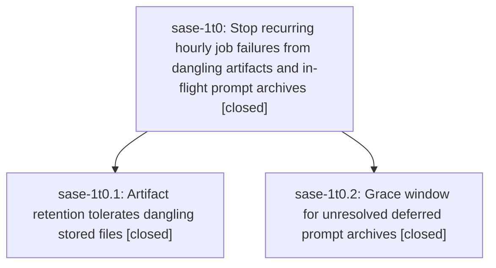

# Bead: sase-1t0 — Stop recurring hourly job failures from dangling artifacts and in-flight prompt archives

[Bead Pages](../README.md) / sase-1t0

**Status:** ✓ closed · **Resolution:** done · **Type:** ▸ plan · **Tier:** epic
**Owner:** `bryanbugyi34@gmail.com` · **Created by:** [bbugyi200.athena.1cm](https://github.com/sase-org/sase--agents/blob/main/sessions/bbugyi200.athena.1cm.md) · **Assignee:** `sase-1t0.land`
**Created:** 2026-11-15 12:29:20 EST · **Closed:** 2026-11-15 15:37:24 EST
**Plan:** [202611/hourly\_job\_error\_hardening.md](https://github.com/sase-org/sase--plans/blob/main/202611/hourly_job_error_hardening.md)

<!-- sase:links:start -->

## Links

| Relation | Artifact | Why |
| --- | --- | --- |
| implemented-by | [plan:202611/hourly_job_error_hardening.md][1] | derived from the plan's `bead_id:` frontmatter field |

[1]: https://github.com/sase-org/sase--plans/blob/main/202611/hourly_job_error_hardening.md

<!-- sase:links:end -->

## Description

The hourly artifact_retention job reclaims dangling index rows instead of failing forever on a missing stored file, and agent_publication no longer emits axe digest errors for deferred prompt archives that are only seconds-to-minutes old and resolve on their own.

## Notes

[2026-11-15T19:53:03Z · sase-1t0.land] LANDING AUDIT (2026-11-15): Reviewed the epic (no earlier notes), approved plan plan:202611/hourly_job_error_hardening.md, both children, all four retention notes and both publication notes. Both phases are closed done. Source and commits 974c600c6a, 9793a95a5c, and linked-core 2159438d implement the selected decisions: opt-in metadata-only trash with preserved record, zero reclaimed bytes and missing-payload counters; purge still attempted on trash failure; 1800-second grace only for young unavailable unresolved prompts, no acknowledgment, diagnostics, or attempt charges, with legacy/expired/explicit-error behavior retained in both publication paths. Core serde defaults and PyO3 round-trip coverage are present; sase-core-revision.txt equals containing commit 2159438d. Read regression tests and the real call sites. Retention notes #2-4 are corroborated by successful primary ToolRun a8815e44ac9b42768b4f5ea3fd7b16cb (all gates and scoped tests, exit 0). Publication note #1 matches source and tests; note #2 matches its landed commit.

INTEGRATION: Fetched origin in both checkouts. Main HEAD/origin/master is 9793a95a5c, core HEAD/origin/master is 2159438d. Reviewed the only two non-epic commits since the epic began/first feature commit: 0c929393a5 (TUI bead-mention highlighting) and 3ee3f17ab4 (TUI running-claim projection merge). Neither consumes or duplicates retention/publication behavior; no integration edits needed. No non-epic core drift. No remaining product defect found. epic-symbols returned no entries.

FOLLOW-UP TRIAGE COMPLETE: The sole PROPOSED FOLLOW-UP is sase-1t0.1 note #1. /sase_new_task found no exact duplicate after all-status CI/all-type search and last-week sweep. The retained feature check 79adfed2e211f2b94150c4916418530f and clean-base check e9090c09c67111234aa63f4af9ef5a31 both show the four Rust 1.100 needless_bool errors; the clean run records no dirty files, and all affected source is unchanged at current core. Created small CI task sase-1t1 with evidence file:explicit:b4045c72067f344a59543fd3. Declined reopening sase-1an because its different Rust 1.95 lints were verified fixed on Rust 1.99; linked it for context. Reviewed active epic scopes and sase-1hi/.1 notes: these newly exposed compiler lints affect old unrelated domains, not this epic or the outstanding Plan Decisions repairs; linked sase-1hi for shared-file coordination. No other child proposals exist.

VERIFICATION CONTINUATION: A fresh focused pytest run stopped at collection because the editable sase_core_rs package has no built extension in this workspace; just fmt left Python unchanged but also stopped in sase-backed doc rendering on that missing dependency. No source edits made. This is environment setup, not remaining epic feature work. Rebuild with just install-venv, rerun fmt, the focused regression set and wrapped just check, then finish the requested closeout. Do not run check-full. Leave epic and original plan open until verification completes.

[2026-11-15T20:37:24Z · sase-1t0.land--1] LANDING COMPLETE: Rechecked the recorded LANDING AUDIT, approved plan plan:202611/hourly_job_error_hardening.md, both closed-done phases, and all six child notes. Source and feature commits 974c600c6a, 9793a95a5c, and linked-core 2159438d satisfy all reviewer decisions: metadata-only trash preserves the full original record, reports zero reclaimed bytes and missing-payload counts, and purge still runs on trash failure; young unavailable unresolved prompt archives receive 1800 seconds of grace, remain queued/unacknowledged, emit no error diagnostics, and incur no attempt charges in both publication paths. Legacy, expired, and explicit-error behavior remains intact. Core serde defaults, PyO3 round-trip coverage, and the containing sase-core-revision.txt pin were verified.

CHILD-NOTE OUTCOMES: sase-1t0.1 note #1 is the sole PROPOSED FOLLOW-UP and is triaged below; notes #2-4 are supported by the recorded passing Rust trash tests (6/6), binding round-trip, and primary checks including a8815e44ac9b42768b4f5ea3fd7b16cb. sase-1t0.2 note #1 matches source and regression coverage, and note #2 matches the landed publication commit. No child note remains unaddressed.

INTEGRATION: Reviewed non-epic commits 0c929393a5 (TUI bead mentions) and 3ee3f17ab4 (running-claim projection merge); neither duplicates, conflicts with, nor needs the retention/publication changes. Refetched origin/master in both repositories after monitor completion: main remains 9793a95a5c and core remains 2159438d, both equal their fetched upstream. No new drift, product gaps, or integration edits are required.

VERIFICATION: Monitor e18v0ezpqxp5 completed exit 0 after rebuilding the missing local editable Rust extension, running just fmt, all 58 focused regression tests, and wrapped just check. Check ToolRun e5e19db597ff6939d33e859c72d5f865 passed every lint/validation stage and its automatically escalated full test lane; no just check-full was run. Main and core trees are clean with no formatting diff. Monitor evidence: file:monitor-retained-log:e18v0ezpqxp5 and file:monitor-diagnostic-manifest:e18v0ezpqxp5. Fresh sase bead epic-symbols sase-1t0 returned no entries.

FOLLOW-UP TRIAGE: Phase sase-1t0.1 note #1 produced small READY CI task sase-1t1 for four pre-existing Rust 1.100 needless_bool Clippy errors, supported by independent feature/clean-base logs and evidence file:explicit:b4045c72067f344a59543fd3. No exact duplicate was found. Reopening sase-1an was deliberately declined: its distinct Rust 1.95 lints were already verified fixed on Rust 1.99. That bead is linked for context; active sase-1hi is linked only for shared-file coordination because the errors predate and are not caused by either epic. No other follow-up proposals exist. Closing normally, without force.

## Phases

| Bead | Title | Status | Size | Created | Agents | Commits |
|---|---|---|---|---|---:|---:|
| [sase-1t0.1](sase-1t0.1.md) | Artifact retention tolerates dangling stored files | ✓ closed | medium | 2026-11-15 | 1 | 2 |
| [sase-1t0.2](sase-1t0.2.md) | Grace window for unresolved deferred prompt archives | ✓ closed | medium | 2026-11-15 | 1 | 1 |

## Lineage

## Agents

| Agent | Bead | Commits |
|---|---|---:|
| [bbugyi200.athena.sase-1t0.1](https://github.com/sase-org/sase--agents/blob/main/sessions/bbugyi200.athena.sase-1t0.1.md) | [sase-1t0.1](sase-1t0.1.md) | 2 |
| [bbugyi200.athena.sase-1t0.2](https://github.com/sase-org/sase--agents/blob/main/sessions/bbugyi200.athena.sase-1t0.2.md) | [sase-1t0.2](sase-1t0.2.md) | 1 |
| [bbugyi200.athena.sase-1t0.land](https://github.com/sase-org/sase--agents/blob/main/sessions/bbugyi200.athena.sase-1t0.land.md) | [sase-1t0](README.md) | 1 |

## Commits

| Repo | Commit | Subject | Bead | Committed |
|---|---|---|---|---|
| sase | [`974c600`](https://github.com/sase-org/sase/commit/974c600c6a29cf25b123ab3ae3aa381bdfcbf522) | feat(agents-sync): grace unresolved deferred prompt archives | [sase-1t0.2](sase-1t0.2.md) | 2026-11-15 13:28:13 EST |
| sase-core | [`sase-core@2159438`](https://github.com/sase-org/sase-core/commit/2159438daaad1b2925acde6a9a6dabfd3e79bca5) | fix(artifact-files): support missing payloads in trash | [sase-1t0.1](sase-1t0.1.md) | 2026-11-15 14:41:03 EST |
| sase | [`9793a95`](https://github.com/sase-org/sase/commit/9793a95a5c507b75d97139b084797488329f9aab) | fix(artifact-retention): tolerate dangling payloads | [sase-1t0.1](sase-1t0.1.md) | 2026-11-15 14:42:24 EST |
| sase--plans | [`sase--plans@65d9c42`](https://github.com/sase-org/sase--plans/commit/65d9c421960c8ec8fad41c8626c1f346fc2af126) | docs(plans): mark sase-1t0 hourly job hardening complete | [sase-1t0](README.md) | 2026-11-15 15:39:41 EST |
