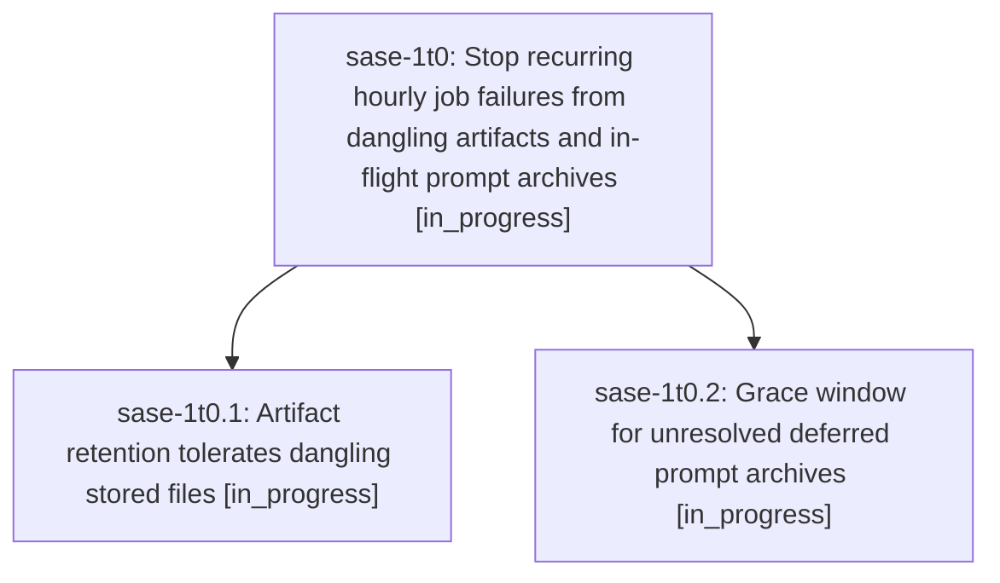

# Bead: sase-1t0 — Stop recurring hourly job failures from dangling artifacts and in-flight prompt archives

[Bead Pages](../README.md) / sase-1t0

**Status:** ◐ in_progress · **Type:** ▸ plan · **Tier:** epic
**Owner:** `bryanbugyi34@gmail.com` · **Created by:** [bbugyi200.athena.1cm](https://github.com/sase-org/sase--agents/blob/main/sessions/bbugyi200.athena.1cm.md) · **Assignee:** `sase-1t0.land`
**Created:** 2026-11-15 12:29:20 EST
**Plan:** [202611/hourly\_job\_error\_hardening.md](https://github.com/sase-org/sase--plans/blob/main/202611/hourly_job_error_hardening.md)

<!-- sase:links:start -->

## Links

| Relation | Artifact | Why |
| --- | --- | --- |
| implemented-by | [plan:202611/hourly_job_error_hardening.md][1] | derived from the plan's `bead_id:` frontmatter field |

[1]: https://github.com/sase-org/sase--plans/blob/main/202611/hourly_job_error_hardening.md

<!-- sase:links:end -->

## Description

The hourly artifact_retention job reclaims dangling index rows instead of failing forever on a missing stored file, and agent_publication no longer emits axe digest errors for deferred prompt archives that are only seconds-to-minutes old and resolve on their own.

## Phases

| Bead | Title | Status | Size | Created | Agents | Commits |
|---|---|---|---|---|---:|---:|
| [sase-1t0.1](sase-1t0.1.md) | Artifact retention tolerates dangling stored files | ◐ in_progress | medium | 2026-11-15 | 1 | 0 |
| [sase-1t0.2](sase-1t0.2.md) | Grace window for unresolved deferred prompt archives | ◐ in_progress | medium | 2026-11-15 | 1 | 1 |

## Lineage

## Agents

| Agent | Bead | Commits |
|---|---|---:|
| [bbugyi200.athena.sase-1t0.1](https://github.com/sase-org/sase--agents/blob/main/sessions/bbugyi200.athena.sase-1t0.1.md) | [sase-1t0.1](sase-1t0.1.md) | 0 |
| [bbugyi200.athena.sase-1t0.2](https://github.com/sase-org/sase--agents/blob/main/sessions/bbugyi200.athena.sase-1t0.2.md) | [sase-1t0.2](sase-1t0.2.md) | 1 |
| [bbugyi200.athena.sase-1t0.land](https://github.com/sase-org/sase--agents/blob/main/agents/bbugyi200.athena.sase-1t0.land/README.md) | [sase-1t0](README.md) | 0 |

## Commits

| Repo | Commit | Subject | Bead | Committed |
|---|---|---|---|---|
| sase | [`974c600`](https://github.com/sase-org/sase/commit/974c600c6a29cf25b123ab3ae3aa381bdfcbf522) | feat(agents-sync): grace unresolved deferred prompt archives | [sase-1t0.2](sase-1t0.2.md) | 2026-11-15 13:28:13 EST |
