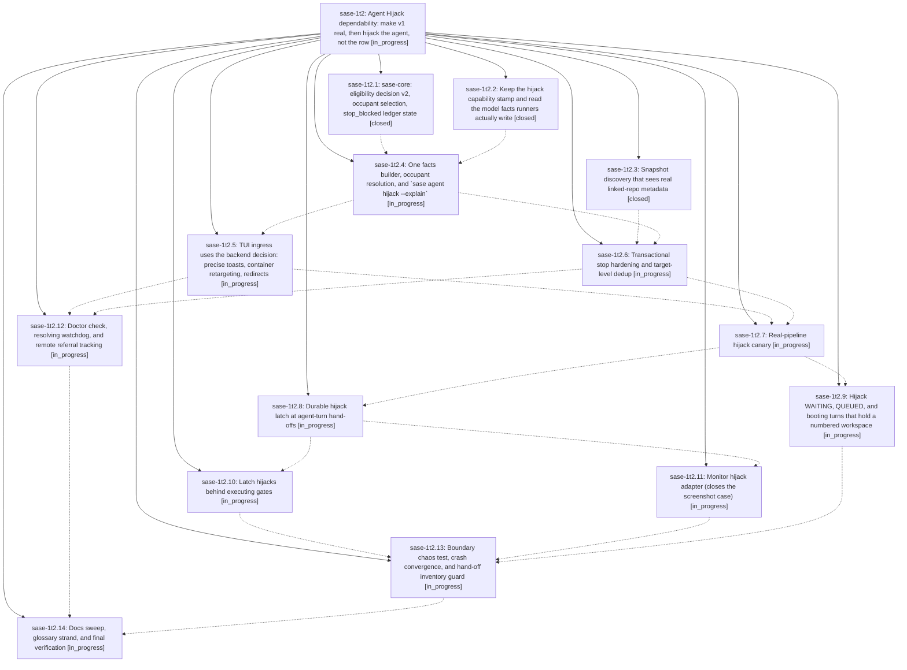

# Bead: sase-1t2 — Agent Hijack dependability: make v1 real, then hijack the agent, not the row

[Bead Pages](../README.md) / sase-1t2

**Status:** ◐ in_progress · **Type:** ▸ plan · **Tier:** epic
**Owner:** `bryanbugyi34@gmail.com` · **Created by:** [bbugyi200.athena.1ct](https://github.com/sase-org/sase--agents/blob/main/sessions/bbugyi200.athena.1ct.md) · **Assignee:** `sase-1t2.land`
**Created:** 2026-11-15 20:00:08 EST
**Plan:** [202611/agent\_hijack\_dependability.md](https://github.com/sase-org/sase--plans/blob/main/202611/agent_hijack_dependability.md)

<!-- sase:links:start -->

## Links

| Relation | Artifact | Why |
| --- | --- | --- |
| implemented-by | [plan:202611/agent_hijack_dependability.md][1] | derived from the plan's `bead_id:` frontmatter field |

_Plus 1 automatic references — see [Referenced By](#referenced-by)._

[1]: https://github.com/sase-org/sase--plans/blob/main/202611/agent_hijack_dependability.md

<!-- sase:links:end -->

## Description

Pressing ,k (or the kill dialog's h, or `sase agent hijack NAME`) on any local agent row, session container, or session name hijacks the session's occupying turn when that is safe now, latches the hijack to the next safe hand-off when it is not, and otherwise answers with a precise reason and next action, never the generic "not eligible" toast. Ordinary running agent turns, --plan/--tale turns, retries, booting and WAITING/QUEUED turns that hold a numbered workspace, running monitor turns, finalizing turns, staged hand-offs, monitor follow-ups, and executing gates are all covered. A real-pipeline canary proves hijack then Continue works end to end, and concurrent or crashed hijacks converge to exactly one operation and at most one successor.

## Phases

| Bead | Title | Status | Size | Created | Agents | Commits |
|---|---|---|---|---|---:|---:|
| [sase-1t2.1](sase-1t2.1.md) | sase-core: eligibility decision v2, occupant selection, stop\_blocked ledger state | ✓ closed | medium | 2026-11-15 | 1 | 2 |
| [sase-1t2.10](sase-1t2.10.md) | Latch hijacks behind executing gates | ◐ in_progress | small | 2026-11-15 | 1 | 0 |
| [sase-1t2.11](sase-1t2.11.md) | Monitor hijack adapter (closes the screenshot case) | ◐ in_progress | large | 2026-11-15 | 1 | 0 |
| [sase-1t2.12](sase-1t2.12.md) | Doctor check, resolving watchdog, and remote referral tracking | ◐ in_progress | small | 2026-11-15 | 1 | 0 |
| [sase-1t2.13](sase-1t2.13.md) | Boundary chaos test, crash convergence, and hand-off inventory guard | ◐ in_progress | medium | 2026-11-15 | 1 | 0 |
| [sase-1t2.14](sase-1t2.14.md) | Docs sweep, glossary strand, and final verification | ◐ in_progress | small | 2026-11-15 | 1 | 0 |
| [sase-1t2.2](sase-1t2.2.md) | Keep the hijack capability stamp and read the model facts runners actually write | ✓ closed | small | 2026-11-15 | 1 | 1 |
| [sase-1t2.3](sase-1t2.3.md) | Snapshot discovery that sees real linked-repo metadata | ✓ closed | small | 2026-11-15 | 1 | 1 |
| [sase-1t2.4](sase-1t2.4.md) | One facts builder, occupant resolution, and \`sase agent hijack --explain\` | ◐ in_progress | medium | 2026-11-15 | 1 | 0 |
| [sase-1t2.5](sase-1t2.5.md) | TUI ingress uses the backend decision: precise toasts, container retargeting, redirects | ◐ in_progress | medium | 2026-11-15 | 1 | 0 |
| [sase-1t2.6](sase-1t2.6.md) | Transactional stop hardening and target-level dedup | ◐ in_progress | medium | 2026-11-15 | 1 | 0 |
| [sase-1t2.7](sase-1t2.7.md) | Real-pipeline hijack canary | ◐ in_progress | medium | 2026-11-15 | 1 | 0 |
| [sase-1t2.8](sase-1t2.8.md) | Durable hijack latch at agent-turn hand-offs | ◐ in_progress | large | 2026-11-15 | 1 | 0 |
| [sase-1t2.9](sase-1t2.9.md) | Hijack WAITING, QUEUED, and booting turns that hold a numbered workspace | ◐ in_progress | medium | 2026-11-15 | 1 | 0 |

## Lineage

## Agents

| Agent | Bead | Commits |
|---|---|---:|
| [bbugyi200.athena.sase-1t2.1](https://github.com/sase-org/sase--agents/blob/main/agents/bbugyi200.athena.sase-1t2.1/README.md) | [sase-1t2.1](sase-1t2.1.md) | 2 |
| [bbugyi200.athena.sase-1t2.10](https://github.com/sase-org/sase--agents/blob/main/agents/bbugyi200.athena.sase-1t2.10/README.md) | [sase-1t2.10](sase-1t2.10.md) | 0 |
| [bbugyi200.athena.sase-1t2.11](https://github.com/sase-org/sase--agents/blob/main/agents/bbugyi200.athena.sase-1t2.11/README.md) | [sase-1t2.11](sase-1t2.11.md) | 0 |
| [bbugyi200.athena.sase-1t2.12](https://github.com/sase-org/sase--agents/blob/main/agents/bbugyi200.athena.sase-1t2.12/README.md) | [sase-1t2.12](sase-1t2.12.md) | 0 |
| [bbugyi200.athena.sase-1t2.13](https://github.com/sase-org/sase--agents/blob/main/agents/bbugyi200.athena.sase-1t2.13/README.md) | [sase-1t2.13](sase-1t2.13.md) | 0 |
| [bbugyi200.athena.sase-1t2.14](https://github.com/sase-org/sase--agents/blob/main/agents/bbugyi200.athena.sase-1t2.14/README.md) | [sase-1t2.14](sase-1t2.14.md) | 0 |
| [bbugyi200.athena.sase-1t2.2](https://github.com/sase-org/sase--agents/blob/main/agents/bbugyi200.athena.sase-1t2.2/README.md) | [sase-1t2.2](sase-1t2.2.md) | 1 |
| [bbugyi200.athena.sase-1t2.3](https://github.com/sase-org/sase--agents/blob/main/sessions/bbugyi200.athena.sase-1t2.3.md) | [sase-1t2.3](sase-1t2.3.md) | 1 |
| [bbugyi200.athena.sase-1t2.4](https://github.com/sase-org/sase--agents/blob/main/agents/bbugyi200.athena.sase-1t2.4/README.md) | [sase-1t2.4](sase-1t2.4.md) | 0 |
| [bbugyi200.athena.sase-1t2.5](https://github.com/sase-org/sase--agents/blob/main/agents/bbugyi200.athena.sase-1t2.5/README.md) | [sase-1t2.5](sase-1t2.5.md) | 0 |
| [bbugyi200.athena.sase-1t2.6](https://github.com/sase-org/sase--agents/blob/main/agents/bbugyi200.athena.sase-1t2.6/README.md) | [sase-1t2.6](sase-1t2.6.md) | 0 |
| [bbugyi200.athena.sase-1t2.7](https://github.com/sase-org/sase--agents/blob/main/agents/bbugyi200.athena.sase-1t2.7/README.md) | [sase-1t2.7](sase-1t2.7.md) | 0 |
| [bbugyi200.athena.sase-1t2.8](https://github.com/sase-org/sase--agents/blob/main/agents/bbugyi200.athena.sase-1t2.8/README.md) | [sase-1t2.8](sase-1t2.8.md) | 0 |
| [bbugyi200.athena.sase-1t2.9](https://github.com/sase-org/sase--agents/blob/main/agents/bbugyi200.athena.sase-1t2.9/README.md) | [sase-1t2.9](sase-1t2.9.md) | 0 |
| [bbugyi200.athena.sase-1t2.land](https://github.com/sase-org/sase--agents/blob/main/agents/bbugyi200.athena.sase-1t2.land/README.md) | [sase-1t2](README.md) | 0 |

## Commits

| Repo | Commit | Subject | Bead | Committed |
|---|---|---|---|---|
| sase | [`880f7e9`](https://github.com/sase-org/sase/commit/880f7e96f375b0c867531cde29443b8b62f0cec4) | feat(hijack): share linked-repo inventory for stop/release snapshots | [sase-1t2.3](sase-1t2.3.md) | 2026-11-15 20:47:46 EST |
| sase-core | [`sase-core@9940715`](https://github.com/sase-org/sase-core/commit/9940715099807a75f0ab1046c8b4fa6bc8fd7409) | feat(agent-hijack): add eligibility v2 wire, occupant selection, stop\_blocked ledger | [sase-1t2.1](sase-1t2.1.md) | 2026-11-15 21:25:37 EST |
| sase | [`e6af326`](https://github.com/sase-org/sase/commit/e6af32680efeed0246edd07d9f4cdd070b5c0f8b) | feat(agent-hijack): add Python wrappers, ledger custody, and core tests | [sase-1t2.1](sase-1t2.1.md) | 2026-11-15 21:27:07 EST |
| sase | [`bd99aba`](https://github.com/sase-org/sase/commit/bd99aba1c871134b1b7e2c0935d7c0cdf7ce851f) | fix(hijack): preserve runner boot meta and read real model facts | [sase-1t2.2](sase-1t2.2.md) | 2026-11-15 22:35:17 EST |

<!-- sase:referenced-by:start -->

## Referenced By

| Relation | Artifact | Why | Uses |
| --- | --- | --- | ---: |
| read-by | [agent:sase-1t2.1][1] | need epic plan and scope | 1 |

[1]: https://github.com/sase-org/sase--agents/blob/main/agents/bbugyi200.athena.sase-1t2.1/README.md

<!-- sase:referenced-by:end -->
