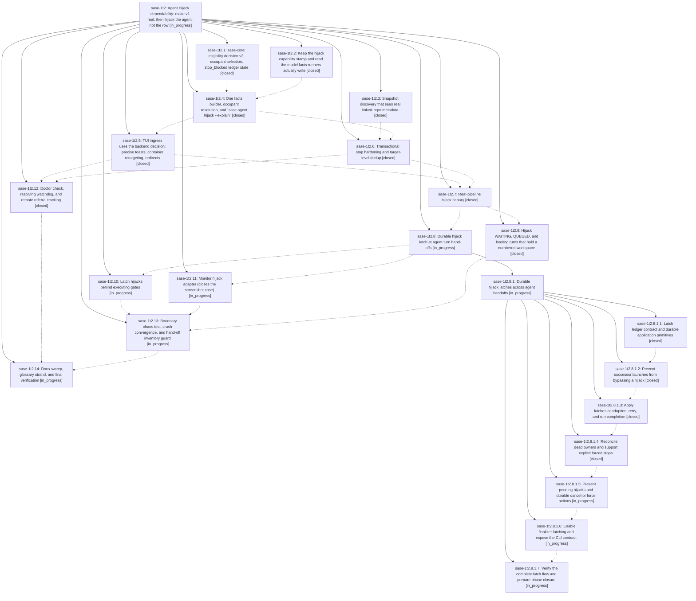

# Bead: sase-1t2 — Agent Hijack dependability: make v1 real, then hijack the agent, not the row

[Bead Pages](../README.md) / sase-1t2

**Status:** ◐ in_progress · **Type:** ▸ plan · **Tier:** epic
**Owner:** `bryanbugyi34@gmail.com` · **Created by:** [bbugyi200.athena.1ct](https://github.com/sase-org/sase--agents/blob/main/sessions/bbugyi200.athena.1ct.md) · **Assignee:** `sase-1t2.land`
**Created:** 2026-11-15 20:00:08 EST
**Plan:** [202611/agent\_hijack\_dependability.md](https://github.com/sase-org/sase--plans/blob/main/202611/agent_hijack_dependability.md)

<!-- sase:links:start -->

## Links

| Relation | Artifact | Why |
| --- | --- | --- |
| implemented-by | [plan:202611/agent_hijack_dependability.md][1] | derived from the plan's `bead_id:` frontmatter field |

_Plus 3 automatic references — see [Referenced By](#referenced-by)._

[1]: https://github.com/sase-org/sase--plans/blob/main/202611/agent_hijack_dependability.md

<!-- sase:links:end -->

## Description

Pressing ,k (or the kill dialog's h, or `sase agent hijack NAME`) on any local agent row, session container, or session name hijacks the session's occupying turn when that is safe now, latches the hijack to the next safe hand-off when it is not, and otherwise answers with a precise reason and next action, never the generic "not eligible" toast. Ordinary running agent turns, --plan/--tale turns, retries, booting and WAITING/QUEUED turns that hold a numbered workspace, running monitor turns, finalizing turns, staged hand-offs, monitor follow-ups, and executing gates are all covered. A real-pipeline canary proves hijack then Continue works end to end, and concurrent or crashed hijacks converge to exactly one operation and at most one successor.

## Phases

| Bead | Title | Status | Size | Created | Agents | Commits |
|---|---|---|---|---|---:|---:|
| [sase-1t2.1](sase-1t2.1.md) | sase-core: eligibility decision v2, occupant selection, stop\_blocked ledger state | ✓ closed | medium | 2026-11-15 | 1 | 2 |
| [sase-1t2.10](sase-1t2.10.md) | Latch hijacks behind executing gates | ◐ in_progress | small | 2026-11-15 | 1 | 0 |
| [sase-1t2.11](sase-1t2.11.md) | Monitor hijack adapter (closes the screenshot case) | ◐ in_progress | large | 2026-11-15 | 1 | 0 |
| [sase-1t2.12](sase-1t2.12.md) | Doctor check, resolving watchdog, and remote referral tracking | ✓ closed | small | 2026-11-15 | 1 | 2 |
| [sase-1t2.13](sase-1t2.13.md) | Boundary chaos test, crash convergence, and hand-off inventory guard | ◐ in_progress | medium | 2026-11-15 | 1 | 0 |
| [sase-1t2.14](sase-1t2.14.md) | Docs sweep, glossary strand, and final verification | ◐ in_progress | small | 2026-11-15 | 1 | 0 |
| [sase-1t2.2](sase-1t2.2.md) | Keep the hijack capability stamp and read the model facts runners actually write | ✓ closed | small | 2026-11-15 | 1 | 2 |
| [sase-1t2.3](sase-1t2.3.md) | Snapshot discovery that sees real linked-repo metadata | ✓ closed | small | 2026-11-15 | 1 | 1 |
| [sase-1t2.4](sase-1t2.4.md) | One facts builder, occupant resolution, and \`sase agent hijack --explain\` | ✓ closed | medium | 2026-11-15 | 1 | 1 |
| [sase-1t2.5](sase-1t2.5.md) | TUI ingress uses the backend decision: precise toasts, container retargeting, redirects | ✓ closed | medium | 2026-11-15 | 1 | 1 |
| [sase-1t2.6](sase-1t2.6.md) | Transactional stop hardening and target-level dedup | ✓ closed | medium | 2026-11-15 | 1 | 2 |
| [sase-1t2.7](sase-1t2.7.md) | Real-pipeline hijack canary | ✓ closed | medium | 2026-11-15 | 1 | 1 |
| [sase-1t2.8](sase-1t2.8.md) | Durable hijack latch at agent-turn hand-offs | ◐ in_progress | large | 2026-11-15 | 1 | 0 |
| [sase-1t2.9](sase-1t2.9.md) | Hijack WAITING, QUEUED, and booting turns that hold a numbered workspace | ✓ closed | medium | 2026-11-15 | 1 | 3 |

## Lineage

## Agents

| Agent | Bead | Commits |
|---|---|---:|
| [bbugyi200.athena.sase-1t2.1](https://github.com/sase-org/sase--agents/blob/main/agents/bbugyi200.athena.sase-1t2.1/README.md) | [sase-1t2.1](sase-1t2.1.md) | 2 |
| [bbugyi200.athena.sase-1t2.10](https://github.com/sase-org/sase--agents/blob/main/agents/bbugyi200.athena.sase-1t2.10/README.md) | [sase-1t2.10](sase-1t2.10.md) | 0 |
| [bbugyi200.athena.sase-1t2.11](https://github.com/sase-org/sase--agents/blob/main/agents/bbugyi200.athena.sase-1t2.11/README.md) | [sase-1t2.11](sase-1t2.11.md) | 0 |
| [bbugyi200.athena.sase-1t2.12](https://github.com/sase-org/sase--agents/blob/main/agents/bbugyi200.athena.sase-1t2.12/README.md) | [sase-1t2.12](sase-1t2.12.md) | 2 |
| [bbugyi200.athena.sase-1t2.13](https://github.com/sase-org/sase--agents/blob/main/agents/bbugyi200.athena.sase-1t2.13/README.md) | [sase-1t2.13](sase-1t2.13.md) | 0 |
| [bbugyi200.athena.sase-1t2.14](https://github.com/sase-org/sase--agents/blob/main/agents/bbugyi200.athena.sase-1t2.14/README.md) | [sase-1t2.14](sase-1t2.14.md) | 0 |
| [bbugyi200.athena.sase-1t2.2](https://github.com/sase-org/sase--agents/blob/main/agents/bbugyi200.athena.sase-1t2.2/README.md) | [sase-1t2.2](sase-1t2.2.md) | 2 |
| [bbugyi200.athena.sase-1t2.3](https://github.com/sase-org/sase--agents/blob/main/sessions/bbugyi200.athena.sase-1t2.3.md) | [sase-1t2.3](sase-1t2.3.md) | 1 |
| [bbugyi200.athena.sase-1t2.4](https://github.com/sase-org/sase--agents/blob/main/sessions/bbugyi200.athena.sase-1t2.4.md) | [sase-1t2.4](sase-1t2.4.md) | 1 |
| [bbugyi200.athena.sase-1t2.5](https://github.com/sase-org/sase--agents/blob/main/agents/bbugyi200.athena.sase-1t2.5/README.md) | [sase-1t2.5](sase-1t2.5.md) | 1 |
| [bbugyi200.athena.sase-1t2.6](https://github.com/sase-org/sase--agents/blob/main/sessions/bbugyi200.athena.sase-1t2.6.md) | [sase-1t2.6](sase-1t2.6.md) | 2 |
| [bbugyi200.athena.sase-1t2.7](https://github.com/sase-org/sase--agents/blob/main/sessions/bbugyi200.athena.sase-1t2.7.md) | [sase-1t2.7](sase-1t2.7.md) | 1 |
| [bbugyi200.athena.sase-1t2.8](https://github.com/sase-org/sase--agents/blob/main/sessions/bbugyi200.athena.sase-1t2.8.md) | [sase-1t2.8](sase-1t2.8.md) | 0 |
| [bbugyi200.athena.sase-1t2.8.1.1](https://github.com/sase-org/sase--agents/blob/main/agents/bbugyi200.athena.sase-1t2.8.1.1/README.md) | [sase-1t2.8.1.1](sase-1t2.8.1.1.md) | 2 |
| [bbugyi200.athena.sase-1t2.8.1.2](https://github.com/sase-org/sase--agents/blob/main/sessions/bbugyi200.athena.sase-1t2.8.1.2.md) | [sase-1t2.8.1.2](sase-1t2.8.1.2.md) | 1 |
| [bbugyi200.athena.sase-1t2.8.1.3](https://github.com/sase-org/sase--agents/blob/main/agents/bbugyi200.athena.sase-1t2.8.1.3/README.md) | [sase-1t2.8.1.3](sase-1t2.8.1.3.md) | 1 |
| [bbugyi200.athena.sase-1t2.8.1.4](https://github.com/sase-org/sase--agents/blob/main/agents/bbugyi200.athena.sase-1t2.8.1.4/README.md) | [sase-1t2.8.1.4](sase-1t2.8.1.4.md) | 1 |
| [bbugyi200.athena.sase-1t2.8.1.5](https://github.com/sase-org/sase--agents/blob/main/agents/bbugyi200.athena.sase-1t2.8.1.5/README.md) | [sase-1t2.8.1.5](sase-1t2.8.1.5.md) | 0 |
| [bbugyi200.athena.sase-1t2.8.1.6](https://github.com/sase-org/sase--agents/blob/main/agents/bbugyi200.athena.sase-1t2.8.1.6/README.md) | [sase-1t2.8.1.6](sase-1t2.8.1.6.md) | 0 |
| [bbugyi200.athena.sase-1t2.8.1.7](https://github.com/sase-org/sase--agents/blob/main/agents/bbugyi200.athena.sase-1t2.8.1.7/README.md) | [sase-1t2.8.1.7](sase-1t2.8.1.7.md) | 0 |
| [bbugyi200.athena.sase-1t2.8.1.land](https://github.com/sase-org/sase--agents/blob/main/agents/bbugyi200.athena.sase-1t2.8.1.land/README.md) | [sase-1t2.8.1](sase-1t2.8.1.md) | 0 |
| [bbugyi200.athena.sase-1t2.9](https://github.com/sase-org/sase--agents/blob/main/agents/bbugyi200.athena.sase-1t2.9/README.md) | [sase-1t2.9](sase-1t2.9.md) | 3 |
| [bbugyi200.athena.sase-1t2.land](https://github.com/sase-org/sase--agents/blob/main/agents/bbugyi200.athena.sase-1t2.land/README.md) | [sase-1t2](README.md) | 0 |

## Commits

| Repo | Commit | Subject | Bead | Committed |
|---|---|---|---|---|
| sase | [`880f7e9`](https://github.com/sase-org/sase/commit/880f7e96f375b0c867531cde29443b8b62f0cec4) | feat(hijack): share linked-repo inventory for stop/release snapshots | [sase-1t2.3](sase-1t2.3.md) | 2026-11-15 20:47:46 EST |
| sase-core | [`sase-core@9940715`](https://github.com/sase-org/sase-core/commit/9940715099807a75f0ab1046c8b4fa6bc8fd7409) | feat(agent-hijack): add eligibility v2 wire, occupant selection, stop\_blocked ledger | [sase-1t2.1](sase-1t2.1.md) | 2026-11-15 21:25:37 EST |
| sase | [`e6af326`](https://github.com/sase-org/sase/commit/e6af32680efeed0246edd07d9f4cdd070b5c0f8b) | feat(agent-hijack): add Python wrappers, ledger custody, and core tests | [sase-1t2.1](sase-1t2.1.md) | 2026-11-15 21:27:07 EST |
| sase | [`bd99aba`](https://github.com/sase-org/sase/commit/bd99aba1c871134b1b7e2c0935d7c0cdf7ce851f) | fix(hijack): preserve runner boot meta and read real model facts | [sase-1t2.2](sase-1t2.2.md) | 2026-11-15 22:35:17 EST |
| sase | [`e2ae4f2`](https://github.com/sase-org/sase/commit/e2ae4f2252d3f3162a67364239089be59f8361c7) | test(models-panel): wait for alias rows before reset highlight | [sase-1t2.2](sase-1t2.2.md) | 2026-11-15 22:37:39 EST |
| sase | [`cc1e71b`](https://github.com/sase-org/sase/commit/cc1e71b755672fb6186a439d380da3515b24eef9) | feat(agent-hijack): resolve session occupants before stopping | [sase-1t2.4](sase-1t2.4.md) | 2026-11-15 23:48:58 EST |
| sase | [`deddacb`](https://github.com/sase-org/sase/commit/deddacb1e510d0d40fa12e05da8629cc8c15373d) | feat(agent-hijack): transactional stop hardening and target-level dedup | [sase-1t2.6](sase-1t2.6.md) | 2026-11-16 00:28:30 EST |
| sase | [`dcae086`](https://github.com/sase-org/sase/commit/dcae0865684a74cf837c8189b5a481f6229b9ab5) | test(agent-hijack): review \_promote\_sessionless\_predecessor marker path passing | [sase-1t2.6](sase-1t2.6.md) | 2026-11-16 00:49:14 EST |
| sase | [`d26b581`](https://github.com/sase-org/sase/commit/d26b581253780c3c1417839c6af08c1294885328) | feat(agent-hijack): cache backend decisions for TUI hijack ingress | [sase-1t2.5](sase-1t2.5.md) | 2026-11-16 01:27:04 EST |
| sase-core | [`sase-core@6866f35`](https://github.com/sase-org/sase-core/commit/6866f35bea67fc2609ff1f1ff26c92e6a09b0266) | feat(agent-hijack): return queued resolving records to held after dispatch bound | [sase-1t2.12](sase-1t2.12.md) | 2026-11-16 02:57:17 EST |
| sase | [`3c8564d`](https://github.com/sase-org/sase/commit/3c8564dd8735b014bec17a9f2a8357918dbc5fc6) | feat(agent-hijack): add doctor check, dispatch watchdog, and remote referrals | [sase-1t2.12](sase-1t2.12.md) | 2026-11-16 02:58:57 EST |
| sase | [`8254254`](https://github.com/sase-org/sase/commit/8254254e2f61726db20f2313ce4f8afb9b7e4300) | feat(agent-hijack): add real-pipeline hijack canary | [sase-1t2.7](sase-1t2.7.md) | 2026-11-16 03:55:28 EST |
| sase-core | [`sase-core@20b8133`](https://github.com/sase-org/sase-core/commit/20b8133ea3e82a852ccd17a2228820c6a1c97160) | feat(agent-hijack): add pre-provider decisions | [sase-1t2.9](sase-1t2.9.md) | 2026-11-16 04:34:04 EST |
| sase-core | [`sase-core@e9b1cf0`](https://github.com/sase-org/sase-core/commit/e9b1cf04158d1168e43fb150dc6d7a62c14a959c) | feat(agent-hijack): add latch ledger policy and bindings | [sase-1t2.8.1.1](sase-1t2.8.1.1.md) | 2026-11-16 06:05:49 EST |
| sase | [`73718c7`](https://github.com/sase-org/sase/commit/73718c77e13940f99ca42f2fdda49bb9aec3d6a7) | feat(agent-hijack): add durable latch request and application primitives | [sase-1t2.8.1.1](sase-1t2.8.1.1.md) | 2026-11-16 06:07:37 EST |
| sase-core | [`sase-core@50a6d97`](https://github.com/sase-org/sase-core/commit/50a6d972f9ec7f985c2e34624f3b368ff55cb59b) | test(agent-hijack): cover pre-provider hijack decisions | [sase-1t2.9](sase-1t2.9.md) | 2026-11-16 06:45:16 EST |
| sase | [`0731d06`](https://github.com/sase-org/sase/commit/0731d06c5a290eb037c88d17bde34bb174103295) | feat(agent-hijack): support waiting and unstarted turn recovery | [sase-1t2.9](sase-1t2.9.md) | 2026-11-16 06:47:08 EST |
| sase | [`ba6ec68`](https://github.com/sase-org/sase/commit/ba6ec6897bf3b50ba318e3c349cc3eac158508dd) | feat(agent-hijack): refuse successor launches against a latched predecessor | [sase-1t2.8.1.2](sase-1t2.8.1.2.md) | 2026-11-16 08:33:19 EST |
| sase | [`13b7ae9`](https://github.com/sase-org/sase/commit/13b7ae9075e96781c3d53480420a885b9f028b85) | feat(agent-hijack): enforce runner-side latch at adoption, retry, and delivery boundaries | [sase-1t2.8.1.3](sase-1t2.8.1.3.md) | 2026-11-16 09:08:06 EST |
| sase | [`93273f4`](https://github.com/sase-org/sase/commit/93273f4a4f1dc3f3ba25f740491837b182ceb76c) | feat(agent-hijack): reconcile stale latch owners and forced stops | [sase-1t2.8.1.4](sase-1t2.8.1.4.md) | 2026-11-16 10:09:28 EST |

<!-- sase:referenced-by:start -->

## Referenced By

| Relation | Artifact | Why | Uses |
| --- | --- | --- | ---: |
| read-by | [agent:research.62.final][1] | Confirm hijack epic status for TUI perf consolidation | 1 |
| read-by | [agent:sase-1t2.1][2] | need epic plan and scope | 1 |
| read-by | [agent:sase-1t2.9][3] | Need the epic's accepted glossary decision context and phase state to keep the authorized memory edit accurate | 1 |

[1]: https://github.com/sase-org/sase--agents/blob/main/agents/bbugyi200.athena.research.62.final/README.md
[2]: https://github.com/sase-org/sase--agents/blob/main/agents/bbugyi200.athena.sase-1t2.1/README.md
[3]: https://github.com/sase-org/sase--agents/blob/main/agents/bbugyi200.athena.sase-1t2.9/README.md

<!-- sase:referenced-by:end -->
