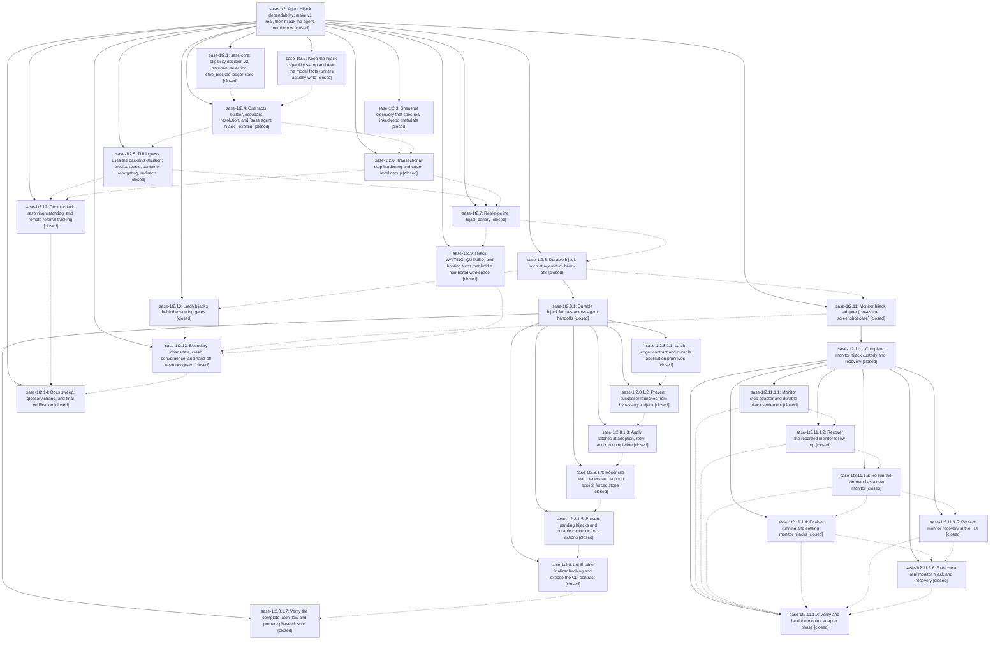

# Bead: sase-1t2 — Agent Hijack dependability: make v1 real, then hijack the agent, not the row

[Bead Pages](../README.md) / sase-1t2

**Status:** ✓ closed · **Resolution:** done · **Type:** ▸ plan · **Tier:** epic
**Owner:** `bryanbugyi34@gmail.com` · **Created by:** [bbugyi200.athena.1ct](https://github.com/sase-org/sase--agents/blob/main/sessions/bbugyi200.athena.1ct.md) · **Assignee:** `sase-1t2.land`
**Created:** 2026-11-15 20:00:08 EST · **Closed:** 2026-11-17 05:49:00 EST
**Plan:** [202611/agent\_hijack\_dependability.md](https://github.com/sase-org/sase--plans/blob/main/202611/agent_hijack_dependability.md)

<!-- sase:links:start -->

## Links

| Relation | Artifact | Why |
| --- | --- | --- |
| implemented-by | [plan:202611/agent_hijack_dependability.md][1] | derived from the plan's `bead_id:` frontmatter field |

_Plus 9 automatic references — see [Referenced By](#referenced-by)._

[1]: https://github.com/sase-org/sase--plans/blob/main/202611/agent_hijack_dependability.md

<!-- sase:links:end -->

## Description

Pressing ,k (or the kill dialog's h, or `sase agent hijack NAME`) on any local agent row, session container, or session name hijacks the session's occupying turn when that is safe now, latches the hijack to the next safe hand-off when it is not, and otherwise answers with a precise reason and next action, never the generic "not eligible" toast. Ordinary running agent turns, --plan/--tale turns, retries, booting and WAITING/QUEUED turns that hold a numbered workspace, running monitor turns, finalizing turns, staged hand-offs, monitor follow-ups, and executing gates are all covered. A real-pipeline canary proves hijack then Continue works end to end, and concurrent or crashed hijacks converge to exactly one operation and at most one successor.

## Notes

[2026-11-16T23:50:38Z · toobig-9v.local_trust_management.0] DISCOVERED ISSUE: On 2026-11-16, during an unrelated local trust split, just _lint-toobig reported tests/ace/tui/test_agent_hijack_action.py at 1092 lines, over its 1000-line limit. This is a deterministic violation outside the trust split. The active hijack epic has ongoing boundary-chaos and final verification work; triage the test-size fix with the appropriate phase owner.

[2026-11-17T05:01:18Z · sase-1t3.6.1.land] DISCOVERED ISSUE: Proposed by sase-1t3.6.1.3 note 3, independently remeasured by its lander at primary ca0732fc10. TUI import footprint is 12,335,426 normalized source bytes versus 12,006,094 before dc09b5eba3 (cap 12,162,484), with identical installed Python/native dependencies and isolated git-archive source comparison. Largest newly eager modules include monitor.hijack_settlement (+16,035 B, introduced by a2c9c3ecb5 / sase-1t2.11.1.1), monitor.settlement_fresh_owner (+12,949), hijack.recover_settle (+11,805), custody (+11,007), _release_effects (+10,714), ledger (+10,654), plus the recovery admission/preview/latch graph. This identifies a causal connection to current hijack/monitor work, not just topical startup overlap. Coordinate with startup phase sase-1t3.8; remove unnecessary first-paint imports instead of raising the cap. Indexed lookup adds +2,619 B in _lookup_named (partly offset elsewhere); its remaining Rust-ranking tale owns that smaller contribution. Evidence and full per-module delta: file:explicit:342e54884b78a18ce53099ce; prior independent failure: file:explicit:30a40133acfe3c8fa7bda0f4. All-status task searches and last-week sweep found no exact duplicate; closed sase-1ic fixed the old module-count false positives and is not reopened for this real byte-growth report. No new task because this active epic is causal.

[2026-11-17T08:30:43Z · sase-1t3.6.1.land--1] DISCOVERED ISSUE: Required check ToolRun a4ac7f1adcae20a048906fdb9a55ee9e on 2026-11-17 failed tests/test_macro_terminology.py::test_macro_string_literals_avoid_xprompt_terms. The scanner finds submitted_xprompt.md in tests/fakey/_agent_hijack_monitor_canary.py, a canary file changed in the current branch base relative to origin/master, plus a legacy-directive literal in tests/ace/tui/widgets/test_directive_completion_candidates.py. This is a test-guard regression in the active hijack canary work, not in the staged indexed-lookup repair. Existing task sase-1hr received independent corroboration; please route the canary literal through the legacy filename constants or otherwise keep the guard green.

[2026-11-17T09:15:51Z · sase-1t2.11.1.land] DISCOVERED ISSUE (resolved in the sase-1t2.11.1 landing): Proposed by phase sase-1t2.11.1.6 (note 1). tests/fakey/test_agent_hijack_canary.py::test_session_hijack_chooses_running_member_one (the sase-1t2.7 canary) failed with WorkspaceClaimError 'workspace #3 is already claimed' when spawning member --1. Check ToolRun 9ef863fa1ed9a1ffba539ccf7d488e79 reproduced it as NEW. Root cause is a test race, not product code: the runner writes the success done.json in run_agent_exec before finalize_runner_shutdown releases the claim (caller_tag agent-finalize), but the scenario spawned --1 as soon as done.json existed. Fixed by adding CanaryHarness.wait_workspace_released() and calling it before the child spawn. Same landing: added the canary harness's missing json/Any imports (wait_meta's 'except json.JSONDecodeError' would have raised NameError on a partial agent_meta.json read) and removed a duplicated _dirty_workspace definition. Re-run check ToolRun 5de39afe2e015b68215f220c23cd2824 succeeded.

[2026-11-17T09:44:31Z · sase-1t2.11.1.land] DISCOVERED ISSUE: The sase-1t2.7 real-pipeline hijack canary harness (tests/fakey/_agent_hijack_canary_harness.py) is not safe when its tests run concurrently on one host. On sase 346d84ce32, both with and without the sase-1t2.11.1 landing changes, 'tools/run_pytest fast tests/fakey/test_agent_hijack_canary.py' (14 worksteal workers, all 6 canaries at once) fails 5 of 6 in about 15s. A raw 'pytest -n 6' fails the same way. Every failing test shares one launch artifacts_timestamp (e.g. 20261117043340); the runners report kill_source=external, log "Ignoring stale SASE_AGENT_PLANNED_NAME='canary' because its registry reservation does not belong to artifacts directory ...", and one LLM canary is refused with unnumbered_workspace (session=None). This matches the earlier KNOWN witness 0297c0b9e7f93a8615f576f01f20e711, which predates the monitor canaries. Identical names, workflow names and timestamps across xdist workers collide in some host-global state. The same tests pass serially, two monitor canaries pass concurrently, Master Gate CI shards pass them, and the scoped check lane passed (ToolRun 5de39afe2e015b68215f220c23cd2824). The harness owner (sase-1t2.7 / chaos phase sase-1t2.13) should give each test unique launch identity or group the canaries onto one xdist worker. No new task was created because this active epic owns the harness.

[2026-11-17T09:44:36Z · sase-1t2.11.1.land] RESOLVED by the sase-1t2.11.1 landing: DISCOVERED ISSUE #2 (TUI import footprint). It was caused by this child epic: a2c9c3ecb5 (sase-1t2.11.1.1) made monitor/_settlement_followup.py import monitor.hijack_settlement eagerly, which imported sase.agent.hijack._stop_models and pulled the whole sase.agent.hijack facade (48 modules) into TUI startup. Measured 12,024,012 bytes at a2c9c3ecb5^, 12,311,609 at a2c9c3ecb5, and 12,340,115 at HEAD against the 12,162,484 cap; Master Gate 44050410830 failed it. The landing defers both edges (a call-site import in settle_claim_and_followup, plus TYPE_CHECKING and function-local _stop_models imports) and adds sase.agent.hijack and sase.monitor.hijack_settlement to the absolute _DEFERRED_MODULES guard. The footprint is now 12,051,268 and test_app_import_budget passes. DISCOVERED ISSUE #3 (the submitted_xprompt literal in the monitor canary) was already fixed by fa771fe912, and tests/test_macro_terminology.py passes at HEAD.

[2026-11-17T10:49:00Z · sase-1t2.land] LANDED by sase-1t2.land.

STEP 1 VERIFY: All 14 phases are closed, and every phase note was reviewed. Both nested child epics (sase-1t2.8.1 latch, sase-1t2.11.1 monitor adapter) were already landed by their own landers, with integration and follow-up triage. Source spot-checks pass:
- Rust v2 decision/occupant/ledger, and the sase-core pin d2010865 contains every agent_hijack commit (none unpinned on origin).
- The generic "not eligible" toast is gone. agent_can_offer_hijack is now only the cheap row-local pre-decision check.
- CLI -c/-e/-n/-j/-r are present. The doctor check is agent_hijack.capability.
- HijackLatchedError is not a WorkspaceClaimError.
- Lock-order, chaos, inventory-guard, canary, parity, and screenshot-fixture tests exist.
- glossary:agent-hijack was rewritten per the glossary_strand=yes decision. No other memory was edited.

Epic notes:
- #1 (oversized hijack action test): fixed by 178f57cc91.
- #2 (import footprint) and #3 (macro terminology): resolved per note #6.
- #4: resolved.
- #5 (canary harness unsafe when run concurrently) was epic-caused and is FIXED IN THIS LANDING. Root cause: terminate_agent_processes also signals any host process whose environ carries the target's SASE_LAUNCH_SCRATCH_KEY (<project>-ws<N>-<timestamp>). Timestamps are unique only per SASE_HOME, so concurrent canaries sharing project 'hijack-canary' and ws3 SIGTERMed each other's runners (kill_source=external). CanaryHarness now uses a host-unique project name (hijack-canary-<8hex>). Verification under the same short TMPDIR: pytest -n 6 went from 5/6 failing to 6/6 passing. Under the long agent TMPDIR the two finalizing-latch canaries still fail serially; that is the known sase-1t4 (provenance_id >160B), not concurrency.

STEP 2 INTEGRATE: The only non-epic commits after the sase-1t2.11.1 landing (346d84ce32) are fbf8555011 (unrelated test split). The indexed lookup commits 7c514e2f8e and 824fc2445e already route hijack resolution through indexed session/clan queries, with parity tests, and the earlier landers verified the stop/latch/supervise/TUI splits. No duplication or conflict was found. sase tool run check 45d5e5ebbd86d4bae584cf51e9364107 succeeded: all lint gates plus the scoped tests.

FOLLOW-UP TRIAGE:
- .1 #1 pin move: done (pin d2010865).
- .1 #2 models-panel flake: fixed by e2ae4f2252.
- .1 #3, .9 #3/#5, .12 #1 clippy: duplicate of sase-1t1, already corroborated.
- .8 #1 and .9 #4 missing research ref: declined. It resolves after pulling the research sidecar; it was a stale local clone.
- .10 #1 12 unrelated failures: declined. They were triaged by the sase-1t2.8.1 and .11.1 landers and pass at HEAD.
- .12 #2 completion snapshot drift: declined. tests/completion/test_snapshot.py passes at HEAD.
- .12 #3 bead-preview flake: filed as sase-1t6 (flake).
- The land phase .14 never recorded the plan-mandated deferred follow-ups; triaged here:
  - routed remote execution: sase-1t7
  - home-mode custody: sase-1t8
  - bulk hijack: sase-1t9
  - Resume suppressed hand-off: sase-1ta
  - Telegram/mobile ingress: +1 on sase-1rj, scope widened to requesting hijacks
  - pending-gate adapter: declined, because the plan conditions it on real-use demand and there is none yet.
- Task sase-1t5 (toobig, including this epic's note #1) was closed as verified resolved upstream.

No --epic-symbol entries. No parent bead.

## Phases

| Bead | Title | Status | Size | Created | Agents | Commits |
|---|---|---|---|---|---:|---:|
| [sase-1t2.1](sase-1t2.1.md) | sase-core: eligibility decision v2, occupant selection, stop\_blocked ledger state | ✓ closed | medium | 2026-11-15 | 1 | 2 |
| [sase-1t2.10](sase-1t2.10.md) | Latch hijacks behind executing gates | ✓ closed | small | 2026-11-15 | 1 | 1 |
| [sase-1t2.11](sase-1t2.11.md) | Monitor hijack adapter (closes the screenshot case) | ✓ closed | large | 2026-11-15 | 1 | 0 |
| [sase-1t2.12](sase-1t2.12.md) | Doctor check, resolving watchdog, and remote referral tracking | ✓ closed | small | 2026-11-15 | 1 | 2 |
| [sase-1t2.13](sase-1t2.13.md) | Boundary chaos test, crash convergence, and hand-off inventory guard | ✓ closed | medium | 2026-11-15 | 1 | 1 |
| [sase-1t2.14](sase-1t2.14.md) | Docs sweep, glossary strand, and final verification | ✓ closed | small | 2026-11-15 | 1 | 1 |
| [sase-1t2.2](sase-1t2.2.md) | Keep the hijack capability stamp and read the model facts runners actually write | ✓ closed | small | 2026-11-15 | 1 | 2 |
| [sase-1t2.3](sase-1t2.3.md) | Snapshot discovery that sees real linked-repo metadata | ✓ closed | small | 2026-11-15 | 1 | 1 |
| [sase-1t2.4](sase-1t2.4.md) | One facts builder, occupant resolution, and \`sase agent hijack --explain\` | ✓ closed | medium | 2026-11-15 | 1 | 1 |
| [sase-1t2.5](sase-1t2.5.md) | TUI ingress uses the backend decision: precise toasts, container retargeting, redirects | ✓ closed | medium | 2026-11-15 | 1 | 1 |
| [sase-1t2.6](sase-1t2.6.md) | Transactional stop hardening and target-level dedup | ✓ closed | medium | 2026-11-15 | 1 | 2 |
| [sase-1t2.7](sase-1t2.7.md) | Real-pipeline hijack canary | ✓ closed | medium | 2026-11-15 | 1 | 1 |
| [sase-1t2.8](sase-1t2.8.md) | Durable hijack latch at agent-turn hand-offs | ✓ closed | large | 2026-11-15 | 1 | 0 |
| [sase-1t2.9](sase-1t2.9.md) | Hijack WAITING, QUEUED, and booting turns that hold a numbered workspace | ✓ closed | medium | 2026-11-15 | 1 | 3 |

## Lineage

## Agents

| Agent | Bead | Commits |
|---|---|---:|
| [bbugyi200.athena.sase-1t2.1](https://github.com/sase-org/sase--agents/blob/main/agents/bbugyi200.athena.sase-1t2.1/README.md) | [sase-1t2.1](sase-1t2.1.md) | 2 |
| [bbugyi200.athena.sase-1t2.10](https://github.com/sase-org/sase--agents/blob/main/agents/bbugyi200.athena.sase-1t2.10/README.md) | [sase-1t2.10](sase-1t2.10.md) | 1 |
| [bbugyi200.athena.sase-1t2.11](https://github.com/sase-org/sase--agents/blob/main/sessions/bbugyi200.athena.sase-1t2.11.md) | [sase-1t2.11](sase-1t2.11.md) | 0 |
| [bbugyi200.athena.sase-1t2.11.1.1](https://github.com/sase-org/sase--agents/blob/main/agents/bbugyi200.athena.sase-1t2.11.1.1/README.md) | [sase-1t2.11.1.1](sase-1t2.11.1.1.md) | 1 |
| [bbugyi200.athena.sase-1t2.11.1.2](https://github.com/sase-org/sase--agents/blob/main/agents/bbugyi200.athena.sase-1t2.11.1.2/README.md) | [sase-1t2.11.1.2](sase-1t2.11.1.2.md) | 2 |
| [bbugyi200.athena.sase-1t2.11.1.3](https://github.com/sase-org/sase--agents/blob/main/sessions/bbugyi200.athena.sase-1t2.11.1.3.md) | [sase-1t2.11.1.3](sase-1t2.11.1.3.md) | 3 |
| [bbugyi200.athena.sase-1t2.11.1.4](https://github.com/sase-org/sase--agents/blob/main/agents/bbugyi200.athena.sase-1t2.11.1.4/README.md) | [sase-1t2.11.1.4](sase-1t2.11.1.4.md) | 2 |
| [bbugyi200.athena.sase-1t2.11.1.5](https://github.com/sase-org/sase--agents/blob/main/sessions/bbugyi200.athena.sase-1t2.11.1.5.md) | [sase-1t2.11.1.5](sase-1t2.11.1.5.md) | 1 |
| [bbugyi200.athena.sase-1t2.11.1.6](https://github.com/sase-org/sase--agents/blob/main/sessions/bbugyi200.athena.sase-1t2.11.1.6.md) | [sase-1t2.11.1.6](sase-1t2.11.1.6.md) | 3 |
| [bbugyi200.athena.sase-1t2.11.1.7](https://github.com/sase-org/sase--agents/blob/main/agents/bbugyi200.athena.sase-1t2.11.1.7/README.md) | [sase-1t2.11.1.7](sase-1t2.11.1.7.md) | 1 |
| [bbugyi200.athena.sase-1t2.11.1.land](https://github.com/sase-org/sase--agents/blob/main/agents/bbugyi200.athena.sase-1t2.11.1.land/README.md) | [sase-1t2.11.1](sase-1t2.11.1.md) | 2 |
| [bbugyi200.athena.sase-1t2.12](https://github.com/sase-org/sase--agents/blob/main/agents/bbugyi200.athena.sase-1t2.12/README.md) | [sase-1t2.12](sase-1t2.12.md) | 2 |
| [bbugyi200.athena.sase-1t2.13](https://github.com/sase-org/sase--agents/blob/main/agents/bbugyi200.athena.sase-1t2.13/README.md) | [sase-1t2.13](sase-1t2.13.md) | 1 |
| [bbugyi200.athena.sase-1t2.14](https://github.com/sase-org/sase--agents/blob/main/agents/bbugyi200.athena.sase-1t2.14/README.md) | [sase-1t2.14](sase-1t2.14.md) | 1 |
| [bbugyi200.athena.sase-1t2.2](https://github.com/sase-org/sase--agents/blob/main/agents/bbugyi200.athena.sase-1t2.2/README.md) | [sase-1t2.2](sase-1t2.2.md) | 2 |
| [bbugyi200.athena.sase-1t2.3](https://github.com/sase-org/sase--agents/blob/main/sessions/bbugyi200.athena.sase-1t2.3.md) | [sase-1t2.3](sase-1t2.3.md) | 1 |
| [bbugyi200.athena.sase-1t2.4](https://github.com/sase-org/sase--agents/blob/main/sessions/bbugyi200.athena.sase-1t2.4.md) | [sase-1t2.4](sase-1t2.4.md) | 1 |
| [bbugyi200.athena.sase-1t2.5](https://github.com/sase-org/sase--agents/blob/main/agents/bbugyi200.athena.sase-1t2.5/README.md) | [sase-1t2.5](sase-1t2.5.md) | 1 |
| [bbugyi200.athena.sase-1t2.6](https://github.com/sase-org/sase--agents/blob/main/sessions/bbugyi200.athena.sase-1t2.6.md) | [sase-1t2.6](sase-1t2.6.md) | 2 |
| [bbugyi200.athena.sase-1t2.7](https://github.com/sase-org/sase--agents/blob/main/sessions/bbugyi200.athena.sase-1t2.7.md) | [sase-1t2.7](sase-1t2.7.md) | 1 |
| [bbugyi200.athena.sase-1t2.8](https://github.com/sase-org/sase--agents/blob/main/sessions/bbugyi200.athena.sase-1t2.8.md) | [sase-1t2.8](sase-1t2.8.md) | 0 |
| [bbugyi200.athena.sase-1t2.8.1.1](https://github.com/sase-org/sase--agents/blob/main/agents/bbugyi200.athena.sase-1t2.8.1.1/README.md) | [sase-1t2.8.1.1](sase-1t2.8.1.1.md) | 2 |
| [bbugyi200.athena.sase-1t2.8.1.2](https://github.com/sase-org/sase--agents/blob/main/sessions/bbugyi200.athena.sase-1t2.8.1.2.md) | [sase-1t2.8.1.2](sase-1t2.8.1.2.md) | 1 |
| [bbugyi200.athena.sase-1t2.8.1.3](https://github.com/sase-org/sase--agents/blob/main/agents/bbugyi200.athena.sase-1t2.8.1.3/README.md) | [sase-1t2.8.1.3](sase-1t2.8.1.3.md) | 1 |
| [bbugyi200.athena.sase-1t2.8.1.4](https://github.com/sase-org/sase--agents/blob/main/agents/bbugyi200.athena.sase-1t2.8.1.4/README.md) | [sase-1t2.8.1.4](sase-1t2.8.1.4.md) | 1 |
| [bbugyi200.athena.sase-1t2.8.1.5](https://github.com/sase-org/sase--agents/blob/main/agents/bbugyi200.athena.sase-1t2.8.1.5/README.md) | [sase-1t2.8.1.5](sase-1t2.8.1.5.md) | 1 |
| [bbugyi200.athena.sase-1t2.8.1.6](https://github.com/sase-org/sase--agents/blob/main/sessions/bbugyi200.athena.sase-1t2.8.1.6.md) | [sase-1t2.8.1.6](sase-1t2.8.1.6.md) | 2 |
| [bbugyi200.athena.sase-1t2.8.1.7](https://github.com/sase-org/sase--agents/blob/main/agents/bbugyi200.athena.sase-1t2.8.1.7/README.md) | [sase-1t2.8.1.7](sase-1t2.8.1.7.md) | 1 |
| [bbugyi200.athena.sase-1t2.8.1.land](https://github.com/sase-org/sase--agents/blob/main/agents/bbugyi200.athena.sase-1t2.8.1.land/README.md) | [sase-1t2.8.1](sase-1t2.8.1.md) | 2 |
| [bbugyi200.athena.sase-1t2.9](https://github.com/sase-org/sase--agents/blob/main/agents/bbugyi200.athena.sase-1t2.9/README.md) | [sase-1t2.9](sase-1t2.9.md) | 3 |
| [bbugyi200.athena.sase-1t2.land](https://github.com/sase-org/sase--agents/blob/main/agents/bbugyi200.athena.sase-1t2.land/README.md) | [sase-1t2](README.md) | 2 |

## Commits

| Repo | Commit | Subject | Bead | Committed |
|---|---|---|---|---|
| sase | [`880f7e9`](https://github.com/sase-org/sase/commit/880f7e96f375b0c867531cde29443b8b62f0cec4) | feat(hijack): share linked-repo inventory for stop/release snapshots | [sase-1t2.3](sase-1t2.3.md) | 2026-11-15 20:47:46 EST |
| sase-core | [`sase-core@9940715`](https://github.com/sase-org/sase-core/commit/9940715099807a75f0ab1046c8b4fa6bc8fd7409) | feat(agent-hijack): add eligibility v2 wire, occupant selection, stop\_blocked ledger | [sase-1t2.1](sase-1t2.1.md) | 2026-11-15 21:25:37 EST |
| sase | [`e6af326`](https://github.com/sase-org/sase/commit/e6af32680efeed0246edd07d9f4cdd070b5c0f8b) | feat(agent-hijack): add Python wrappers, ledger custody, and core tests | [sase-1t2.1](sase-1t2.1.md) | 2026-11-15 21:27:07 EST |
| sase | [`bd99aba`](https://github.com/sase-org/sase/commit/bd99aba1c871134b1b7e2c0935d7c0cdf7ce851f) | fix(hijack): preserve runner boot meta and read real model facts | [sase-1t2.2](sase-1t2.2.md) | 2026-11-15 22:35:17 EST |
| sase | [`e2ae4f2`](https://github.com/sase-org/sase/commit/e2ae4f2252d3f3162a67364239089be59f8361c7) | test(models-panel): wait for alias rows before reset highlight | [sase-1t2.2](sase-1t2.2.md) | 2026-11-15 22:37:39 EST |
| sase | [`cc1e71b`](https://github.com/sase-org/sase/commit/cc1e71b755672fb6186a439d380da3515b24eef9) | feat(agent-hijack): resolve session occupants before stopping | [sase-1t2.4](sase-1t2.4.md) | 2026-11-15 23:48:58 EST |
| sase | [`deddacb`](https://github.com/sase-org/sase/commit/deddacb1e510d0d40fa12e05da8629cc8c15373d) | feat(agent-hijack): transactional stop hardening and target-level dedup | [sase-1t2.6](sase-1t2.6.md) | 2026-11-16 00:28:30 EST |
| sase | [`dcae086`](https://github.com/sase-org/sase/commit/dcae0865684a74cf837c8189b5a481f6229b9ab5) | test(agent-hijack): review \_promote\_sessionless\_predecessor marker path passing | [sase-1t2.6](sase-1t2.6.md) | 2026-11-16 00:49:14 EST |
| sase | [`d26b581`](https://github.com/sase-org/sase/commit/d26b581253780c3c1417839c6af08c1294885328) | feat(agent-hijack): cache backend decisions for TUI hijack ingress | [sase-1t2.5](sase-1t2.5.md) | 2026-11-16 01:27:04 EST |
| sase-core | [`sase-core@6866f35`](https://github.com/sase-org/sase-core/commit/6866f35bea67fc2609ff1f1ff26c92e6a09b0266) | feat(agent-hijack): return queued resolving records to held after dispatch bound | [sase-1t2.12](sase-1t2.12.md) | 2026-11-16 02:57:17 EST |
| sase | [`3c8564d`](https://github.com/sase-org/sase/commit/3c8564dd8735b014bec17a9f2a8357918dbc5fc6) | feat(agent-hijack): add doctor check, dispatch watchdog, and remote referrals | [sase-1t2.12](sase-1t2.12.md) | 2026-11-16 02:58:57 EST |
| sase | [`8254254`](https://github.com/sase-org/sase/commit/8254254e2f61726db20f2313ce4f8afb9b7e4300) | feat(agent-hijack): add real-pipeline hijack canary | [sase-1t2.7](sase-1t2.7.md) | 2026-11-16 03:55:28 EST |
| sase-core | [`sase-core@20b8133`](https://github.com/sase-org/sase-core/commit/20b8133ea3e82a852ccd17a2228820c6a1c97160) | feat(agent-hijack): add pre-provider decisions | [sase-1t2.9](sase-1t2.9.md) | 2026-11-16 04:34:04 EST |
| sase-core | [`sase-core@e9b1cf0`](https://github.com/sase-org/sase-core/commit/e9b1cf04158d1168e43fb150dc6d7a62c14a959c) | feat(agent-hijack): add latch ledger policy and bindings | [sase-1t2.8.1.1](sase-1t2.8.1.1.md) | 2026-11-16 06:05:49 EST |
| sase | [`73718c7`](https://github.com/sase-org/sase/commit/73718c77e13940f99ca42f2fdda49bb9aec3d6a7) | feat(agent-hijack): add durable latch request and application primitives | [sase-1t2.8.1.1](sase-1t2.8.1.1.md) | 2026-11-16 06:07:37 EST |
| sase-core | [`sase-core@50a6d97`](https://github.com/sase-org/sase-core/commit/50a6d972f9ec7f985c2e34624f3b368ff55cb59b) | test(agent-hijack): cover pre-provider hijack decisions | [sase-1t2.9](sase-1t2.9.md) | 2026-11-16 06:45:16 EST |
| sase | [`0731d06`](https://github.com/sase-org/sase/commit/0731d06c5a290eb037c88d17bde34bb174103295) | feat(agent-hijack): support waiting and unstarted turn recovery | [sase-1t2.9](sase-1t2.9.md) | 2026-11-16 06:47:08 EST |
| sase | [`ba6ec68`](https://github.com/sase-org/sase/commit/ba6ec6897bf3b50ba318e3c349cc3eac158508dd) | feat(agent-hijack): refuse successor launches against a latched predecessor | [sase-1t2.8.1.2](sase-1t2.8.1.2.md) | 2026-11-16 08:33:19 EST |
| sase | [`13b7ae9`](https://github.com/sase-org/sase/commit/13b7ae9075e96781c3d53480420a885b9f028b85) | feat(agent-hijack): enforce runner-side latch at adoption, retry, and delivery boundaries | [sase-1t2.8.1.3](sase-1t2.8.1.3.md) | 2026-11-16 09:08:06 EST |
| sase | [`93273f4`](https://github.com/sase-org/sase/commit/93273f4a4f1dc3f3ba25f740491837b182ceb76c) | feat(agent-hijack): reconcile stale latch owners and forced stops | [sase-1t2.8.1.4](sase-1t2.8.1.4.md) | 2026-11-16 10:09:28 EST |
| sase | [`ade2558`](https://github.com/sase-org/sase/commit/ade2558ba85772ca6687049f094c2ddb59c144a1) | feat(ace): present pending hijack latches with cancel and force | [sase-1t2.8.1.5](sase-1t2.8.1.5.md) | 2026-11-16 10:51:12 EST |
| sase-core | [`sase-core@c58ecb8`](https://github.com/sase-org/sase-core/commit/c58ecb80996dfcb6d0066e72ee0e8b2d843d16ec) | feat(agent-hijack): latch finalizer turns with staged-adoption boundary wire | [sase-1t2.8.1.6](sase-1t2.8.1.6.md) | 2026-11-16 12:28:16 EST |
| sase | [`5f99e0c`](https://github.com/sase-org/sase/commit/5f99e0ce00b043cb29304860be6ca3c4ee573b56) | feat(agent-hijack): latch finalizer turns and expose cancel/explain/now CLI contract | [sase-1t2.8.1.6](sase-1t2.8.1.6.md) | 2026-11-16 12:29:38 EST |
| sase | [`8a1b84b`](https://github.com/sase-org/sase/commit/8a1b84b096401ced7f1ec2f8b4c3d937ae5ab135) | fix(hijack): complete staged latch recovery | [sase-1t2.8.1.7](sase-1t2.8.1.7.md) | 2026-11-16 13:56:51 EST |
| sase | [`81dfe57`](https://github.com/sase-org/sase/commit/81dfe5710ea123542f9426a1abafe7bd01c17bbb) | fix(ace): tolerate duck-typed rows when mirroring hijack overlays | [sase-1t2.8.1](sase-1t2.8.1.md) | 2026-11-16 15:19:07 EST |
| sase--plans | [`sase--plans@507a87d`](https://github.com/sase-org/sase--plans/commit/507a87d1b817c58cb3ca7b3be26b6c77a6b9005d) | docs(plans): mark hijack latch boundaries plan done | [sase-1t2.8.1](sase-1t2.8.1.md) | 2026-11-16 15:20:07 EST |
| sase | [`fbd0c47`](https://github.com/sase-org/sase/commit/fbd0c4781a19231e6452a751135fe1b868b8f2e6) | feat(agent-hijack): latch executing gates before follow-up | [sase-1t2.10](sase-1t2.10.md) | 2026-11-16 15:45:42 EST |
| sase | [`a2c9c3e`](https://github.com/sase-org/sase/commit/a2c9c3ecb5ecd441e85807cb06d1115eac1fc2aa) | feat(agent-hijack): add durable monitor stop custody | [sase-1t2.11.1.1](sase-1t2.11.1.1.md) | 2026-11-16 16:53:11 EST |
| sase-core | [`sase-core@2108ed3`](https://github.com/sase-org/sase-core/commit/2108ed33bb8301e2b2b14e16bcc6a35a8586be76) | feat(agent-hijack): add monitor-scope recovery preview rows | [sase-1t2.11.1.2](sase-1t2.11.1.2.md) | 2026-11-16 19:17:47 EST |
| sase | [`fe314c9`](https://github.com/sase-org/sase/commit/fe314c9f8f20fb8c5c44021d2b5fb73ac6833cf6) | feat(agent-hijack): recover recorded monitor follow-up keep-work | [sase-1t2.11.1.2](sase-1t2.11.1.2.md) | 2026-11-16 19:20:01 EST |
| sase-core | [`sase-core@5f163b5`](https://github.com/sase-org/sase-core/commit/5f163b514ede771d60c2c87286c42df6dc26b91d) | feat(agent-hijack): monitor-only rerun preview and validation | [sase-1t2.11.1.3](sase-1t2.11.1.3.md) | 2026-11-16 20:12:22 EST |
| sase | [`af98fb9`](https://github.com/sase-org/sase/commit/af98fb9ec13a1c7193a907048a3316b14a6fe73d) | feat(agent-hijack): implement monitor rerun recovery (sase side) | [sase-1t2.11.1.3](sase-1t2.11.1.3.md) | 2026-11-16 20:13:51 EST |
| sase | [`2e04694`](https://github.com/sase-org/sase/commit/2e046947668d262c8d696c5dee2fa75f2a4e8c88) | fix(agent-hijack): clear rerun lint gates and sync completion snapshot | [sase-1t2.11.1.3](sase-1t2.11.1.3.md) | 2026-11-16 21:24:49 EST |
| sase | [`c52a24a`](https://github.com/sase-org/sase/commit/c52a24ade967836e4abac3ec93f7b0a40df07888) | feat(ace-tui): present monitor recovery in hijack panel | [sase-1t2.11.1.5](sase-1t2.11.1.5.md) | 2026-11-16 21:59:24 EST |
| sase-core | [`sase-core@aef1da8`](https://github.com/sase-org/sase-core/commit/aef1da8b05f7b60c32c74ce06dd91ae4a5983085) | feat(agent-hijack): decide running and latched monitor occupancy | [sase-1t2.11.1.4](sase-1t2.11.1.4.md) | 2026-11-17 00:05:12 EST |
| sase | [`3f3cf4f`](https://github.com/sase-org/sase/commit/3f3cf4fb3844d47b47ca9319d676a0344751d075) | feat(agent-hijack): enable running and settling monitor hijacks | [sase-1t2.11.1.4](sase-1t2.11.1.4.md) | 2026-11-17 00:56:01 EST |
| sase-core | [`sase-core@35904eb`](https://github.com/sase-org/sase-core/commit/35904ebd0713ea1db7046be1386f9e05c434a52a) | fix(agent-hijack): allow held monitor rerun resolution in ledger | [sase-1t2.11.1.6](sase-1t2.11.1.6.md) | 2026-11-17 02:27:11 EST |
| sase | [`42f5f6f`](https://github.com/sase-org/sase/commit/42f5f6fc944935ec550d0a420921dcd0eecf5611) | fix(agent-hijack): allow monitor rerun resolution and correct canary assertions | [sase-1t2.11.1.6](sase-1t2.11.1.6.md) | 2026-11-17 02:28:46 EST |
| sase | [`fa771fe`](https://github.com/sase-org/sase/commit/fa771fe9121c486aca2e160af32c524d30e93619) | fix(agent-hijack): use legacy prompt filename constants in monitor canary | [sase-1t2.11.1.6](sase-1t2.11.1.6.md) | 2026-11-17 02:58:39 EST |
| sase | [`346d84c`](https://github.com/sase-org/sase/commit/346d84ce327c6f2cba5510028e05bd6ba24b1d33) | docs(monitor): document hijack recovery and command rerun | [sase-1t2.11.1.7](sase-1t2.11.1.7.md) | 2026-11-17 03:41:26 EST |
| sase | [`3431374`](https://github.com/sase-org/sase/commit/343137405d5e8373684b9d002db2c36657071850) | fix(agent-hijack): keep hijack modules out of TUI startup and settle canary races | [sase-1t2.11.1](sase-1t2.11.1.md) | 2026-11-17 04:47:35 EST |
| sase--plans | [`sase--plans@855c28a`](https://github.com/sase-org/sase--plans/commit/855c28ae1a46152df367280a95a99e409aa16638) | docs(plans): mark monitor hijack adapter plan done | [sase-1t2.11.1](sase-1t2.11.1.md) | 2026-11-17 04:48:42 EST |
| sase | [`9ab2401`](https://github.com/sase-org/sase/commit/9ab2401aea42479ef3eb56cd59035c2def910942) | test(hijack): add agent hijack chaos coverage | [sase-1t2.13](sase-1t2.13.md) | 2026-11-17 05:01:56 EST |
| sase | [`875d599`](https://github.com/sase-org/sase/commit/875d599023728c2b309384d8ce2e4f2f05729867) | docs(hijack): land glossary strand, doc reconciliation, and final verification | [sase-1t2.14](sase-1t2.14.md) | 2026-11-17 05:21:06 EST |
| sase | [`694cdec`](https://github.com/sase-org/sase/commit/694cdec86b1b67dbab0df37d2dfe4255ce0ccc48) | fix(agent-hijack): give each hijack canary a host-unique project | [sase-1t2](README.md) | 2026-11-17 05:51:19 EST |
| sase--plans | [`sase--plans@46a2beb`](https://github.com/sase-org/sase--plans/commit/46a2beba6b0f540afe6bcc4fb107b82366bdcb58) | chore(plans): mark agent\_hijack\_dependability done | [sase-1t2](README.md) | 2026-11-17 05:52:24 EST |

<!-- sase:referenced-by:start -->

## Referenced By

| Relation | Artifact | Why | Uses |
| --- | --- | --- | ---: |
| read-by | [agent:ef][1] | User asked whether epics sase-1t2 and sase-1t3 conflict | 1 |
| read-by | [agent:research.62.final][2] | Confirm hijack epic status for TUI perf consolidation | 1 |
| read-by | [agent:sase-1t2.1][3] | need epic plan and scope | 1 |
| read-by | [agent:sase-1t2.11.1.land][4] | Find ordinal of my session-hijack DISCOVERED ISSUE note to correct it | 3 |
| read-by | [agent:sase-1t2.8.1.land][5] | Find chaos phase bead id and status for inventory handoff | 1 |
| read-by | [agent:sase-1t2.9][6] | Need the epic's accepted glossary decision context and phase state to keep the authorized memory edit accurate | 1 |
| read-by | [agent:sase-1t3.6.1.land][7] | Confirm the import-footprint follow-up is routed to the active hijack epic | 1 |
| read-by | [agent:sase-1t3.6.1.land--1][7] | Check whether the agent-hijack epic owns the canary string changes behind the macro terminology failure | 1 |
| read-by | [agent:toobig-9v.local_trust_management.0][8] | Inspect the newly added follow-up note after shell quoting substituted its punctuation | 3 |

[1]: https://github.com/sase-org/sase--agents/blob/main/agents/bbugyi200.athena.ef/README.md
[2]: https://github.com/sase-org/sase--agents/blob/main/agents/bbugyi200.athena.research.62.final/README.md
[3]: https://github.com/sase-org/sase--agents/blob/main/agents/bbugyi200.athena.sase-1t2.1/README.md
[4]: https://github.com/sase-org/sase--agents/blob/main/agents/bbugyi200.athena.sase-1t2.11.1.land/README.md
[5]: https://github.com/sase-org/sase--agents/blob/main/agents/bbugyi200.athena.sase-1t2.8.1.land/README.md
[6]: https://github.com/sase-org/sase--agents/blob/main/agents/bbugyi200.athena.sase-1t2.9/README.md
[7]: https://github.com/sase-org/sase--agents/blob/main/sessions/bbugyi200.athena.sase-1t3.6.1.land.md
[8]: https://github.com/sase-org/sase--agents/blob/main/agents/bbugyi200.athena.toobig-9v.local_trust_management.0/README.md

<!-- sase:referenced-by:end -->
