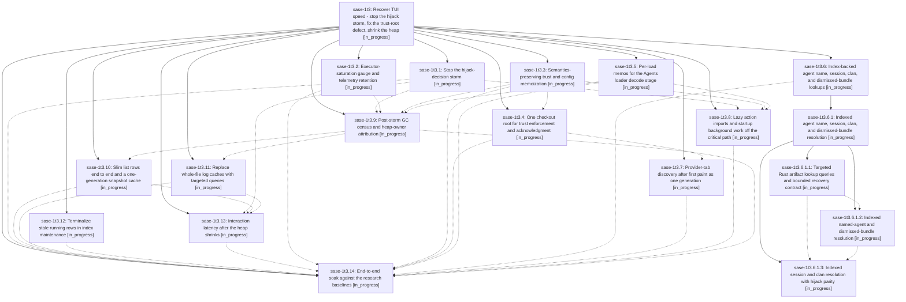

# Bead: sase-1t3 — Recover TUI speed - stop the hijack storm, fix the trust-root defect, shrink the heap

[Bead Pages](../README.md) / sase-1t3

**Status:** ◐ in_progress · **Type:** ▸ plan · **Tier:** epic
**Owner:** `bryanbugyi34@gmail.com` · **Created by:** [bbugyi200.athena.research.62.linker.w0](https://github.com/sase-org/sase--agents/blob/main/sessions/bbugyi200.athena.research.62.linker.w0.md) · **Assignee:** `sase-1t3.land`
**Created:** 2026-11-16 07:57:54 EST
**Plan:** [202611/tui\_storm\_trust\_heap\_recovery.md](https://github.com/sase-org/sase--plans/blob/main/202611/tui_storm_trust_heap_recovery.md)

<!-- sase:links:start -->

## Links

| Relation | Artifact | Why |
| --- | --- | --- |
| implemented-by | [plan:202611/tui_storm_trust_heap_recovery.md][1] | derived from the plan's `bead_id:` frontmatter field |

[1]: https://github.com/sase-org/sase--plans/blob/main/202611/tui_storm_trust_heap_recovery.md

<!-- sase:links:end -->

## Description

`sase tui` reaches a usable Agents list in about 6-7 s instead of about 14 s. Selection changes can no longer start archive scans that fill memory or the default executor. Numbered workspaces inherit their project's trust acknowledgment. Long sessions keep a bounded heap and responsive j/k navigation. Existing telemetry proves each stage.

## Phases

| Bead | Title | Status | Size | Created | Agents | Commits |
|---|---|---|---|---|---:|---:|
| [sase-1t3.1](sase-1t3.1.md) | Stop the hijack-decision storm | ◐ in_progress | medium | 2026-11-16 | 1 | 0 |
| [sase-1t3.10](sase-1t3.10.md) | Slim list rows end to end and a one-generation snapshot cache | ◐ in_progress | large | 2026-11-16 | 1 | 0 |
| [sase-1t3.11](sase-1t3.11.md) | Replace whole-file log caches with targeted queries | ◐ in_progress | large | 2026-11-16 | 1 | 0 |
| [sase-1t3.12](sase-1t3.12.md) | Terminalize stale running rows in index maintenance | ◐ in_progress | large | 2026-11-16 | 1 | 0 |
| [sase-1t3.13](sase-1t3.13.md) | Interaction latency after the heap shrinks | ◐ in_progress | large | 2026-11-16 | 1 | 0 |
| [sase-1t3.14](sase-1t3.14.md) | End-to-end soak against the research baselines | ◐ in_progress | medium | 2026-11-16 | 1 | 0 |
| [sase-1t3.2](sase-1t3.2.md) | Executor-saturation gauge and telemetry retention | ◐ in_progress | small | 2026-11-16 | 1 | 0 |
| [sase-1t3.3](sase-1t3.3.md) | Semantics-preserving trust and config memoization | ◐ in_progress | medium | 2026-11-16 | 1 | 1 |
| [sase-1t3.4](sase-1t3.4.md) | One checkout root for trust enforcement and acknowledgment | ◐ in_progress | medium | 2026-11-16 | 1 | 0 |
| [sase-1t3.5](sase-1t3.5.md) | Per-load memos for the Agents loader decode stage | ◐ in_progress | medium | 2026-11-16 | 1 | 0 |
| [sase-1t3.6](sase-1t3.6.md) | Index-backed agent name, session, clan, and dismissed-bundle lookups | ◐ in_progress | large | 2026-11-16 | 1 | 0 |
| [sase-1t3.7](sase-1t3.7.md) | Provider-tab discovery after first paint as one generation | ◐ in_progress | large | 2026-11-16 | 1 | 0 |
| [sase-1t3.8](sase-1t3.8.md) | Lazy action imports and startup background work off the critical path | ◐ in_progress | large | 2026-11-16 | 1 | 0 |
| [sase-1t3.9](sase-1t3.9.md) | Post-storm GC census and heap-owner attribution | ◐ in_progress | medium | 2026-11-16 | 1 | 0 |

## Lineage

## Agents

| Agent | Bead | Commits |
|---|---|---:|
| [bbugyi200.athena.sase-1t3.1](https://github.com/sase-org/sase--agents/blob/main/agents/bbugyi200.athena.sase-1t3.1/README.md) | [sase-1t3.1](sase-1t3.1.md) | 0 |
| [bbugyi200.athena.sase-1t3.10](https://github.com/sase-org/sase--agents/blob/main/agents/bbugyi200.athena.sase-1t3.10/README.md) | [sase-1t3.10](sase-1t3.10.md) | 0 |
| [bbugyi200.athena.sase-1t3.11](https://github.com/sase-org/sase--agents/blob/main/agents/bbugyi200.athena.sase-1t3.11/README.md) | [sase-1t3.11](sase-1t3.11.md) | 0 |
| [bbugyi200.athena.sase-1t3.12](https://github.com/sase-org/sase--agents/blob/main/sessions/bbugyi200.athena.sase-1t3.12.md) | [sase-1t3.12](sase-1t3.12.md) | 0 |
| [bbugyi200.athena.sase-1t3.13](https://github.com/sase-org/sase--agents/blob/main/agents/bbugyi200.athena.sase-1t3.13/README.md) | [sase-1t3.13](sase-1t3.13.md) | 0 |
| [bbugyi200.athena.sase-1t3.14](https://github.com/sase-org/sase--agents/blob/main/agents/bbugyi200.athena.sase-1t3.14/README.md) | [sase-1t3.14](sase-1t3.14.md) | 0 |
| [bbugyi200.athena.sase-1t3.2](https://github.com/sase-org/sase--agents/blob/main/sessions/bbugyi200.athena.sase-1t3.2.md) | [sase-1t3.2](sase-1t3.2.md) | 0 |
| [bbugyi200.athena.sase-1t3.3](https://github.com/sase-org/sase--agents/blob/main/agents/bbugyi200.athena.sase-1t3.3/README.md) | [sase-1t3.3](sase-1t3.3.md) | 1 |
| [bbugyi200.athena.sase-1t3.4](https://github.com/sase-org/sase--agents/blob/main/agents/bbugyi200.athena.sase-1t3.4/README.md) | [sase-1t3.4](sase-1t3.4.md) | 0 |
| [bbugyi200.athena.sase-1t3.5](https://github.com/sase-org/sase--agents/blob/main/sessions/bbugyi200.athena.sase-1t3.5.md) | [sase-1t3.5](sase-1t3.5.md) | 0 |
| [bbugyi200.athena.sase-1t3.6](https://github.com/sase-org/sase--agents/blob/main/sessions/bbugyi200.athena.sase-1t3.6.md) | [sase-1t3.6](sase-1t3.6.md) | 0 |
| [bbugyi200.athena.sase-1t3.6.1.1](https://github.com/sase-org/sase--agents/blob/main/agents/bbugyi200.athena.sase-1t3.6.1.1/README.md) | [sase-1t3.6.1.1](sase-1t3.6.1.1.md) | 0 |
| [bbugyi200.athena.sase-1t3.6.1.2](https://github.com/sase-org/sase--agents/blob/main/agents/bbugyi200.athena.sase-1t3.6.1.2/README.md) | [sase-1t3.6.1.2](sase-1t3.6.1.2.md) | 0 |
| [bbugyi200.athena.sase-1t3.6.1.3](https://github.com/sase-org/sase--agents/blob/main/agents/bbugyi200.athena.sase-1t3.6.1.3/README.md) | [sase-1t3.6.1.3](sase-1t3.6.1.3.md) | 0 |
| [bbugyi200.athena.sase-1t3.6.1.land](https://github.com/sase-org/sase--agents/blob/main/agents/bbugyi200.athena.sase-1t3.6.1.land/README.md) | [sase-1t3.6.1](sase-1t3.6.1.md) | 0 |
| [bbugyi200.athena.sase-1t3.7](https://github.com/sase-org/sase--agents/blob/main/agents/bbugyi200.athena.sase-1t3.7/README.md) | [sase-1t3.7](sase-1t3.7.md) | 0 |
| [bbugyi200.athena.sase-1t3.8](https://github.com/sase-org/sase--agents/blob/main/agents/bbugyi200.athena.sase-1t3.8/README.md) | [sase-1t3.8](sase-1t3.8.md) | 0 |
| [bbugyi200.athena.sase-1t3.9](https://github.com/sase-org/sase--agents/blob/main/agents/bbugyi200.athena.sase-1t3.9/README.md) | [sase-1t3.9](sase-1t3.9.md) | 0 |
| [bbugyi200.athena.sase-1t3.land](https://github.com/sase-org/sase--agents/blob/main/agents/bbugyi200.athena.sase-1t3.land/README.md) | [sase-1t3](README.md) | 0 |

## Commits

| Repo | Commit | Subject | Bead | Committed |
|---|---|---|---|---|
| sase | [`157ae99`](https://github.com/sase-org/sase/commit/157ae99cf0a70d6af16283a9140c080cbae1df85) | feat(config): memoize trust identity and merged-config fast path | [sase-1t3.3](sase-1t3.3.md) | 2026-11-16 08:32:41 EST |
