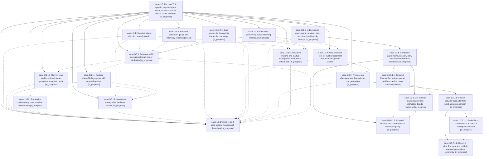

# Bead: sase-1t3 — Recover TUI speed - stop the hijack storm, fix the trust-root defect, shrink the heap

[Bead Pages](../README.md) / sase-1t3

**Status:** ◐ in_progress · **Type:** ▸ plan · **Tier:** epic
**Owner:** `bryanbugyi34@gmail.com` · **Created by:** [bbugyi200.athena.research.62.linker.w0](https://github.com/sase-org/sase--agents/blob/main/sessions/bbugyi200.athena.research.62.linker.w0.md) · **Assignee:** `sase-1t3.land`
**Created:** 2026-11-16 07:57:54 EST
**Plan:** [202611/tui\_storm\_trust\_heap\_recovery.md](https://github.com/sase-org/sase--plans/blob/main/202611/tui_storm_trust_heap_recovery.md)

<!-- sase:links:start -->

## Links

| Relation | Artifact | Why |
| --- | --- | --- |
| implemented-by | [plan:202611/tui_storm_trust_heap_recovery.md][1] | derived from the plan's `bead_id:` frontmatter field |

_Plus 4 automatic references — see [Referenced By](#referenced-by)._

[1]: https://github.com/sase-org/sase--plans/blob/main/202611/tui_storm_trust_heap_recovery.md

<!-- sase:links:end -->

## Description

`sase tui` reaches a usable Agents list in about 6-7 s instead of about 14 s. Selection changes can no longer start archive scans that fill memory or the default executor. Numbered workspaces inherit their project's trust acknowledgment. Long sessions keep a bounded heap and responsive j/k navigation. Existing telemetry proves each stage.

## Notes

[2026-11-16T15:28:39Z · toobig-9u.test_agent_hijack_canary.0] DISCOVERED ISSUE: On a clean checkout at 93273f4a4f1dc3f3ba25f740491837b182ceb76c, just _lint-symvision and sase tool run check both still report unused reset_lower_macros_cache in src/sase/config/local_trust_enforcement.py and reset_project_identity_caches in src/sase/config/local_trust_management.py; check stops before its scoped test lane. The canary tests pass 2/2. These same symbols are named as deleted in phase sase-1t3.4 note #3, so this checkout appears to predate that phase's fix; recheck after the phase changes land.

## Phases

| Bead | Title | Status | Size | Created | Agents | Commits |
|---|---|---|---|---|---:|---:|
| [sase-1t3.1](sase-1t3.1.md) | Stop the hijack-decision storm | ✓ closed | medium | 2026-11-16 | 1 | 1 |
| [sase-1t3.10](sase-1t3.10.md) | Slim list rows end to end and a one-generation snapshot cache | ◐ in_progress | large | 2026-11-16 | 0 | 0 |
| [sase-1t3.11](sase-1t3.11.md) | Replace whole-file log caches with targeted queries | ◐ in_progress | large | 2026-11-16 | 0 | 0 |
| [sase-1t3.12](sase-1t3.12.md) | Terminalize stale running rows in index maintenance | ◐ in_progress | large | 2026-11-16 | 0 | 0 |
| [sase-1t3.13](sase-1t3.13.md) | Interaction latency after the heap shrinks | ◐ in_progress | large | 2026-11-16 | 0 | 0 |
| [sase-1t3.14](sase-1t3.14.md) | End-to-end soak against the research baselines | ◐ in_progress | medium | 2026-11-16 | 0 | 0 |
| [sase-1t3.2](sase-1t3.2.md) | Executor-saturation gauge and telemetry retention | ✓ closed | small | 2026-11-16 | 1 | 1 |
| [sase-1t3.3](sase-1t3.3.md) | Semantics-preserving trust and config memoization | ✓ closed | medium | 2026-11-16 | 1 | 1 |
| [sase-1t3.4](sase-1t3.4.md) | One checkout root for trust enforcement and acknowledgment | ✓ closed | medium | 2026-11-16 | 1 | 1 |
| [sase-1t3.5](sase-1t3.5.md) | Per-load memos for the Agents loader decode stage | ◐ in_progress | medium | 2026-11-16 | 0 | 0 |
| [sase-1t3.6](sase-1t3.6.md) | Index-backed agent name, session, clan, and dismissed-bundle lookups | ◐ in_progress | large | 2026-11-16 | 0 | 0 |
| [sase-1t3.7](sase-1t3.7.md) | Provider-tab discovery after first paint as one generation | ◐ in_progress | large | 2026-11-16 | 0 | 0 |
| [sase-1t3.8](sase-1t3.8.md) | Lazy action imports and startup background work off the critical path | ◐ in_progress | large | 2026-11-16 | 0 | 0 |
| [sase-1t3.9](sase-1t3.9.md) | Post-storm GC census and heap-owner attribution | ◐ in_progress | medium | 2026-11-16 | 0 | 0 |

## Lineage

## Agents

| Agent | Bead | Commits |
|---|---|---:|
| [bbugyi200.athena.sase-1t3.1](https://github.com/sase-org/sase--agents/blob/main/agents/bbugyi200.athena.sase-1t3.1/README.md) | [sase-1t3.1](sase-1t3.1.md) | 1 |
| [bbugyi200.athena.sase-1t3.2](https://github.com/sase-org/sase--agents/blob/main/sessions/bbugyi200.athena.sase-1t3.2.md) | [sase-1t3.2](sase-1t3.2.md) | 1 |
| [bbugyi200.athena.sase-1t3.3](https://github.com/sase-org/sase--agents/blob/main/agents/bbugyi200.athena.sase-1t3.3/README.md) | [sase-1t3.3](sase-1t3.3.md) | 1 |
| [bbugyi200.athena.sase-1t3.4](https://github.com/sase-org/sase--agents/blob/main/sessions/bbugyi200.athena.sase-1t3.4.md) | [sase-1t3.4](sase-1t3.4.md) | 1 |
| [bbugyi200.athena.sase-1t3.6.1.1](https://github.com/sase-org/sase--agents/blob/main/agents/bbugyi200.athena.sase-1t3.6.1.1/README.md) | [sase-1t3.6.1.1](sase-1t3.6.1.1.md) | 2 |
| [bbugyi200.athena.sase-1t3.6.1.2](https://github.com/sase-org/sase--agents/blob/main/agents/bbugyi200.athena.sase-1t3.6.1.2/README.md) | [sase-1t3.6.1.2](sase-1t3.6.1.2.md) | 1 |

## Commits

| Repo | Commit | Subject | Bead | Committed |
|---|---|---|---|---|
| sase | [`157ae99`](https://github.com/sase-org/sase/commit/157ae99cf0a70d6af16283a9140c080cbae1df85) | feat(config): memoize trust identity and merged-config fast path | [sase-1t3.3](sase-1t3.3.md) | 2026-11-16 08:32:41 EST |
| sase | [`c580b68`](https://github.com/sase-org/sase/commit/c580b689c18bace8e59234042fcbe08d9bfe2b23) | feat(ace): add executor saturation gauge and telemetry retention | [sase-1t3.2](sase-1t3.2.md) | 2026-11-16 08:58:50 EST |
| sase | [`75ed2a1`](https://github.com/sase-org/sase/commit/75ed2a12395f17be73302b31081a40f85ee1b50b) | fix(tui): stop the hijack-decision compute storm | [sase-1t3.1](sase-1t3.1.md) | 2026-11-16 09:53:32 EST |
| sase | [`ac19f90`](https://github.com/sase-org/sase/commit/ac19f907ae531b47a40272013e3ef4e74da38d16) | fix(config): key local-command trust on the owning checkout | [sase-1t3.4](sase-1t3.4.md) | 2026-11-16 10:57:37 EST |
| sase-core | [`sase-core@a4b1c84`](https://github.com/sase-org/sase-core/commit/a4b1c8432139f40fd6c926041e3ab2c33c5cff11) | feat(agent-scan): add read-only indexed artifact identity lookups | [sase-1t3.6.1.1](sase-1t3.6.1.1.md) | 2026-11-16 11:11:20 EST |
| sase | [`dc09b5e`](https://github.com/sase-org/sase/commit/dc09b5eba323c0b9ae21400b0e45c70acb7a5dde) | feat(agent-scan): add lookup\_agent\_artifacts facade and schema 38 pin | [sase-1t3.6.1.1](sase-1t3.6.1.1.md) | 2026-11-16 11:12:52 EST |
| sase-core | [`sase-core@8593b14`](https://github.com/sase-org/sase-core/commit/8593b148fd3b00678e21775f414f19c0a99104e4) | feat(agent-archive): project workflow\_name column with name-or-workflow lookup | [sase-1t3.6.1.2](sase-1t3.6.1.2.md) | 2026-11-16 13:14:41 EST |

<!-- sase:referenced-by:start -->

## Referenced By

| Relation | Artifact | Why | Uses |
| --- | --- | --- | ---: |
| read-by | [agent:ef][1] | User asked whether epics sase-1t2 and sase-1t3 conflict | 1 |
| read-by | [agent:sase-1t3.1][2] | Need parent epic decisions and phase list | 1 |
| read-by | [agent:sase-1t3.6.1.1][3] | Need parent phase and grandparent epic DECISIONS for lookup-core | 1 |
| read-by | [agent:toobig-9u.test_agent_hijack_canary.0][4] | Check whether the active trust and config performance epic plausibly owns unused cache-reset symbols in local trust modules | 1 |

[1]: https://github.com/sase-org/sase--agents/blob/main/agents/bbugyi200.athena.ef/README.md
[2]: https://github.com/sase-org/sase--agents/blob/main/sessions/bbugyi200.athena.sase-1t3.1.md
[3]: https://github.com/sase-org/sase--agents/blob/main/agents/bbugyi200.athena.sase-1t3.6.1.1/README.md
[4]: https://github.com/sase-org/sase--agents/blob/main/agents/bbugyi200.athena.toobig-9u.test_agent_hijack_canary.0/README.md

<!-- sase:referenced-by:end -->
