# Bead: sase-1t3 — Recover TUI speed - stop the hijack storm, fix the trust-root defect, shrink the heap

[Bead Pages](../README.md) / sase-1t3

**Status:** ◐ in_progress · **Type:** ▸ plan · **Tier:** epic
**Owner:** `bryanbugyi34@gmail.com` · **Created by:** [bbugyi200.athena.research.62.linker.w0](https://github.com/sase-org/sase--agents/blob/main/sessions/bbugyi200.athena.research.62.linker.w0.md) · **Assignee:** `sase-1t3.land`
**Created:** 2026-11-16 07:57:54 EST
**Plan:** [202611/tui\_storm\_trust\_heap\_recovery.md](https://github.com/sase-org/sase--plans/blob/main/202611/tui_storm_trust_heap_recovery.md)

<!-- sase:links:start -->

## Links

| Relation | Artifact | Why |
| --- | --- | --- |
| implemented-by | [plan:202611/tui_storm_trust_heap_recovery.md][1] | derived from the plan's `bead_id:` frontmatter field |

_Plus 7 automatic references — see [Referenced By](#referenced-by)._

[1]: https://github.com/sase-org/sase--plans/blob/main/202611/tui_storm_trust_heap_recovery.md

<!-- sase:links:end -->

## Description

`sase tui` reaches a usable Agents list in about 6-7 s instead of about 14 s. Selection changes can no longer start archive scans that fill memory or the default executor. Numbered workspaces inherit their project's trust acknowledgment. Long sessions keep a bounded heap and responsive j/k navigation. Existing telemetry proves each stage.

## Notes

[2026-11-16T15:28:39Z · toobig-9u.test_agent_hijack_canary.0] DISCOVERED ISSUE: On a clean checkout at 93273f4a4f1dc3f3ba25f740491837b182ceb76c, just _lint-symvision and sase tool run check both still report unused reset_lower_macros_cache in src/sase/config/local_trust_enforcement.py and reset_project_identity_caches in src/sase/config/local_trust_management.py; check stops before its scoped test lane. The canary tests pass 2/2. These same symbols are named as deleted in phase sase-1t3.4 note #3, so this checkout appears to predate that phase's fix; recheck after the phase changes land.

[2026-11-16T23:51:22Z · toobig-9v.local_trust_management.0] DISCOVERED ISSUE: On 2026-11-16, during an unrelated local trust split, standalone mypy and the requested sase tool run check both failed on untouched TUI files. Errors: src/sase/ace/tui/actions/_state_init_late.py has four [misc] errors at lines 381, 382, 384, and 385 for type declarations in assignments to non-self attributes; src/sase/ace/tui/actions/artifacts_navigation.py:548 assigns str to a variable inferred as None. The check records both as NEW and stops before scoped tests. The files map directly to active phase 1t3.8 (late action initialization/lazy imports) and phase 1t3.7 (provider-tab navigation), respectively. The trust split touches neither file. Please triage against those active phase trees.

[2026-11-17T08:31:00Z · sase-1t3.6.1.land--1] DISCOVERED ISSUE: Required check ToolRun a4ac7f1adcae20a048906fdb9a55ee9e on 2026-11-17 failed tests/ace/tui/test_app_import_budget.py::test_tui_app_import_stays_under_startup_budget at 12,340,057 normalized source bytes versus the 12,162,484 cap. Running .venv/bin/python tools/tui_import_closure --diff 42f5f6fc944935ec550d0a420921dcd0eecf5611 measured the base at 12,342,089 bytes and this integrated lookup patch at 12,340,057: zero module changes and a 2,032-byte decrease. The residual overage is therefore present at the rebase base and this patch does not cause it. The existing startup phase 1t3.8 already owns the footprint work; this corroborates that report, and the closed module-count task sase-1ic is not reopened.

[2026-11-17T17:17:07Z · sase-1t3.9--2] Post-storm GC census ranked heap owners (sase-1t3.9 closed). Diet phases sase-1t3.10 (slim-list-rows) and sase-1t3.11 (bounded-log-caches) should use this list. Full method/PIDs/dirs live on sase-1t3.9. Cross-ref on sase-1sl.4. tui_perf.md not edited (DECISIONS tui_perf_memory=no).

2h sample: instance 39893a35 PID 1706747, census index 11 nearest 7200s (uptime 6937s / 115.6 min, RSS 3.652 GB, allocated_blocks 13,042,356, survivors 1,748,928 / 271.60 MB). Ranking holds at census 12 (7539s) and last census 13 (8141s / 135.7 min). 10 min sample: instance d5ac2b89 PID 4050454 census index 1 @ 683s (RSS 2.337 GB). Mid-soak support: instance 2e14b925 PID 2450990 last census ~65 min (RSS 3.220 GB).

RSS / GC / executor (39893a35, 28 heartbeats, 135.7 min): RSS 1.416–3.652 GB (last 3.012 GB); allocated_blocks 8,086,536–15,536,694; gen-2 n=131 p50=1.285s p95=2.030s max=2.470s; default_executor workers=32 threads=16 queue=0 saturated=false every heartbeat.

Ranked surviving owners at ~2h (count / shallow bytes), with 10 min → 2h:

1. builtins.dict — 84,054 / 25.7 MB @10m (d5ac2b89) → 378,739 / 128.3 MB @2h (39893a35). Dominant byte owner. Slim nested wire/list-row payloads (sase-1t3.10).
2. builtins.list — 267,581 / 26.8 MB → 684,723 / 78.9 MB. Same diet.
3. pathlib.PosixPath — 96,071 / 10.0 MB → 277,559 / 28.9 MB. Filesystem walks feeding log/index caches (sase-1t3.11).
4. builtins.tuple — 16,338 / 2.7 MB → 56,285 / 9.4 MB. Nested row/cache keys.
5. pathlib._os.DirEntryInfo — 72,515 / 4.6 MB → 85,957 / 5.5 MB. Same walks as PosixPath.
6. sase.core.artifact_file_types.ArtifactFile — 47,466 / 2.28 MB → 47,658 / 2.29 MB (stable after first load; matches _artifact_file_index_cache.row_total 47,460 → 47,625). Anchor: src/sase/core/artifact_file_types.py, src/sase/core/artifact_file_explicit.py. First sase-1t3.11 target.
7. sase.notifications.models.NotificationPlusOne — 22,368 / 1.07 MB → 28,547 / 1.37 MB (grows over idle soak). Anchor: src/sase/notifications/models.py. Not in 1t3.10/1t3.11 scope.
8. sase.memory._read_log_models.MemoryReadEvent — 6,262 / 0.30 MB on d5ac2b89 (bob-cli cache 6,260) vs 23,457 / 1.13 MB on 39893a35 (sase+tailnet cache 23,457; 1:1 with live objects). Anchor: src/sase/memory/_read_log_models.py, src/sase/ace/tui/memory_reads.py. sase-1t3.11.
9. sase.agents.catalog._query.AgentCatalogLinkFacets — 17,832 / 1.00 MB → 17,889 / 1.00 MB (stable after first paint). Anchor: src/sase/agents/catalog/_query.py. sase-1t3.10.
10. sase.core.bead_touch_index_models.BeadTouch — 7,332 / 0.35 MB on d5ac2b89 vs 16,307 / 0.78 MB on 39893a35 (stable on that soak; _bead_touches_snapshot_cache.event_total=0 so these are not in that cache). Anchor: src/sase/core/bead_touch_index_models.py, src/sase/ace/tui/_bead_touches_loader.py. sase-1t3.11 must find the real materializer.
11. sase.skills.use_log.SkillUseEvent — 11,402 / 0.55 MB @2h ≈ _skill_uses_snapshot_cache 11,397. Anchor: src/sase/skills/use_log.py, src/sase/ace/tui/skill_uses.py. Whole-file cache, not named in the 1t3.11 phase text.
12. textual.cache.FIFOCache — soak-dependent growth: 45,933 / 2.94 MB @10m d5ac2b89; 91,405 / 5.85 MB @65m 2e14b925; only 7,709 / 0.49 MB @2h 39893a35 (200x50 idle viewport). Still a sase-1t3.10 render-cache owner. Also rich.segment.Segment / textual.strip.Strip.

survivor_watch at ~2h (39893a35 census 11): Agent 2,816 (oscillates 900–2,800; src/sase/ace/tui/models/agent.py); AceRowHandle 4,044 (oscillates 2,050–4,221; src/sase/ace/tui/provider_contract.py); AgentCatalogLinkFacets 17,889; ArtifactReadEvent 146 live vs cache 27,587 (src/sase/artifact_read_log.py, src/sase/ace/tui/artifact_reads.py; on 2e14b925 live objects matched cache at 13,584); AgentArtifactRecordWire watch path sase.core.agent_scan_wire.AgentArtifactRecordWire always 0; live type sase.core.agent_scan_wire_records.AgentArtifactRecordWire is transient 0–1,217 (defined src/sase/core/agent_scan_wire_records.py, re-exported src/sase/core/agent_scan_wire.py); ArtifactFile 47,658; BeadTouch 16,307; MemoryReadEvent 23,457; Notification 8,454; NotificationPlusOne 28,547; FIFOCache 7,709.

known_caches at ~2h: ARTIFACT_SNAPSHOT_CACHE entries=8/max=8 record_total=812 (src/sase/ace/tui/models/_agent_loader_artifact_cache.py) — cap at one live generation in sase-1t3.10; _artifact_file_index_cache rows=47,625; _artifact_reads_snapshot_cache events=27,587 (sase 27,441 + tailnet 146); _memory_reads_snapshot_cache events=23,457; _bead_touches_snapshot_cache events=0; _glossary_reads_snapshot_cache 357; _skill_uses_snapshot_cache 11,397.

sase-1t3.10 order: slim list DTO (dict/list/tuple + AgentCatalogLinkFacets), drop wire snapshots after Agent construction (Agent / AceRowHandle already bounded; records-module AgentArtifactRecordWire is not a chronic survivor), cap ARTIFACT_SNAPSHOT_CACHE at one generation, treat FIFOCache as a growth owner when the viewport actually paints.

sase-1t3.11 census order: ArtifactFile index (stable 47.5k), MemoryReadEvent cache (1:1 live), BeadTouch (16k live, cache empty), PosixPath/DirEntryInfo walks, ArtifactReadEvent snapshot cache (27.6k events, few live objects on this soak), then SkillUseEvent if that phase takes whole-file log caches beyond the named set.

## Phases

| Bead | Title | Status | Size | Created | Agents | Commits |
|---|---|---|---|---|---:|---:|
| [sase-1t3.1](sase-1t3.1.md) | Stop the hijack-decision storm | ✓ closed | medium | 2026-11-16 | 1 | 1 |
| [sase-1t3.10](sase-1t3.10.md) | Slim list rows end to end and a one-generation snapshot cache | ◐ in_progress | large | 2026-11-16 | 1 | 0 |
| [sase-1t3.11](sase-1t3.11.md) | Replace whole-file log caches with targeted queries | ◐ in_progress | large | 2026-11-16 | 1 | 0 |
| [sase-1t3.12](sase-1t3.12.md) | Terminalize stale running rows in index maintenance | ✓ closed | large | 2026-11-16 | 1 | 2 |
| [sase-1t3.13](sase-1t3.13.md) | Interaction latency after the heap shrinks | ◐ in_progress | large | 2026-11-16 | 1 | 0 |
| [sase-1t3.14](sase-1t3.14.md) | End-to-end soak against the research baselines | ◐ in_progress | medium | 2026-11-16 | 1 | 0 |
| [sase-1t3.2](sase-1t3.2.md) | Executor-saturation gauge and telemetry retention | ✓ closed | small | 2026-11-16 | 1 | 1 |
| [sase-1t3.3](sase-1t3.3.md) | Semantics-preserving trust and config memoization | ✓ closed | medium | 2026-11-16 | 1 | 1 |
| [sase-1t3.4](sase-1t3.4.md) | One checkout root for trust enforcement and acknowledgment | ✓ closed | medium | 2026-11-16 | 1 | 1 |
| [sase-1t3.5](sase-1t3.5.md) | Per-load memos for the Agents loader decode stage | ✓ closed | medium | 2026-11-16 | 1 | 1 |
| [sase-1t3.6](sase-1t3.6.md) | Index-backed agent name, session, clan, and dismissed-bundle lookups | ✓ closed | large | 2026-11-16 | 1 | 0 |
| [sase-1t3.7](sase-1t3.7.md) | Provider-tab discovery after first paint as one generation | ✓ closed | large | 2026-11-16 | 1 | 0 |
| [sase-1t3.8](sase-1t3.8.md) | Lazy action imports and startup background work off the critical path | ✓ closed | large | 2026-11-16 | 1 | 1 |
| [sase-1t3.9](sase-1t3.9.md) | Post-storm GC census and heap-owner attribution | ✓ closed | medium | 2026-11-16 | 1 | 1 |

## Lineage

```mermaid
flowchart TD
    n0["sase-1t3: Recover TUI speed - stop the hijack storm, fix the trust-root defect, shrink the heap [in_progress]"]
    n1["sase-1t3.1: Stop the hijack-decision storm [closed]"]
    n2["sase-1t3.10: Slim list rows end to end and a one-generation snapshot cache [in_progress]"]
    n3["sase-1t3.10.1: Slim agent list rows and bound retained snapshots [in_progress]"]
    n4["sase-1t3.10.1.1: Add compact list contracts and Rust bindings [closed]"]
    n5["sase-1t3.10.1.2: Decode compact rows and construct ordinary agents [closed]"]
    n6["sase-1t3.10.1.3: Consume slim rows throughout TUI loading [in_progress]"]
    n7["sase-1t3.10.1.4: Bound snapshot and detail retention and measure the result [in_progress]"]
    n8["sase-1t3.11: Replace whole-file log caches with targeted queries [in_progress]"]
    n9["sase-1t3.11.1: Bound retained log objects with targeted backend queries [in_progress]"]
    n10["sase-1t3.11.1.1: Stream artifact-file queries before Python conversion [closed]"]
    n11["sase-1t3.11.1.2: Query memory-read history for the selected context [closed]"]
    n12["sase-1t3.11.1.3: Restrict touch queries to exact actors and session aliases [closed]"]
    n13["sase-1t3.11.1.4: Reuse targeted audit queries for artifact-read history [closed]"]
    n14["sase-1t3.11.1.5: Collect stranded facts and titles from one targeted snapshot [closed]"]
    n15["sase-1t3.11.1.6: Verify combined heap retention and query costs [in_progress]"]
    n16["sase-1t3.12: Terminalize stale running rows in index maintenance [closed]"]
    n17["sase-1t3.13: Interaction latency after the heap shrinks [in_progress]"]
    n18["sase-1t3.14: End-to-end soak against the research baselines [in_progress]"]
    n19["sase-1t3.2: Executor-saturation gauge and telemetry retention [closed]"]
    n20["sase-1t3.3: Semantics-preserving trust and config memoization [closed]"]
    n21["sase-1t3.4: One checkout root for trust enforcement and acknowledgment [closed]"]
    n22["sase-1t3.5: Per-load memos for the Agents loader decode stage [closed]"]
    n23["sase-1t3.6: Index-backed agent name, session, clan, and dismissed-bundle lookups [closed]"]
    n24["sase-1t3.6.1: Indexed agent name, session, clan, and dismissed-bundle resolution [closed]"]
    n25["sase-1t3.6.1.1: Targeted Rust artifact lookup queries and bounded recovery contract [closed]"]
    n26["sase-1t3.6.1.2: Indexed named-agent and dismissed-bundle resolution [closed]"]
    n27["sase-1t3.6.1.3: Indexed session and clan resolution with hijack parity [closed]"]
    n28["sase-1t3.7: Provider-tab discovery after first paint as one generation [closed]"]
    n29["sase-1t3.7.1: Publish provider tabs after first paint as one generation [closed]"]
    n30["sase-1t3.7.1.1: Pin Artifacts consumers to an explicit descriptor snapshot [closed]"]
    n31["sase-1t3.7.1.2: Discover after first paint and publish mounted generations coherently [closed]"]
    n32["sase-1t3.8: Lazy action imports and startup background work off the critical path [closed]"]
    n33["sase-1t3.9: Post-storm GC census and heap-owner attribution [closed]"]
    n0 --> n1
    n0 --> n2
    n2 --> n3
    n3 --> n4
    n3 --> n5
    n3 --> n6
    n3 --> n7
    n0 --> n8
    n8 --> n9
    n9 --> n10
    n9 --> n11
    n9 --> n12
    n9 --> n13
    n9 --> n14
    n9 --> n15
    n0 --> n16
    n0 --> n17
    n0 --> n18
    n0 --> n19
    n0 --> n20
    n0 --> n21
    n0 --> n22
    n0 --> n23
    n23 --> n24
    n24 --> n25
    n24 --> n26
    n24 --> n27
    n0 --> n28
    n28 --> n29
    n29 --> n30
    n29 --> n31
    n0 --> n32
    n0 --> n33
    n1 -.-> n17
    n1 -.-> n18
    n1 -.-> n32
    n1 -.-> n33
    n2 -.-> n17
    n2 -.-> n18
    n4 -.-> n5
    n5 -.-> n6
    n6 -.-> n7
    n8 -.-> n17
    n8 -.-> n18
    n10 -.-> n11
    n11 -.-> n12
    n12 -.-> n13
    n13 -.-> n14
    n14 -.-> n15
    n16 -.-> n18
    n17 -.-> n18
    n19 -.-> n18
    n19 -.-> n33
    n20 -.-> n18
    n20 -.-> n21
    n20 -.-> n32
    n20 -.-> n33
    n21 -.-> n18
    n21 -.-> n28
    n22 -.-> n18
    n22 -.-> n32
    n22 -.-> n33
    n23 -.-> n18
    n25 -.-> n26
    n25 -.-> n27
    n26 -.-> n27
    n28 -.-> n18
    n30 -.-> n31
    n32 -.-> n18
    n33 -.-> n2
    n33 -.-> n8
    n33 -.-> n18
```

## Agents

| Agent | Bead | Commits |
|---|---|---:|
| [bbugyi200.athena.sase-1t3.1](https://github.com/sase-org/sase--agents/blob/main/agents/bbugyi200.athena.sase-1t3.1/README.md) | [sase-1t3.1](sase-1t3.1.md) | 1 |
| [bbugyi200.athena.sase-1t3.10](https://github.com/sase-org/sase--agents/blob/main/sessions/bbugyi200.athena.sase-1t3.10.md) | [sase-1t3.10](sase-1t3.10.md) | 0 |
| [bbugyi200.athena.sase-1t3.10.1.1](https://github.com/sase-org/sase--agents/blob/main/agents/bbugyi200.athena.sase-1t3.10.1.1/README.md) | [sase-1t3.10.1.1](sase-1t3.10.1.1.md) | 1 |
| [bbugyi200.athena.sase-1t3.10.1.2](https://github.com/sase-org/sase--agents/blob/main/agents/bbugyi200.athena.sase-1t3.10.1.2/README.md) | [sase-1t3.10.1.2](sase-1t3.10.1.2.md) | 1 |
| [bbugyi200.athena.sase-1t3.10.1.3](https://github.com/sase-org/sase--agents/blob/main/sessions/bbugyi200.athena.sase-1t3.10.1.3.md) | [sase-1t3.10.1.3](sase-1t3.10.1.3.md) | 1 |
| [bbugyi200.athena.sase-1t3.10.1.4](https://github.com/sase-org/sase--agents/blob/main/agents/bbugyi200.athena.sase-1t3.10.1.4/README.md) | [sase-1t3.10.1.4](sase-1t3.10.1.4.md) | 0 |
| [bbugyi200.athena.sase-1t3.10.1.land](https://github.com/sase-org/sase--agents/blob/main/agents/bbugyi200.athena.sase-1t3.10.1.land/README.md) | [sase-1t3.10.1](sase-1t3.10.1.md) | 0 |
| [bbugyi200.athena.sase-1t3.11](https://github.com/sase-org/sase--agents/blob/main/sessions/bbugyi200.athena.sase-1t3.11.md) | [sase-1t3.11](sase-1t3.11.md) | 0 |
| [bbugyi200.athena.sase-1t3.11.1.1](https://github.com/sase-org/sase--agents/blob/main/agents/bbugyi200.athena.sase-1t3.11.1.1/README.md) | [sase-1t3.11.1.1](sase-1t3.11.1.1.md) | 2 |
| [bbugyi200.athena.sase-1t3.11.1.2](https://github.com/sase-org/sase--agents/blob/main/sessions/bbugyi200.athena.sase-1t3.11.1.2.md) | [sase-1t3.11.1.2](sase-1t3.11.1.2.md) | 3 |
| [bbugyi200.athena.sase-1t3.11.1.3](https://github.com/sase-org/sase--agents/blob/main/agents/bbugyi200.athena.sase-1t3.11.1.3/README.md) | [sase-1t3.11.1.3](sase-1t3.11.1.3.md) | 2 |
| [bbugyi200.athena.sase-1t3.11.1.4](https://github.com/sase-org/sase--agents/blob/main/agents/bbugyi200.athena.sase-1t3.11.1.4/README.md) | [sase-1t3.11.1.4](sase-1t3.11.1.4.md) | 2 |
| [bbugyi200.athena.sase-1t3.11.1.5](https://github.com/sase-org/sase--agents/blob/main/agents/bbugyi200.athena.sase-1t3.11.1.5/README.md) | [sase-1t3.11.1.5](sase-1t3.11.1.5.md) | 2 |
| [bbugyi200.athena.sase-1t3.11.1.6](https://github.com/sase-org/sase--agents/blob/main/agents/bbugyi200.athena.sase-1t3.11.1.6/README.md) | [sase-1t3.11.1.6](sase-1t3.11.1.6.md) | 0 |
| [bbugyi200.athena.sase-1t3.11.1.land](https://github.com/sase-org/sase--agents/blob/main/agents/bbugyi200.athena.sase-1t3.11.1.land/README.md) | [sase-1t3.11.1](sase-1t3.11.1.md) | 0 |
| [bbugyi200.athena.sase-1t3.12](https://github.com/sase-org/sase--agents/blob/main/sessions/bbugyi200.athena.sase-1t3.12.md) | [sase-1t3.12](sase-1t3.12.md) | 2 |
| [bbugyi200.athena.sase-1t3.13](https://github.com/sase-org/sase--agents/blob/main/agents/bbugyi200.athena.sase-1t3.13/README.md) | [sase-1t3.13](sase-1t3.13.md) | 0 |
| [bbugyi200.athena.sase-1t3.14](https://github.com/sase-org/sase--agents/blob/main/agents/bbugyi200.athena.sase-1t3.14/README.md) | [sase-1t3.14](sase-1t3.14.md) | 0 |
| [bbugyi200.athena.sase-1t3.2](https://github.com/sase-org/sase--agents/blob/main/sessions/bbugyi200.athena.sase-1t3.2.md) | [sase-1t3.2](sase-1t3.2.md) | 1 |
| [bbugyi200.athena.sase-1t3.3](https://github.com/sase-org/sase--agents/blob/main/agents/bbugyi200.athena.sase-1t3.3/README.md) | [sase-1t3.3](sase-1t3.3.md) | 1 |
| [bbugyi200.athena.sase-1t3.4](https://github.com/sase-org/sase--agents/blob/main/sessions/bbugyi200.athena.sase-1t3.4.md) | [sase-1t3.4](sase-1t3.4.md) | 1 |
| [bbugyi200.athena.sase-1t3.5](https://github.com/sase-org/sase--agents/blob/main/sessions/bbugyi200.athena.sase-1t3.5.md) | [sase-1t3.5](sase-1t3.5.md) | 1 |
| [bbugyi200.athena.sase-1t3.6](https://github.com/sase-org/sase--agents/blob/main/sessions/bbugyi200.athena.sase-1t3.6.md) | [sase-1t3.6](sase-1t3.6.md) | 0 |
| [bbugyi200.athena.sase-1t3.6.1.1](https://github.com/sase-org/sase--agents/blob/main/agents/bbugyi200.athena.sase-1t3.6.1.1/README.md) | [sase-1t3.6.1.1](sase-1t3.6.1.1.md) | 2 |
| [bbugyi200.athena.sase-1t3.6.1.2](https://github.com/sase-org/sase--agents/blob/main/agents/bbugyi200.athena.sase-1t3.6.1.2/README.md) | [sase-1t3.6.1.2](sase-1t3.6.1.2.md) | 2 |
| [bbugyi200.athena.sase-1t3.6.1.3](https://github.com/sase-org/sase--agents/blob/main/sessions/bbugyi200.athena.sase-1t3.6.1.3.md) | [sase-1t3.6.1.3](sase-1t3.6.1.3.md) | 2 |
| [bbugyi200.athena.sase-1t3.6.1.land](https://github.com/sase-org/sase--agents/blob/main/agents/bbugyi200.athena.sase-1t3.6.1.land/README.md) | [sase-1t3.6.1](sase-1t3.6.1.md) | 3 |
| [bbugyi200.athena.sase-1t3.7](https://github.com/sase-org/sase--agents/blob/main/sessions/bbugyi200.athena.sase-1t3.7.md) | [sase-1t3.7](sase-1t3.7.md) | 0 |
| [bbugyi200.athena.sase-1t3.7.1.1](https://github.com/sase-org/sase--agents/blob/main/sessions/bbugyi200.athena.sase-1t3.7.1.1.md) | [sase-1t3.7.1.1](sase-1t3.7.1.1.md) | 2 |
| [bbugyi200.athena.sase-1t3.7.1.2](https://github.com/sase-org/sase--agents/blob/main/sessions/bbugyi200.athena.sase-1t3.7.1.2.md) | [sase-1t3.7.1.2](sase-1t3.7.1.2.md) | 1 |
| [bbugyi200.athena.sase-1t3.7.1.land](https://github.com/sase-org/sase--agents/blob/main/sessions/bbugyi200.athena.sase-1t3.7.1.land.md) | [sase-1t3.7.1](sase-1t3.7.1.md) | 2 |
| [bbugyi200.athena.sase-1t3.8](https://github.com/sase-org/sase--agents/blob/main/sessions/bbugyi200.athena.sase-1t3.8.md) | [sase-1t3.8](sase-1t3.8.md) | 1 |
| [bbugyi200.athena.sase-1t3.9](https://github.com/sase-org/sase--agents/blob/main/sessions/bbugyi200.athena.sase-1t3.9.md) | [sase-1t3.9](sase-1t3.9.md) | 1 |
| [bbugyi200.athena.sase-1t3.land](https://github.com/sase-org/sase--agents/blob/main/agents/bbugyi200.athena.sase-1t3.land/README.md) | [sase-1t3](README.md) | 0 |

## Commits

| Repo | Commit | Subject | Bead | Committed |
|---|---|---|---|---|
| sase | [`157ae99`](https://github.com/sase-org/sase/commit/157ae99cf0a70d6af16283a9140c080cbae1df85) | feat(config): memoize trust identity and merged-config fast path | [sase-1t3.3](sase-1t3.3.md) | 2026-11-16 08:32:41 EST |
| sase | [`c580b68`](https://github.com/sase-org/sase/commit/c580b689c18bace8e59234042fcbe08d9bfe2b23) | feat(ace): add executor saturation gauge and telemetry retention | [sase-1t3.2](sase-1t3.2.md) | 2026-11-16 08:58:50 EST |
| sase | [`75ed2a1`](https://github.com/sase-org/sase/commit/75ed2a12395f17be73302b31081a40f85ee1b50b) | fix(tui): stop the hijack-decision compute storm | [sase-1t3.1](sase-1t3.1.md) | 2026-11-16 09:53:32 EST |
| sase | [`ac19f90`](https://github.com/sase-org/sase/commit/ac19f907ae531b47a40272013e3ef4e74da38d16) | fix(config): key local-command trust on the owning checkout | [sase-1t3.4](sase-1t3.4.md) | 2026-11-16 10:57:37 EST |
| sase-core | [`sase-core@a4b1c84`](https://github.com/sase-org/sase-core/commit/a4b1c8432139f40fd6c926041e3ab2c33c5cff11) | feat(agent-scan): add read-only indexed artifact identity lookups | [sase-1t3.6.1.1](sase-1t3.6.1.1.md) | 2026-11-16 11:11:20 EST |
| sase | [`dc09b5e`](https://github.com/sase-org/sase/commit/dc09b5eba323c0b9ae21400b0e45c70acb7a5dde) | feat(agent-scan): add lookup\_agent\_artifacts facade and schema 38 pin | [sase-1t3.6.1.1](sase-1t3.6.1.1.md) | 2026-11-16 11:12:52 EST |
| sase-core | [`sase-core@8593b14`](https://github.com/sase-org/sase-core/commit/8593b148fd3b00678e21775f414f19c0a99104e4) | feat(agent-archive): project workflow\_name column with name-or-workflow lookup | [sase-1t3.6.1.2](sase-1t3.6.1.2.md) | 2026-11-16 13:14:41 EST |
| sase | [`e1d81ee`](https://github.com/sase-org/sase/commit/e1d81ee6c6f2adc9c99819764ed7fa8740443f63) | feat(agent-names): indexed lookup via lookup\_agent\_artifacts with workflow-name ranking | [sase-1t3.6.1.2](sase-1t3.6.1.2.md) | 2026-11-16 13:15:57 EST |
| sase-core | [`sase-core@969096d`](https://github.com/sase-org/sase-core/commit/969096d095350a73ce38d5ee4f90b62c2bbe420f) | feat(agent-scan): terminalize stale running index rows with lifecycle witnesses | [sase-1t3.12](sase-1t3.12.md) | 2026-11-16 13:22:55 EST |
| sase | [`f8c2763`](https://github.com/sase-org/sase/commit/f8c2763ae38fc3bb67afed60d8356b346563b5ec) | feat(agent-scan): surface terminalization diagnostics on the index update wire | [sase-1t3.12](sase-1t3.12.md) | 2026-11-16 13:24:31 EST |
| sase | [`fadbfdc`](https://github.com/sase-org/sase/commit/fadbfdc497dc98b2a17a0250b64c43a83da93a85) | feat(ace): memoize per-load agent loader work | [sase-1t3.5](sase-1t3.5.md) | 2026-11-16 15:35:18 EST |
| sase-core | [`sase-core@a2abeb1`](https://github.com/sase-org/sase-core/commit/a2abeb1e1b1905780bcd554f55989114c3995292) | fix(agent-archive): compile corpus against current store schema | [sase-1t3.7.1.1](sase-1t3.7.1.1.md) | 2026-11-16 16:31:40 EST |
| sase | [`1bd8552`](https://github.com/sase-org/sase/commit/1bd855256e1b8c00917caa113f7a0aadb4a467ea) | feat(ace): pin Artifacts consumers to a descriptor snapshot | [sase-1t3.7.1.1](sase-1t3.7.1.1.md) | 2026-11-16 16:33:04 EST |
| sase | [`7c68d18`](https://github.com/sase-org/sase/commit/7c68d1860cb6fa8b94a43cc77c8ce7672f90170e) | feat(artifacts): publish provider tabs after first paint as one coherent generation | [sase-1t3.7.1.2](sase-1t3.7.1.2.md) | 2026-11-16 17:45:49 EST |
| sase | [`f8fc0bb`](https://github.com/sase-org/sase/commit/f8fc0bbf855290c9d9e04ba5f6d55a1cbdc8a7ba) | fix(ace): finish coherent provider-tab publication | [sase-1t3.7.1](sase-1t3.7.1.md) | 2026-11-16 20:34:42 EST |
| sase--plans | [`sase--plans@f7a5604`](https://github.com/sase-org/sase--plans/commit/f7a56045db1ca8a5398c6bd609a570fe1df9b327) | docs(plans): mark provider-tab generation and finish tale done | [sase-1t3.7.1](sase-1t3.7.1.md) | 2026-11-16 20:36:02 EST |
| sase-core | [`sase-core@b9f33b0`](https://github.com/sase-org/sase-core/commit/b9f33b02caa17bfbb72ed504375b03680890210a) | feat(agent-scan): select indexed session and clan generations | [sase-1t3.6.1.3](sase-1t3.6.1.3.md) | 2026-11-16 23:44:37 EST |
| sase | [`7c514e2`](https://github.com/sase-org/sase/commit/7c514e2f8ee94a289fd5dbd10fbf7bafc4602bc9) | feat(agents): resolve sessions and clans through indexed core queries | [sase-1t3.6.1.3](sase-1t3.6.1.3.md) | 2026-11-16 23:45:57 EST |
| sase-core | [`sase-core@d201086`](https://github.com/sase-org/sase-core/commit/d20108657804cfc257342b0bfb4617ea8bc61a0f) | feat(agent-scan): add bounded named lookup selection | [sase-1t3.6.1](sase-1t3.6.1.md) | 2026-11-17 02:40:16 EST |
| sase | [`824fc24`](https://github.com/sase-org/sase/commit/824fc2445e33499872674f4a26fb4ad9bc672a34) | feat(agent-lookup): land indexed lookup resolution | [sase-1t3.6.1](sase-1t3.6.1.md) | 2026-11-17 03:35:12 EST |
| sase--plans | [`sase--plans@4b2ef58`](https://github.com/sase-org/sase--plans/commit/4b2ef58f10bd8b5d785c37c07275bfc8e35458bb) | chore(plans): mark indexed agent lookup epic and landing tale done | [sase-1t3.6.1](sase-1t3.6.1.md) | 2026-11-17 04:06:02 EST |
| sase | [`10c55db`](https://github.com/sase-org/sase/commit/10c55dbe3022514fd2bf0ec8af90948e3560431b) | perf(ace): keep startup off the agents-action and AXE snapshot path | [sase-1t3.8](sase-1t3.8.md) | 2026-11-17 07:25:58 EST |
| sase | [`4adc535`](https://github.com/sase-org/sase/commit/4adc535e273922761deddae398eedd2005015145) | feat(tui): attribute post-storm heap owners in the GC census | [sase-1t3.9](sase-1t3.9.md) | 2026-11-17 08:04:32 EST |
| sase-core | [`sase-core@8cedd45`](https://github.com/sase-org/sase-core/commit/8cedd45d2e83c901daf23e475407bfee4f7450bd) | feat: add compact agent-list wire contracts and PyO3 bindings | [sase-1t3.10.1.1](sase-1t3.10.1.1.md) | 2026-11-17 13:49:50 EST |
| sase-core | [`sase-core@19b89ac`](https://github.com/sase-org/sase-core/commit/19b89ac9dd45fe27546e600926915a88e4dcd27f) | feat(artifact-file): add targeted association query over JSONL index | [sase-1t3.11.1.1](sase-1t3.11.1.1.md) | 2026-11-17 14:34:57 EST |
| sase | [`8a64510`](https://github.com/sase-org/sase/commit/8a6451068e2be0c4bc407484b7c43708adbd289f) | feat(artifact-file): query associations instead of caching the full index | [sase-1t3.11.1.1](sase-1t3.11.1.1.md) | 2026-11-17 14:37:11 EST |
| sase-core | [`sase-core@c5e60d7`](https://github.com/sase-org/sase-core/commit/c5e60d78575b50b8eefd1b2881e6fac2b8768f55) | feat(audit-query): add targeted memory audit query over JSONL | [sase-1t3.11.1.2](sase-1t3.11.1.2.md) | 2026-11-17 15:37:19 EST |
| sase | [`1c626f3`](https://github.com/sase-org/sase/commit/1c626f39e5a40ede6de4c7d60082f1e46d193ecd) | feat(memory-reads): query memory audit log with targeted Rust backend | [sase-1t3.11.1.2](sase-1t3.11.1.2.md) | 2026-11-17 15:39:07 EST |
| sase | [`be6adc2`](https://github.com/sase-org/sase/commit/be6adc20d0926f49055094192a1a36f08356f029) | feat(agent-scan): add compact scalar-row list adapters with parity and guards | [sase-1t3.10.1.2](sase-1t3.10.1.2.md) | 2026-11-17 15:47:30 EST |
| sase | [`cd0b9c5`](https://github.com/sase-org/sase/commit/cd0b9c52733af177af29cadf61c6cde474b6340c) | fix(memory-reads): privatize audit row per symvision unused-public hierarchy | [sase-1t3.11.1.2](sase-1t3.11.1.2.md) | 2026-11-17 17:23:59 EST |
| sase | [`8fa9c1a`](https://github.com/sase-org/sase/commit/8fa9c1ad8bdea0abd8364a0cc65129c34e0695e3) | fix(tui): repair workflow-list-cutover regressions found by full-suite monitor | [sase-1t3.10.1.3](sase-1t3.10.1.3.md) | 2026-11-17 19:02:03 EST |
| sase-core | [`sase-core@9f9341e`](https://github.com/sase-org/sase-core/commit/9f9341e55169216ecb63ab34e0bd384ff32b4126) | feat(bead): add member-targeted touch index query with streaming views fold | [sase-1t3.11.1.3](sase-1t3.11.1.3.md) | 2026-11-17 20:00:08 EST |
| sase | [`4894d41`](https://github.com/sase-org/sase/commit/4894d4199101499cf69fa519881a909fb2825217) | feat(bead): route touch and legacy view queries through targeted Rust member queries | [sase-1t3.11.1.3](sase-1t3.11.1.3.md) | 2026-11-17 20:02:02 EST |
| sase-core | [`sase-core@3992fce`](https://github.com/sase-org/sase-core/commit/3992fce8871f13adaac332e66c791cf9a91df47c) | feat(audit-query): query artifact-read audit logs | [sase-1t3.11.1.4](sase-1t3.11.1.4.md) | 2026-11-17 22:13:55 EST |
| sase | [`5e3931c`](https://github.com/sase-org/sase/commit/5e3931c592a59fae099d386147d94094aabe8369) | feat(artifact-reads): query audit events by agent | [sase-1t3.11.1.4](sase-1t3.11.1.4.md) | 2026-11-17 22:16:19 EST |
| sase-core | [`sase-core@71c59dc`](https://github.com/sase-org/sase-core/commit/71c59dca5790d8ac7e8eab1e9c1e11f8d2ae4440) | perf(bead): add bead\_stranded\_snapshot slim projection | [sase-1t3.11.1.5](sase-1t3.11.1.5.md) | 2026-11-18 00:19:09 EST |
| sase | [`88431ca`](https://github.com/sase-org/sase/commit/88431cab7190cf5bb3b78c6e629c4a33958d5d10) | perf(bead): read stranded report from single slim snapshot | [sase-1t3.11.1.5](sase-1t3.11.1.5.md) | 2026-11-18 00:20:52 EST |

<!-- sase:referenced-by:start -->

## Referenced By

| Relation | Artifact | Why | Uses |
| --- | --- | --- | ---: |
| read-by | [agent:ef][1] | User asked whether epics sase-1t2 and sase-1t3 conflict | 1 |
| read-by | [agent:sase-1t3.1][2] | Need parent epic decisions and phase list | 1 |
| read-by | [agent:sase-1t3.11.1.1][3] | Need inherited DECISIONS from parent epic | 1 |
| read-by | [agent:sase-1t3.6.1.1][4] | Need parent phase and grandparent epic DECISIONS for lookup-core | 1 |
| read-by | [agent:sase-1t3.6.1.land--1][5] | Check the active TUI startup epic for ownership of the import-budget overage | 2 |
| read-by | [agent:toobig-9u.test_agent_hijack_canary.0][6] | Check whether the active trust and config performance epic plausibly owns unused cache-reset symbols in local trust modules | 1 |
| read-by | [agent:toobig-9v.local_trust_management.0][7] | Check whether the active TUI/trust epic plausibly owns the unrelated ACE mypy failures | 3 |

[1]: https://github.com/sase-org/sase--agents/blob/main/agents/bbugyi200.athena.ef/README.md
[2]: https://github.com/sase-org/sase--agents/blob/main/sessions/bbugyi200.athena.sase-1t3.1.md
[3]: https://github.com/sase-org/sase--agents/blob/main/agents/bbugyi200.athena.sase-1t3.11.1.1/README.md
[4]: https://github.com/sase-org/sase--agents/blob/main/agents/bbugyi200.athena.sase-1t3.6.1.1/README.md
[5]: https://github.com/sase-org/sase--agents/blob/main/sessions/bbugyi200.athena.sase-1t3.6.1.land.md
[6]: https://github.com/sase-org/sase--agents/blob/main/agents/bbugyi200.athena.toobig-9u.test_agent_hijack_canary.0/README.md
[7]: https://github.com/sase-org/sase--agents/blob/main/agents/bbugyi200.athena.toobig-9v.local_trust_management.0/README.md

<!-- sase:referenced-by:end -->
