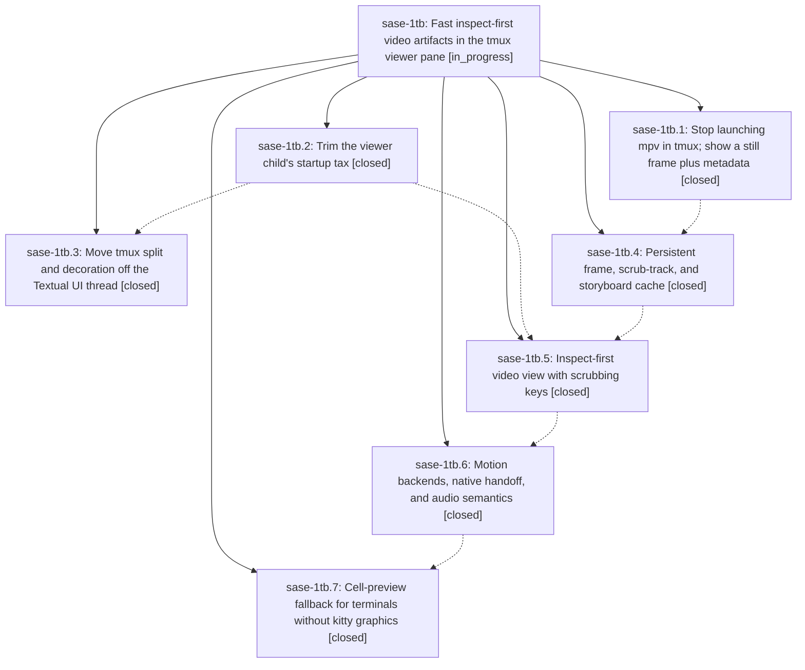

# Bead: sase-1tb — Fast inspect-first video artifacts in the tmux viewer pane

[Bead Pages](../README.md) / sase-1tb

**Status:** ◐ in_progress · **Type:** ▸ plan · **Tier:** epic
**Owner:** `bryanbugyi34@gmail.com` · **Created by:** [bbugyi200.athena.1di](https://github.com/sase-org/sase--agents/blob/main/sessions/bbugyi200.athena.1di.md) · **Assignee:** `sase-1tb.land`
**Created:** 2026-11-17 11:16:32 EST
**Plan:** [202611/fast\_video\_artifact\_pane.md](https://github.com/sase-org/sase--plans/blob/main/202611/fast_video_artifact_pane.md)

<!-- sase:links:start -->

## Links

| Relation | Artifact | Why |
| --- | --- | --- |
| implemented-by | [plan:202611/fast_video_artifact_pane.md][1] | derived from the plan's `bead_id:` frontmatter field |
| related | [bead:sase-1td][2] | Deferred by epic sase-1tb (plan Deferred list); builds on its inspect-first viewer, frame cache, and motion backends |

_Plus 3 automatic references — see [Referenced By](#referenced-by)._

[1]: https://github.com/sase-org/sase--plans/blob/main/202611/fast_video_artifact_pane.md
[2]: https://github.com/sase-org/sase--beads/blob/main/pages/sase-1td/README.md

<!-- sase:links:end -->

## Description

Opening a video artifact from the Agents tab inside tmux shows a useful frame in about half a second (always under 1 s) over SSH. It never garbles pane titles or lags tmux or the SASE TUI. The user can scrub frames, play motion where the topology supports it, or hand off to a native player. The fixed per-open launch tax is gone for every artifact kind.

## Notes

[2026-11-18T00:55:41Z · sase-1tb.land] LAND TRIAGE of child PROPOSED FOLLOW-UP notes (sase-1tb.land, 2026-11-17):
- sase-1tb.5 #1 (test_chops_run_concurrently 1.99s vs <1.8s): semantic duplicate of closed flake sase-uz (same fixed 1.8 s wall-clock ceiling, still at tests/test_axe_lumberjack_tick.py:445). Recorded +1; sase-uz reopened to READY.
- sase-1tb.6 #1 streamed kitty-animation player: created feature task sase-1td (large; gated on the real-kitty spike plus demand; research wire-format rules cited).
- sase-1tb.6 #2 in-TUI file-panel poster rider: created feature task sase-1te (large).
- sase-1tb.6 #3 persistent viewer pane / mpv IPC: created feature task sase-1tf (large).
- sase-1tb.6 #4 gateway byte-range media route: created feature task sase-1tg (large).
- sase-1tb.6 #5 symvision MemoryAuditRow: declined, already fixed on master by cd0b9c5273 (privatized the audit row).
- sase-1tb.6 #6 pre-existing check failures, split by item:
  (a) TUI import footprint cap: NOT pre-existing on current master; it is epic work. tests/ace/tui/test_app_import_budget.py::test_tui_app_import_stays_under_startup_budget fails at f28da33a13 (11,929,502 vs 11,924,777 cap). The 8fa9c1ad8b rebaseline (11,920,681) was measured on a tree without sase-1tb.6's eager growth, and the tree at 8fa9c1ad8b already measures 11,927,211. tools/tui_import_closure --diff shows the epic adds +7,070 to _viewer_loop_media and +1,729 to _viewer_loop_terminal on the first-paint path (+13.3 KB across the epic). Folded into the remaining-work tale; no task created.
  (b) KNOWN test_tracked_marker_mutation_sites_are_reviewed: declined, passes on current master (fixed by 8fa9c1ad8b).
  (c) KNOWN test_pipe_e2e default-pipe: duplicate of flake sase-r2; recorded +1 (now +4).
  (d) FLAKY import-budget timing test: declined as a separate task. No node id or fail/pass evidence was recorded, and the deterministic footprint failure on that node is handled under (a).
- Typed related links from sase-1td..1tg to sase-1tb were NOT recorded. 'sase artifact link add' spins at ~90% CPU in partition_artifact_link_candidates for >100 s; recorded as a DISCOVERED ISSUE on in-progress epic sase-yy.8 (publication path).

## Phases

| Bead | Title | Status | Size | Created | Agents | Commits |
|---|---|---|---|---|---:|---:|
| [sase-1tb.1](sase-1tb.1.md) | Stop launching mpv in tmux; show a still frame plus metadata | ✓ closed | medium | 2026-11-17 | 1 | 2 |
| [sase-1tb.2](sase-1tb.2.md) | Trim the viewer child's startup tax | ✓ closed | small | 2026-11-17 | 1 | 1 |
| [sase-1tb.3](sase-1tb.3.md) | Move tmux split and decoration off the Textual UI thread | ✓ closed | medium | 2026-11-17 | 1 | 1 |
| [sase-1tb.4](sase-1tb.4.md) | Persistent frame, scrub-track, and storyboard cache | ✓ closed | medium | 2026-11-17 | 1 | 1 |
| [sase-1tb.5](sase-1tb.5.md) | Inspect-first video view with scrubbing keys | ✓ closed | medium | 2026-11-17 | 1 | 1 |
| [sase-1tb.6](sase-1tb.6.md) | Motion backends, native handoff, and audio semantics | ✓ closed | medium | 2026-11-17 | 1 | 1 |
| [sase-1tb.7](sase-1tb.7.md) | Cell-preview fallback for terminals without kitty graphics | ✓ closed | small | 2026-11-17 | 1 | 1 |

## Lineage

## Agents

| Agent | Bead | Commits |
|---|---|---:|
| [bbugyi200.athena.sase-1tb.1](https://github.com/sase-org/sase--agents/blob/main/agents/bbugyi200.athena.sase-1tb.1/README.md) | [sase-1tb.1](sase-1tb.1.md) | 2 |
| [bbugyi200.athena.sase-1tb.2](https://github.com/sase-org/sase--agents/blob/main/agents/bbugyi200.athena.sase-1tb.2/README.md) | [sase-1tb.2](sase-1tb.2.md) | 1 |
| [bbugyi200.athena.sase-1tb.3](https://github.com/sase-org/sase--agents/blob/main/agents/bbugyi200.athena.sase-1tb.3/README.md) | [sase-1tb.3](sase-1tb.3.md) | 1 |
| [bbugyi200.athena.sase-1tb.4](https://github.com/sase-org/sase--agents/blob/main/sessions/bbugyi200.athena.sase-1tb.4.md) | [sase-1tb.4](sase-1tb.4.md) | 1 |
| [bbugyi200.athena.sase-1tb.5](https://github.com/sase-org/sase--agents/blob/main/sessions/bbugyi200.athena.sase-1tb.5.md) | [sase-1tb.5](sase-1tb.5.md) | 1 |
| [bbugyi200.athena.sase-1tb.6](https://github.com/sase-org/sase--agents/blob/main/sessions/bbugyi200.athena.sase-1tb.6.md) | [sase-1tb.6](sase-1tb.6.md) | 1 |
| [bbugyi200.athena.sase-1tb.7](https://github.com/sase-org/sase--agents/blob/main/sessions/bbugyi200.athena.sase-1tb.7.md) | [sase-1tb.7](sase-1tb.7.md) | 1 |
| [bbugyi200.athena.sase-1tb.land](https://github.com/sase-org/sase--agents/blob/main/sessions/bbugyi200.athena.sase-1tb.land.md) | [sase-1tb](README.md) | 1 |

## Commits

| Repo | Commit | Subject | Bead | Committed |
|---|---|---|---|---|
| sase | [`4878259`](https://github.com/sase-org/sase/commit/487825956afdd4eba04706367c563b5addea3723) | feat(tui): trim artifact viewer child startup tax | [sase-1tb.2](sase-1tb.2.md) | 2026-11-17 12:17:46 EST |
| sase | [`bfa6032`](https://github.com/sase-org/sase/commit/bfa60324a69641e8019e7dd9e60b1f120eed30fc) | feat(viewer): show video still frame with metadata in tmux | [sase-1tb.1](sase-1tb.1.md) | 2026-11-17 12:33:43 EST |
| sase | [`898eb8f`](https://github.com/sase-org/sase/commit/898eb8ffa5b90e04a19ead37e3cbcfc13867854f) | perf(viewer): defer video still module off TUI startup | [sase-1tb.1](sase-1tb.1.md) | 2026-11-17 13:26:34 EST |
| sase | [`5b4e61b`](https://github.com/sase-org/sase/commit/5b4e61bfa7d256d0fb29317eb268782bbee7f42b) | feat(tui): launch artifact tmux panes off the UI thread | [sase-1tb.3](sase-1tb.3.md) | 2026-11-17 13:42:05 EST |
| sase | [`f2fb7fb`](https://github.com/sase-org/sase/commit/f2fb7fb6b5006fdee544b398fab0f74fecbaa3aa) | feat(viewer): add persistent video frame, scrub-track, and storyboard cache | [sase-1tb.4](sase-1tb.4.md) | 2026-11-17 14:46:04 EST |
| sase | [`ded40c1`](https://github.com/sase-org/sase/commit/ded40c1e6393eeaad92a86e6dfad722bf19b961c) | feat(artifact-viewer): inspect-first video scrubber | [sase-1tb.5](sase-1tb.5.md) | 2026-11-17 17:20:38 EST |
| sase | [`4a6d3c5`](https://github.com/sase-org/sase/commit/4a6d3c51b352c61f9054b01546663f4a0a48c536) | feat(viewer): motion backends, native handoff, and muted in-pane audio | [sase-1tb.6](sase-1tb.6.md) | 2026-11-17 18:39:30 EST |
| sase | [`f28da33`](https://github.com/sase-org/sase/commit/f28da33a13f55399cc6df2a8791d1658f9eb970d) | feat(ace): cell-preview fallback for terminals without kitty graphics | [sase-1tb.7](sase-1tb.7.md) | 2026-11-17 19:25:57 EST |
| sase | [`61212be`](https://github.com/sase-org/sase/commit/61212bee5ebb2cac251b575571dc2dec4df6d65a) | fix(ace): land fast video inspect pane fixes for sase-1tb | [sase-1tb](README.md) | 2026-11-17 22:31:00 EST |

<!-- sase:referenced-by:start -->

## Referenced By

| Relation | Artifact | Why | Uses |
| --- | --- | --- | ---: |
| read-by | [agent:sase-1tb.2][1] | Need epic DECISIONS block | 2 |
| read-by | [agent:sase-1tb.3][2] | Need parent epic DECISIONS and phase list for sase-1tb.3 | 1 |
| read-by | [agent:sase-1tb.4--1][3] | need epic close flow for phase with upstream epic-symbols | 1 |

[1]: https://github.com/sase-org/sase--agents/blob/main/agents/bbugyi200.athena.sase-1tb.2/README.md
[2]: https://github.com/sase-org/sase--agents/blob/main/agents/bbugyi200.athena.sase-1tb.3/README.md
[3]: https://github.com/sase-org/sase--agents/blob/main/sessions/bbugyi200.athena.sase-1tb.4.md

<!-- sase:referenced-by:end -->
