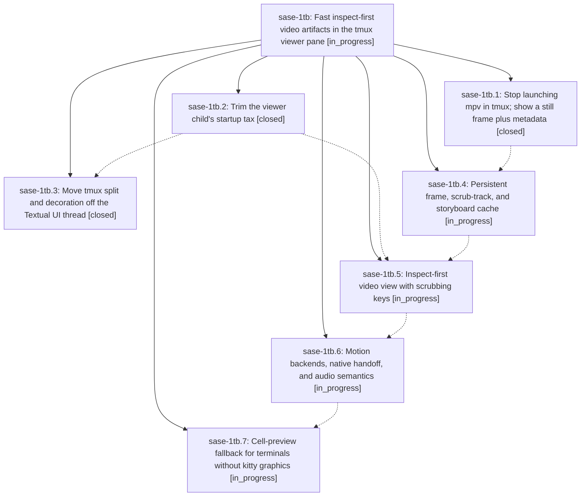

# Bead: sase-1tb — Fast inspect-first video artifacts in the tmux viewer pane

[Bead Pages](../README.md) / sase-1tb

**Status:** ◐ in_progress · **Type:** ▸ plan · **Tier:** epic
**Owner:** `bryanbugyi34@gmail.com` · **Created by:** [bbugyi200.athena.1di](https://github.com/sase-org/sase--agents/blob/main/sessions/bbugyi200.athena.1di.md) · **Assignee:** `sase-1tb.land`
**Created:** 2026-11-17 11:16:32 EST
**Plan:** [202611/fast\_video\_artifact\_pane.md](https://github.com/sase-org/sase--plans/blob/main/202611/fast_video_artifact_pane.md)

<!-- sase:links:start -->

## Links

| Relation | Artifact | Why |
| --- | --- | --- |
| implemented-by | [plan:202611/fast_video_artifact_pane.md][1] | derived from the plan's `bead_id:` frontmatter field |

_Plus 1 automatic references — see [Referenced By](#referenced-by)._

[1]: https://github.com/sase-org/sase--plans/blob/main/202611/fast_video_artifact_pane.md

<!-- sase:links:end -->

## Description

Opening a video artifact from the Agents tab inside tmux shows a useful frame in about half a second (always under 1 s) over SSH. It never garbles pane titles or lags tmux or the SASE TUI. The user can scrub frames, play motion where the topology supports it, or hand off to a native player. The fixed per-open launch tax is gone for every artifact kind.

## Phases

| Bead | Title | Status | Size | Created | Agents | Commits |
|---|---|---|---|---|---:|---:|
| [sase-1tb.1](sase-1tb.1.md) | Stop launching mpv in tmux; show a still frame plus metadata | ✓ closed | medium | 2026-11-17 | 1 | 2 |
| [sase-1tb.2](sase-1tb.2.md) | Trim the viewer child's startup tax | ✓ closed | small | 2026-11-17 | 1 | 1 |
| [sase-1tb.3](sase-1tb.3.md) | Move tmux split and decoration off the Textual UI thread | ✓ closed | medium | 2026-11-17 | 1 | 1 |
| [sase-1tb.4](sase-1tb.4.md) | Persistent frame, scrub-track, and storyboard cache | ◐ in_progress | medium | 2026-11-17 | 1 | 0 |
| [sase-1tb.5](sase-1tb.5.md) | Inspect-first video view with scrubbing keys | ◐ in_progress | medium | 2026-11-17 | 1 | 0 |
| [sase-1tb.6](sase-1tb.6.md) | Motion backends, native handoff, and audio semantics | ◐ in_progress | medium | 2026-11-17 | 1 | 0 |
| [sase-1tb.7](sase-1tb.7.md) | Cell-preview fallback for terminals without kitty graphics | ◐ in_progress | small | 2026-11-17 | 1 | 0 |

## Lineage

## Agents

| Agent | Bead | Commits |
|---|---|---:|
| [bbugyi200.athena.sase-1tb.1](https://github.com/sase-org/sase--agents/blob/main/agents/bbugyi200.athena.sase-1tb.1/README.md) | [sase-1tb.1](sase-1tb.1.md) | 2 |
| [bbugyi200.athena.sase-1tb.2](https://github.com/sase-org/sase--agents/blob/main/agents/bbugyi200.athena.sase-1tb.2/README.md) | [sase-1tb.2](sase-1tb.2.md) | 1 |
| [bbugyi200.athena.sase-1tb.3](https://github.com/sase-org/sase--agents/blob/main/agents/bbugyi200.athena.sase-1tb.3/README.md) | [sase-1tb.3](sase-1tb.3.md) | 1 |
| [bbugyi200.athena.sase-1tb.4](https://github.com/sase-org/sase--agents/blob/main/agents/bbugyi200.athena.sase-1tb.4/README.md) | [sase-1tb.4](sase-1tb.4.md) | 0 |
| [bbugyi200.athena.sase-1tb.5](https://github.com/sase-org/sase--agents/blob/main/agents/bbugyi200.athena.sase-1tb.5/README.md) | [sase-1tb.5](sase-1tb.5.md) | 0 |
| [bbugyi200.athena.sase-1tb.6](https://github.com/sase-org/sase--agents/blob/main/agents/bbugyi200.athena.sase-1tb.6/README.md) | [sase-1tb.6](sase-1tb.6.md) | 0 |
| [bbugyi200.athena.sase-1tb.7](https://github.com/sase-org/sase--agents/blob/main/agents/bbugyi200.athena.sase-1tb.7/README.md) | [sase-1tb.7](sase-1tb.7.md) | 0 |
| [bbugyi200.athena.sase-1tb.land](https://github.com/sase-org/sase--agents/blob/main/agents/bbugyi200.athena.sase-1tb.land/README.md) | [sase-1tb](README.md) | 0 |

## Commits

| Repo | Commit | Subject | Bead | Committed |
|---|---|---|---|---|
| sase | [`4878259`](https://github.com/sase-org/sase/commit/487825956afdd4eba04706367c563b5addea3723) | feat(tui): trim artifact viewer child startup tax | [sase-1tb.2](sase-1tb.2.md) | 2026-11-17 12:17:46 EST |
| sase | [`bfa6032`](https://github.com/sase-org/sase/commit/bfa60324a69641e8019e7dd9e60b1f120eed30fc) | feat(viewer): show video still frame with metadata in tmux | [sase-1tb.1](sase-1tb.1.md) | 2026-11-17 12:33:43 EST |
| sase | [`898eb8f`](https://github.com/sase-org/sase/commit/898eb8ffa5b90e04a19ead37e3cbcfc13867854f) | perf(viewer): defer video still module off TUI startup | [sase-1tb.1](sase-1tb.1.md) | 2026-11-17 13:26:34 EST |
| sase | [`5b4e61b`](https://github.com/sase-org/sase/commit/5b4e61bfa7d256d0fb29317eb268782bbee7f42b) | feat(tui): launch artifact tmux panes off the UI thread | [sase-1tb.3](sase-1tb.3.md) | 2026-11-17 13:42:05 EST |

<!-- sase:referenced-by:start -->

## Referenced By

| Relation | Artifact | Why | Uses |
| --- | --- | --- | ---: |
| read-by | [agent:sase-1tb.2][1] | Need epic DECISIONS block | 2 |

[1]: https://github.com/sase-org/sase--agents/blob/main/agents/bbugyi200.athena.sase-1tb.2/README.md

<!-- sase:referenced-by:end -->
