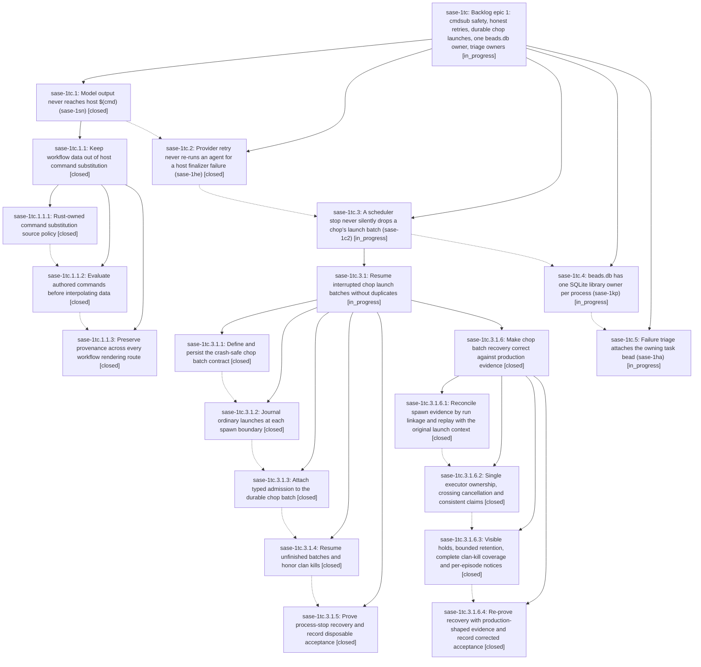

# Bead: sase-1tc — Backlog epic 1: cmdsub safety, honest retries, durable chop launches, one beads.db owner, triage owners

[Bead Pages](../README.md) / sase-1tc

**Status:** ◐ in_progress · **Type:** ▸ plan · **Tier:** epic
**Owner:** `bryanbugyi34@gmail.com` · **Created by:** [bbugyi200.athena.1dg](https://github.com/sase-org/sase--agents/blob/main/sessions/bbugyi200.athena.1dg.md) · **Assignee:** `sase-1tc.land`
**Created:** 2026-11-17 11:19:25 EST
**Plan:** [202611/backlog\_epic\_cmdsub\_retries\_launches.md](https://github.com/sase-org/sase--plans/blob/main/202611/backlog_epic_cmdsub_retries_launches.md)

<!-- sase:links:start -->

## Links

| Relation | Artifact | Why |
| --- | --- | --- |
| implemented-by | [plan:202611/backlog_epic_cmdsub_retries_launches.md][1] | derived from the plan's `bead_id:` frontmatter field |

_Plus 2 automatic references — see [Referenced By](#referenced-by)._

[1]: https://github.com/sase-org/sase--plans/blob/main/202611/backlog_epic_cmdsub_retries_launches.md

<!-- sase:links:end -->

## Description

The five most important unowned task beads are fixed and closed: model output can never run host $(cmd), host finalizer failures never re-run an agent, a scheduler stop never silently drops a chop's launch batch, beads.db has one SQLite library owner per process, and check-run triage attaches the owning task bead. The lander then continues the backlog chain with the next five beads.

## Notes

[2026-11-18T09:40:38Z · sase-1tc.3.1.3--3] DISCOVERED ISSUE: While recovering phase sase-1tc.3.1.3, ToolRun ad627b9af9e24daebcb010e105f90945 failed tests/llm_provider/test_commit_finalizer_auto_sdd_status.py::test_auto_commit_git_runner_recovers_stale_index_lock in the full 14-worker check. Triage labeled it NEW with no owner even though it shares the aged .git/index.lock recovery path tracked by ready task sase-1kr; I recorded this independent reproduction there. The same node passed unchanged in focused ToolRun 03a698314138047be3a67e857c073538. This is direct evidence for phase sase-1tc.5's exact-node/location owner-matching scope.

[2026-11-18T15:38:19Z · ex.f0] DISCOVERED ISSUE: efc66a420b (sase-1tc.1.1.2) makes #research name the PRIMARY research checkout, so reports land outside the commit finalizer's scan and are silently never committed. Cause: macro bodies now run their own $(...) during expansion (src/sase/macro/_processor_render.py:123). The runner expands macros (run_agent_runner_bootstrap.py:442) before it enters the workspace (:448). With no workspace marker in cwd, `sase repo path research --ensure` (sase-research-artifacts xprompts/research.md:39) falls back to workspace #0 (repo_handler_common.py:87-89). Before efc66, $(...) ran at the provider call inside the workspace. Impact on apollo: 0 of 96 #research runs Nov 15 to Nov 17 14:28 named the primary path; all 24 from Nov 17 15:30 did (sase, bob-cli, tailnet). Of those, 7 committed (the agent wrote into a checkout it had opened) and 11 finished with no research commit. Concrete case: agent ex (run 20261118095611) opened research at its workspace clone, but wrote 202611/overnight_backlog_epic_chains_audit.md to the primary checkout. The clone stayed clean, so final context was not_triggered / submission_required=false and the commit finalizer reported success with empty evidence. The file is still untracked in the primary. Suggested fix: resolve launch-time macro commands inside the claimed workspace, or pass the runner's workspace number to `sase repo path`. A finalize-time check for untracked writes outside scanned repos would also have caught it (see related sase-1g1). Report: research:202611/research_report_finalized_without_commit.md (file:explicit:6c500d0b78ec209c6a77680b).

[2026-11-18T18:03:15Z · sase-1tj.land] DISCOVERED ISSUE: sase-1tj.1 note #1 proposes resolving the general launch-time cwd hazard caused by efc66a420b (sase-1tc.1.1.2). Landing review at fbfaf07123 confirms _processor_render.py executes eligible macro-body commands while run_agent_runner_bootstrap.py calls preprocess_prompt_macros before enter_agent_workspace; repo_handler_common.resolve_list_workspace_num returns workspace 0 without a matching marker. Research-specific macros are fixed in plugin 73b3350, but other authored cwd-sensitive commands still see the launch cwd. Please evaluate entering an already-known workspace before expansion or preserving source provenance while deferring execution until after claim, including deferred launches. Routed here via /sase_new_task; same causal issue as note #2, not a duplicate task or a request to weaken the cmdsub trust model.

## Phases

| Bead | Title | Status | Size | Created | Agents | Commits |
|---|---|---|---|---|---:|---:|
| [sase-1tc.1](sase-1tc.1.md) | Model output never reaches host $(cmd) (sase-1sn) | ✓ closed | large | 2026-11-17 | 1 | 0 |
| [sase-1tc.2](sase-1tc.2.md) | Provider retry never re-runs an agent for a host finalizer failure (sase-1he) | ✓ closed | medium | 2026-11-17 | 1 | 1 |
| [sase-1tc.3](sase-1tc.3.md) | A scheduler stop never silently drops a chop's launch batch (sase-1c2) | ◐ in_progress | large | 2026-11-17 | 1 | 0 |
| [sase-1tc.4](sase-1tc.4.md) | beads.db has one SQLite library owner per process (sase-1kp) | ◐ in_progress | large | 2026-11-17 | 1 | 0 |
| [sase-1tc.5](sase-1tc.5.md) | Failure triage attaches the owning task bead (sase-1ha) | ◐ in_progress | large | 2026-11-17 | 1 | 0 |

## Lineage

## Agents

| Agent | Bead | Commits |
|---|---|---:|
| [bbugyi200.athena.sase-1tc.1](https://github.com/sase-org/sase--agents/blob/main/sessions/bbugyi200.athena.sase-1tc.1.md) | [sase-1tc.1](sase-1tc.1.md) | 0 |
| [bbugyi200.athena.sase-1tc.1.1.1](https://github.com/sase-org/sase--agents/blob/main/agents/bbugyi200.athena.sase-1tc.1.1.1/README.md) | [sase-1tc.1.1.1](sase-1tc.1.1.1.md) | 1 |
| [bbugyi200.athena.sase-1tc.1.1.2](https://github.com/sase-org/sase--agents/blob/main/sessions/bbugyi200.athena.sase-1tc.1.1.2.md) | [sase-1tc.1.1.2](sase-1tc.1.1.2.md) | 1 |
| [bbugyi200.athena.sase-1tc.1.1.3](https://github.com/sase-org/sase--agents/blob/main/sessions/bbugyi200.athena.sase-1tc.1.1.3.md) | [sase-1tc.1.1.3](sase-1tc.1.1.3.md) | 1 |
| [bbugyi200.athena.sase-1tc.1.1.land](https://github.com/sase-org/sase--agents/blob/main/sessions/bbugyi200.athena.sase-1tc.1.1.land.md) | [sase-1tc.1.1](sase-1tc.1.1.md) | 1 |
| [bbugyi200.athena.sase-1tc.2](https://github.com/sase-org/sase--agents/blob/main/agents/bbugyi200.athena.sase-1tc.2/README.md) | [sase-1tc.2](sase-1tc.2.md) | 1 |
| [bbugyi200.athena.sase-1tc.3](https://github.com/sase-org/sase--agents/blob/main/sessions/bbugyi200.athena.sase-1tc.3.md) | [sase-1tc.3](sase-1tc.3.md) | 0 |
| [bbugyi200.athena.sase-1tc.3.1.1](https://github.com/sase-org/sase--agents/blob/main/agents/bbugyi200.athena.sase-1tc.3.1.1/README.md) | [sase-1tc.3.1.1](sase-1tc.3.1.1.md) | 2 |
| [bbugyi200.athena.sase-1tc.3.1.2](https://github.com/sase-org/sase--agents/blob/main/sessions/bbugyi200.athena.sase-1tc.3.1.2.md) | [sase-1tc.3.1.2](sase-1tc.3.1.2.md) | 1 |
| [bbugyi200.athena.sase-1tc.3.1.3](https://github.com/sase-org/sase--agents/blob/main/sessions/bbugyi200.athena.sase-1tc.3.1.3.md) | [sase-1tc.3.1.3](sase-1tc.3.1.3.md) | 1 |
| [bbugyi200.athena.sase-1tc.3.1.4](https://github.com/sase-org/sase--agents/blob/main/sessions/bbugyi200.athena.sase-1tc.3.1.4.md) | [sase-1tc.3.1.4](sase-1tc.3.1.4.md) | 1 |
| [bbugyi200.athena.sase-1tc.3.1.5](https://github.com/sase-org/sase--agents/blob/main/agents/bbugyi200.athena.sase-1tc.3.1.5/README.md) | [sase-1tc.3.1.5](sase-1tc.3.1.5.md) | 1 |
| [bbugyi200.athena.sase-1tc.3.1.6.1](https://github.com/sase-org/sase--agents/blob/main/agents/bbugyi200.athena.sase-1tc.3.1.6.1/README.md) | [sase-1tc.3.1.6.1](sase-1tc.3.1.6.1.md) | 1 |
| [bbugyi200.athena.sase-1tc.3.1.6.2](https://github.com/sase-org/sase--agents/blob/main/agents/bbugyi200.athena.sase-1tc.3.1.6.2/README.md) | [sase-1tc.3.1.6.2](sase-1tc.3.1.6.2.md) | 2 |
| [bbugyi200.athena.sase-1tc.3.1.6.3](https://github.com/sase-org/sase--agents/blob/main/agents/bbugyi200.athena.sase-1tc.3.1.6.3/README.md) | [sase-1tc.3.1.6.3](sase-1tc.3.1.6.3.md) | 1 |
| [bbugyi200.athena.sase-1tc.3.1.6.4](https://github.com/sase-org/sase--agents/blob/main/agents/bbugyi200.athena.sase-1tc.3.1.6.4/README.md) | [sase-1tc.3.1.6.4](sase-1tc.3.1.6.4.md) | 1 |
| [bbugyi200.athena.sase-1tc.3.1.6.land](https://github.com/sase-org/sase--agents/blob/main/sessions/bbugyi200.athena.sase-1tc.3.1.6.land.md) | [sase-1tc.3.1.6](sase-1tc.3.1.6.md) | 3 |
| [bbugyi200.athena.sase-1tc.3.1.land](https://github.com/sase-org/sase--agents/blob/main/sessions/bbugyi200.athena.sase-1tc.3.1.land.md) | [sase-1tc.3.1](sase-1tc.3.1.md) | 0 |
| [bbugyi200.athena.sase-1tc.4](https://github.com/sase-org/sase--agents/blob/main/agents/bbugyi200.athena.sase-1tc.4/README.md) | [sase-1tc.4](sase-1tc.4.md) | 0 |
| [bbugyi200.athena.sase-1tc.5](https://github.com/sase-org/sase--agents/blob/main/agents/bbugyi200.athena.sase-1tc.5/README.md) | [sase-1tc.5](sase-1tc.5.md) | 0 |
| [bbugyi200.athena.sase-1tc.land](https://github.com/sase-org/sase--agents/blob/main/agents/bbugyi200.athena.sase-1tc.land/README.md) | [sase-1tc](README.md) | 0 |

## Commits

| Repo | Commit | Subject | Bead | Committed |
|---|---|---|---|---|
| sase-core | [`sase-core@1191f9a`](https://github.com/sase-org/sase-core/commit/1191f9a68e76b0c49d7da8768b7cf161edd42b1a) | feat: add prompt command-substitution source policy | [sase-1tc.1.1.1](sase-1tc.1.1.1.md) | 2026-11-17 12:22:29 EST |
| sase | [`efc66a4`](https://github.com/sase-org/sase/commit/efc66a420b8c738e52cefa4f04bc28eec0031132) | feat(macro): evaluate authored commands before interpolating data | [sase-1tc.1.1.2](sase-1tc.1.1.2.md) | 2026-11-17 15:12:16 EST |
| sase | [`8165695`](https://github.com/sase-org/sase/commit/81656950c684d2c5fb4722439331993b79c6008c) | feat(macro): preserve provenance across workflow rendering routes | [sase-1tc.1.1.3](sase-1tc.1.1.3.md) | 2026-11-17 16:54:05 EST |
| sase | [`07aedfc`](https://github.com/sase-org/sase/commit/07aedfc8ca479b7142c05610eebfab193e352137) | fix(llm\_provider): skip agent retry on host finalizer failures | [sase-1tc.2](sase-1tc.2.md) | 2026-11-17 19:03:29 EST |
| sase | [`4b9513e`](https://github.com/sase-org/sase/commit/4b9513e3f4775d753cf48d1c8e67699f1abb8e07) | feat(macro): finish command-substitution provenance landing | [sase-1tc.1.1](sase-1tc.1.1.md) | 2026-11-17 20:47:31 EST |
| sase-core | [`sase-core@6cd9a0c`](https://github.com/sase-org/sase-core/commit/6cd9a0c2898850c8a81e90a23aca489cd742ba26) | feat(axe-chop): versioned crash-safe chop batch contract | [sase-1tc.3.1.1](sase-1tc.3.1.1.md) | 2026-11-17 21:17:51 EST |
| sase | [`c6b6da1`](https://github.com/sase-org/sase/commit/c6b6da1d2ca5dcbeebae8fab0beacb4f180ca345) | feat(axe): crash-safe chop batch store and facade | [sase-1tc.3.1.1](sase-1tc.3.1.1.md) | 2026-11-17 21:19:41 EST |
| sase | [`558fbd1`](https://github.com/sase-org/sase/commit/558fbd127f0ea0f7b83c771dca98849da132590b) | feat(axe): journal ordinary chop launches at spawn boundaries | [sase-1tc.3.1.2](sase-1tc.3.1.2.md) | 2026-11-18 02:48:14 EST |
| sase | [`3cf982b`](https://github.com/sase-org/sase/commit/3cf982bdff43f5ab232c668bf0a1770d9a77644a) | feat(axe): attach typed admission to durable chop batches | [sase-1tc.3.1.3](sase-1tc.3.1.3.md) | 2026-11-18 04:56:41 EST |
| sase | [`b8c9f6c`](https://github.com/sase-org/sase/commit/b8c9f6c6aa101546a21539dcafc17b20ccdcdaf5) | feat(axe): add chop batch pause-resume recovery, clan cancellation, and durable notices | [sase-1tc.3.1.4](sase-1tc.3.1.4.md) | 2026-11-18 05:54:13 EST |
| sase | [`0747964`](https://github.com/sase-org/sase/commit/07479640e2f1949fbc787892920f0bf2955a203a) | feat(axe): recover interrupted chop batches | [sase-1tc.3.1.5](sase-1tc.3.1.5.md) | 2026-11-18 06:57:37 EST |
| sase | [`6026cc1`](https://github.com/sase-org/sase/commit/6026cc1182910ec2cde1c5392ec66c91356cced7) | feat(axe): chop batch recovery via run-linkage spawn matching | [sase-1tc.3.1.6.1](sase-1tc.3.1.6.1.md) | 2026-11-18 08:00:32 EST |
| sase-core | [`sase-core@98a22b7`](https://github.com/sase-org/sase-core/commit/98a22b7906f3bdcc5a9e5c293d975a9ec2c116b5) | fix(axe-chop): settle in-flight launches after cancellation | [sase-1tc.3.1.6.2](sase-1tc.3.1.6.2.md) | 2026-11-18 11:11:48 EST |
| sase | [`4e5c1b9`](https://github.com/sase-org/sase/commit/4e5c1b9730229036faa5c1eef1029457ef36f14d) | fix(axe-chop): preserve batch claims across cancellation | [sase-1tc.3.1.6.2](sase-1tc.3.1.6.2.md) | 2026-11-18 12:08:43 EST |
| sase | [`3c6e3a0`](https://github.com/sase-org/sase/commit/3c6e3a06c039d1032cf6043f28a7b83ff6e63ba0) | fix(axe): make batch recovery visible and durable | [sase-1tc.3.1.6.3](sase-1tc.3.1.6.3.md) | 2026-11-18 13:52:42 EST |
| sase | [`5b08952`](https://github.com/sase-org/sase/commit/5b08952c6d8dd69b6b1731989a3580c61b3d660e) | feat(axe): re-prove chop batch recovery with production-shaped acceptance evidence | [sase-1tc.3.1.6.4](sase-1tc.3.1.6.4.md) | 2026-11-18 15:27:35 EST |
| sase-core | [`sase-core@b1a0363`](https://github.com/sase-org/sase-core/commit/b1a0363997eb8150f8db8a425b83564faf5101f3) | feat(axe-chop): add clan-scoped generation match and cancelled settlement | [sase-1tc.3.1.6](sase-1tc.3.1.6.md) | 2026-11-18 17:13:53 EST |
| sase | [`d3fcb19`](https://github.com/sase-org/sase/commit/d3fcb19562816378011aa3ca0c3ff7b5f1f693ee) | fix(axe): finish chop recovery safety and nested landing closeout | [sase-1tc.3.1.6](sase-1tc.3.1.6.md) | 2026-11-18 17:15:37 EST |
| sase--plans | [`sase--plans@9394c75`](https://github.com/sase-org/sase--plans/commit/9394c750024cc6a0ce17635e85962ab3d3522fc4) | docs(plans): mark chop recovery defects plan done | [sase-1tc.3.1.6](sase-1tc.3.1.6.md) | 2026-11-18 17:16:53 EST |

<!-- sase:referenced-by:start -->

## Referenced By

| Relation | Artifact | Why | Uses |
| --- | --- | --- | ---: |
| read-by | [agent:ex.f0][1] | Need the epic scope: in-progress backlog epic whose cmdsub phase caused the regression | 1 |
| read-by | [agent:sase-1tc.1.1.2--1][2] | Check top epic | 1 |

[1]: https://github.com/sase-org/sase--agents/blob/main/agents/bbugyi200.athena.ex.f0/README.md
[2]: https://github.com/sase-org/sase--agents/blob/main/sessions/bbugyi200.athena.sase-1tc.1.1.2.md

<!-- sase:referenced-by:end -->
