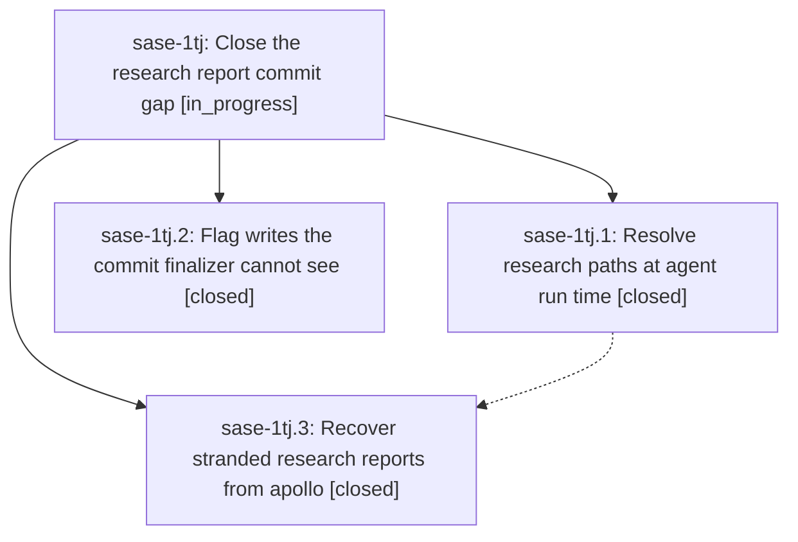

# Bead: sase-1tj — Close the research report commit gap

[Bead Pages](../README.md) / sase-1tj

**Status:** ◐ in_progress · **Type:** ▸ plan · **Tier:** epic
**Owner:** `bryanbugyi34@gmail.com` · **Created by:** [bbugyi200.athena.1dz](https://github.com/sase-org/sase--agents/blob/main/sessions/bbugyi200.athena.1dz.md) · **Assignee:** `sase-1tj.land`
**Created:** 2026-11-18 11:26:27 EST
**Plan:** [202611/research\_commit\_gap.md](https://github.com/sase-org/sase--plans/blob/main/202611/research_commit_gap.md)

<!-- sase:links:start -->

## Links

| Relation | Artifact | Why |
| --- | --- | --- |
| implemented-by | [plan:202611/research_commit_gap.md][1] | derived from the plan's `bead_id:` frontmatter field |

_Plus 1 automatic references — see [Referenced By](#referenced-by)._

[1]: https://github.com/sase-org/sase--plans/blob/main/202611/research_commit_gap.md

<!-- sase:links:end -->

## Description

Every research-macro report lands in a checkout the host commits. A run that writes into a checkout the commit finalizer does not scan is told so before it stops. The ten reports already stranded in apollo's primary research checkouts get committed.

## Phases

| Bead | Title | Status | Size | Created | Agents | Commits |
|---|---|---|---|---|---:|---:|
| [sase-1tj.1](sase-1tj.1.md) | Resolve research paths at agent run time | ✓ closed | small | 2026-11-18 | 1 | 1 |
| [sase-1tj.2](sase-1tj.2.md) | Flag writes the commit finalizer cannot see | ✓ closed | medium | 2026-11-18 | 1 | 1 |
| [sase-1tj.3](sase-1tj.3.md) | Recover stranded research reports from apollo | ✓ closed | small | 2026-11-18 | 1 | 1 |

## Lineage

## Agents

| Agent | Bead | Commits |
|---|---|---:|
| [bbugyi200.athena.sase-1tj.1](https://github.com/sase-org/sase--agents/blob/main/agents/bbugyi200.athena.sase-1tj.1/README.md) | [sase-1tj.1](sase-1tj.1.md) | 1 |
| [bbugyi200.athena.sase-1tj.2](https://github.com/sase-org/sase--agents/blob/main/agents/bbugyi200.athena.sase-1tj.2/README.md) | [sase-1tj.2](sase-1tj.2.md) | 1 |
| [bbugyi200.athena.sase-1tj.3](https://github.com/sase-org/sase--agents/blob/main/agents/bbugyi200.athena.sase-1tj.3/README.md) | [sase-1tj.3](sase-1tj.3.md) | 1 |
| [bbugyi200.athena.sase-1tj.land](https://github.com/sase-org/sase--agents/blob/main/agents/bbugyi200.athena.sase-1tj.land/README.md) | [sase-1tj](README.md) | 0 |

## Commits

| Repo | Commit | Subject | Bead | Committed |
|---|---|---|---|---|
| sase | [`03a48ab`](https://github.com/sase-org/sase/commit/03a48ab7fc25f64baf244dfef1012a5cbcc42e02) | feat(finalizers): flag writes the commit finalizer cannot see | [sase-1tj.2](sase-1tj.2.md) | 2026-11-18 12:22:39 EST |
| sase | [`43ef590`](https://github.com/sase-org/sase/commit/43ef590bb62ec0873fda2a6e7566b2e5b8e0ad66) | docs(macros): clarify command substitution cwd behavior | [sase-1tj.1](sase-1tj.1.md) | 2026-11-18 12:48:05 EST |
| sase--research | [`sase--research@df90f1e`](https://github.com/sase-org/sase--research/commit/df90f1ef9aff1992f65185df8ec4e176578632cc) | docs(research): recover stranded overnight\_backlog\_epic\_chains\_audit report from apollo | [sase-1tj.3](sase-1tj.3.md) | 2026-11-18 12:56:57 EST |

<!-- sase:referenced-by:start -->

## Referenced By

| Relation | Artifact | Why | Uses |
| --- | --- | --- | ---: |
| read-by | [agent:sase-1tj.2][1] | Need parent epic context | 1 |

[1]: https://github.com/sase-org/sase--agents/blob/main/agents/bbugyi200.athena.sase-1tj.2/README.md

<!-- sase:referenced-by:end -->
