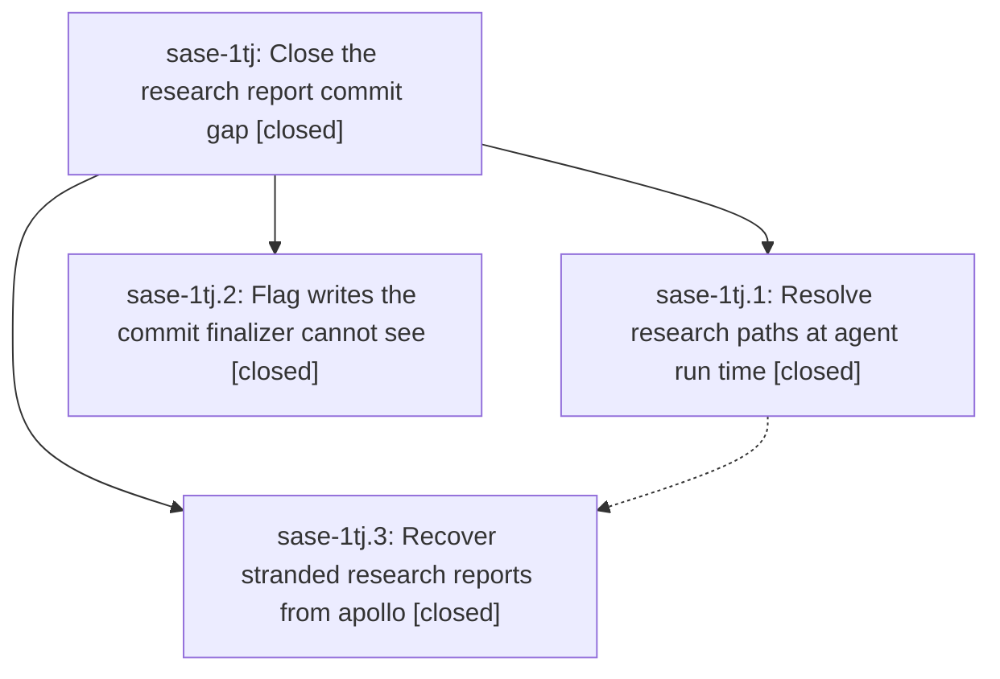

# Bead: sase-1tj — Close the research report commit gap

[Bead Pages](../README.md) / sase-1tj

**Status:** ✓ closed · **Resolution:** done · **Type:** ▸ plan · **Tier:** epic
**Owner:** `bryanbugyi34@gmail.com` · **Created by:** [bbugyi200.athena.1dz](https://github.com/sase-org/sase--agents/blob/main/sessions/bbugyi200.athena.1dz.md) · **Assignee:** `sase-1tj.land`
**Created:** 2026-11-18 11:26:27 EST · **Closed:** 2026-11-18 15:14:24 EST
**Plan:** [202611/research\_commit\_gap.md](https://github.com/sase-org/sase--plans/blob/main/202611/research_commit_gap.md)

<!-- sase:links:start -->

## Links

| Relation | Artifact | Why |
| --- | --- | --- |
| implemented-by | [plan:202611/research_commit_gap.md][1] | derived from the plan's `bead_id:` frontmatter field |

_Plus 2 automatic references — see [Referenced By](#referenced-by)._

[1]: https://github.com/sase-org/sase--plans/blob/main/202611/research_commit_gap.md

<!-- sase:links:end -->

## Description

Every research-macro report lands in a checkout the host commits. A run that writes into a checkout the commit finalizer does not scan is told so before it stops. The ten reports already stranded in apollo's primary research checkouts get committed.

## Notes

[2026-11-18T18:04:46Z · sase-1tj.land] LANDER FOLLOW-UP TRIAGE: Reviewed every phase note. sase-1tj.1 note #1 general launch-time cwd hazard is causally owned by active epic sase-1tc, whose phase sase-1tc.1/child efc66a420b introduced macro-body source-boundary execution before workspace entry. Via /sase_new_task, searched all-status bug tasks, swept recent tasks and active epics, then appended detailed evidence to sase-1tc; no new duplicate task. sase-1tj.1 note #2 splits into (a) two launch-admission assertions already tracked by sase-1tl, (b) two chop cancellation assertions already tracked by sase-1tm, and (c) gate-capacity flake sase-1tn. All five exact tests pass now on fbfaf07123 with companion 4e5c1b9730; 18 passed including all 13 guard tests. Declined new tasks for (a)/(b) because this is the already-diagnosed older-primary/newer-core pairing, recorded passing evidence on both tasks and causal epic sase-1tc.3.1.6. Corroborated (c) on existing flake sase-1tn with attribution to phase check c8fbf549a33e3fd56ae2869a4674661a; serial pass does not retire the intermittent report. Phase .2 skill redeploy and phase .3 Apollo plugin refresh remain documented post-landing activation steps, not new defect tasks; no global install attempted. No other PROPOSED FOLLOW-UP entries were present.

[2026-11-18T18:06:17Z · sase-1tj.land] LANDING REVIEW / REMAINING WORK: All three closed phase beads and every note reviewed. Macro commit 73b3350 (plugin) and 43ef590bb6 (sase docs) preserve month, target, suffix, no-overwrite and runtime-open rules; raw-source regression passes. Phase .2 commit 03a48ab7fc implements the selected warn branch and advisory top-level context without changing obligations, but is incomplete: commit_scan_roots is a duplicate enumeration, not the planned extraction consumed by collect_dirty_state. Concrete temporary-git reproduction: configured target research -> B plus opened research -> A, both dirty; dirty_configured_sibling_repos returns only A due to seen_names, commit_scan_roots includes A and B, and find_unscanned_writes(extra_paths=(B/report.md,), include_run_paths=False) returns empty. Also _match_inventory_record collects all projects and ignores owning project in the repair command: _suggest_fix for bob-cli primary research yields sase repo open research, which opens this host project sase research, so the instruction moves a report into the wrong repo. Shared classification/repair policy is all Python and must honor the Rust backend boundary. These are remaining phase-.2/epic work, not new follow-up tasks. Planning one medium tale to repair them and close this epic. No epic-symbol entries currently exist. No parent_bead is displayed.

[2026-11-18T18:06:23Z · sase-1tj.land] LANDING VERIFICATION / INTEGRATION: At fbfaf07123, freshly fetched origin/master has no additional commits. Reviewed non-epic changes since creation/first epic commit: 5f4807e61b repository-integration facade split, 4e5c1b9730 cancellation contract, 1ccd5c0579 update lock waiting, fbfaf07123 compact-list cleanup. None adds a competing research writer or guard consumer; cancellation drift is integrated by 4e5c1b9730 and the four affected tests now pass. Focused verification: 18 passed in 6.55s (13 guard tests plus all five phase-.1 follow-up tests); plugin source regression 1 passed. Phase .3 recovery verified against actual commits df90f1ef (sase:1), b83df6f6 (bob-cli:10), 3db5ee60 (tailnet:2), each carrying sase-1tj.3. All 13 committed Git blob IDs exactly match git hash-object of the parked Apollo originals under ~/.local/state/sase/recovered-research/<project>/202611; commit_and_park was honored with three extra bob-cli reports beyond the original ten. Apollo macro inspection still finds the launch-time sase repo path research expressions. Reinstall/redeploy activation remains required after landed code, as the approved plan states. Do not wait for a future commit/CI result to perform the repair tales closeout.

[2026-11-18T18:07:34Z · sase-1tj.land] FINAL LANDER CHECKPOINT: Audited remote repo opens on Apollo (-p sase/bob-cli/tailnet -w 0, read-only purpose) followed by git status --porcelain --untracked-files=all confirm all three primary research checkouts are clean; the recovered report paths now exist there as committed files after sync. This independently verifies the remaining phase-.3 clean-primary claim. Rechecked epic-symbols: empty. Repair tale sase_plan_research_commit_guard_finish.md passed --explain validation and revalidation with zero warnings; it covers both reproduced detector defects, shared Rust policy, verification, drift review and this epics full same-turn closeout. No primary tracked source files changed during this landing review, so no new just check run was required; 19 focused tests passed in total. Epic and original plan remain open intentionally pending that repair.

[2026-11-18T20:14:24Z · sase-1tj.land] Verified all phases and decisions, runtime research paths, 13 committed and parked recoveries, effective guard coverage and project-correct repairs through Rust; integrated post-start drift and passed the required checks. Follow-up dispositions: general cwd hazard on sase-1tc; cancellation reports on sase-1tl/sase-1tm pass after 4e5c1b9730; gate-capacity flake corroborated on sase-1tn; no new duplicate tasks. Tale evidence: sase-core check pass (run 23397e2c: fmt, features, clippy, all tests incl 13 unscanned-policy + binding round trip); sase check pass (run 035bf88b: all lint incl symvision, 260 scoped tests incl 20 guard tests: 13 existing + 7 new duplicate-name/SDD/nested/cross-project/real-git-error/Rust-round-trip, plus updated validate-tool contracts test); drift 9fda297df0 is TUI video previews only, no guard/finalizer consumers; sase-core pin 98a22b79 equals core HEAD, no drift; epic-symbols empty; no parent bead.

[2026-11-18T20:44:39Z · sase-1tj.land--1] Follow-up verification 2026-11-18: sase tool run check passed in sase (run b421895a6c9e60da55d0e69794949d1e, 508s) and sase-core (run 081a3345c18369450f01f925536d3cb3, 731s, exit 0). Drift review: only 9fda297df0 TUI video previews since fbfaf07123, no guard/finalizer consumers; sase-core pin 98a22b79 equals HEAD pre-commit. Plan 202611/research_commit_gap.md status done. Ready for host commit of main, sibling:sase-core, sdd:plans.

## Phases

| Bead | Title | Status | Size | Created | Agents | Commits |
|---|---|---|---|---|---:|---:|
| [sase-1tj.1](sase-1tj.1.md) | Resolve research paths at agent run time | ✓ closed | small | 2026-11-18 | 1 | 2 |
| [sase-1tj.2](sase-1tj.2.md) | Flag writes the commit finalizer cannot see | ✓ closed | medium | 2026-11-18 | 1 | 1 |
| [sase-1tj.3](sase-1tj.3.md) | Recover stranded research reports from apollo | ✓ closed | small | 2026-11-18 | 1 | 1 |

## Lineage

## Agents

| Agent | Bead | Commits |
|---|---|---:|
| [bbugyi200.athena.sase-1tj.1](https://github.com/sase-org/sase--agents/blob/main/agents/bbugyi200.athena.sase-1tj.1/README.md) | [sase-1tj.1](sase-1tj.1.md) | 2 |
| [bbugyi200.athena.sase-1tj.2](https://github.com/sase-org/sase--agents/blob/main/agents/bbugyi200.athena.sase-1tj.2/README.md) | [sase-1tj.2](sase-1tj.2.md) | 1 |
| [bbugyi200.athena.sase-1tj.3](https://github.com/sase-org/sase--agents/blob/main/agents/bbugyi200.athena.sase-1tj.3/README.md) | [sase-1tj.3](sase-1tj.3.md) | 1 |
| [bbugyi200.athena.sase-1tj.land](https://github.com/sase-org/sase--agents/blob/main/sessions/bbugyi200.athena.sase-1tj.land.md) | [sase-1tj](README.md) | 3 |

## Commits

| Repo | Commit | Subject | Bead | Committed |
|---|---|---|---|---|
| sase | [`03a48ab`](https://github.com/sase-org/sase/commit/03a48ab7fc25f64baf244dfef1012a5cbcc42e02) | feat(finalizers): flag writes the commit finalizer cannot see | [sase-1tj.2](sase-1tj.2.md) | 2026-11-18 12:22:39 EST |
| sase | [`43ef590`](https://github.com/sase-org/sase/commit/43ef590bb62ec0873fda2a6e7566b2e5b8e0ad66) | docs(macros): clarify command substitution cwd behavior | [sase-1tj.1](sase-1tj.1.md) | 2026-11-18 12:48:05 EST |
| sase-research-artifacts | [`sase-research-artifacts@73b3350`](https://github.com/sase-org/sase-research-artifacts/commit/73b335096249aea1aed535c2f2f76c712a4230a7) | fix(research): resolve checkout paths at agent runtime | [sase-1tj.1](sase-1tj.1.md) | 2026-11-18 12:48:55 EST |
| sase--research | [`sase--research@df90f1e`](https://github.com/sase-org/sase--research/commit/df90f1ef9aff1992f65185df8ec4e176578632cc) | docs(research): recover stranded overnight\_backlog\_epic\_chains\_audit report from apollo | [sase-1tj.3](sase-1tj.3.md) | 2026-11-18 12:56:57 EST |
| sase-core | [`sase-core@7ac2081`](https://github.com/sase-org/sase-core/commit/7ac2081b30d402317f261b968934d720ab9db019) | feat(finalizer): add shared unscanned-writes coverage and repair policy | [sase-1tj](README.md) | 2026-11-18 15:46:35 EST |
| sase | [`bd86168`](https://github.com/sase-org/sase/commit/bd8616817d90d840b68ba5858bf44af12f9d1573) | feat(finalizer): finish unscanned-writes guard with shared Rust policy | [sase-1tj](README.md) | 2026-11-18 15:47:38 EST |
| sase--plans | [`sase--plans@78225fd`](https://github.com/sase-org/sase--plans/commit/78225fda5148b332a5baedabe821bf37ec73136b) | docs(plans): mark research\_commit\_gap done | [sase-1tj](README.md) | 2026-11-18 15:48:13 EST |

<!-- sase:referenced-by:start -->

## Referenced By

| Relation | Artifact | Why | Uses |
| --- | --- | --- | ---: |
| read-by | [agent:sase-1tj.2][1] | Need parent epic context | 1 |
| read-by | [agent:sase-1tj.3][2] | Need parent epic scope and plan context | 1 |

[1]: https://github.com/sase-org/sase--agents/blob/main/agents/bbugyi200.athena.sase-1tj.2/README.md
[2]: https://github.com/sase-org/sase--agents/blob/main/agents/bbugyi200.athena.sase-1tj.3/README.md

<!-- sase:referenced-by:end -->
