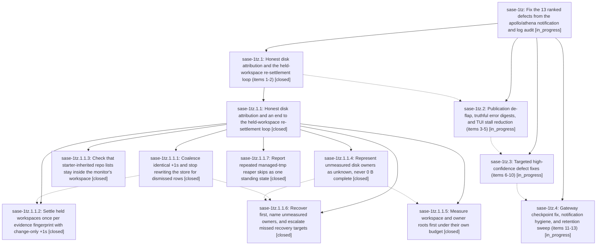

# Bead: sase-1tz — Fix the 13 ranked defects from the apollo/athena notification and log audit

[Bead Pages](../README.md) / sase-1tz

**Status:** ◐ in_progress · **Type:** ▸ plan · **Tier:** epic
**Owner:** `bryanbugyi34@gmail.com` · **Created by:** [bbugyi200.athena.1eb](https://github.com/sase-org/sase--agents/blob/main/sessions/bbugyi200.athena.1eb.md) · **Assignee:** `sase-1tz.land`
**Created:** 2026-11-19 07:09:38 EST
**Plan:** [202611/notification\_log\_audit\_fixes.md](https://github.com/sase-org/sase--plans/blob/main/202611/notification_log_audit_fixes.md)

<!-- sase:links:start -->

## Links

| Relation | Artifact | Why |
| --- | --- | --- |
| implemented-by | [plan:202611/notification_log_audit_fixes.md][1] | derived from the plan's `bead_id:` frontmatter field |

_Plus 2 automatic references — see [Referenced By](#referenced-by)._

[1]: https://github.com/sase-org/sase--plans/blob/main/202611/notification_log_audit_fixes.md

<!-- sase:links:end -->

## Description

Disk pressure names the owners it could not measure, and recovery runs even when attribution is incomplete. Held workspaces stop rewriting the notification store. agent_publication and the error digest report each cause once, with true counts. Measured TUI stalls shrink. The six targeted defects (prompt_prose wire, update races, Telegram transport, Codex bundle cap, triage request-id retry, gateway WAL checkpoint) are fixed. Notifications, logs, and state files follow their stated dedup and retention rules on both hosts.

## Phases

| Bead | Title | Status | Size | Created | Agents | Commits |
|---|---|---|---|---|---:|---:|
| [sase-1tz.1](sase-1tz.1.md) | Honest disk attribution and the held-workspace re-settlement loop (items 1-2) | ✓ closed | xlarge | 2026-11-19 | 1 | 0 |
| [sase-1tz.2](sase-1tz.2.md) | Publication de-flap, truthful error digests, and TUI stall reduction (items 3-5) | ◐ in_progress | xlarge | 2026-11-19 | 1 | 0 |
| [sase-1tz.3](sase-1tz.3.md) | Targeted high-confidence defect fixes (items 6-10) | ◐ in_progress | xlarge | 2026-11-19 | 1 | 0 |
| [sase-1tz.4](sase-1tz.4.md) | Gateway checkpoint fix, notification hygiene, and retention sweep (items 11-13) | ◐ in_progress | xlarge | 2026-11-19 | 1 | 0 |

## Lineage

## Agents

| Agent | Bead | Commits |
|---|---|---:|
| [bbugyi200.athena.sase-1tz.1](https://github.com/sase-org/sase--agents/blob/main/sessions/bbugyi200.athena.sase-1tz.1.md) | [sase-1tz.1](sase-1tz.1.md) | 0 |
| [bbugyi200.athena.sase-1tz.1.1.1](https://github.com/sase-org/sase--agents/blob/main/agents/bbugyi200.athena.sase-1tz.1.1.1/README.md) | [sase-1tz.1.1.1](sase-1tz.1.1.1.md) | 2 |
| [bbugyi200.athena.sase-1tz.1.1.2](https://github.com/sase-org/sase--agents/blob/main/agents/bbugyi200.athena.sase-1tz.1.1.2/README.md) | [sase-1tz.1.1.2](sase-1tz.1.1.2.md) | 1 |
| [bbugyi200.athena.sase-1tz.1.1.3](https://github.com/sase-org/sase--agents/blob/main/sessions/bbugyi200.athena.sase-1tz.1.1.3.md) | [sase-1tz.1.1.3](sase-1tz.1.1.3.md) | 1 |
| [bbugyi200.athena.sase-1tz.1.1.4](https://github.com/sase-org/sase--agents/blob/main/agents/bbugyi200.athena.sase-1tz.1.1.4/README.md) | [sase-1tz.1.1.4](sase-1tz.1.1.4.md) | 2 |
| [bbugyi200.athena.sase-1tz.1.1.5](https://github.com/sase-org/sase--agents/blob/main/agents/bbugyi200.athena.sase-1tz.1.1.5/README.md) | [sase-1tz.1.1.5](sase-1tz.1.1.5.md) | 1 |
| [bbugyi200.athena.sase-1tz.1.1.6](https://github.com/sase-org/sase--agents/blob/main/agents/bbugyi200.athena.sase-1tz.1.1.6/README.md) | [sase-1tz.1.1.6](sase-1tz.1.1.6.md) | 1 |
| [bbugyi200.athena.sase-1tz.1.1.7](https://github.com/sase-org/sase--agents/blob/main/agents/bbugyi200.athena.sase-1tz.1.1.7/README.md) | [sase-1tz.1.1.7](sase-1tz.1.1.7.md) | 1 |
| [bbugyi200.athena.sase-1tz.1.1.land](https://github.com/sase-org/sase--agents/blob/main/agents/bbugyi200.athena.sase-1tz.1.1.land/README.md) | [sase-1tz.1.1](sase-1tz.1.1.md) | 1 |
| [bbugyi200.athena.sase-1tz.2](https://github.com/sase-org/sase--agents/blob/main/agents/bbugyi200.athena.sase-1tz.2/README.md) | [sase-1tz.2](sase-1tz.2.md) | 0 |
| [bbugyi200.athena.sase-1tz.3](https://github.com/sase-org/sase--agents/blob/main/agents/bbugyi200.athena.sase-1tz.3/README.md) | [sase-1tz.3](sase-1tz.3.md) | 0 |
| [bbugyi200.athena.sase-1tz.4](https://github.com/sase-org/sase--agents/blob/main/agents/bbugyi200.athena.sase-1tz.4/README.md) | [sase-1tz.4](sase-1tz.4.md) | 0 |
| [bbugyi200.athena.sase-1tz.land](https://github.com/sase-org/sase--agents/blob/main/agents/bbugyi200.athena.sase-1tz.land/README.md) | [sase-1tz](README.md) | 0 |

## Commits

| Repo | Commit | Subject | Bead | Committed |
|---|---|---|---|---|
| sase | [`63fc5cc`](https://github.com/sase-org/sase/commit/63fc5ccc4c6fed1adcb09eadc508587338dd508e) | test(monitor): live foreign starter repos do not retain | [sase-1tz.1.1.3](sase-1tz.1.1.3.md) | 2026-11-19 08:02:36 EST |
| sase | [`06ae058`](https://github.com/sase-org/sase/commit/06ae058b5fff147bfb39ec81f58a6788141071a5) | feat(axe): report managed tmp skips as standing state | [sase-1tz.1.1.7](sase-1tz.1.1.7.md) | 2026-11-19 08:33:03 EST |
| sase-core | [`sase-core@d8681db`](https://github.com/sase-org/sase-core/commit/d8681dbbff2b435cbb83d7052db7c118afcd9b67) | feat(notifications): coalesce plus-one updates | [sase-1tz.1.1.1](sase-1tz.1.1.1.md) | 2026-11-19 08:54:40 EST |
| sase | [`ed5cb12`](https://github.com/sase-org/sase/commit/ed5cb12ef9ccd656302dbacf045a856e9e77f6c2) | feat(notifications): coalesce repeated plus-ones | [sase-1tz.1.1.1](sase-1tz.1.1.1.md) | 2026-11-19 08:55:52 EST |
| sase-core | [`sase-core@eabe416`](https://github.com/sase-org/sase-core/commit/eabe416cb5691876e3fd275e40769fcfbd18788d) | feat!: bump disk-inventory wire to v2 with per-row size state | [sase-1tz.1.1.4](sase-1tz.1.1.4.md) | 2026-11-19 09:10:50 EST |
| sase | [`6ee5f85`](https://github.com/sase-org/sase/commit/6ee5f8560caa8ec689349a3b5767954e5d99e4d6) | feat(disk): render unmeasured owners instead of 0 B complete | [sase-1tz.1.1.4](sase-1tz.1.1.4.md) | 2026-11-19 09:12:00 EST |
| sase | [`5c7b87c`](https://github.com/sase-org/sase/commit/5c7b87c71a9c6c41c22d7f3e85ea71fe0b7215e7) | feat(retention): settle held workspaces once per evidence fingerprint | [sase-1tz.1.1.2](sase-1tz.1.1.2.md) | 2026-11-19 09:59:07 EST |
| sase | [`7b6a44a`](https://github.com/sase-org/sase/commit/7b6a44a100e5090d8cc98481377d01af40c54aca) | feat(disk): recover under pressure before attributing owners | [sase-1tz.1.1.6](sase-1tz.1.1.6.md) | 2026-11-19 10:26:11 EST |
| sase | [`6f21d01`](https://github.com/sase-org/sase/commit/6f21d01de33c0fa13f3479eaeb0091f7607dbd73) | feat(disk): prioritize workspace root measurements | [sase-1tz.1.1.5](sase-1tz.1.1.5.md) | 2026-11-19 10:34:30 EST |
| sase--plans | [`sase--plans@2b4d1de`](https://github.com/sase-org/sase--plans/commit/2b4d1de2ac50f24091306eb54af02b1e20e70126) | chore(plans): mark outage disk attribution epic done | [sase-1tz.1.1](sase-1tz.1.1.md) | 2026-11-19 10:50:35 EST |

<!-- sase:referenced-by:start -->

## Referenced By

| Relation | Artifact | Why | Uses |
| --- | --- | --- | ---: |
| read-by | [agent:sase-1tz.1.1.1][1] | Need the governing epic DECISIONS before implementing its notification-store phase | 1 |
| read-by | [agent:sase-1tz.1.1.4][2] | Need top-level parent epic DECISIONS which are final | 1 |

[1]: https://github.com/sase-org/sase--agents/blob/main/agents/bbugyi200.athena.sase-1tz.1.1.1/README.md
[2]: https://github.com/sase-org/sase--agents/blob/main/agents/bbugyi200.athena.sase-1tz.1.1.4/README.md

<!-- sase:referenced-by:end -->
