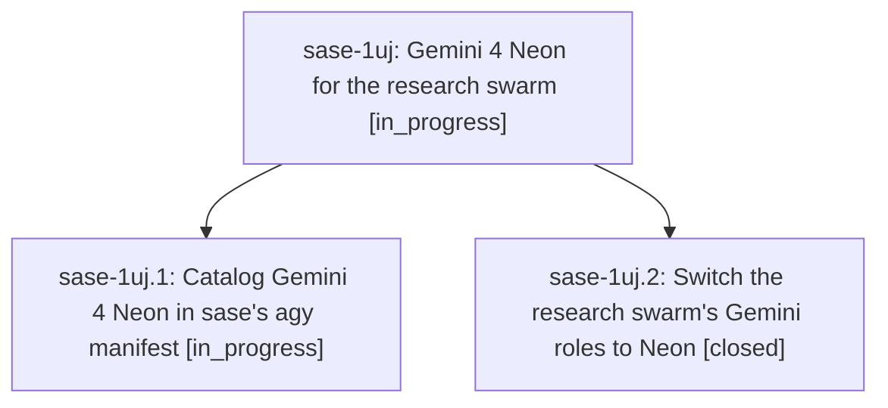

# Bead: sase-1uj — Gemini 4 Neon for the research swarm

[Bead Pages](../README.md) / sase-1uj

**Status:** ◐ in_progress · **Type:** ▸ plan · **Tier:** epic
**Owner:** `bryanbugyi34@gmail.com` · **Created by:** [bbugyi200.athena.1eo](https://github.com/sase-org/sase--agents/blob/main/sessions/bbugyi200.athena.1eo.md) · **Assignee:** `sase-1uj.land`
**Created:** 2026-11-20 16:42:51 EST
**Plan:** [202611/gemini\_neon\_research\_swarm.md](https://github.com/sase-org/sase--plans/blob/main/202611/gemini_neon_research_swarm.md)

<!-- sase:links:start -->

## Links

| Relation | Artifact | Why |
| --- | --- | --- |
| implemented-by | [plan:202611/gemini_neon_research_swarm.md][1] | derived from the plan's `bead_id:` frontmatter field |

[1]: https://github.com/sase-org/sase--plans/blob/main/202611/gemini_neon_research_swarm.md

<!-- sase:links:end -->

## Description

SASE catalogs Gemini 4 Neon on Antigravity with accurate plan-gating advisories, and the #research_swarm Gemini researcher runs on agy/gemini-4-neon-xhigh instead of Gemini 4 Hydrogen.

## Phases

| Bead | Title | Status | Size | Created | Agents | Commits |
|---|---|---|---|---|---:|---:|
| [sase-1uj.1](sase-1uj.1.md) | Catalog Gemini 4 Neon in sase's agy manifest | ◐ in_progress | medium | 2026-11-20 | 1 | 0 |
| [sase-1uj.2](sase-1uj.2.md) | Switch the research swarm's Gemini roles to Neon | ✓ closed | small | 2026-11-20 | 1 | 1 |

## Lineage

## Agents

| Agent | Bead | Commits |
|---|---|---:|
| [bbugyi200.athena.sase-1uj.1](https://github.com/sase-org/sase--agents/blob/main/agents/bbugyi200.athena.sase-1uj.1/README.md) | [sase-1uj.1](sase-1uj.1.md) | 0 |
| [bbugyi200.athena.sase-1uj.2](https://github.com/sase-org/sase--agents/blob/main/agents/bbugyi200.athena.sase-1uj.2/README.md) | [sase-1uj.2](sase-1uj.2.md) | 1 |
| [bbugyi200.athena.sase-1uj.land](https://github.com/sase-org/sase--agents/blob/main/agents/bbugyi200.athena.sase-1uj.land/README.md) | [sase-1uj](README.md) | 0 |

## Commits

| Repo | Commit | Subject | Bead | Committed |
|---|---|---|---|---|
| sase-research-artifacts | [`sase-research-artifacts@50b479b`](https://github.com/sase-org/sase-research-artifacts/commit/50b479b23def0e633bd8be6fff4528ff008f3795) | feat(research-swarm): default Gemini roles to Neon | [sase-1uj.2](sase-1uj.2.md) | 2026-11-20 17:20:43 EST |
