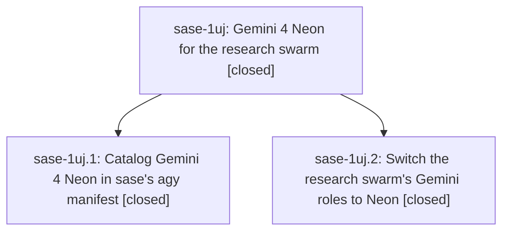

# Bead: sase-1uj — Gemini 4 Neon for the research swarm

[Bead Pages](../README.md) / sase-1uj

**Status:** ✓ closed · **Resolution:** done · **Type:** ▸ plan · **Tier:** epic
**Owner:** `bryanbugyi34@gmail.com` · **Created by:** [bbugyi200.athena.1eo](https://github.com/sase-org/sase--agents/blob/main/sessions/bbugyi200.athena.1eo.md) · **Assignee:** `sase-1uj.land`
**Created:** 2026-11-20 16:42:51 EST · **Closed:** 2026-11-20 18:13:11 EST
**Plan:** [202611/gemini\_neon\_research\_swarm.md](https://github.com/sase-org/sase--plans/blob/main/202611/gemini_neon_research_swarm.md)

<!-- sase:links:start -->

## Links

| Relation | Artifact | Why |
| --- | --- | --- |
| implemented-by | [plan:202611/gemini_neon_research_swarm.md][1] | derived from the plan's `bead_id:` frontmatter field |
| related | file:explicit:da2691fcb96155711373b1f0 | attached via sase artifact create --bead |

_Plus 1 automatic references — see [Referenced By](#referenced-by)._

[1]: https://github.com/sase-org/sase--plans/blob/main/202611/gemini_neon_research_swarm.md

<!-- sase:links:end -->

## Description

SASE catalogs Gemini 4 Neon on Antigravity with accurate plan-gating advisories, and the #research_swarm Gemini researcher runs on agy/gemini-4-neon-xhigh instead of Gemini 4 Hydrogen.

## Notes

[2026-11-20T22:58:16Z · sase-1uj.land] LANDER VERIFICATION AND FOLLOW-UP TRIAGE: Read both children and all four child notes, accepted plan plan:202611/gemini_neon_research_swarm.md, and commits 7e590921e3 (catalog) / plugin 50b479b (swarm). Both DECISIONS honored: image_pool=yes switches the agy image member to Neon; hydrogen_advisory=yes adds paid-Pro notices. agy models confirms all four slugs; runtime model_advisory_for(neon-xhigh) returns the intended info advisory; 139 focused catalog/provider/usage/picker tests pass. Inspected both changed PNG goldens (28 agy models, neon-xhigh effort row). Plugin ruff/mypy pass and its tests pass 167/4 deselected; wrapped check f1513c02301edd6457c691384e49508e was signaled 143 during dependency build, so direct lint/test components were run. Integration reviewed 3025de0572, 8f5ed08088, eb5401709d since epic creation, fetched both origins, and checked plugin release-only 83b7f4e; no new consumer, duplicate catalog, or conflict needs edits. FOLLOW-UP OUTCOMES: sase-1uj.1 #1 completion description_digest drift caused by eca97ab5a7/sase-1tz.3.1.1 is recorded on active ancestor sase-1tz. #2 audit-site failure caused by 1115db9e66/sase-1tz.4.1.9 is recorded on sase-1tz.4.1 and sase-1tz. #2 publication reserve-budget flake (phase check 0969175d22c2ec238390416539271827, 33.38s; isolated landing rerun passes in 2.33s call) was introduced by c756511c11/sase-1tz.2.1.4 and is recorded on sase-1tz. No standalone duplicates created; related sase-xo has different nodes and no proven identical cause. #2 real-gateway environmental proposal declined: all four tests pass in this checkout; no fresh failure or +1 warranted for sase-13h. Broader agy catalog refresh stays outside this accepted scope. epic-symbols is empty; parent_id is null. No code or main-repo file edits. Main check 8c408ed06a2c4f7ca50faa3253f0aca3 is still waiting on its dependency rebuild; close, post-close just symvision, and plan status update remain.

[2026-11-20T23:13:11Z · sase-1uj.land] Verified both closed phases, every child note, accepted plan, and implementation commits 7e590921e3 / sase-research-artifacts 50b479b. DECISIONS image_pool=yes and hydrogen_advisory=yes are honored. The four Neon slugs match agy models; runtime advisory lookup returns the intended info notice; aliases, effort variants, docs, 28-model picker count, and both changed PNG goldens were reviewed. Main tier defaults and size-alias pools remain unchanged. 139 focused catalog/provider/picker tests pass; plugin ruff/mypy and 167 tests pass (4 wheel tests deselected). Plugin wrapped check f1513c02301edd6457c691384e49508e was signaled during dependency setup; direct lint/test components passed. Main check 8c408ed06a2c4f7ca50faa3253f0aca3 is an additional ongoing check, currently delayed by dependency builds; no main-repo files changed in this landing. Integration: reviewed all non-epic commits since creation (eb5401709d, 8f5ed08088, 3025de0572), fetched both origins, and reviewed release-only plugin commit 83b7f4e. No new consumer, duplicate, or conflict requires changes. FOLLOW-UPS from sase-1uj.1: note #1 completion snapshot drift is caused by eca97ab5a7/sase-1tz.3.1.1 and routed to active ancestor sase-1tz; note #2 audit-site failure is caused by 1115db9e66/sase-1tz.4.1.9 and routed to sase-1tz.4.1 and sase-1tz; note #2 reserve-cleanup flake (33.38s in phase check; isolated rerun passes, 2.33s call) was introduced by c756511c11/sase-1tz.2.1.4 and routed to sase-1tz. No duplicate tasks created: closed completion reports concern older defects, and related sase-xo has different nodes with no proven identical cause. Note #2 real-gateway proposal declined because all four tests pass here; no current setup error or new evidence for sase-13h. Evidence: file:explicit:da2691fcb96155711373b1f0, also attached to sase-1tz. No epic-symbol entries remain. No parent bead. Epic work is complete; post-close Symvision and plan status update follow.

[2026-11-20T23:19:00Z · sase-1uj.land] POST-CLOSE: just symvision passed (all public/private classes/functions used properly). Set status: done in plan:202611/gemini_neon_research_swarm.md. Audited the parent link after closing: parent_id=null, so no ancestor closeout is needed. Main combined check 8c408ed06a2c4f7ca50faa3253f0aca3 is still running; its model-policy, Ruff, and mypy stages have passed.

[2026-11-20T23:24:59Z · sase-1uj.land] FINAL VERIFICATION: post-close just symvision passed; plan frontmatter is status: done. Additional main ToolRun 8c408ed06a2c4f7ca50faa3253f0aca3 passed every lint/format/model-policy/docs-contract/SASE-validation/committed-plan stage, then selected the full test lane after rebuilding dependencies. Because this landing changed only the plans sidecar and the relevant 139 SASE + 167 plugin tests already passed, I explicitly stopped this additional full lane; this is NOT a just-check pass. No check-full was run. Final origin refresh also found 6b444fcdef (opt-in notification payload sidecars); its core notification facade/wire/store APIs and docs have no Neon catalog, advisory, alias, or research-swarm consumer overlap, so no integration edit is needed. Plugin origin has no further changes. Both proposing child notes are fully dispositioned in the close note and file:explicit:da2691fcb96155711373b1f0.

## Phases

| Bead | Title | Status | Size | Created | Agents | Commits |
|---|---|---|---|---|---:|---:|
| [sase-1uj.1](sase-1uj.1.md) | Catalog Gemini 4 Neon in sase's agy manifest | ✓ closed | medium | 2026-11-20 | 1 | 1 |
| [sase-1uj.2](sase-1uj.2.md) | Switch the research swarm's Gemini roles to Neon | ✓ closed | small | 2026-11-20 | 1 | 1 |

## Lineage

## Agents

| Agent | Bead | Commits |
|---|---|---:|
| [bbugyi200.athena.sase-1uj.1](https://github.com/sase-org/sase--agents/blob/main/agents/bbugyi200.athena.sase-1uj.1/README.md) | [sase-1uj.1](sase-1uj.1.md) | 1 |
| [bbugyi200.athena.sase-1uj.2](https://github.com/sase-org/sase--agents/blob/main/agents/bbugyi200.athena.sase-1uj.2/README.md) | [sase-1uj.2](sase-1uj.2.md) | 1 |
| [bbugyi200.athena.sase-1uj.land](https://github.com/sase-org/sase--agents/blob/main/agents/bbugyi200.athena.sase-1uj.land/README.md) | [sase-1uj](README.md) | 1 |

## Commits

| Repo | Commit | Subject | Bead | Committed |
|---|---|---|---|---|
| sase-research-artifacts | [`sase-research-artifacts@50b479b`](https://github.com/sase-org/sase-research-artifacts/commit/50b479b23def0e633bd8be6fff4528ff008f3795) | feat(research-swarm): default Gemini roles to Neon | [sase-1uj.2](sase-1uj.2.md) | 2026-11-20 17:20:43 EST |
| sase | [`7e59092`](https://github.com/sase-org/sase/commit/7e590921e33a9d6b6b8e1c174fc2e053bbb38da5) | feat(models): add gemini-4-neon agy family with Pro/paid-Pro advisories | [sase-1uj.1](sase-1uj.1.md) | 2026-11-20 17:46:21 EST |
| sase--plans | [`sase--plans@2daec31`](https://github.com/sase-org/sase--plans/commit/2daec314de108f763c55072cd2d6e0b17940532e) | docs(plans): mark sase-1uj Neon research swarm epic done | [sase-1uj](README.md) | 2026-11-20 18:26:00 EST |

<!-- sase:referenced-by:start -->

## Referenced By

| Relation | Artifact | Why | Uses |
| --- | --- | --- | ---: |
| read-by | [agent:sase-1uj.1][1] | parent epic scope | 1 |

[1]: https://github.com/sase-org/sase--agents/blob/main/agents/bbugyi200.athena.sase-1uj.1/README.md

<!-- sase:referenced-by:end -->
