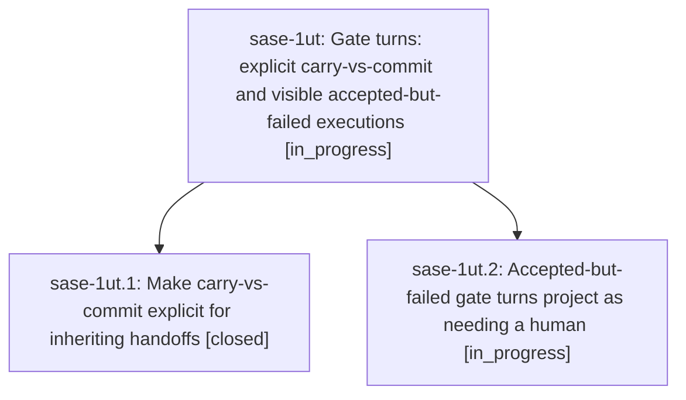

# Bead: sase-1ut — Gate turns: explicit carry-vs-commit and visible accepted-but-failed executions

[Bead Pages](../README.md) / sase-1ut

**Status:** ◐ in_progress · **Type:** ▸ plan · **Tier:** epic
**Owner:** `bryanbugyi34@gmail.com` · **Created by:** [bbugyi200.athena.1et](https://github.com/sase-org/sase--agents/blob/main/sessions/bbugyi200.athena.1et.md) · **Assignee:** `sase-1ut.land`
**Created:** 2026-11-21 09:19:54 EST
**Plan:** [202611/gate\_turn\_carry\_and\_failed\_execution.md](https://github.com/sase-org/sase--plans/blob/main/202611/gate_turn_carry_and_failed_execution.md)

<!-- sase:links:start -->

## Links

| Relation | Artifact | Why |
| --- | --- | --- |
| implemented-by | [plan:202611/gate_turn_carry_and_failed_execution.md][1] | derived from the plan's `bead_id:` frontmatter field |

[1]: https://github.com/sase-org/sase--plans/blob/main/202611/gate_turn_carry_and_failed_execution.md

<!-- sase:links:end -->

## Description

Agents staging inheriting gate turns know dirty work is carried uncommitted unless they declare commit, and a gate whose accepted option command failed is visibly failed and recoverable on every surface instead of silently parking in a Running "settling" state.

## Phases

| Bead | Title | Status | Size | Created | Agents | Commits |
|---|---|---|---|---|---:|---:|
| [sase-1ut.1](sase-1ut.1.md) | Make carry-vs-commit explicit for inheriting handoffs | ✓ closed | medium | 2026-11-21 | 1 | 1 |
| [sase-1ut.2](sase-1ut.2.md) | Accepted-but-failed gate turns project as needing a human | ◐ in_progress | medium | 2026-11-21 | 1 | 0 |

## Lineage

## Agents

| Agent | Bead | Commits |
|---|---|---:|
| [bbugyi200.athena.sase-1ut.1](https://github.com/sase-org/sase--agents/blob/main/agents/bbugyi200.athena.sase-1ut.1/README.md) | [sase-1ut.1](sase-1ut.1.md) | 1 |
| [bbugyi200.athena.sase-1ut.2](https://github.com/sase-org/sase--agents/blob/main/agents/bbugyi200.athena.sase-1ut.2/README.md) | [sase-1ut.2](sase-1ut.2.md) | 0 |
| [bbugyi200.athena.sase-1ut.land](https://github.com/sase-org/sase--agents/blob/main/agents/bbugyi200.athena.sase-1ut.land/README.md) | [sase-1ut](README.md) | 0 |

## Commits

| Repo | Commit | Subject | Bead | Committed |
|---|---|---|---|---|
| sase | [`e6251b5`](https://github.com/sase-org/sase/commit/e6251b55d2e09f3c7c7408a885193c59f4b97fc3) | feat(finalizers): surface carry defaults for inheriting handoffs | [sase-1ut.1](sase-1ut.1.md) | 2026-11-21 10:15:01 EST |
