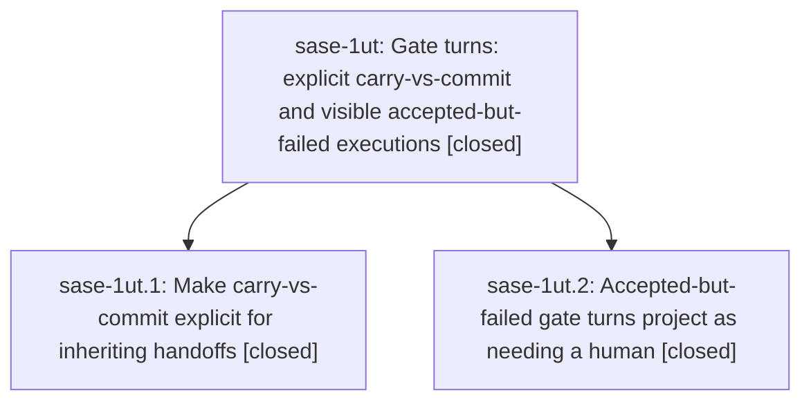

# Bead: sase-1ut — Gate turns: explicit carry-vs-commit and visible accepted-but-failed executions

[Bead Pages](../README.md) / sase-1ut

**Status:** ✓ closed · **Resolution:** done · **Type:** ▸ plan · **Tier:** epic
**Owner:** `bryanbugyi34@gmail.com` · **Created by:** [bbugyi200.athena.1et](https://github.com/sase-org/sase--agents/blob/main/sessions/bbugyi200.athena.1et.md) · **Assignee:** `sase-1ut.land`
**Created:** 2026-11-21 09:19:54 EST · **Closed:** 2026-11-21 11:46:12 EST
**Plan:** [202611/gate\_turn\_carry\_and\_failed\_execution.md](https://github.com/sase-org/sase--plans/blob/main/202611/gate_turn_carry_and_failed_execution.md)

<!-- sase:links:start -->

## Links

| Relation | Artifact | Why |
| --- | --- | --- |
| implemented-by | [plan:202611/gate_turn_carry_and_failed_execution.md][1] | derived from the plan's `bead_id:` frontmatter field |

_Plus 1 automatic references — see [Referenced By](#referenced-by)._

[1]: https://github.com/sase-org/sase--plans/blob/main/202611/gate_turn_carry_and_failed_execution.md

<!-- sase:links:end -->

## Description

Agents staging inheriting gate turns know dirty work is carried uncommitted unless they declare commit, and a gate whose accepted option command failed is visibly failed and recoverable on every surface instead of silently parking in a Running "settling" state.

## Notes

[2026-11-21T15:39:05Z · sase-1ut.land] FOLLOW-UP TRIAGE: Reviewed every note on sase-1ut.1 and sase-1ut.2. The only PROPOSED FOLLOW-UP is sase-1ut.2 note #1 (continuation-retention ancestry test). Through /sase_new_task, searched CI and all task types across statuses, swept all 58 task beads from the last week, and reviewed active-epic scopes. Exact existing bug sase-1uk owns the pre-epic 92dc6274e5 keep-recent short-circuit defect; independently reproduced the line-90 failure on 07411341e3 and added +1 evidence. No new task created. No causally related active epic found: generic retention and CI epics are topical overlap, while the introducing change was the standalone housekeeping retention speedup. No proposals declined or untriaged.

[2026-11-21T15:43:11Z · sase-1ut.land] LANDING AUDIT at 07411341e3: NOT READY TO CLOSE. Reviewed epic scope/DECISIONS and all notes on both closed children, approved artifact plan, both epic commits e6251b55d2/07411341e3, source and tests, and Rust agent_scan wire/scanner. Carry hints/template and waiting/Stopped bucket are correct. Fetched origin/master: no non-epic commits since the first epic commit or epic creation; 39b594a30c is earlier, so no intervening integration edits needed. Ran focused gate failure/staged descriptor/entry/finalizer tests: 48 pass. Remaining epic defects: reclaim returns early on an unrelated visible GateExecutionFailed row before identity matching (probe: target-only restores; unrelated-first does not); delay uses failure age rather than dismissal age; writing a second failed attempt under the same acceptance resets resurfaced true to false; backfill/resurface effects are not guarded by fresh acceptance/member-lock checks; gate failure contract is absent from Rust AgentSessionTurnGateWire and Python compensates with per-row meta rereads; CLI table/Markdown list lacks failure summary and recovery commands; helper tests do not prove real failure-to-resume/cancel or notification-independent ACE Enter; generated carry skills remain stale per sase skill init --diff. No epic-symbol entries. The original epic has no parent. Proposing one medium tale to repair these bounded gaps, run required checks and finish this epic closeout in the coder turn. All out-of-scope follow-ups were triaged in note #1; no new tasks needed.

[2026-11-21T15:43:53Z · sase-1ut.land] Repair tale validated with --explain, removed the inert tale parent_bead field, then revalidated with zero warnings. sase plan propose reported Staged. The tale explicitly finishes this epic landing itself, with no wait for its own SHA/push/CI. Retained targeted-test evidence: file:explicit:7c7d7cf2b3648dc17dcac646. Epic and original plan remain unfinished until the repairs pass.

[2026-11-21T16:46:12Z · sase-1ut.land] Verified both original phases and all notes; repaired shared failure projection, dismissal timing and once-per-acceptance recovery; verified CLI and ACE recovery, generated carry skills, current drift integration and recorded checks. Rust: gate_execution_failure wire + scanner + dismissed_at store/reconcile + resurface decision/projects_attention core fns with bindings and round-trip tests (agent_scan wire, py bindings, notifications dismissal). Python: wire mirror + from_record/store wire preference + snapshot-only + ACE wire enrichment, backfill/resurface lane-lock revalidation + changed proof, dismissal age from dismissed_at with legacy observation, history across same acceptance, failure_outcome lock, list table/markdown failure summary + recovery commands, notification dismissed_at facade. Tests: 13 gate failure attention (history, unrelated-visible, CLI list/markdown, snapshot-only), 289 gate_turn + 39 staged/finalizer, 46 notification models/state, Rust gate resurface policy + failure bindings + dismissal timestamp. Docs updated with dismissal/legacy semantics. Drift: origin/master added 63e52a856e (artifact-links) + dfc0866360 (TUI prompt) since 07411341e3, neither touches gate/notifications, no integration needed. Follow-up from sase-1ut.2 note #1 corroborated existing sase-1uk; no proposals remain untriaged. just symvision clean, ruff + mypy clean.

## Phases

| Bead | Title | Status | Size | Created | Agents | Commits |
|---|---|---|---|---|---:|---:|
| [sase-1ut.1](sase-1ut.1.md) | Make carry-vs-commit explicit for inheriting handoffs | ✓ closed | medium | 2026-11-21 | 1 | 1 |
| [sase-1ut.2](sase-1ut.2.md) | Accepted-but-failed gate turns project as needing a human | ✓ closed | medium | 2026-11-21 | 1 | 1 |

## Lineage

## Agents

| Agent | Bead | Commits |
|---|---|---:|
| [bbugyi200.athena.sase-1ut.1](https://github.com/sase-org/sase--agents/blob/main/agents/bbugyi200.athena.sase-1ut.1/README.md) | [sase-1ut.1](sase-1ut.1.md) | 1 |
| [bbugyi200.athena.sase-1ut.2](https://github.com/sase-org/sase--agents/blob/main/agents/bbugyi200.athena.sase-1ut.2/README.md) | [sase-1ut.2](sase-1ut.2.md) | 1 |
| [bbugyi200.athena.sase-1ut.land](https://github.com/sase-org/sase--agents/blob/main/sessions/bbugyi200.athena.sase-1ut.land.md) | [sase-1ut](README.md) | 1 |

## Commits

| Repo | Commit | Subject | Bead | Committed |
|---|---|---|---|---|
| sase | [`e6251b5`](https://github.com/sase-org/sase/commit/e6251b55d2e09f3c7c7408a885193c59f4b97fc3) | feat(finalizers): surface carry defaults for inheriting handoffs | [sase-1ut.1](sase-1ut.1.md) | 2026-11-21 10:15:01 EST |
| sase | [`0741134`](https://github.com/sase-org/sase/commit/07411341e330e09b7a1e6843ae6dc16dc8b88ca8) | feat(gate-turn): surface accepted-but-failed gates as needing a human | [sase-1ut.2](sase-1ut.2.md) | 2026-11-21 10:33:47 EST |
| sase-core | [`sase-core@f0034a7`](https://github.com/sase-org/sase-core/commit/f0034a781942efe0780caffed520f7e30e037de8) | feat(agent-scan,notifications): project gate failure and dismissal timestamps with shared resurface policy | [sase-1ut](README.md) | 2026-11-21 11:48:22 EST |

<!-- sase:referenced-by:start -->

## Referenced By

| Relation | Artifact | Why | Uses |
| --- | --- | --- | ---: |
| read-by | [agent:sase-1ut.2][1] | need parent epic scope | 1 |

[1]: https://github.com/sase-org/sase--agents/blob/main/agents/bbugyi200.athena.sase-1ut.2/README.md

<!-- sase:referenced-by:end -->
