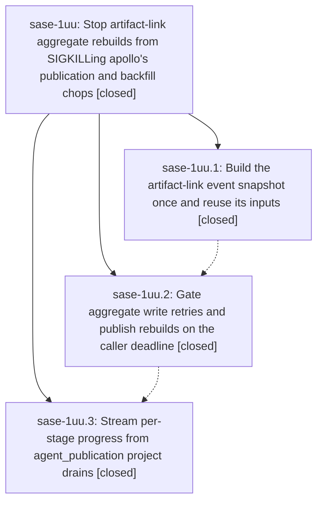

# Bead: sase-1uu — Stop artifact-link aggregate rebuilds from SIGKILLing apollo's publication and backfill chops

[Bead Pages](../README.md) / sase-1uu

**Status:** ✓ closed · **Resolution:** done · **Type:** ▸ plan · **Tier:** epic
**Owner:** `bryanbugyi34@gmail.com` · **Created by:** [bbugyi200.athena.1ew](https://github.com/sase-org/sase--agents/blob/main/sessions/bbugyi200.athena.1ew.md) · **Assignee:** `sase-1uu.land`
**Created:** 2026-11-21 10:59:30 EST · **Closed:** 2026-11-21 13:42:21 EST
**Plan:** [202611/artifact\_link\_aggregate\_timeouts.md](https://github.com/sase-org/sase--plans/blob/main/202611/artifact_link_aggregate_timeouts.md)

<!-- sase:links:start -->

## Links

| Relation | Artifact | Why |
| --- | --- | --- |
| implemented-by | [plan:202611/artifact_link_aggregate_timeouts.md][1] | derived from the plan's `bead_id:` frontmatter field |
| related | [bead:sase-1uv][2] | Epic sase-1uu added +4,146 chop-only first-paint bytes (snapshot memo and deadline-gated aggregate writes) through the eagerly imported artifact-link store |

_Plus 2 automatic references — see [Referenced By](#referenced-by)._

[1]: https://github.com/sase-org/sase--plans/blob/main/202611/artifact_link_aggregate_timeouts.md
[2]: https://github.com/sase-org/sase--beads/blob/main/pages/sase-1uv/README.md

<!-- sase:links:end -->

## Description

agent_publication and artifact_link_backfill finish inside their budgets because aggregate previews build one cheap snapshot, write retries respect the deadline, and slow drains leave progress breadcrumbs.

## Notes

[2026-11-21T18:42:21Z · sase-1uu.land] LANDED. Verified (sase-1uu.land): read every phase bead and note, the plan, and all three commits (63e52a856e, 555e30d832, 333f244b50) against the source.

- snapshot-reuse (sase-1uu.1): preview_aggregate passes its snapshot to _load_store_truth_rows / _load_sidecar_truth_rows, so it builds one snapshot and reads the outbox once (counting test present). The ContextVar memo is re-entrant and active only inside publish_artifact_link_events, drain_artifact_link_outbox, and reconcile_and_repair_artifact_links. Durable entries are keyed by stat taken before the read. The pending outbox is stat'ed inside the shared lock (artifact_link_outbox_read_scope). Exclusion by event operation_id is equivalent to the old entry.id exclusion, because entry ids must equal operation_id.
- deadline-aware-aggregate (sase-1uu.2): _write_merged_aggregate raises ArtifactLinkAggregateWriteDeferred after a lost CAS that no longer fits, or before the first compute when already expired. deadline=None keeps 5 attempts with a forced last. The deadline is threaded through rebuild_aggregate, reconcile_aggregate (on-disk aggregate plus the reconcile-deadline diagnostic; repair skipped), and apply_events_to_aggregate. The publish path honors DECISION publish_deferral=retain: aggregate_ready=False, deferred=True, rows stay queued. Six publish phase_seconds, drained as publish.*.
- publication-drain-progress (sase-1uu.3): drain_project emits stage lines before each stage plus a link-drain-phases line. _run_publication_job gates them through _maybe_progress with project=.
- Other deadline-less rebuild callers (upsert_row, remove_rows, renames, import_apply, doctor link_health) are interactive or CLI and keep the 5-attempt loop, per the plan.

Integration: the only non-epic commit since the epic started, da2165b80f (gate-turn), does not touch artifact-link code. Lander cleanup: phase 3 had copied phase 2's drain-phase formatter into agents_sync. Both chops now call one shared render_drain_phase_seconds in sdd/_artifact_link_outbox_drain_support.py, with identical output; the existing formatter tests pass. Closed sase-1rt, which phase 1 resolved but never closed. Epic-symbols: none.

Verification: sase tool run -k check (f6933a48) passed every lint gate, including symvision, and the scoped tests (137 files). Its only failure is docs contract: pre-existing, tracked as sase-1uw below.

PROPOSED FOLLOW-UP outcomes:
1. notification-gates.md over the 6,000-word cap (sase-1uu.1 #2, sase-1uu.2 #3, sase-1uu.3 #1): new task sase-1uw (ci, small). It is 6,158 words on 333f244b50 after da2165b80f; not caused by this epic.
2. test_continuation_retention live-ancestry failure (sase-1uu.2 #1): duplicate of sase-1uk (same node, same keep-recent short-circuit root cause). Reproduced on 333f244b50 and recorded as a +1.
3. test_app_import_budget (sase-1uu.2 #2): the phase blamed host load, but it is a deterministic first-paint source-footprint overrun (11,905,892 vs the 11,896,376 cap), so it was not +1'd onto CPU flake sase-1ai. New task sase-1uv (ci, medium), linked to sase-1ai, sase-1uu, and sase-1ut. The guard was already red before this epic (dfc0866360 measures 11,897,750). This epic adds +4,146 chop-only bytes through the eagerly imported artifact-link store stack. da2165b80f adds +3,996. Deferring only this epic's bytes would still leave the guard red, so I did not micro-defer them here. sase-1uv tracks the real fix: drop the sase.sdd.artifact_link_store facade (~130 KB, 24 modules) from TUI first paint at its six importers.
Not filed: the phase 3 note's load-flaky test_sdd_commit / gate_capacity were not proposals, and gate capacity is already sase-1tn. The plan's optional Rust batch-reduce follow-up was never proposed and needs post-deploy apollo timings first.

## Phases

| Bead | Title | Status | Size | Created | Agents | Commits |
|---|---|---|---|---|---:|---:|
| [sase-1uu.1](sase-1uu.1.md) | Build the artifact-link event snapshot once and reuse its inputs | ✓ closed | medium | 2026-11-21 | 1 | 1 |
| [sase-1uu.2](sase-1uu.2.md) | Gate aggregate write retries and publish rebuilds on the caller deadline | ✓ closed | medium | 2026-11-21 | 1 | 1 |
| [sase-1uu.3](sase-1uu.3.md) | Stream per-stage progress from agent\_publication project drains | ✓ closed | small | 2026-11-21 | 1 | 1 |

## Lineage

## Agents

| Agent | Bead | Commits |
|---|---|---:|
| [bbugyi200.athena.sase-1uu.1](https://github.com/sase-org/sase--agents/blob/main/agents/bbugyi200.athena.sase-1uu.1/README.md) | [sase-1uu.1](sase-1uu.1.md) | 1 |
| [bbugyi200.athena.sase-1uu.2](https://github.com/sase-org/sase--agents/blob/main/agents/bbugyi200.athena.sase-1uu.2/README.md) | [sase-1uu.2](sase-1uu.2.md) | 1 |
| [bbugyi200.athena.sase-1uu.3](https://github.com/sase-org/sase--agents/blob/main/agents/bbugyi200.athena.sase-1uu.3/README.md) | [sase-1uu.3](sase-1uu.3.md) | 1 |
| [bbugyi200.athena.sase-1uu.land](https://github.com/sase-org/sase--agents/blob/main/agents/bbugyi200.athena.sase-1uu.land/README.md) | [sase-1uu](README.md) | 2 |

## Commits

| Repo | Commit | Subject | Bead | Committed |
|---|---|---|---|---|
| sase | [`63e52a8`](https://github.com/sase-org/sase/commit/63e52a856e0cb3b4d71aeccdc46b80eea214974a) | perf(artifact-links): reuse scoped snapshot inputs | [sase-1uu.1](sase-1uu.1.md) | 2026-11-21 11:37:54 EST |
| sase | [`555e30d`](https://github.com/sase-org/sase/commit/555e30d83289d6a669210704c272884596aa8c09) | feat(artifact-links): gate aggregate write retries and publish rebuilds on the caller deadline | [sase-1uu.2](sase-1uu.2.md) | 2026-11-21 12:28:05 EST |
| sase | [`333f244`](https://github.com/sase-org/sase/commit/333f244b50e593996f65e34e9f5aa25cb006316f) | feat(agent-publication): stream per-stage progress from project drains | [sase-1uu.3](sase-1uu.3.md) | 2026-11-21 13:07:52 EST |
| sase | [`6933ac5`](https://github.com/sase-org/sase/commit/6933ac564df2fa3ba6271c7983f5354c0771fdae) | refactor(artifact-links): share the drain phase-timing renderer between both chops | [sase-1uu](README.md) | 2026-11-21 13:45:04 EST |
| sase--plans | [`sase--plans@30c7ee3`](https://github.com/sase-org/sase--plans/commit/30c7ee3e70fbd45552eaad952d1c38b5c3476fdf) | chore(plans): mark artifact\_link\_aggregate\_timeouts done after sase-1uu landed | [sase-1uu](README.md) | 2026-11-21 13:46:18 EST |

<!-- sase:referenced-by:start -->

## Referenced By

| Relation | Artifact | Why | Uses |
| --- | --- | --- | ---: |
| read-by | [agent:sase-1uu.1][1] | Need parent plan state and original task context to verify phase scope and landed work | 1 |
| read-by | [agent:sase-1uu.2][2] | Need epic notes | 1 |

[1]: https://github.com/sase-org/sase--agents/blob/main/agents/bbugyi200.athena.sase-1uu.1/README.md
[2]: https://github.com/sase-org/sase--agents/blob/main/agents/bbugyi200.athena.sase-1uu.2/README.md

<!-- sase:referenced-by:end -->
