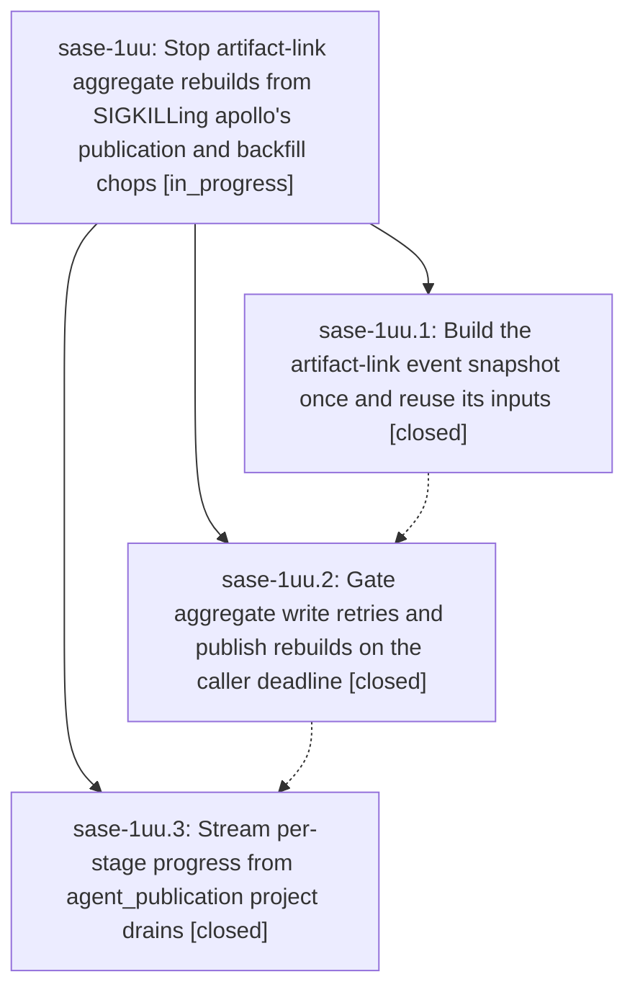

# Bead: sase-1uu — Stop artifact-link aggregate rebuilds from SIGKILLing apollo's publication and backfill chops

[Bead Pages](../README.md) / sase-1uu

**Status:** ◐ in_progress · **Type:** ▸ plan · **Tier:** epic
**Owner:** `bryanbugyi34@gmail.com` · **Created by:** [bbugyi200.athena.1ew](https://github.com/sase-org/sase--agents/blob/main/sessions/bbugyi200.athena.1ew.md) · **Assignee:** `sase-1uu.land`
**Created:** 2026-11-21 10:59:30 EST
**Plan:** [202611/artifact\_link\_aggregate\_timeouts.md](https://github.com/sase-org/sase--plans/blob/main/202611/artifact_link_aggregate_timeouts.md)

<!-- sase:links:start -->

## Links

| Relation | Artifact | Why |
| --- | --- | --- |
| implemented-by | [plan:202611/artifact_link_aggregate_timeouts.md][1] | derived from the plan's `bead_id:` frontmatter field |

_Plus 2 automatic references — see [Referenced By](#referenced-by)._

[1]: https://github.com/sase-org/sase--plans/blob/main/202611/artifact_link_aggregate_timeouts.md

<!-- sase:links:end -->

## Description

agent_publication and artifact_link_backfill finish inside their budgets because aggregate previews build one cheap snapshot, write retries respect the deadline, and slow drains leave progress breadcrumbs.

## Phases

| Bead | Title | Status | Size | Created | Agents | Commits |
|---|---|---|---|---|---:|---:|
| [sase-1uu.1](sase-1uu.1.md) | Build the artifact-link event snapshot once and reuse its inputs | ✓ closed | medium | 2026-11-21 | 1 | 1 |
| [sase-1uu.2](sase-1uu.2.md) | Gate aggregate write retries and publish rebuilds on the caller deadline | ✓ closed | medium | 2026-11-21 | 1 | 1 |
| [sase-1uu.3](sase-1uu.3.md) | Stream per-stage progress from agent\_publication project drains | ✓ closed | small | 2026-11-21 | 1 | 1 |

## Lineage

## Agents

| Agent | Bead | Commits |
|---|---|---:|
| [bbugyi200.athena.sase-1uu.1](https://github.com/sase-org/sase--agents/blob/main/agents/bbugyi200.athena.sase-1uu.1/README.md) | [sase-1uu.1](sase-1uu.1.md) | 1 |
| [bbugyi200.athena.sase-1uu.2](https://github.com/sase-org/sase--agents/blob/main/agents/bbugyi200.athena.sase-1uu.2/README.md) | [sase-1uu.2](sase-1uu.2.md) | 1 |
| [bbugyi200.athena.sase-1uu.3](https://github.com/sase-org/sase--agents/blob/main/agents/bbugyi200.athena.sase-1uu.3/README.md) | [sase-1uu.3](sase-1uu.3.md) | 1 |
| [bbugyi200.athena.sase-1uu.land](https://github.com/sase-org/sase--agents/blob/main/agents/bbugyi200.athena.sase-1uu.land/README.md) | [sase-1uu](README.md) | 0 |

## Commits

| Repo | Commit | Subject | Bead | Committed |
|---|---|---|---|---|
| sase | [`63e52a8`](https://github.com/sase-org/sase/commit/63e52a856e0cb3b4d71aeccdc46b80eea214974a) | perf(artifact-links): reuse scoped snapshot inputs | [sase-1uu.1](sase-1uu.1.md) | 2026-11-21 11:37:54 EST |
| sase | [`555e30d`](https://github.com/sase-org/sase/commit/555e30d83289d6a669210704c272884596aa8c09) | feat(artifact-links): gate aggregate write retries and publish rebuilds on the caller deadline | [sase-1uu.2](sase-1uu.2.md) | 2026-11-21 12:28:05 EST |
| sase | [`333f244`](https://github.com/sase-org/sase/commit/333f244b50e593996f65e34e9f5aa25cb006316f) | feat(agent-publication): stream per-stage progress from project drains | [sase-1uu.3](sase-1uu.3.md) | 2026-11-21 13:07:52 EST |

<!-- sase:referenced-by:start -->

## Referenced By

| Relation | Artifact | Why | Uses |
| --- | --- | --- | ---: |
| read-by | [agent:sase-1uu.1][1] | Need parent plan state and original task context to verify phase scope and landed work | 1 |
| read-by | [agent:sase-1uu.2][2] | Need epic notes | 1 |

[1]: https://github.com/sase-org/sase--agents/blob/main/agents/bbugyi200.athena.sase-1uu.1/README.md
[2]: https://github.com/sase-org/sase--agents/blob/main/agents/bbugyi200.athena.sase-1uu.2/README.md

<!-- sase:referenced-by:end -->
