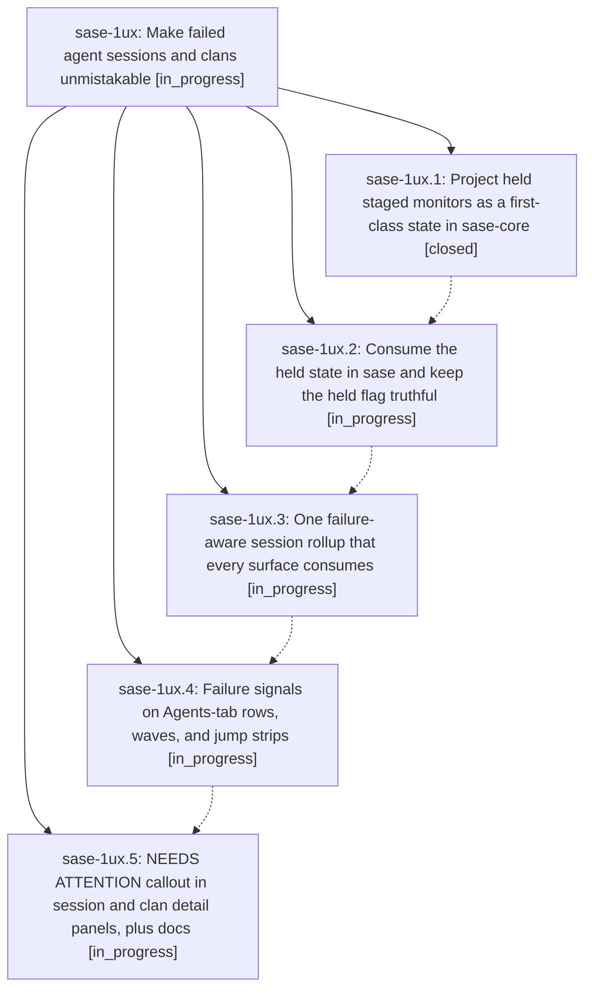

# Bead: sase-1ux — Make failed agent sessions and clans unmistakable

[Bead Pages](../README.md) / sase-1ux

**Status:** ◐ in_progress · **Type:** ▸ plan · **Tier:** epic
**Owner:** `bryanbugyi34@gmail.com` · **Created by:** [bbugyi200.athena.1f4](https://github.com/sase-org/sase--agents/blob/main/sessions/bbugyi200.athena.1f4.md) · **Assignee:** `sase-1ux.land`
**Created:** 2026-11-22 08:33:06 EST
**Plan:** [202611/failed\_clan\_visibility.md](https://github.com/sase-org/sase--plans/blob/main/202611/failed_clan_visibility.md)

<!-- sase:links:start -->

## Links

| Relation | Artifact | Why |
| --- | --- | --- |
| implemented-by | [plan:202611/failed_clan_visibility.md][1] | derived from the plan's `bead_id:` frontmatter field |

_Plus 1 automatic references — see [Referenced By](#referenced-by)._

[1]: https://github.com/sase-org/sase--plans/blob/main/202611/failed_clan_visibility.md

<!-- sase:links:end -->

## Description

When an agent session or clan stops on a failure, every Agents-tab surface says so: the row, the BY_STATUS section, the count chips, the waves and jump strips, and the detail panels all read FAILED and agree with each other. The cause and the next step are one glance away. A staged handoff the host refused to adopt shows as NOT ADOPTED, never as a phantom RUNNING with a ticking clock.

## Phases

| Bead | Title | Status | Size | Created | Agents | Commits |
|---|---|---|---|---|---:|---:|
| [sase-1ux.1](sase-1ux.1.md) | Project held staged monitors as a first-class state in sase-core | ✓ closed | medium | 2026-11-22 | 1 | 1 |
| [sase-1ux.2](sase-1ux.2.md) | Consume the held state in sase and keep the held flag truthful | ◐ in_progress | medium | 2026-11-22 | 1 | 1 |
| [sase-1ux.3](sase-1ux.3.md) | One failure-aware session rollup that every surface consumes | ◐ in_progress | medium | 2026-11-22 | 1 | 0 |
| [sase-1ux.4](sase-1ux.4.md) | Failure signals on Agents-tab rows, waves, and jump strips | ◐ in_progress | medium | 2026-11-22 | 1 | 0 |
| [sase-1ux.5](sase-1ux.5.md) | NEEDS ATTENTION callout in session and clan detail panels, plus docs | ◐ in_progress | medium | 2026-11-22 | 1 | 0 |

## Lineage

## Agents

| Agent | Bead | Commits |
|---|---|---:|
| [bbugyi200.athena.sase-1ux.1](https://github.com/sase-org/sase--agents/blob/main/agents/bbugyi200.athena.sase-1ux.1/README.md) | [sase-1ux.1](sase-1ux.1.md) | 1 |
| [bbugyi200.athena.sase-1ux.2](https://github.com/sase-org/sase--agents/blob/main/sessions/bbugyi200.athena.sase-1ux.2.md) | [sase-1ux.2](sase-1ux.2.md) | 1 |
| [bbugyi200.athena.sase-1ux.3](https://github.com/sase-org/sase--agents/blob/main/agents/bbugyi200.athena.sase-1ux.3/README.md) | [sase-1ux.3](sase-1ux.3.md) | 0 |
| [bbugyi200.athena.sase-1ux.4](https://github.com/sase-org/sase--agents/blob/main/agents/bbugyi200.athena.sase-1ux.4/README.md) | [sase-1ux.4](sase-1ux.4.md) | 0 |
| [bbugyi200.athena.sase-1ux.5](https://github.com/sase-org/sase--agents/blob/main/agents/bbugyi200.athena.sase-1ux.5/README.md) | [sase-1ux.5](sase-1ux.5.md) | 0 |
| [bbugyi200.athena.sase-1ux.land](https://github.com/sase-org/sase--agents/blob/main/agents/bbugyi200.athena.sase-1ux.land/README.md) | [sase-1ux](README.md) | 0 |

## Commits

| Repo | Commit | Subject | Bead | Committed |
|---|---|---|---|---|
| sase-core | [`sase-core@1fb9701`](https://github.com/sase-org/sase-core/commit/1fb9701f40b6609ec810326c0e78ee07722de26d) | feat(staged-handoff): project held staged monitors as first-class state | [sase-1ux.1](sase-1ux.1.md) | 2026-11-22 09:21:03 EST |
| sase | [`1c4c89f`](https://github.com/sase-org/sase/commit/1c4c89f6b41b981ad615a797cb0f49d393c82ab9) | feat(monitor): consume held staged-monitor state in sase | [sase-1ux.2](sase-1ux.2.md) | 2026-11-22 11:20:19 EST |

<!-- sase:referenced-by:start -->

## Referenced By

| Relation | Artifact | Why | Uses |
| --- | --- | --- | ---: |
| read-by | [agent:sase-1ux.1][1] | Need epic scope and plan context | 1 |

[1]: https://github.com/sase-org/sase--agents/blob/main/agents/bbugyi200.athena.sase-1ux.1/README.md

<!-- sase:referenced-by:end -->
