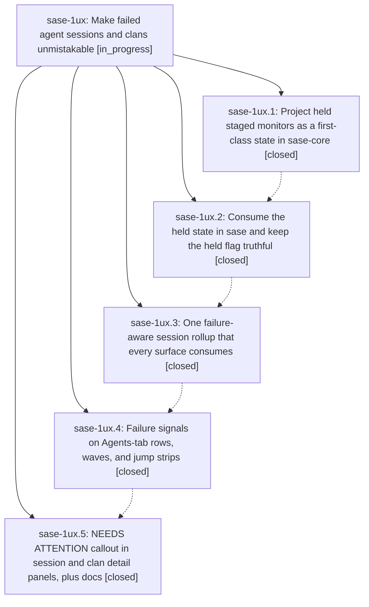

# Bead: sase-1ux — Make failed agent sessions and clans unmistakable

[Bead Pages](../README.md) / sase-1ux

**Status:** ◐ in_progress · **Type:** ▸ plan · **Tier:** epic
**Owner:** `bryanbugyi34@gmail.com` · **Created by:** [bbugyi200.athena.1f4](https://github.com/sase-org/sase--agents/blob/main/sessions/bbugyi200.athena.1f4.md) · **Assignee:** `sase-1ux.land`
**Created:** 2026-11-22 08:33:06 EST
**Plan:** [202611/failed\_clan\_visibility.md](https://github.com/sase-org/sase--plans/blob/main/202611/failed_clan_visibility.md)

<!-- sase:links:start -->

## Links

| Relation | Artifact | Why |
| --- | --- | --- |
| implemented-by | [plan:202611/failed_clan_visibility.md][1] | derived from the plan's `bead_id:` frontmatter field |

_Plus 2 automatic references — see [Referenced By](#referenced-by)._

[1]: https://github.com/sase-org/sase--plans/blob/main/202611/failed_clan_visibility.md

<!-- sase:links:end -->

## Description

When an agent session or clan stops on a failure, every Agents-tab surface says so: the row, the BY_STATUS section, the count chips, the waves and jump strips, and the detail panels all read FAILED and agree with each other. The cause and the next step are one glance away. A staged handoff the host refused to adopt shows as NOT ADOPTED, never as a phantom RUNNING with a ticking clock.

## Notes

[2026-11-22T20:42:30Z · sase-1ux.land] LAND TRIAGE (sase-1ux.land): PROPOSED FOLLOW-UP outcomes. (1) sase-1ux.2 #1 dead-pid gate audit -> new task sase-1v0 (bug, large; related sase-1so). (2) sase-1ux.3 #1 six clean-base check failures -> declined as a new task: at HEAD 1d4f456f41 the system-clock display audit, monitor-settlement replay, and both artifact-marker mutation audits pass (fixed by later commits); the terminology audit is sase-1uy and the project-display audit is sase-1uz. (3) sase-1ux.4 #1 / sase-1ux.5 #2 terminology guard (sase-1uy) -> CAUSED BY THIS EPIC: 1c4c89f6b4's notification-gates.md trim introduced the literal guarded phrases; fixed by the land agent's doc rewording (terminology tests 3 passed) and sase-1uy closed. sase-1uw (6,158-word cap) also closed as fixed by 1c4c89f6b4 (page now 5,662 words, check_docs clean). (4) sase-1ux.4 #2 / sase-1ux.5 #1 project metadata audit -> duplicate of sase-1uz, corroborated with a +1 (reproduced at HEAD). (5) sase-1ux.4 #3 cause-chip drop not recomputed on first paint/resize -> CAUSED BY THIS EPIC, kept as epic work in the landing tale (also normalizes the per-row render-key width so only chip-capable rows key on viewport width). (6) sase-1ux.4 #4 FinalizerInventoryWorkerResult GC leftover -> new task sase-1v2 (flake; 3/3 serial reruns passed). Plan out-of-scope list: owner-index leaks -> new task sase-1v1 (bug, medium; 4 orphaned entries on athena, related sase-1ra.8); sase-core rollup port -> new task sase-1v3 (feature, large); WAITING-blocked row marker -> declined, the clan callout's 'blocks' line covers the clan view and no surface showed a need; bulk-dismissed failure notifications -> declined, the epic made the Agents tab itself carry FAILED state so a dismissed notification no longer hides the failure, and no concrete remedy was proposed.

## Phases

| Bead | Title | Status | Size | Created | Agents | Commits |
|---|---|---|---|---|---:|---:|
| [sase-1ux.1](sase-1ux.1.md) | Project held staged monitors as a first-class state in sase-core | ✓ closed | medium | 2026-11-22 | 1 | 1 |
| [sase-1ux.2](sase-1ux.2.md) | Consume the held state in sase and keep the held flag truthful | ✓ closed | medium | 2026-11-22 | 1 | 1 |
| [sase-1ux.3](sase-1ux.3.md) | One failure-aware session rollup that every surface consumes | ✓ closed | medium | 2026-11-22 | 1 | 1 |
| [sase-1ux.4](sase-1ux.4.md) | Failure signals on Agents-tab rows, waves, and jump strips | ✓ closed | medium | 2026-11-22 | 1 | 1 |
| [sase-1ux.5](sase-1ux.5.md) | NEEDS ATTENTION callout in session and clan detail panels, plus docs | ✓ closed | medium | 2026-11-22 | 1 | 1 |

## Lineage

## Agents

| Agent | Bead | Commits |
|---|---|---:|
| [bbugyi200.athena.sase-1ux.1](https://github.com/sase-org/sase--agents/blob/main/agents/bbugyi200.athena.sase-1ux.1/README.md) | [sase-1ux.1](sase-1ux.1.md) | 1 |
| [bbugyi200.athena.sase-1ux.2](https://github.com/sase-org/sase--agents/blob/main/sessions/bbugyi200.athena.sase-1ux.2.md) | [sase-1ux.2](sase-1ux.2.md) | 1 |
| [bbugyi200.athena.sase-1ux.3](https://github.com/sase-org/sase--agents/blob/main/agents/bbugyi200.athena.sase-1ux.3/README.md) | [sase-1ux.3](sase-1ux.3.md) | 1 |
| [bbugyi200.athena.sase-1ux.4](https://github.com/sase-org/sase--agents/blob/main/agents/bbugyi200.athena.sase-1ux.4/README.md) | [sase-1ux.4](sase-1ux.4.md) | 1 |
| [bbugyi200.athena.sase-1ux.5](https://github.com/sase-org/sase--agents/blob/main/agents/bbugyi200.athena.sase-1ux.5/README.md) | [sase-1ux.5](sase-1ux.5.md) | 1 |
| [bbugyi200.athena.sase-1ux.land](https://github.com/sase-org/sase--agents/blob/main/agents/bbugyi200.athena.sase-1ux.land/README.md) | [sase-1ux](README.md) | 1 |

## Commits

| Repo | Commit | Subject | Bead | Committed |
|---|---|---|---|---|
| sase-core | [`sase-core@1fb9701`](https://github.com/sase-org/sase-core/commit/1fb9701f40b6609ec810326c0e78ee07722de26d) | feat(staged-handoff): project held staged monitors as first-class state | [sase-1ux.1](sase-1ux.1.md) | 2026-11-22 09:21:03 EST |
| sase | [`1c4c89f`](https://github.com/sase-org/sase/commit/1c4c89f6b41b981ad615a797cb0f49d393c82ab9) | feat(monitor): consume held staged-monitor state in sase | [sase-1ux.2](sase-1ux.2.md) | 2026-11-22 11:20:19 EST |
| sase | [`3dc72dd`](https://github.com/sase-org/sase/commit/3dc72ddd4c3fe4e6b1f16746151dbaf639083ecb) | feat(tui): unify failure-aware session rollups | [sase-1ux.3](sase-1ux.3.md) | 2026-11-22 12:51:38 EST |
| sase | [`623c826`](https://github.com/sase-org/sase/commit/623c826812eef397bd0912d1d1002682a7570d22) | feat(tui): show failure cause chips, times, and glyphs on Agents rows | [sase-1ux.4](sase-1ux.4.md) | 2026-11-22 14:14:48 EST |
| sase | [`1d4f456`](https://github.com/sase-org/sase/commit/1d4f456f41a3a4b20c237bbdcb322d8b8a01f03f) | feat(tui): add NEEDS ATTENTION callout to session and clan detail panels | [sase-1ux.5](sase-1ux.5.md) | 2026-11-22 15:23:57 EST |
| sase | [`4a058c8`](https://github.com/sase-org/sase/commit/4a058c8e98d2ae2fc8668581123d55877554a831) | docs(gates): reword retired shell spellings past the terminology guard | [sase-1ux](README.md) | 2026-11-22 15:53:09 EST |

<!-- sase:referenced-by:start -->

## Referenced By

| Relation | Artifact | Why | Uses |
| --- | --- | --- | ---: |
| read-by | [agent:sase-1ux.1][1] | Need epic scope and plan context | 1 |
| read-by | [agent:sase-1ux.5][2] | Need epic scope and plan | 1 |

[1]: https://github.com/sase-org/sase--agents/blob/main/agents/bbugyi200.athena.sase-1ux.1/README.md
[2]: https://github.com/sase-org/sase--agents/blob/main/agents/bbugyi200.athena.sase-1ux.5/README.md

<!-- sase:referenced-by:end -->
