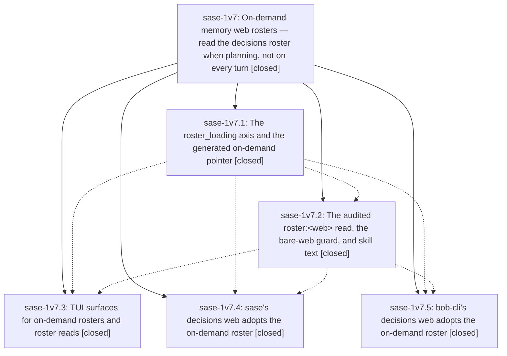

# Bead: sase-1v7 — On-demand memory web rosters — read the decisions roster when planning, not on every turn

[Bead Pages](../README.md) / sase-1v7

**Status:** ✓ closed · **Resolution:** done · **Type:** ▸ plan · **Tier:** epic
**Owner:** `bryanbugyi34@gmail.com` · **Created by:** [bbugyi200.athena.1g7](https://github.com/sase-org/sase--agents/blob/main/sessions/bbugyi200.athena.1g7.md) · **Assignee:** `sase-1v7.land`
**Created:** 2026-11-25 15:44:39 EST · **Closed:** 2026-11-25 19:49:11 EST
**Plan:** [202611/on\_demand\_web\_rosters.md](https://github.com/sase-org/sase--plans/blob/main/202611/on_demand_web_rosters.md)

<!-- sase:links:start -->

## Links

| Relation | Artifact | Why |
| --- | --- | --- |
| implemented-by | [plan:202611/on_demand_web_rosters.md][1] | derived from the plan's `bead_id:` frontmatter field |

_Plus 2 automatic references — see [Referenced By](#referenced-by)._

[1]: https://github.com/sase-org/sase--plans/blob/main/202611/on_demand_web_rosters.md

<!-- sase:links:end -->

## Description

Any memory web can declare `roster_loading: on_demand`. Agent instruction bundles and the committed AGENTS.md then carry a short generated pointer instead of the full roster. The pointer names the exact audited command and lists who MUST run it: planners and researchers, plus anyone changing governed behavior without a plan. The command is `sase memory read roster:<web>`, it batches with strand reads, and the TUI shows it in the agent MEMORY lane and on the Memory panel's web card. A bare read of an on-demand web can no longer dump every strand body by accident. The decisions webs in sase and bob-cli adopt it, so the decisions section drops from about 8.4 KB to about 0.8 KB in sase and from about 25.6 KB to about 1 KB in bob-cli. bob-cli's Codex bundle goes from over its cap to roughly 19 KB of headroom.

## Notes

[2026-11-26T00:10:49Z · sase-1v7.land] LAND TRIAGE (sase-1v7.land): PROPOSED FOLLOW-UP outcomes — (1) sase-1v7.3 #1 completion snapshot drift: caused by this epic (sase-1v7.2 added -a/--all-strands and roster:<web> help text without running just sync-completion-spec); declined as a task, kept as epic work in the landing tale. (2) sase-1v7.3 #2 design-decisions anchor failure: caused by this epic (sase-1v7.4 wrote superseded_by: decisions:rosters-load-on-demand instead of the decisions/<slug> form every other record uses, so tests/test_render_design_decisions.py::test_real_decisions_web_renders_every_record fails); declined as a task, kept as epic work in the landing tale. (3) sase-1v7.5 #1 bob-cli 22 pre-existing cargo test failures: not caused by the epic (reproduced on clean base 9dd67c62); filed as task sase-1v9 (ci, large, ready, related to sase-1gb). Other epic gaps found while verifying, also in the landing tale: the on-demand 'body empty outside the managed region' blocker never fires for a populated region (validation.py uses strip_managed_roster_markers, which keeps roster lines); rosters-load-on-demand record lacks the plan-required measurements, rejected alternatives, cost items, reopen triggers, research citation, and back-link; decisions.md preamble's last sentence still duplicates the pointer's strand-read line; Memory panel docs (docs/reference/tui/prompt-completion-panels.md) omit the ON DEMAND badge and new card rows; the sase_memory_read/sase_plan skill updates were never deployed (phase 4 deployed from the primary checkout at e489558571, so the chezmoi manifest source_commit predates the phase-2 skill sources). Integration: the only non-epic commit since the epic started is 696e0180f4 (agents-sync publication planning), which does not touch memory webs; nothing to integrate. bob-cli adoption verified at bob-cli d13f8d1d. sase bead epic-symbols sase-1v7 is empty.

[2026-11-26T00:49:11Z · sase-1v7.land] Land tale complete. Skill deploy: from 8e6818d0a6, diff only roster: overwrites, deployed with -y, verified empty diff + manifest HEAD + roster text in skills, venv restored. Blocker fix: body_without_managed_roster_region added to roster.py, used in validation.py, 2 new tests, file 23 passed. Snapshot: just sync-completion-spec, diff only memory read/show -a/--all-strands + digests. Memory: superseded_by fixed to decisions/rosters-load-on-demand with house back-link; rosters-load-on-demand rewritten with df9ce4ef55 measurements, outcomes (AGENTS.md 21076->13868 B), rejected alternatives, costs, reopen triggers, evidence link (research ref missing, omitted); decisions.md preamble trimmed; sase memory init regenerated. Docs: ON DEMAND panel sentence added. Verify: just fix clean; targeted 58 passed (snapshot, design-decisions, roster-loading, selector-roster, init-memory-webs); memory init --check clean; roster:decisions shows [partly superseded by rosters-load-on-demand]; epic-symbols empty; just symvision clean. sase tool run check fb24d94391609bb349dc0b6c9edf1ef9: all lint/SASE/docs stages green, test (scoped) 63678 passed 1 failed — test_blocked_render_with_young_index_lock_is_bounded, load-sensitive flake (load1 hit 133), passes isolated in 6.3s; filed as flake sase-1va (ready, related to sase-xo). Both plan files (epic + land tale) flipped to status done.

## Phases

| Bead | Title | Status | Size | Created | Agents | Commits |
|---|---|---|---|---|---:|---:|
| [sase-1v7.1](sase-1v7.1.md) | The roster\_loading axis and the generated on-demand pointer | ✓ closed | medium | 2026-11-25 | 1 | 1 |
| [sase-1v7.2](sase-1v7.2.md) | The audited roster:\<web\> read, the bare-web guard, and skill text | ✓ closed | medium | 2026-11-25 | 1 | 1 |
| [sase-1v7.3](sase-1v7.3.md) | TUI surfaces for on-demand rosters and roster reads | ✓ closed | small | 2026-11-25 | 1 | 1 |
| [sase-1v7.4](sase-1v7.4.md) | sase's decisions web adopts the on-demand roster | ✓ closed | small | 2026-11-25 | 1 | 1 |
| [sase-1v7.5](sase-1v7.5.md) | bob-cli's decisions web adopts the on-demand roster | ✓ closed | small | 2026-11-25 | 1 | 0 |

## Lineage

## Agents

| Agent | Bead | Commits |
|---|---|---:|
| [bbugyi200.athena.sase-1v7.1](https://github.com/sase-org/sase--agents/blob/main/agents/bbugyi200.athena.sase-1v7.1/README.md) | [sase-1v7.1](sase-1v7.1.md) | 1 |
| [bbugyi200.athena.sase-1v7.2](https://github.com/sase-org/sase--agents/blob/main/agents/bbugyi200.athena.sase-1v7.2/README.md) | [sase-1v7.2](sase-1v7.2.md) | 1 |
| [bbugyi200.athena.sase-1v7.3](https://github.com/sase-org/sase--agents/blob/main/sessions/bbugyi200.athena.sase-1v7.3.md) | [sase-1v7.3](sase-1v7.3.md) | 1 |
| [bbugyi200.athena.sase-1v7.4](https://github.com/sase-org/sase--agents/blob/main/agents/bbugyi200.athena.sase-1v7.4/README.md) | [sase-1v7.4](sase-1v7.4.md) | 1 |
| [bbugyi200.athena.sase-1v7.5](https://github.com/sase-org/sase--agents/blob/main/agents/bbugyi200.athena.sase-1v7.5/README.md) | [sase-1v7.5](sase-1v7.5.md) | 0 |
| [bbugyi200.athena.sase-1v7.land](https://github.com/sase-org/sase--agents/blob/main/sessions/bbugyi200.athena.sase-1v7.land.md) | [sase-1v7](README.md) | 1 |

## Commits

| Repo | Commit | Subject | Bead | Committed |
|---|---|---|---|---|
| sase | [`e489558`](https://github.com/sase-org/sase/commit/e489558571a747220f7912156f1ebed7fb95e7b5) | feat(memory): add on-demand web roster loading axis | [sase-1v7.1](sase-1v7.1.md) | 2026-11-25 16:54:19 EST |
| sase | [`1a468da`](https://github.com/sase-org/sase/commit/1a468da521f18d4a29ad7c2787c41634f9194db1) | feat(memory): add audited roster web read with bare-web guard | [sase-1v7.2](sase-1v7.2.md) | 2026-11-25 17:35:21 EST |
| sase | [`47cec6e`](https://github.com/sase-org/sase/commit/47cec6ea49154aee6d56ac766385e6c8f2b4238e) | feat(memory): load decisions roster on demand | [sase-1v7.4](sase-1v7.4.md) | 2026-11-25 18:11:44 EST |
| sase | [`8e6818d`](https://github.com/sase-org/sase/commit/8e6818d0a6bc0f6eb1b3fd8071385b152af04752) | feat(tui): show on-demand memory rosters | [sase-1v7.3](sase-1v7.3.md) | 2026-11-25 18:12:13 EST |
| sase | [`ac3f1d2`](https://github.com/sase-org/sase/commit/ac3f1d288475c0fbf2999cd6520832fefbfacdc2) | feat(memory): finish and land on-demand memory web rosters | [sase-1v7](README.md) | 2026-11-25 19:51:26 EST |

<!-- sase:referenced-by:start -->

## Referenced By

| Relation | Artifact | Why | Uses |
| --- | --- | --- | ---: |
| read-by | [agent:sase-1v7.1][1] | Need parent epic decisions, plan, and overall scope | 1 |
| read-by | [agent:sase-1v7.2][2] | epic scope | 1 |

[1]: https://github.com/sase-org/sase--agents/blob/main/agents/bbugyi200.athena.sase-1v7.1/README.md
[2]: https://github.com/sase-org/sase--agents/blob/main/agents/bbugyi200.athena.sase-1v7.2/README.md

<!-- sase:referenced-by:end -->
