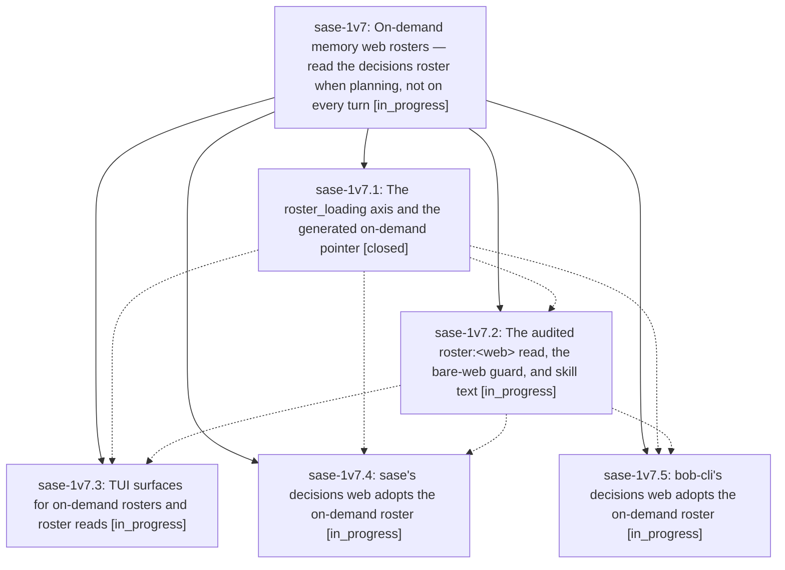

# Bead: sase-1v7 — On-demand memory web rosters — read the decisions roster when planning, not on every turn

[Bead Pages](../README.md) / sase-1v7

**Status:** ◐ in_progress · **Type:** ▸ plan · **Tier:** epic
**Owner:** `bryanbugyi34@gmail.com` · **Created by:** [bbugyi200.athena.1g7](https://github.com/sase-org/sase--agents/blob/main/sessions/bbugyi200.athena.1g7.md) · **Assignee:** `sase-1v7.land`
**Created:** 2026-11-25 15:44:39 EST
**Plan:** [202611/on\_demand\_web\_rosters.md](https://github.com/sase-org/sase--plans/blob/main/202611/on_demand_web_rosters.md)

<!-- sase:links:start -->

## Links

| Relation | Artifact | Why |
| --- | --- | --- |
| implemented-by | [plan:202611/on_demand_web_rosters.md][1] | derived from the plan's `bead_id:` frontmatter field |

[1]: https://github.com/sase-org/sase--plans/blob/main/202611/on_demand_web_rosters.md

<!-- sase:links:end -->

## Description

Any memory web can declare `roster_loading: on_demand`. Agent instruction bundles and the committed AGENTS.md then carry a short generated pointer instead of the full roster. The pointer names the exact audited command and lists who MUST run it: planners and researchers, plus anyone changing governed behavior without a plan. The command is `sase memory read roster:<web>`, it batches with strand reads, and the TUI shows it in the agent MEMORY lane and on the Memory panel's web card. A bare read of an on-demand web can no longer dump every strand body by accident. The decisions webs in sase and bob-cli adopt it, so the decisions section drops from about 8.4 KB to about 0.8 KB in sase and from about 25.6 KB to about 1 KB in bob-cli. bob-cli's Codex bundle goes from over its cap to roughly 19 KB of headroom.

## Phases

| Bead | Title | Status | Size | Created | Agents | Commits |
|---|---|---|---|---|---:|---:|
| [sase-1v7.1](sase-1v7.1.md) | The roster\_loading axis and the generated on-demand pointer | ✓ closed | medium | 2026-11-25 | 1 | 1 |
| [sase-1v7.2](sase-1v7.2.md) | The audited roster:\<web\> read, the bare-web guard, and skill text | ◐ in_progress | medium | 2026-11-25 | 1 | 0 |
| [sase-1v7.3](sase-1v7.3.md) | TUI surfaces for on-demand rosters and roster reads | ◐ in_progress | small | 2026-11-25 | 1 | 0 |
| [sase-1v7.4](sase-1v7.4.md) | sase's decisions web adopts the on-demand roster | ◐ in_progress | small | 2026-11-25 | 1 | 0 |
| [sase-1v7.5](sase-1v7.5.md) | bob-cli's decisions web adopts the on-demand roster | ◐ in_progress | small | 2026-11-25 | 1 | 0 |

## Lineage

## Agents

| Agent | Bead | Commits |
|---|---|---:|
| [bbugyi200.athena.sase-1v7.1](https://github.com/sase-org/sase--agents/blob/main/agents/bbugyi200.athena.sase-1v7.1/README.md) | [sase-1v7.1](sase-1v7.1.md) | 1 |
| [bbugyi200.athena.sase-1v7.2](https://github.com/sase-org/sase--agents/blob/main/agents/bbugyi200.athena.sase-1v7.2/README.md) | [sase-1v7.2](sase-1v7.2.md) | 0 |
| [bbugyi200.athena.sase-1v7.3](https://github.com/sase-org/sase--agents/blob/main/agents/bbugyi200.athena.sase-1v7.3/README.md) | [sase-1v7.3](sase-1v7.3.md) | 0 |
| [bbugyi200.athena.sase-1v7.4](https://github.com/sase-org/sase--agents/blob/main/agents/bbugyi200.athena.sase-1v7.4/README.md) | [sase-1v7.4](sase-1v7.4.md) | 0 |
| [bbugyi200.athena.sase-1v7.5](https://github.com/sase-org/sase--agents/blob/main/agents/bbugyi200.athena.sase-1v7.5/README.md) | [sase-1v7.5](sase-1v7.5.md) | 0 |
| [bbugyi200.athena.sase-1v7.land](https://github.com/sase-org/sase--agents/blob/main/agents/bbugyi200.athena.sase-1v7.land/README.md) | [sase-1v7](README.md) | 0 |

## Commits

| Repo | Commit | Subject | Bead | Committed |
|---|---|---|---|---|
| sase | [`e489558`](https://github.com/sase-org/sase/commit/e489558571a747220f7912156f1ebed7fb95e7b5) | feat(memory): add on-demand web roster loading axis | [sase-1v7.1](sase-1v7.1.md) | 2026-11-25 16:54:19 EST |
