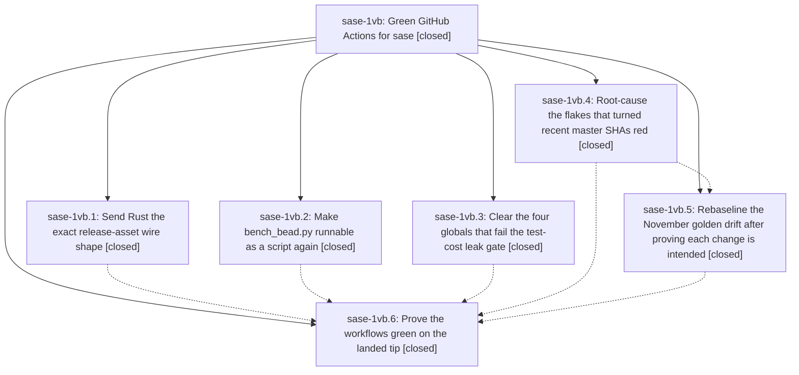

# Bead: sase-1vb — Green GitHub Actions for sase

[Bead Pages](../README.md) / sase-1vb

**Status:** ✓ closed · **Resolution:** done · **Type:** ▸ plan · **Tier:** epic
**Owner:** `bryanbugyi34@gmail.com` · **Created by:** [bbugyi200.athena.1ge](https://github.com/sase-org/sase--agents/blob/main/sessions/bbugyi200.athena.1ge.md) · **Assignee:** `sase-1vb.land`
**Created:** 2026-11-26 06:30:35 EST · **Closed:** 2026-11-26 12:47:48 EST
**Plan:** [202611/green\_github\_actions.md](https://github.com/sase-org/sase--plans/blob/main/202611/green_github_actions.md)

<!-- sase:links:start -->

## Links

| Relation | Artifact | Why |
| --- | --- | --- |
| implemented-by | [plan:202611/green_github_actions.md][1] | derived from the plan's `bead_id:` frontmatter field |

_Plus 1 automatic references — see [Referenced By](#referenced-by)._

[1]: https://github.com/sase-org/sase--plans/blob/main/202611/green_github_actions.md

<!-- sase:links:end -->

## Description

Every red sase GitHub Actions workflow is green on the landed master tip or handed to a named owner with evidence, each traced to a root cause, with no raised timeouts, weakened assertions, or blindly regenerated goldens.

## Notes

[2026-11-26T17:47:48Z · sase-1vb.land] LANDED. Verified all 6 phases against code, commits, and CI.

(1) steward-wire 9bdc6046ab: _release_wire emits exactly name/kind/generation, and _fresh_train_abandoned reads raw asset ids. No other wire-asset id reads remain (_release_watch_actions re-reads raw releases). Fixtures are fixed, and unit plus real-binding tests were added. Observe-only steward 45849433197 on 1e017d0def succeeded with primary=waiting and no watcher_broken.

(2) bench-bead-path a52d4328e6: repo-root bootstrap plus an AST guard over Justfile perf scripts. Full CI perf-floors is green.

(3) leak-gate 102e579e2a: fixed _warned_signatures (autouse fixtures), _SKIP_STREAKS (autouse fixture), and _detail_owner (weakref finalizer plus on_unmount release). I reran the cost lane on all 16 files that poisoned in Telemetry 45709304226/45787348404 at master f1eaded87c: 192 passed, 0 poisoning. The 4th global (_live_config_token_refresh_threads) did not reproduce in the phase or in my run and was already absent from Telemetry on 32b0d45; it is filed as sase-1vg. CI Telemetry has not yet run on a post-epic tip.

(4) master-gate-flakes 5db9dbf33b: the archive focus re-defer, link-follow settle, and scoped-prep copy-count fixes are root-cause and do not loosen assertions. Warmup-GC residue is the upstream Textual active_worker pin.

(5) visual-drift 1e017d0def: 18 goldens updated. agents_final_rows_80x40 stayed unchanged. The retry fallback 4->2 files is intended per-run scoping (the db500a0f files are absent from the run index and attempt archives). The five flicker candidates matched across two targeted checks each. Full CI visual-test is green.

(6) ci-proof: Master Gate is green on 1e017d0def (45846683375) and f1eaded87c (45861705514). Full CI 45849428321 is red only on owned/filed flakes. The core_cut=gate decision is honored: gate custom-2fb0bbeb-512b-4f7c-a000-27b15027bcef is pending user approval, so Publish stays CORE_LAG.

Integration: reviewed non-epic commits 650492693a, 312a030e9f, 45a205c549, e251ae713d, f1eaded87c, and b9964f31a8. None needs epic APIs or conflicts. f1eaded87c changed the copy-as modal, but its targeted visual check is clean (5 unchanged). b9964f31a8 moved the core pin to 76638b5, which equals sase-core master, so the pending release-plz gate still covers it. Core CI 45870048366 is in progress there; approve the gate only once it is green. No code changes were needed. epic-symbols: none.

Follow-ups:
- sase-1vb.3#1, sase-1vb.4#1, and sase-1vb.6#6 (warmup GC): +1 on sase-1v2 with the Full CI 3.13/3.14 evidence and the Textual mechanism.
- sase-1vb.4#2a: new task sase-1ve (large).
- sase-1vb.4#2b: new task sase-1vf (medium; related to sase-t6).
- sase-1vb.6#6 (countdown Strip garbage): DISCOVERED ISSUE on tailnet-1e, whose phase tailnet-1e.7.1.3.1.1 authored the test.
- sase-1vb.6#4/#5: declined, superseded by note #6's terminal triage.
- Land-observed Master Gate 45843695662 _queue.Empty flake: DISCOVERED ISSUE on sase-1tc (sase-1tc.4 authored the test).
- sase-1v4: noted as stale (clean on tip).

## Phases

| Bead | Title | Status | Size | Created | Agents | Commits |
|---|---|---|---|---|---:|---:|
| [sase-1vb.1](sase-1vb.1.md) | Send Rust the exact release-asset wire shape | ✓ closed | small | 2026-11-26 | 1 | 1 |
| [sase-1vb.2](sase-1vb.2.md) | Make bench\_bead.py runnable as a script again | ✓ closed | xsmall | 2026-11-26 | 1 | 1 |
| [sase-1vb.3](sase-1vb.3.md) | Clear the four globals that fail the test-cost leak gate | ✓ closed | medium | 2026-11-26 | 1 | 1 |
| [sase-1vb.4](sase-1vb.4.md) | Root-cause the flakes that turned recent master SHAs red | ✓ closed | medium | 2026-11-26 | 1 | 1 |
| [sase-1vb.5](sase-1vb.5.md) | Rebaseline the November golden drift after proving each change is intended | ✓ closed | medium | 2026-11-26 | 1 | 1 |
| [sase-1vb.6](sase-1vb.6.md) | Prove the workflows green on the landed tip | ✓ closed | small | 2026-11-26 | 1 | 0 |

## Lineage

## Agents

| Agent | Bead | Commits |
|---|---|---:|
| [bbugyi200.athena.sase-1vb.1](https://github.com/sase-org/sase--agents/blob/main/agents/bbugyi200.athena.sase-1vb.1/README.md) | [sase-1vb.1](sase-1vb.1.md) | 1 |
| [bbugyi200.athena.sase-1vb.2](https://github.com/sase-org/sase--agents/blob/main/agents/bbugyi200.athena.sase-1vb.2/README.md) | [sase-1vb.2](sase-1vb.2.md) | 1 |
| [bbugyi200.athena.sase-1vb.3](https://github.com/sase-org/sase--agents/blob/main/agents/bbugyi200.athena.sase-1vb.3/README.md) | [sase-1vb.3](sase-1vb.3.md) | 1 |
| [bbugyi200.athena.sase-1vb.4](https://github.com/sase-org/sase--agents/blob/main/agents/bbugyi200.athena.sase-1vb.4/README.md) | [sase-1vb.4](sase-1vb.4.md) | 1 |
| [bbugyi200.athena.sase-1vb.5](https://github.com/sase-org/sase--agents/blob/main/sessions/bbugyi200.athena.sase-1vb.5.md) | [sase-1vb.5](sase-1vb.5.md) | 1 |
| [bbugyi200.athena.sase-1vb.6](https://github.com/sase-org/sase--agents/blob/main/sessions/bbugyi200.athena.sase-1vb.6.md) | [sase-1vb.6](sase-1vb.6.md) | 0 |
| [bbugyi200.athena.sase-1vb.land](https://github.com/sase-org/sase--agents/blob/main/agents/bbugyi200.athena.sase-1vb.land/README.md) | [sase-1vb](README.md) | 1 |

## Commits

| Repo | Commit | Subject | Bead | Committed |
|---|---|---|---|---|
| sase | [`a52d432`](https://github.com/sase-org/sase/commit/a52d4328e6878bdf243d0161a6b243a1aba1cbc6) | fix(perf): bootstrap sys.path in bench\_bead.py and add static guard | [sase-1vb.2](sase-1vb.2.md) | 2026-11-26 06:49:22 EST |
| sase | [`9bdc604`](https://github.com/sase-org/sase/commit/9bdc6046ab9d67725832c0a910fd606b0b4f3894) | fix(release-steward): send Rust the exact release-asset wire shape | [sase-1vb.1](sase-1vb.1.md) | 2026-11-26 06:50:36 EST |
| sase | [`102e579`](https://github.com/sase-org/sase/commit/102e579e2aaa6b88bdf672985ff6a1077719c3bb) | fix(tests): isolate leaking test state | [sase-1vb.3](sase-1vb.3.md) | 2026-11-26 07:27:23 EST |
| sase | [`5db9dbf`](https://github.com/sase-org/sase/commit/5db9dbf33b5c824174942a445fa8fda8a2e3897e) | fix(tui): root-cause Master Gate flakes at their source | [sase-1vb.4](sase-1vb.4.md) | 2026-11-26 08:25:10 EST |
| sase | [`1e017d0`](https://github.com/sase-org/sase/commit/1e017d0defae1100988816e246930db21ffdfc84) | test(tui): rebaseline intended November screenshot goldens | [sase-1vb.5](sase-1vb.5.md) | 2026-11-26 10:12:01 EST |
| sase--plans | [`sase--plans@771e2ef`](https://github.com/sase-org/sase--plans/commit/771e2ef222ea87c29d5443ef6fe5f7f01f4044ee) | chore(plans): mark green\_github\_actions epic plan done | [sase-1vb](README.md) | 2026-11-26 13:04:42 EST |

<!-- sase:referenced-by:start -->

## Referenced By

| Relation | Artifact | Why | Uses |
| --- | --- | --- | ---: |
| read-by | [agent:sase-1vb.4][1] | epic context | 1 |

[1]: https://github.com/sase-org/sase--agents/blob/main/agents/bbugyi200.athena.sase-1vb.4/README.md

<!-- sase:referenced-by:end -->
