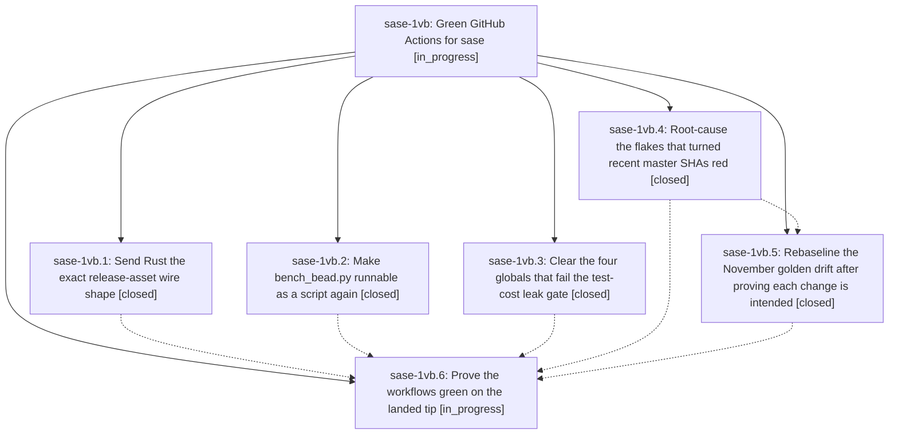

# Bead: sase-1vb — Green GitHub Actions for sase

[Bead Pages](../README.md) / sase-1vb

**Status:** ◐ in_progress · **Type:** ▸ plan · **Tier:** epic
**Owner:** `bryanbugyi34@gmail.com` · **Created by:** [bbugyi200.athena.1ge](https://github.com/sase-org/sase--agents/blob/main/sessions/bbugyi200.athena.1ge.md) · **Assignee:** `sase-1vb.land`
**Created:** 2026-11-26 06:30:35 EST
**Plan:** [202611/green\_github\_actions.md](https://github.com/sase-org/sase--plans/blob/main/202611/green_github_actions.md)

<!-- sase:links:start -->

## Links

| Relation | Artifact | Why |
| --- | --- | --- |
| implemented-by | [plan:202611/green_github_actions.md][1] | derived from the plan's `bead_id:` frontmatter field |

_Plus 1 automatic references — see [Referenced By](#referenced-by)._

[1]: https://github.com/sase-org/sase--plans/blob/main/202611/green_github_actions.md

<!-- sase:links:end -->

## Description

Every red sase GitHub Actions workflow is green on the landed master tip or handed to a named owner with evidence, each traced to a root cause, with no raised timeouts, weakened assertions, or blindly regenerated goldens.

## Phases

| Bead | Title | Status | Size | Created | Agents | Commits |
|---|---|---|---|---|---:|---:|
| [sase-1vb.1](sase-1vb.1.md) | Send Rust the exact release-asset wire shape | ✓ closed | small | 2026-11-26 | 1 | 1 |
| [sase-1vb.2](sase-1vb.2.md) | Make bench\_bead.py runnable as a script again | ✓ closed | xsmall | 2026-11-26 | 1 | 1 |
| [sase-1vb.3](sase-1vb.3.md) | Clear the four globals that fail the test-cost leak gate | ✓ closed | medium | 2026-11-26 | 1 | 1 |
| [sase-1vb.4](sase-1vb.4.md) | Root-cause the flakes that turned recent master SHAs red | ✓ closed | medium | 2026-11-26 | 1 | 1 |
| [sase-1vb.5](sase-1vb.5.md) | Rebaseline the November golden drift after proving each change is intended | ✓ closed | medium | 2026-11-26 | 1 | 1 |
| [sase-1vb.6](sase-1vb.6.md) | Prove the workflows green on the landed tip | ◐ in_progress | small | 2026-11-26 | 1 | 0 |

## Lineage

## Agents

| Agent | Bead | Commits |
|---|---|---:|
| [bbugyi200.athena.sase-1vb.1](https://github.com/sase-org/sase--agents/blob/main/agents/bbugyi200.athena.sase-1vb.1/README.md) | [sase-1vb.1](sase-1vb.1.md) | 1 |
| [bbugyi200.athena.sase-1vb.2](https://github.com/sase-org/sase--agents/blob/main/agents/bbugyi200.athena.sase-1vb.2/README.md) | [sase-1vb.2](sase-1vb.2.md) | 1 |
| [bbugyi200.athena.sase-1vb.3](https://github.com/sase-org/sase--agents/blob/main/agents/bbugyi200.athena.sase-1vb.3/README.md) | [sase-1vb.3](sase-1vb.3.md) | 1 |
| [bbugyi200.athena.sase-1vb.4](https://github.com/sase-org/sase--agents/blob/main/agents/bbugyi200.athena.sase-1vb.4/README.md) | [sase-1vb.4](sase-1vb.4.md) | 1 |
| [bbugyi200.athena.sase-1vb.5](https://github.com/sase-org/sase--agents/blob/main/sessions/bbugyi200.athena.sase-1vb.5.md) | [sase-1vb.5](sase-1vb.5.md) | 1 |
| [bbugyi200.athena.sase-1vb.6](https://github.com/sase-org/sase--agents/blob/main/agents/bbugyi200.athena.sase-1vb.6/README.md) | [sase-1vb.6](sase-1vb.6.md) | 0 |
| [bbugyi200.athena.sase-1vb.land](https://github.com/sase-org/sase--agents/blob/main/agents/bbugyi200.athena.sase-1vb.land/README.md) | [sase-1vb](README.md) | 0 |

## Commits

| Repo | Commit | Subject | Bead | Committed |
|---|---|---|---|---|
| sase | [`a52d432`](https://github.com/sase-org/sase/commit/a52d4328e6878bdf243d0161a6b243a1aba1cbc6) | fix(perf): bootstrap sys.path in bench\_bead.py and add static guard | [sase-1vb.2](sase-1vb.2.md) | 2026-11-26 06:49:22 EST |
| sase | [`9bdc604`](https://github.com/sase-org/sase/commit/9bdc6046ab9d67725832c0a910fd606b0b4f3894) | fix(release-steward): send Rust the exact release-asset wire shape | [sase-1vb.1](sase-1vb.1.md) | 2026-11-26 06:50:36 EST |
| sase | [`102e579`](https://github.com/sase-org/sase/commit/102e579e2aaa6b88bdf672985ff6a1077719c3bb) | fix(tests): isolate leaking test state | [sase-1vb.3](sase-1vb.3.md) | 2026-11-26 07:27:23 EST |
| sase | [`5db9dbf`](https://github.com/sase-org/sase/commit/5db9dbf33b5c824174942a445fa8fda8a2e3897e) | fix(tui): root-cause Master Gate flakes at their source | [sase-1vb.4](sase-1vb.4.md) | 2026-11-26 08:25:10 EST |
| sase | [`1e017d0`](https://github.com/sase-org/sase/commit/1e017d0defae1100988816e246930db21ffdfc84) | test(tui): rebaseline intended November screenshot goldens | [sase-1vb.5](sase-1vb.5.md) | 2026-11-26 10:12:01 EST |

<!-- sase:referenced-by:start -->

## Referenced By

| Relation | Artifact | Why | Uses |
| --- | --- | --- | ---: |
| read-by | [agent:sase-1vb.4][1] | epic context | 1 |

[1]: https://github.com/sase-org/sase--agents/blob/main/agents/bbugyi200.athena.sase-1vb.4/README.md

<!-- sase:referenced-by:end -->
