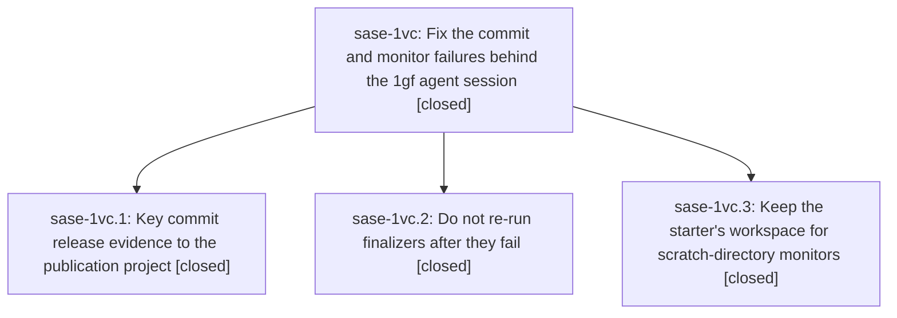

# Bead: sase-1vc — Fix the commit and monitor failures behind the 1gf agent session

[Bead Pages](../README.md) / sase-1vc

**Status:** ✓ closed · **Resolution:** done · **Type:** ▸ plan · **Tier:** epic
**Owner:** `bryanbugyi34@gmail.com` · **Created by:** [bbugyi200.athena.1gj](https://github.com/sase-org/sase--agents/blob/main/sessions/bbugyi200.athena.1gj.md) · **Assignee:** `sase-1vc.land`
**Created:** 2026-11-26 07:38:26 EST · **Closed:** 2026-11-26 08:21:11 EST
**Plan:** [202611/linked\_repo\_commit\_finalization\_fixes.md](https://github.com/sase-org/sase--plans/blob/main/202611/linked_repo_commit_finalization_fixes.md)

<!-- sase:links:start -->

## Links

| Relation | Artifact | Why |
| --- | --- | --- |
| implemented-by | [plan:202611/linked_repo_commit_finalization_fixes.md][1] | derived from the plan's `bead_id:` frontmatter field |

[1]: https://github.com/sase-org/sase--plans/blob/main/202611/linked_repo_commit_finalization_fixes.md

<!-- sase:links:end -->

## Description

Commits from linked repositories outside the host checkout finish publication, a failed finalizer is never re-run or reported as a provider failure, and monitors started in scratch directories hand their follow-up back to the starter's workspace.

## Notes

[2026-11-26T13:21:11Z · sase-1vc.land] Verified the approved plan and every note on all three closed phases against commits 312a030e9f (sase-1vc.1), 650492693a (sase-1vc.2), and 45a205c549 (sase-1vc.3), current source, and 70 passing focused tests (33.59s). Release evidence uses inventory, marker, then checkpoint project-file resolution; background evidence, queue, and hints share the host project key; inline drains retain the machine store; unmapped repositories skip and evidence-write failures remain resumable without a new primary commit. Success-path finalizer exceptions cannot enter provider-failure finalization in any exception branch; persisted attempt IDs continue above prior files/journal events without changing phase budgets or immutable writes. Macro and prepared completion callers do not rerun failed finalizers. The scratch_claim=hold decision is implemented: scratch cwd stays separate from the starter workspace, the supervisor holds its claim through stale cleanup and transfers it to the follow-up, workspace zero resolves to primary, and other managed checkout ownership stays first. Audited settlement observation, starter matching, and inherited obligations: all prioritize the retained workspace. Governing host-owned completion, fail-closed handoffs, machine-link-writes-off-primary, and Rust-core boundaries are preserved. Integration review: fetched origin; master and origin/master agree, with no unrelated commits since epic creation or its first implementation commit, so no drift edits are needed. Follow-up triage: no PROPOSED FOLLOW-UP entries or distinct unrelated defects were found; no proposals declined and no task beads needed. All descendants are closed; sase bead epic-symbols sase-1vc reports no entries. Existing phase just check passes are supplemented by the focused landing regression run; no primary-source changes in this landing.

[2026-11-26T13:22:18Z · sase-1vc.land] Post-close verification: just symvision passed with all public/private symbols used properly. The linked plan frontmatter is now status: done. The post-close parent-link read and plan metadata show no parent_bead, so no ancestor closeout is required. Only the plans sidecar status changed; no primary-repository files changed.

## Phases

| Bead | Title | Status | Size | Created | Agents | Commits |
|---|---|---|---|---|---:|---:|
| [sase-1vc.1](sase-1vc.1.md) | Key commit release evidence to the publication project | ✓ closed | medium | 2026-11-26 | 1 | 1 |
| [sase-1vc.2](sase-1vc.2.md) | Do not re-run finalizers after they fail | ✓ closed | medium | 2026-11-26 | 1 | 1 |
| [sase-1vc.3](sase-1vc.3.md) | Keep the starter's workspace for scratch-directory monitors | ✓ closed | medium | 2026-11-26 | 1 | 1 |

## Lineage

## Agents

| Agent | Bead | Commits |
|---|---|---:|
| [bbugyi200.athena.sase-1vc.1](https://github.com/sase-org/sase--agents/blob/main/agents/bbugyi200.athena.sase-1vc.1/README.md) | [sase-1vc.1](sase-1vc.1.md) | 1 |
| [bbugyi200.athena.sase-1vc.2](https://github.com/sase-org/sase--agents/blob/main/agents/bbugyi200.athena.sase-1vc.2/README.md) | [sase-1vc.2](sase-1vc.2.md) | 1 |
| [bbugyi200.athena.sase-1vc.3](https://github.com/sase-org/sase--agents/blob/main/agents/bbugyi200.athena.sase-1vc.3/README.md) | [sase-1vc.3](sase-1vc.3.md) | 1 |
| [bbugyi200.athena.sase-1vc.land](https://github.com/sase-org/sase--agents/blob/main/agents/bbugyi200.athena.sase-1vc.land/README.md) | [sase-1vc](README.md) | 1 |

## Commits

| Repo | Commit | Subject | Bead | Committed |
|---|---|---|---|---|
| sase | [`6504926`](https://github.com/sase-org/sase/commit/650492693ad86489d4ba9bfc2c2b48bd14a43637) | fix(finalizers): preserve failure boundaries and attempt IDs | [sase-1vc.2](sase-1vc.2.md) | 2026-11-26 08:05:49 EST |
| sase | [`312a030`](https://github.com/sase-org/sase/commit/312a030e9f5bd0acad532ac000d18887d374dadd) | feat(commit): key release evidence to the publication project | [sase-1vc.1](sase-1vc.1.md) | 2026-11-26 08:11:49 EST |
| sase | [`45a205c`](https://github.com/sase-org/sase/commit/45a205c5490f0a2624319f1fcddf0ba53bb5a5d5) | fix(monitor): preserve starter workspace for scratch monitors | [sase-1vc.3](sase-1vc.3.md) | 2026-11-26 08:15:45 EST |
| sase--plans | [`sase--plans@dc799f9`](https://github.com/sase-org/sase--plans/commit/dc799f9257c3b5dfc2b4862d87576bf1faad828e) | docs(plans): mark sase-1vc complete after landing verification | [sase-1vc](README.md) | 2026-11-26 08:22:59 EST |
