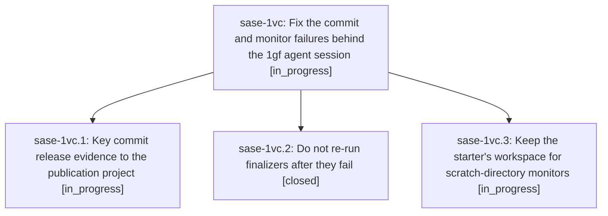

# Bead: sase-1vc — Fix the commit and monitor failures behind the 1gf agent session

[Bead Pages](../README.md) / sase-1vc

**Status:** ◐ in_progress · **Type:** ▸ plan · **Tier:** epic
**Owner:** `bryanbugyi34@gmail.com` · **Created by:** [bbugyi200.athena.1gj](https://github.com/sase-org/sase--agents/blob/main/sessions/bbugyi200.athena.1gj.md) · **Assignee:** `sase-1vc.land`
**Created:** 2026-11-26 07:38:26 EST
**Plan:** [202611/linked\_repo\_commit\_finalization\_fixes.md](https://github.com/sase-org/sase--plans/blob/main/202611/linked_repo_commit_finalization_fixes.md)

## Description

Commits from linked repositories outside the host checkout finish publication, a failed finalizer is never re-run or reported as a provider failure, and monitors started in scratch directories hand their follow-up back to the starter's workspace.

## Phases

| Bead | Title | Status | Size | Created | Agents | Commits |
|---|---|---|---|---|---:|---:|
| [sase-1vc.1](sase-1vc.1.md) | Key commit release evidence to the publication project | ◐ in_progress | medium | 2026-11-26 | 1 | 0 |
| [sase-1vc.2](sase-1vc.2.md) | Do not re-run finalizers after they fail | ✓ closed | medium | 2026-11-26 | 1 | 1 |
| [sase-1vc.3](sase-1vc.3.md) | Keep the starter's workspace for scratch-directory monitors | ◐ in_progress | medium | 2026-11-26 | 1 | 0 |

## Lineage

## Agents

| Agent | Bead | Commits |
|---|---|---:|
| [bbugyi200.athena.sase-1vc.1](https://github.com/sase-org/sase--agents/blob/main/agents/bbugyi200.athena.sase-1vc.1/README.md) | [sase-1vc.1](sase-1vc.1.md) | 0 |
| [bbugyi200.athena.sase-1vc.2](https://github.com/sase-org/sase--agents/blob/main/agents/bbugyi200.athena.sase-1vc.2/README.md) | [sase-1vc.2](sase-1vc.2.md) | 1 |
| [bbugyi200.athena.sase-1vc.3](https://github.com/sase-org/sase--agents/blob/main/agents/bbugyi200.athena.sase-1vc.3/README.md) | [sase-1vc.3](sase-1vc.3.md) | 0 |
| [bbugyi200.athena.sase-1vc.land](https://github.com/sase-org/sase--agents/blob/main/agents/bbugyi200.athena.sase-1vc.land/README.md) | [sase-1vc](README.md) | 0 |

## Commits

| Repo | Commit | Subject | Bead | Committed |
|---|---|---|---|---|
| sase | [`6504926`](https://github.com/sase-org/sase/commit/650492693ad86489d4ba9bfc2c2b48bd14a43637) | fix(finalizers): preserve failure boundaries and attempt IDs | [sase-1vc.2](sase-1vc.2.md) | 2026-11-26 08:05:49 EST |
