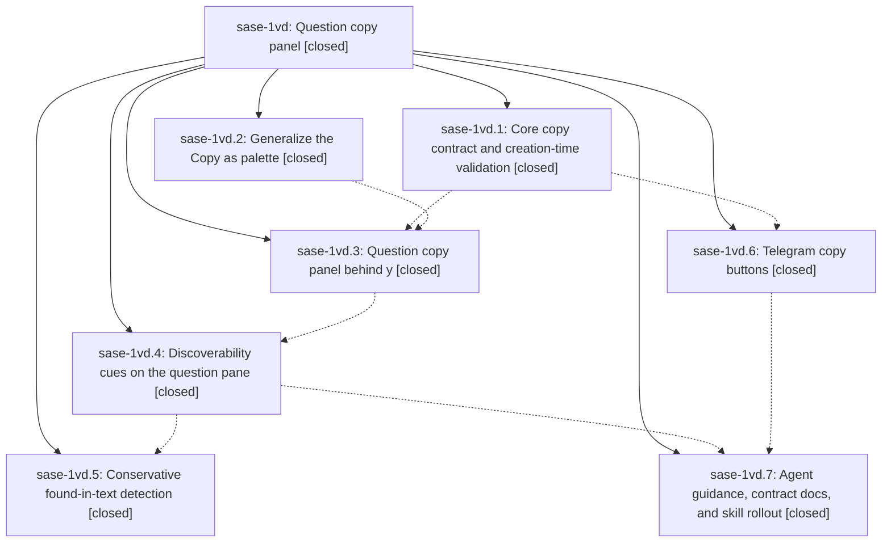

# Bead: sase-1vd — Question copy panel

[Bead Pages](../README.md) / sase-1vd

**Status:** ✓ closed · **Resolution:** done · **Type:** ▸ plan · **Tier:** epic
**Owner:** `bryanbugyi34@gmail.com` · **Created by:** [bbugyi200.athena.1gp](https://github.com/sase-org/sase--agents/blob/main/sessions/bbugyi200.athena.1gp.md) · **Assignee:** `sase-1vd.land`
**Created:** 2026-11-26 10:49:27 EST · **Closed:** 2026-11-26 19:18:52 EST
**Plan:** [202611/question\_copy\_panel.md](https://github.com/sase-org/sase--plans/blob/main/202611/question_copy_panel.md)

<!-- sase:links:start -->

## Links

| Relation | Artifact | Why |
| --- | --- | --- |
| implemented-by | [plan:202611/question_copy_panel.md][1] | derived from the plan's `bead_id:` frontmatter field |

_Plus 1 automatic references — see [Referenced By](#referenced-by)._

[1]: https://github.com/sase-org/sase--plans/blob/main/202611/question_copy_panel.md

<!-- sase:links:end -->

## Description

From the questions gate, the user can copy any agent-declared snippet, the question text, the highlighted option, or the whole Q&A with two keypresses (`y` then one key), exactly byte-for-byte, with visible progress through multi-paste workflows. The same structured copy contract reaches Telegram and agent guidance.

## Notes

[2026-11-27T00:18:52Z · sase-1vd.land] Land verification (sase-1vd.land). VERIFIED: all 7 phases closed with notes addressed. Commits on master: f1eaded87c (palette foundation), b9964f31a8 + sase-core 76638b57 (strict/tolerant copy contract, PyO3 bindings, CLI and gate creation validation), d88af8a00a (QuestionCopyModal behind y, stable key pool that excludes a/j/k/o/q/t/y, ordered delivery seam, checkmarks only on VERIFIED/OSC52_ONLY, yy Copyable items, goldens, docs), 758745cb40 (border subtitle, prose underlines per prose_highlight=yes, also-copyable block), 909566a207 (skill source, contract docs, argparse help), a29a587104 + sase-core 8cb07c3f/464d2c87 (FOUND IN TEXT detector; core pin 8cb07c3f carries the binding), sase-telegram c99da27 (CopyTextButton rows plus Copyable section; released 0.4.31). Read the source and exercised the bindings: every strict rule (unknown key, ESC, bidi, duplicates, 20/21 entries, 4096/4097 bytes, whitespace-only, non-array), tolerant unavailable counting, and conservative detection (no bare paths, balanced parens kept). The prose_highlight=yes decision is honored. INTEGRATION: the only overlapping concurrent commit, ebe2eb17c4 (split of user_question_actions), kept the strict copy normalization in _user_question_actions_payload.user_question_gate_spec. Every question creation path normalizes and successor prompts never pass include_copy_items. The other concurrent commits (agent-runner retries, test stabilization) do not touch this feature. FIXED AT LANDING: (1) the yy export indented only the first line of a multi-line copy value, so later lines left the list item and lost their indentation under CommonMark; qa_markdown now indents every fenced line, with a new markdown-it round-trip test. (2) The copy-panel docs key table was misaligned and omitted ctrl+n/ctrl+p. (3) The sase-1vd.7 post-landing skill deploy (gate custom-d069dcc0, follow-up sase-1vd.7--1) ran from stale source revision d88af8a00a, so the copy guidance never reached providers; redeployed from the landed tree (chezmoi d4cb694c), and sase skill init -c shows no drift. Checks: 60 epic tests pass; sase tool run check 8df1ff7a passed every lint stage (ruff, mypy, symvision, docs). The scoped lane escalated to 63,796 tests with 3 load flakes, each passing in isolation. FOLLOW-UPS: sase-1vd.2 #1 warmup-GC flake -> +1 sase-1v2 (also reproduced here). sase-1vd.3 #1 -> declined, a procedural landing note resolved by d88af8a00a per its note #2. sase-1vd.4 #1 empty 80x24 question box -> new sase-1vk (bug, medium; pre-existing max-height 40% plus padding CSS from Feb). sase-1vd.4 #2 leak-detector timeouts -> new sase-1vl (flake), linked to sase-t6 but not a duplicate (different node and mechanism). sase-1vd.7 #1 admission nested-check flake -> +1 sase-1ve. Found while landing: the init-skills prettier failure root cause (prettier reads .gitignore '.cache/' while agent TMPDIR is under ~/.cache) -> +1 sase-1ui with the root cause; fakey slots flake -> +1 sase-1u0; service-host xdist worker crash -> new sase-1vm (flake). Not filed: a Telegram copy section over 4096 chars relies on the existing chunk split and entity fallback. Epic-symbols: none.

## Phases

| Bead | Title | Status | Size | Created | Agents | Commits |
|---|---|---|---|---|---:|---:|
| [sase-1vd.1](sase-1vd.1.md) | Core copy contract and creation-time validation | ✓ closed | medium | 2026-11-26 | 1 | 2 |
| [sase-1vd.2](sase-1vd.2.md) | Generalize the Copy as palette | ✓ closed | medium | 2026-11-26 | 1 | 1 |
| [sase-1vd.3](sase-1vd.3.md) | Question copy panel behind y | ✓ closed | medium | 2026-11-26 | 1 | 1 |
| [sase-1vd.4](sase-1vd.4.md) | Discoverability cues on the question pane | ✓ closed | small | 2026-11-26 | 1 | 1 |
| [sase-1vd.5](sase-1vd.5.md) | Conservative found-in-text detection | ✓ closed | medium | 2026-11-26 | 1 | 3 |
| [sase-1vd.6](sase-1vd.6.md) | Telegram copy buttons | ✓ closed | small | 2026-11-26 | 1 | 1 |
| [sase-1vd.7](sase-1vd.7.md) | Agent guidance, contract docs, and skill rollout | ✓ closed | small | 2026-11-26 | 1 | 1 |

## Lineage

## Agents

| Agent | Bead | Commits |
|---|---|---:|
| [bbugyi200.athena.sase-1vd.1](https://github.com/sase-org/sase--agents/blob/main/agents/bbugyi200.athena.sase-1vd.1/README.md) | [sase-1vd.1](sase-1vd.1.md) | 2 |
| [bbugyi200.athena.sase-1vd.2](https://github.com/sase-org/sase--agents/blob/main/agents/bbugyi200.athena.sase-1vd.2/README.md) | [sase-1vd.2](sase-1vd.2.md) | 1 |
| [bbugyi200.athena.sase-1vd.3](https://github.com/sase-org/sase--agents/blob/main/sessions/bbugyi200.athena.sase-1vd.3.md) | [sase-1vd.3](sase-1vd.3.md) | 1 |
| [bbugyi200.athena.sase-1vd.4](https://github.com/sase-org/sase--agents/blob/main/sessions/bbugyi200.athena.sase-1vd.4.md) | [sase-1vd.4](sase-1vd.4.md) | 1 |
| [bbugyi200.athena.sase-1vd.5](https://github.com/sase-org/sase--agents/blob/main/sessions/bbugyi200.athena.sase-1vd.5.md) | [sase-1vd.5](sase-1vd.5.md) | 3 |
| [bbugyi200.athena.sase-1vd.6](https://github.com/sase-org/sase--agents/blob/main/agents/bbugyi200.athena.sase-1vd.6/README.md) | [sase-1vd.6](sase-1vd.6.md) | 1 |
| [bbugyi200.athena.sase-1vd.7](https://github.com/sase-org/sase--agents/blob/main/sessions/bbugyi200.athena.sase-1vd.7.md) | [sase-1vd.7](sase-1vd.7.md) | 1 |
| [bbugyi200.athena.sase-1vd.land](https://github.com/sase-org/sase--agents/blob/main/agents/bbugyi200.athena.sase-1vd.land/README.md) | [sase-1vd](README.md) | 2 |

## Commits

| Repo | Commit | Subject | Bead | Committed |
|---|---|---|---|---|
| sase | [`f1eaded`](https://github.com/sase-org/sase/commit/f1eaded87c8ef202309d8c6afea727122b69540f) | feat(ace): copy-as palette foundation with sections and preview pane | [sase-1vd.2](sase-1vd.2.md) | 2026-11-26 11:45:30 EST |
| sase-core | [`sase-core@76638b5`](https://github.com/sase-org/sase-core/commit/76638b579e7e937ae1d18ef677fc61ccbe5da8c0) | feat(questions): add question copy contracts | [sase-1vd.1](sase-1vd.1.md) | 2026-11-26 12:42:49 EST |
| sase | [`b9964f3`](https://github.com/sase-org/sase/commit/b9964f31a8ec7c5f68217fb1dbd4904089c3337f) | feat(questions): validate and display copy metadata | [sase-1vd.1](sase-1vd.1.md) | 2026-11-26 12:43:57 EST |
| sase-telegram | [`sase-telegram@c99da27`](https://github.com/sase-org/sase-telegram/commit/c99da27247cf4d1625827f5e31f7978163d31bf3) | feat(questions): add Telegram copy buttons | [sase-1vd.6](sase-1vd.6.md) | 2026-11-26 13:12:10 EST |
| sase | [`d88af8a`](https://github.com/sase-org/sase/commit/d88af8a00ac19ebd2d82272ffacb49abce7259df) | feat(ace): add question copy panel behind y | [sase-1vd.3](sase-1vd.3.md) | 2026-11-26 14:27:21 EST |
| sase | [`758745c`](https://github.com/sase-org/sase/commit/758745cb400d7846cd630ee0285e4a58a1036ec3) | feat(ace): show copy progress cues on the question pane | [sase-1vd.4](sase-1vd.4.md) | 2026-11-26 15:59:37 EST |
| sase | [`909566a`](https://github.com/sase-org/sase/commit/909566a2079984631682156450d80fe8ccd8fb7d) | feat(questions): document copy items for agents | [sase-1vd.7](sase-1vd.7.md) | 2026-11-26 16:45:33 EST |
| sase-core | [`sase-core@8cb07c3`](https://github.com/sase-org/sase-core/commit/8cb07c3f4685c852c29c22869c56ede33299d00c) | feat(question-copy): add conservative text candidate detector | [sase-1vd.5](sase-1vd.5.md) | 2026-11-26 17:35:57 EST |
| sase | [`a29a587`](https://github.com/sase-org/sase/commit/a29a587104a1acfdc3c2e3bf0872b7841463af5f) | feat(questions): detect copyable items in question text | [sase-1vd.5](sase-1vd.5.md) | 2026-11-26 17:37:10 EST |
| sase-core | [`sase-core@464d2c8`](https://github.com/sase-org/sase-core/commit/464d2c87c007456dc212f9dd644d1c13e7b00fa7) | test(question-copy): remove useless format from detector test | [sase-1vd.5](sase-1vd.5.md) | 2026-11-26 18:19:01 EST |
| sase | [`25bfca1`](https://github.com/sase-org/sase/commit/25bfca11d07084449c66c31488a36ecb9882e76f) | fix(questions): keep multi-line yy copy items inside their list item | [sase-1vd](README.md) | 2026-11-26 19:21:22 EST |
| sase--plans | [`sase--plans@bb52e0c`](https://github.com/sase-org/sase--plans/commit/bb52e0cc855329ddee94a3a518caf12eee4b9f0d) | chore(plans): mark question copy panel plan done | [sase-1vd](README.md) | 2026-11-26 19:22:00 EST |

<!-- sase:referenced-by:start -->

## Referenced By

| Relation | Artifact | Why | Uses |
| --- | --- | --- | ---: |
| read-by | [agent:sase-1vd.2][1] | Need parent epic scope for phase context | 1 |

[1]: https://github.com/sase-org/sase--agents/blob/main/agents/bbugyi200.athena.sase-1vd.2/README.md

<!-- sase:referenced-by:end -->
