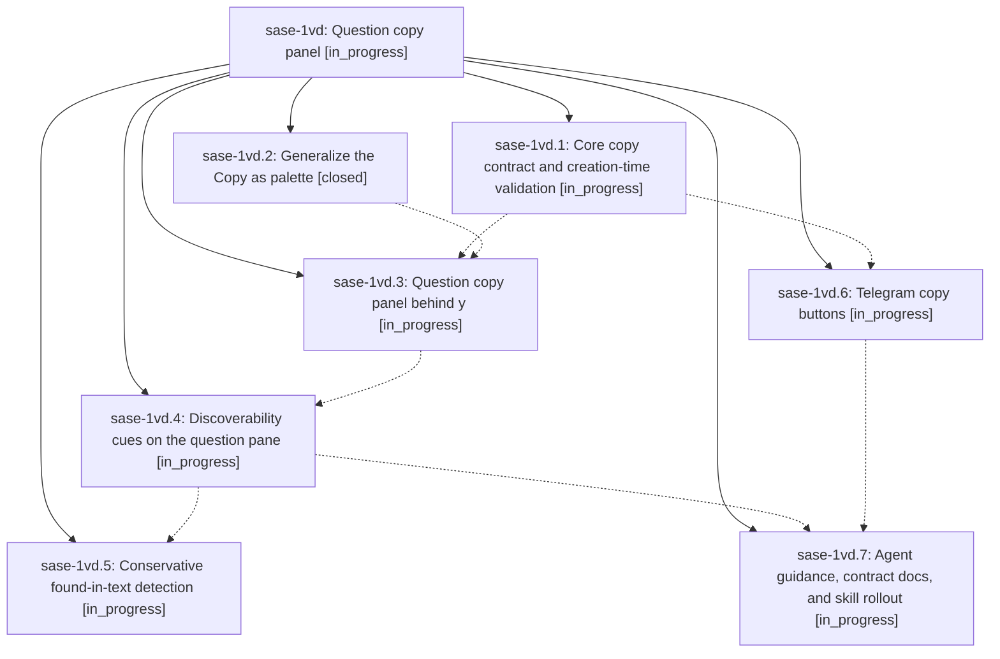

# Bead: sase-1vd — Question copy panel

[Bead Pages](../README.md) / sase-1vd

**Status:** ◐ in_progress · **Type:** ▸ plan · **Tier:** epic
**Owner:** `bryanbugyi34@gmail.com` · **Created by:** [bbugyi200.athena.1gp](https://github.com/sase-org/sase--agents/blob/main/sessions/bbugyi200.athena.1gp.md) · **Assignee:** `sase-1vd.land`
**Created:** 2026-11-26 10:49:27 EST
**Plan:** [202611/question\_copy\_panel.md](https://github.com/sase-org/sase--plans/blob/main/202611/question_copy_panel.md)

<!-- sase:links:start -->

## Links

| Relation | Artifact | Why |
| --- | --- | --- |
| implemented-by | [plan:202611/question_copy_panel.md][1] | derived from the plan's `bead_id:` frontmatter field |

[1]: https://github.com/sase-org/sase--plans/blob/main/202611/question_copy_panel.md

<!-- sase:links:end -->

## Description

From the questions gate, the user can copy any agent-declared snippet, the question text, the highlighted option, or the whole Q&A with two keypresses (`y` then one key), exactly byte-for-byte, with visible progress through multi-paste workflows. The same structured copy contract reaches Telegram and agent guidance.

## Phases

| Bead | Title | Status | Size | Created | Agents | Commits |
|---|---|---|---|---|---:|---:|
| [sase-1vd.1](sase-1vd.1.md) | Core copy contract and creation-time validation | ◐ in_progress | medium | 2026-11-26 | 1 | 0 |
| [sase-1vd.2](sase-1vd.2.md) | Generalize the Copy as palette | ✓ closed | medium | 2026-11-26 | 1 | 1 |
| [sase-1vd.3](sase-1vd.3.md) | Question copy panel behind y | ◐ in_progress | medium | 2026-11-26 | 1 | 0 |
| [sase-1vd.4](sase-1vd.4.md) | Discoverability cues on the question pane | ◐ in_progress | small | 2026-11-26 | 1 | 0 |
| [sase-1vd.5](sase-1vd.5.md) | Conservative found-in-text detection | ◐ in_progress | medium | 2026-11-26 | 1 | 0 |
| [sase-1vd.6](sase-1vd.6.md) | Telegram copy buttons | ◐ in_progress | small | 2026-11-26 | 1 | 0 |
| [sase-1vd.7](sase-1vd.7.md) | Agent guidance, contract docs, and skill rollout | ◐ in_progress | small | 2026-11-26 | 1 | 0 |

## Lineage

## Agents

| Agent | Bead | Commits |
|---|---|---:|
| [bbugyi200.athena.sase-1vd.1](https://github.com/sase-org/sase--agents/blob/main/agents/bbugyi200.athena.sase-1vd.1/README.md) | [sase-1vd.1](sase-1vd.1.md) | 0 |
| [bbugyi200.athena.sase-1vd.2](https://github.com/sase-org/sase--agents/blob/main/agents/bbugyi200.athena.sase-1vd.2/README.md) | [sase-1vd.2](sase-1vd.2.md) | 1 |
| [bbugyi200.athena.sase-1vd.3](https://github.com/sase-org/sase--agents/blob/main/agents/bbugyi200.athena.sase-1vd.3/README.md) | [sase-1vd.3](sase-1vd.3.md) | 0 |
| [bbugyi200.athena.sase-1vd.4](https://github.com/sase-org/sase--agents/blob/main/agents/bbugyi200.athena.sase-1vd.4/README.md) | [sase-1vd.4](sase-1vd.4.md) | 0 |
| [bbugyi200.athena.sase-1vd.5](https://github.com/sase-org/sase--agents/blob/main/agents/bbugyi200.athena.sase-1vd.5/README.md) | [sase-1vd.5](sase-1vd.5.md) | 0 |
| [bbugyi200.athena.sase-1vd.6](https://github.com/sase-org/sase--agents/blob/main/agents/bbugyi200.athena.sase-1vd.6/README.md) | [sase-1vd.6](sase-1vd.6.md) | 0 |
| [bbugyi200.athena.sase-1vd.7](https://github.com/sase-org/sase--agents/blob/main/agents/bbugyi200.athena.sase-1vd.7/README.md) | [sase-1vd.7](sase-1vd.7.md) | 0 |
| [bbugyi200.athena.sase-1vd.land](https://github.com/sase-org/sase--agents/blob/main/agents/bbugyi200.athena.sase-1vd.land/README.md) | [sase-1vd](README.md) | 0 |

## Commits

| Repo | Commit | Subject | Bead | Committed |
|---|---|---|---|---|
| sase | [`f1eaded`](https://github.com/sase-org/sase/commit/f1eaded87c8ef202309d8c6afea727122b69540f) | feat(ace): copy-as palette foundation with sections and preview pane | [sase-1vd.2](sase-1vd.2.md) | 2026-11-26 11:45:30 EST |
