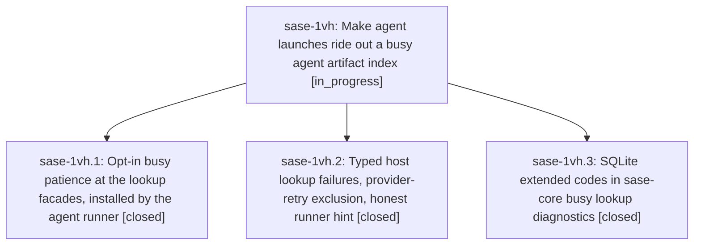

# Bead: sase-1vh — Make agent launches ride out a busy agent artifact index

[Bead Pages](../README.md) / sase-1vh

**Status:** ◐ in_progress · **Type:** ▸ plan · **Tier:** epic
**Owner:** `bryanbugyi34@gmail.com` · **Created by:** [bbugyi200.athena.1gu](https://github.com/sase-org/sase--agents/blob/main/sessions/bbugyi200.athena.1gu.md) · **Assignee:** `sase-1vh.land`
**Created:** 2026-11-26 14:45:30 EST
**Plan:** [202611/launch\_lookup\_busy\_resilience.md](https://github.com/sase-org/sase--plans/blob/main/202611/launch_lookup_busy_resilience.md)

<!-- sase:links:start -->

## Links

| Relation | Artifact | Why |
| --- | --- | --- |
| implemented-by | [plan:202611/launch_lookup_busy_resilience.md][1] | derived from the plan's `bead_id:` frontmatter field |

[1]: https://github.com/sase-org/sase--plans/blob/main/202611/launch_lookup_busy_resilience.md

<!-- sase:links:end -->

## Description

A detached agent runner survives a transiently busy agent artifact index or dismissed-bundle index instead of failing its launch, while hot callers keep bounded single-attempt lookups, fail-closed semantics hold, runner failure hints are typed and honest, and the next busy failure names its SQLite lock class.

## Phases

| Bead | Title | Status | Size | Created | Agents | Commits |
|---|---|---|---|---|---:|---:|
| [sase-1vh.1](sase-1vh.1.md) | Opt-in busy patience at the lookup facades, installed by the agent runner | ✓ closed | medium | 2026-11-26 | 1 | 1 |
| [sase-1vh.2](sase-1vh.2.md) | Typed host lookup failures, provider-retry exclusion, honest runner hint | ✓ closed | small | 2026-11-26 | 1 | 1 |
| [sase-1vh.3](sase-1vh.3.md) | SQLite extended codes in sase-core busy lookup diagnostics | ✓ closed | small | 2026-11-26 | 1 | 1 |

## Lineage

## Agents

| Agent | Bead | Commits |
|---|---|---:|
| [bbugyi200.athena.sase-1vh.1](https://github.com/sase-org/sase--agents/blob/main/agents/bbugyi200.athena.sase-1vh.1/README.md) | [sase-1vh.1](sase-1vh.1.md) | 1 |
| [bbugyi200.athena.sase-1vh.2](https://github.com/sase-org/sase--agents/blob/main/agents/bbugyi200.athena.sase-1vh.2/README.md) | [sase-1vh.2](sase-1vh.2.md) | 1 |
| [bbugyi200.athena.sase-1vh.3](https://github.com/sase-org/sase--agents/blob/main/agents/bbugyi200.athena.sase-1vh.3/README.md) | [sase-1vh.3](sase-1vh.3.md) | 1 |
| [bbugyi200.athena.sase-1vh.land](https://github.com/sase-org/sase--agents/blob/main/agents/bbugyi200.athena.sase-1vh.land/README.md) | [sase-1vh](README.md) | 0 |

## Commits

| Repo | Commit | Subject | Bead | Committed |
|---|---|---|---|---|
| sase-core | [`sase-core@2efa9f6`](https://github.com/sase-org/sase-core/commit/2efa9f6b97fed27fe2fd34e09c59150cb437b325) | fix(agent-scan): report SQLite extended codes in busy lookup diagnostics | [sase-1vh.3](sase-1vh.3.md) | 2026-11-26 15:43:43 EST |
| sase | [`6574797`](https://github.com/sase-org/sase/commit/6574797e4031905e18c8cdcbf9118cb6552d3c23) | fix(agent-retry): classify host index lookup failures | [sase-1vh.2](sase-1vh.2.md) | 2026-11-26 15:44:58 EST |
| sase | [`47605d5`](https://github.com/sase-org/sase/commit/47605d5cb53a420e22998d9c3a6e2072101eb723) | feat(agent-runner): retry busy index lookups during launches | [sase-1vh.1](sase-1vh.1.md) | 2026-11-26 16:23:41 EST |
