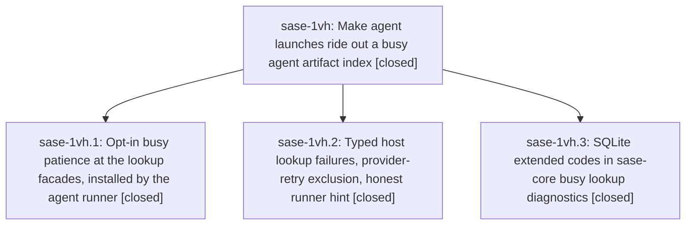

# Bead: sase-1vh — Make agent launches ride out a busy agent artifact index

[Bead Pages](../README.md) / sase-1vh

**Status:** ✓ closed · **Resolution:** done · **Type:** ▸ plan · **Tier:** epic
**Owner:** `bryanbugyi34@gmail.com` · **Created by:** [bbugyi200.athena.1gu](https://github.com/sase-org/sase--agents/blob/main/sessions/bbugyi200.athena.1gu.md) · **Assignee:** `sase-1vh.land`
**Created:** 2026-11-26 14:45:30 EST · **Closed:** 2026-11-26 16:51:03 EST
**Plan:** [202611/launch\_lookup\_busy\_resilience.md](https://github.com/sase-org/sase--plans/blob/main/202611/launch_lookup_busy_resilience.md)

<!-- sase:links:start -->

## Links

| Relation | Artifact | Why |
| --- | --- | --- |
| implemented-by | [plan:202611/launch_lookup_busy_resilience.md][1] | derived from the plan's `bead_id:` frontmatter field |

[1]: https://github.com/sase-org/sase--plans/blob/main/202611/launch_lookup_busy_resilience.md

<!-- sase:links:end -->

## Description

A detached agent runner survives a transiently busy agent artifact index or dismissed-bundle index instead of failing its launch, while hot callers keep bounded single-attempt lookups, fail-closed semantics hold, runner failure hints are typed and honest, and the next busy failure names its SQLite lock class.

## Notes

[2026-11-26T21:29:52Z · sase-1vh.land] LANDING AUDIT (2026-11-26): Read the epic (no prior notes) and all three children and all their notes. Verified sase commits 47605d5cb53a (phase .1) and 6574797e4031 (phase .2), and the actual landed sase-core commit 2efa9f6b97fe (phase .3); .3's note saying its work was left uncommitted is superseded by that host-created commit. Reviewed the current retry helper, both facades, runner entry, named/group failure classes, provider retry exclusion and hints, Rust read-path diagnostic helpers, and tests. The selected s60 budget is installed before runner state/bootstrap; caller policy stays in Python and lookup/recovery stays Rust-owned under decisions:rust-core-required. The lean waiter itself uses markers and a separate dependency probe; that probe resolves its prebound wait index and treats errors as not released, rather than calling the two targeted lookup facades. Original design explicitly requires no pin bump for the unchanged binding/wire diagnostic-only Rust change.

INTEGRATION: Examined non-epic commits since epic creation (including before the first phase commit): sase ebe2eb17c4 (question action split), 758745cb40 (question copy cues), and sase-core 12334fe3 (release CI cadence). Their code paths do not need the new lookup policy and add no competing lookup behavior. Remote master tips match the reviewed workspace tips (sase 47605d5cb53a; core 2efa9f6b97fe). No PR branch/base integration applies. The seven focused Python files passed together: 108 tests in 24.85s. No --epic-symbol entries exist for sase-1vh. Epic has no parent.

REMAINING EPIC WORK: _runner_lookup_retry_logger retains one last_progress_log value measured in seconds_waited, although that field resets for each lookup. Reproduced with artifact-index events (attempt 1 at 0s, progress at 10s, recovered at 10.25s), followed by dismissed-bundle attempt 1 at 0s: the second lookup emits no initial busy line. Even a second lookup with the same label loses its initial line. This violates phase .1's first-retry log contract and can suppress progress for later lookups. A small tale will fix the logger with deterministic regression coverage and complete this epic's landing itself; the epic remains open.

FOLLOW-UP TRIAGE: There are zero PROPOSED FOLLOW-UP entries across .1, .2, and .3. No distinct unrelated actionable follow-up was confirmed, so no task was created or corroborated. Phase .2's historical note reports unnamed failing tests that passed individually on the clean base; it is not an actionable new report without identities/reproduction, and phase .1 subsequently reports a passing check including its full-suite escalation. The current 108-test run passed. The logger defect is caused by this epic and stays epic work, not a task bead. There are no proposal declines to account for. Carry this triage outcome into the eventual close note.

[2026-11-26T21:51:03Z · sase-1vh.land] Final closeout (2026-11-26): reviewed phase commits sase 47605d5cb5 (patience), 6574797e40 (typed failures), and sase-core 2efa9f6b97 (SQLite diagnostics); phase .3's uncommitted note is superseded by its host-created commit. Confirmed selected 60-second runner patience, retry only for busy-incomplete lookups, lock release before backoff, fail-closed typed failures, provider-retry exclusion and honest hints, unchanged wire/binding and diagnostic classification. Rechecked integration commits ebe2eb17c4, 758745cb40, and core 12334fe3; no conflict or duplicate behavior. Fixed runner logging to use monotonic throttling and always report each lookup's first retry; deterministic tests cover same/different labels, recovery/give-up, 10-second boundary, and interleaving. Focused suite: 113 passed. sase tool run check c7dea90d4d3ae9bfc1e1c045b0397e44 passed (lint and scoped tests); git diff --check passed. No --epic-symbol entries in this working tree. reported no exemptions. Triage: no PROPOSED FOLLOW-UP entries, no confirmed distinct unrelated actionable work, and no proposals declined; unnamed historical phase-.2 failures lacked identity/reproduction, while phase .1 and this landing passed. Logger defect fixed as epic work.

## Phases

| Bead | Title | Status | Size | Created | Agents | Commits |
|---|---|---|---|---|---:|---:|
| [sase-1vh.1](sase-1vh.1.md) | Opt-in busy patience at the lookup facades, installed by the agent runner | ✓ closed | medium | 2026-11-26 | 1 | 1 |
| [sase-1vh.2](sase-1vh.2.md) | Typed host lookup failures, provider-retry exclusion, honest runner hint | ✓ closed | small | 2026-11-26 | 1 | 1 |
| [sase-1vh.3](sase-1vh.3.md) | SQLite extended codes in sase-core busy lookup diagnostics | ✓ closed | small | 2026-11-26 | 1 | 1 |

## Lineage

## Agents

| Agent | Bead | Commits |
|---|---|---:|
| [bbugyi200.athena.sase-1vh.1](https://github.com/sase-org/sase--agents/blob/main/agents/bbugyi200.athena.sase-1vh.1/README.md) | [sase-1vh.1](sase-1vh.1.md) | 1 |
| [bbugyi200.athena.sase-1vh.2](https://github.com/sase-org/sase--agents/blob/main/agents/bbugyi200.athena.sase-1vh.2/README.md) | [sase-1vh.2](sase-1vh.2.md) | 1 |
| [bbugyi200.athena.sase-1vh.3](https://github.com/sase-org/sase--agents/blob/main/agents/bbugyi200.athena.sase-1vh.3/README.md) | [sase-1vh.3](sase-1vh.3.md) | 1 |
| [bbugyi200.athena.sase-1vh.land](https://github.com/sase-org/sase--agents/blob/main/sessions/bbugyi200.athena.sase-1vh.land.md) | [sase-1vh](README.md) | 1 |

## Commits

| Repo | Commit | Subject | Bead | Committed |
|---|---|---|---|---|
| sase-core | [`sase-core@2efa9f6`](https://github.com/sase-org/sase-core/commit/2efa9f6b97fed27fe2fd34e09c59150cb437b325) | fix(agent-scan): report SQLite extended codes in busy lookup diagnostics | [sase-1vh.3](sase-1vh.3.md) | 2026-11-26 15:43:43 EST |
| sase | [`6574797`](https://github.com/sase-org/sase/commit/6574797e4031905e18c8cdcbf9118cb6552d3c23) | fix(agent-retry): classify host index lookup failures | [sase-1vh.2](sase-1vh.2.md) | 2026-11-26 15:44:58 EST |
| sase | [`47605d5`](https://github.com/sase-org/sase/commit/47605d5cb53a420e22998d9c3a6e2072101eb723) | feat(agent-runner): retry busy index lookups during launches | [sase-1vh.1](sase-1vh.1.md) | 2026-11-26 16:23:41 EST |
| sase | [`7e9861a`](https://github.com/sase-org/sase/commit/7e9861ac4de136aad52aea34495bd0caf367754b) | fix(agent-runner): log each busy lookup retry | [sase-1vh](README.md) | 2026-11-26 16:54:08 EST |
