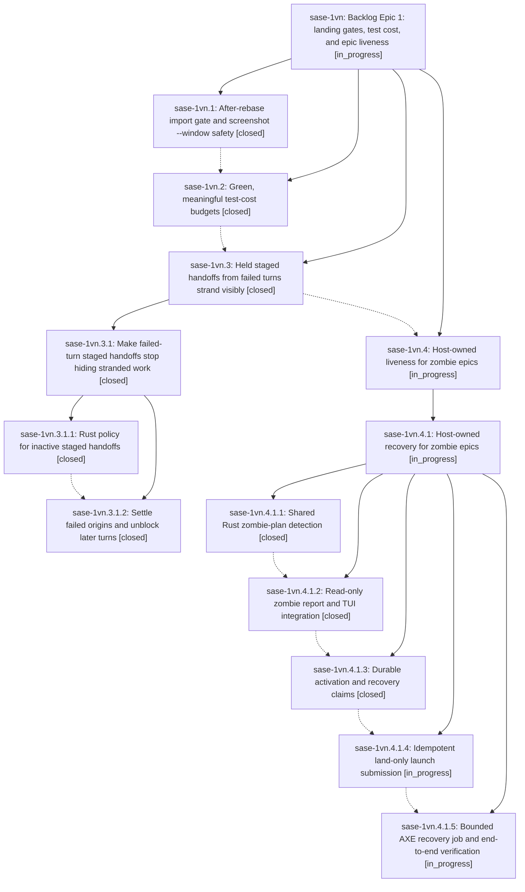

# Bead: sase-1vn — Backlog Epic 1: landing gates, test cost, and epic liveness

[Bead Pages](../README.md) / sase-1vn

**Status:** ◐ in_progress · **Type:** ▸ plan · **Tier:** epic
**Owner:** `bryanbugyi34@gmail.com` · **Created by:** [bbugyi200.athena.1h5](https://github.com/sase-org/sase--agents/blob/main/sessions/bbugyi200.athena.1h5.md) · **Assignee:** `sase-1vn.land`
**Created:** 2026-11-27 10:21:02 EST
**Plan:** [202611/backlog\_epic\_1.md](https://github.com/sase-org/sase--plans/blob/main/202611/backlog_epic_1.md)

<!-- sase:links:start -->

## Links

| Relation | Artifact | Why |
| --- | --- | --- |
| implemented-by | [plan:202611/backlog_epic_1.md][1] | derived from the plan's `bead_id:` frontmatter field |

[1]: https://github.com/sase-org/sase--plans/blob/main/202611/backlog_epic_1.md

<!-- sase:links:end -->

## Description

The five most important open task beads are fixed and closed. The land agent then starts Backlog Epic 2, and the chain continues five beads at a time until no open task beads remain.

## Notes

[2026-11-27T20:38:39Z · bryanbugyi34@gmail.com] The epic lander for this epic should create a new epic but let's stop it at two rounds. Make sure the epic lander for the next epic is aware of this stop point.

## Phases

| Bead | Title | Status | Size | Created | Agents | Commits |
|---|---|---|---|---|---:|---:|
| [sase-1vn.1](sase-1vn.1.md) | After-rebase import gate and screenshot --window safety | ✓ closed | medium | 2026-11-27 | 1 | 1 |
| [sase-1vn.2](sase-1vn.2.md) | Green, meaningful test-cost budgets | ✓ closed | large | 2026-11-27 | 1 | 1 |
| [sase-1vn.3](sase-1vn.3.md) | Held staged handoffs from failed turns strand visibly | ✓ closed | large | 2026-11-27 | 1 | 0 |
| [sase-1vn.4](sase-1vn.4.md) | Host-owned liveness for zombie epics | ◐ in_progress | large | 2026-11-27 | 1 | 0 |

## Lineage

## Agents

| Agent | Bead | Commits |
|---|---|---:|
| [bbugyi200.athena.sase-1vn.1](https://github.com/sase-org/sase--agents/blob/main/sessions/bbugyi200.athena.sase-1vn.1.md) | [sase-1vn.1](sase-1vn.1.md) | 1 |
| [bbugyi200.athena.sase-1vn.2](https://github.com/sase-org/sase--agents/blob/main/sessions/bbugyi200.athena.sase-1vn.2.md) | [sase-1vn.2](sase-1vn.2.md) | 1 |
| [bbugyi200.athena.sase-1vn.3](https://github.com/sase-org/sase--agents/blob/main/sessions/bbugyi200.athena.sase-1vn.3.md) | [sase-1vn.3](sase-1vn.3.md) | 0 |
| [bbugyi200.athena.sase-1vn.3.1.1](https://github.com/sase-org/sase--agents/blob/main/agents/bbugyi200.athena.sase-1vn.3.1.1/README.md) | [sase-1vn.3.1.1](sase-1vn.3.1.1.md) | 1 |
| [bbugyi200.athena.sase-1vn.3.1.2](https://github.com/sase-org/sase--agents/blob/main/agents/bbugyi200.athena.sase-1vn.3.1.2/README.md) | [sase-1vn.3.1.2](sase-1vn.3.1.2.md) | 1 |
| [bbugyi200.athena.sase-1vn.3.1.land](https://github.com/sase-org/sase--agents/blob/main/sessions/bbugyi200.athena.sase-1vn.3.1.land.md) | [sase-1vn.3.1](sase-1vn.3.1.md) | 2 |
| [bbugyi200.athena.sase-1vn.4](https://github.com/sase-org/sase--agents/blob/main/sessions/bbugyi200.athena.sase-1vn.4.md) | [sase-1vn.4](sase-1vn.4.md) | 0 |
| [bbugyi200.athena.sase-1vn.4.1.1](https://github.com/sase-org/sase--agents/blob/main/agents/bbugyi200.athena.sase-1vn.4.1.1/README.md) | [sase-1vn.4.1.1](sase-1vn.4.1.1.md) | 1 |
| [bbugyi200.athena.sase-1vn.4.1.2](https://github.com/sase-org/sase--agents/blob/main/sessions/bbugyi200.athena.sase-1vn.4.1.2.md) | [sase-1vn.4.1.2](sase-1vn.4.1.2.md) | 1 |
| [bbugyi200.athena.sase-1vn.4.1.3](https://github.com/sase-org/sase--agents/blob/main/agents/bbugyi200.athena.sase-1vn.4.1.3/README.md) | [sase-1vn.4.1.3](sase-1vn.4.1.3.md) | 2 |
| [bbugyi200.athena.sase-1vn.4.1.4](https://github.com/sase-org/sase--agents/blob/main/sessions/bbugyi200.athena.sase-1vn.4.1.4.md) | [sase-1vn.4.1.4](sase-1vn.4.1.4.md) | 1 |
| [bbugyi200.athena.sase-1vn.4.1.5](https://github.com/sase-org/sase--agents/blob/main/agents/bbugyi200.athena.sase-1vn.4.1.5/README.md) | [sase-1vn.4.1.5](sase-1vn.4.1.5.md) | 0 |
| [bbugyi200.athena.sase-1vn.4.1.land](https://github.com/sase-org/sase--agents/blob/main/agents/bbugyi200.athena.sase-1vn.4.1.land/README.md) | [sase-1vn.4.1](sase-1vn.4.1.md) | 0 |
| [bbugyi200.athena.sase-1vn.land](https://github.com/sase-org/sase--agents/blob/main/agents/bbugyi200.athena.sase-1vn.land/README.md) | [sase-1vn](README.md) | 0 |

## Commits

| Repo | Commit | Subject | Bead | Committed |
|---|---|---|---|---|
| sase | [`f079628`](https://github.com/sase-org/sase/commit/f07962869753f885da90cb754bb8f282f51e36e7) | fix: restore rebase-import certification and screenshot --window ownership | [sase-1vn.1](sase-1vn.1.md) | 2026-11-27 10:41:58 EST |
| sase | [`1b46158`](https://github.com/sase-org/sase/commit/1b461588eb33d6ce70f0c4414ce3fcd483e8f905) | test(test-cost): rebaseline suite budgets and retain telemetry records | [sase-1vn.2](sase-1vn.2.md) | 2026-11-27 16:31:31 EST |
| sase-core | [`sase-core@34461b7`](https://github.com/sase-org/sase-core/commit/34461b7fd8c03405c330985b8fd658b469e564c1) | fix(staged-handoff): ignore inactive failed-origin ownership | [sase-1vn.3.1.1](sase-1vn.3.1.1.md) | 2026-11-27 17:29:50 EST |
| sase | [`c783119`](https://github.com/sase-org/sase/commit/c783119ffdf81215cbeaa93bddff6f4b82334e49) | fix(axe): settle inactive staged handoffs without failed-origin ownership | [sase-1vn.3.1.2](sase-1vn.3.1.2.md) | 2026-11-27 19:15:28 EST |
| sase | [`7d1a7f1`](https://github.com/sase-org/sase/commit/7d1a7f18107cfb42b7d3aa63209a90781079b8e4) | fix(axe): retry incomplete inactive-stage settlement after failed turns | [sase-1vn.3.1](sase-1vn.3.1.md) | 2026-11-27 20:11:06 EST |
| sase--plans | [`sase--plans@b6ed883`](https://github.com/sase-org/sase--plans/commit/b6ed883cfb3d81721fa2a43ac8a16290ed7feae3) | docs(plans): mark failed-turn handoff epic and closeout tale done | [sase-1vn.3.1](sase-1vn.3.1.md) | 2026-11-27 20:12:09 EST |
| sase-core | [`sase-core@9138065`](https://github.com/sase-org/sase-core/commit/91380657517d03060c977fd9935b4d0fdd228b0d) | feat(bead): add shared zombie plan detection | [sase-1vn.4.1.1](sase-1vn.4.1.1.md) | 2026-11-27 21:00:45 EST |
| sase | [`96e87d5`](https://github.com/sase-org/sase/commit/96e87d598425639b43fd066bd51d5e9b0fd3526e) | feat(bead): add read-only zombie-plan report and TUI integration | [sase-1vn.4.1.2](sase-1vn.4.1.2.md) | 2026-11-27 22:18:35 EST |
| sase-core | [`sase-core@d741692`](https://github.com/sase-org/sase-core/commit/d7416921f526aac66c095674080607dfaa612fd2) | feat(bead): add durable recovery activation and claim records | [sase-1vn.4.1.3](sase-1vn.4.1.3.md) | 2026-11-27 23:48:00 EST |
| sase | [`21bdca5`](https://github.com/sase-org/sase/commit/21bdca56adcf459bbff96257f6a1e8365d64ea4f) | feat(bead): add machine-owned recovery claim publication adapter | [sase-1vn.4.1.3](sase-1vn.4.1.3.md) | 2026-11-27 23:49:10 EST |
| sase | [`a62aafb`](https://github.com/sase-org/sase/commit/a62aafb71899cc6d95dc0ef74ef4ec320bc493ef) | feat(bead): add idempotent land-only recovery launch submission | [sase-1vn.4.1.4](sase-1vn.4.1.4.md) | 2026-11-28 00:51:24 EST |
