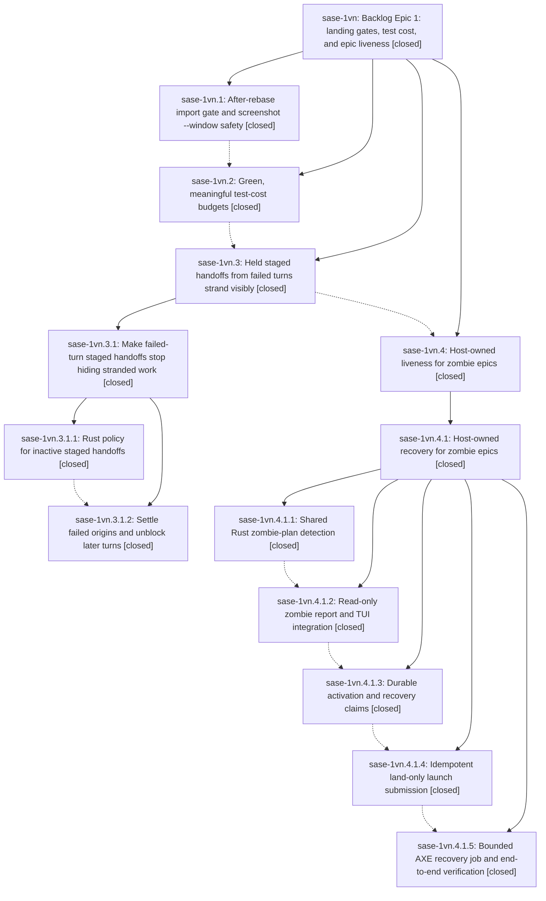

# Bead: sase-1vn — Backlog Epic 1: landing gates, test cost, and epic liveness

[Bead Pages](../README.md) / sase-1vn

**Status:** ✓ closed · **Resolution:** done · **Type:** ▸ plan · **Tier:** epic
**Owner:** `bryanbugyi34@gmail.com` · **Created by:** [bbugyi200.athena.1h5](https://github.com/sase-org/sase--agents/blob/main/sessions/bbugyi200.athena.1h5.md) · **Assignee:** `sase-1vn.land`
**Created:** 2026-11-27 10:21:02 EST · **Closed:** 2026-11-28 03:08:15 EST
**Plan:** [202611/backlog\_epic\_1.md](https://github.com/sase-org/sase--plans/blob/main/202611/backlog_epic_1.md)

<!-- sase:links:start -->

## Links

| Relation | Artifact | Why |
| --- | --- | --- |
| implemented-by | [plan:202611/backlog_epic_1.md][1] | derived from the plan's `bead_id:` frontmatter field |

[1]: https://github.com/sase-org/sase--plans/blob/main/202611/backlog_epic_1.md

<!-- sase:links:end -->

## Description

The five most important open task beads are fixed and closed. The land agent then starts Backlog Epic 2, and the chain continues five beads at a time until no open task beads remain.

## Notes

[2026-11-27T20:38:39Z · bryanbugyi34@gmail.com] The epic lander for this epic should create a new epic but let's stop it at two rounds. Make sure the epic lander for the next epic is aware of this stop point.

[2026-11-28T07:39:41Z · sase-1vn.land] LANDING REVIEW (sase-1vn land agent, 2026-11-28, master 8610438838, sase-core pin d7416921 = sase-core HEAD)

Verified: all 4 phases, both nested child epics (sase-1vn.3.1, sase-1vn.4.1) and their 7 phases are closed. I read every note. Commits checked against source: f079628697 (sase-1vn.1), 1b461588eb (sase-1vn.2), c783119ffd and 7d1a7f1810 (sase-1vn.3.1), and 96e87d5984, 21bdca56ad, a62aafb718, a5fde6cd11 and 8610438838 (sase-1vn.4.1), plus core 34461b7f, 91380657 and d7416921. The epic's 21 touched test files (322 tests) pass on 8610438838. Decisions honored: cost_budgets=rebaseline (budgets re-measured, wall keys advisory, synthetic-regression tests kept) and zombie_recovery=relaunch (land-only relaunch for post-cutoff closes; historical zombies report-only; nothing auto-closes a plan). `sase bead epic-symbols sase-1vn` returns no entries.

Target beads:
- sase-1d9: closed by sase-1vn.1.
- sase-1un: closed by sase-1vn.1.
- sase-j0: closed now (done). The CI Telemetry recording from run 46071761552 replays green with --ci, and the test-cost job finishes in 2:03 inside its 180m cap. The remaining red is the leak gate owned by sase-1vg; evidence was noted there.
- sase-1sh: closed now (done). The legacy record 3w69pb9ezmfy lacks done.json, so it stays held, and it is now visible as `? held`.
- sase-12u: closed now (done).

Drift integration: non-epic sase commits since the epic started were 324beb2ce8, 8c77e6fa64, 324d63e8ef, 51fc0d8cb2, 1cde333808, 5b184c837c, f6dd22d4dd, dcd6c726c3, 61d955445c, a6c7603560 and bfadafb74b; the non-epic core commits were 7e857edd and the v0.45.0 release. None duplicates or conflicts with what the epic added, and none needs to adopt it. The only later edits to phase-1/2 files are the epic's own.

REMAINING EPIC WORK (blocks close): the after-rebase import gate (sase-1un scope) still fails open on 7 of 9 publications since f079628697, now via the 10s hook timeout. The checker takes 7-19s because CommittedTree spawns 2 git subprocesses per loaded module. Details are on sase-1un. A small lander-authored tale fixes it, closes this epic, and then runs this plan's Land section (Backlog Epic 2, final round).

FOLLOW-UP TRIAGE:
- 4.1.1 PROPOSED FOLLOW-UP (core query_cache timing): already filed as sase-1vv by the sase-1vn.4.1 lander.
- 4.1.2 PROPOSED FOLLOW-UP (admission overlap flake): already filed as sase-1vw.
- 4.1.3 PROPOSED FOLLOW-UP (refresh_warmup_gc): declined; owned by sase-1v2.
- The sase-1vx countdown GC flake was filed by the sase-1vn.4.1 lander.
- Phases sase-1vn.1, .2, .3 and 3.1.x had no PROPOSED FOLLOW-UP.
- Newly discovered: test_coordinated_writers_keep_unique_child_ids fails in two consecutive Telemetry coverage-contexts runs. Recorded as a DISCOVERED ISSUE on causally linked epic sase-1tc (its phase sase-1tc.4 owns the test); no task created.
- The contention-test 90m cancellations are tracked under sase-1rq.2.1.4.1.5.3.1.3; no new task.
- Not a task: the global uv-installed sase predates these commits, so epic_liveness goes live only after a human reinstall.

[2026-11-28T08:08:15Z · sase-1vn.land] Close sase-1vn (Backlog Epic 1) after rebase-gate speed tale. Land-agent review (2026-11-28, master 8610438838): all 4 phases plus nested sase-1vn.3.1/sase-1vn.4.1 and their 7 phases closed; targets sase-1d9, sase-1un, sase-j0, sase-1sh, sase-12u closed; drift (non-epic sase commits + core commits incl. v0.45.0) reviewed, no integration needed; epic-symbols empty; follow-up triage done (sase-1vv/1vw/1vx filed, 4.1.3 declined/owned by sase-1v2, contention cancellations under sase-1rq.2.1.4.1.5.3.1.3, coordinated-writers issue noted on sase-1tc). This tale: CommittedTree now builds one git ls-tree -r -z --full-tree index and verifies worktree bytes by git blob-oid hash (sha1/sha256), stdlib-only. Timings (status clean): before 18.9s/10.4s/7.1s for 96e87d5984/a5fde6cd11/8610438838; after 4.48s/2.38s/1.78s. Slowest after 4.48s < 5.0s, so after_rebase_timeout_seconds stays 10. Tests: 4 new (subprocess count 7 for 30 modules; same-length rewrite rejected; symlink retarget rejected; unchanged bytes exact); all 23 in test_check_rebase_imports pass. Check run 5bba6f309046f8a180cbb12922b26697: all lint incl. symvision/mypy/ruff green; test lane 63796 passed with 168 parallel-lane failures in unrelated ace/tui/commit/chop files (none reference the helper; helper imports no sase); 3 sampled NEW items pass in isolation on this tree, so outside this bead scope.

## Phases

| Bead | Title | Status | Size | Created | Agents | Commits |
|---|---|---|---|---|---:|---:|
| [sase-1vn.1](sase-1vn.1.md) | After-rebase import gate and screenshot --window safety | ✓ closed | medium | 2026-11-27 | 1 | 1 |
| [sase-1vn.2](sase-1vn.2.md) | Green, meaningful test-cost budgets | ✓ closed | large | 2026-11-27 | 1 | 1 |
| [sase-1vn.3](sase-1vn.3.md) | Held staged handoffs from failed turns strand visibly | ✓ closed | large | 2026-11-27 | 1 | 0 |
| [sase-1vn.4](sase-1vn.4.md) | Host-owned liveness for zombie epics | ✓ closed | large | 2026-11-27 | 1 | 0 |

## Lineage

## Agents

| Agent | Bead | Commits |
|---|---|---:|
| [bbugyi200.athena.sase-1vn.1](https://github.com/sase-org/sase--agents/blob/main/sessions/bbugyi200.athena.sase-1vn.1.md) | [sase-1vn.1](sase-1vn.1.md) | 1 |
| [bbugyi200.athena.sase-1vn.2](https://github.com/sase-org/sase--agents/blob/main/sessions/bbugyi200.athena.sase-1vn.2.md) | [sase-1vn.2](sase-1vn.2.md) | 1 |
| [bbugyi200.athena.sase-1vn.3](https://github.com/sase-org/sase--agents/blob/main/sessions/bbugyi200.athena.sase-1vn.3.md) | [sase-1vn.3](sase-1vn.3.md) | 0 |
| [bbugyi200.athena.sase-1vn.3.1.1](https://github.com/sase-org/sase--agents/blob/main/agents/bbugyi200.athena.sase-1vn.3.1.1/README.md) | [sase-1vn.3.1.1](sase-1vn.3.1.1.md) | 1 |
| [bbugyi200.athena.sase-1vn.3.1.2](https://github.com/sase-org/sase--agents/blob/main/agents/bbugyi200.athena.sase-1vn.3.1.2/README.md) | [sase-1vn.3.1.2](sase-1vn.3.1.2.md) | 1 |
| [bbugyi200.athena.sase-1vn.3.1.land](https://github.com/sase-org/sase--agents/blob/main/sessions/bbugyi200.athena.sase-1vn.3.1.land.md) | [sase-1vn.3.1](sase-1vn.3.1.md) | 2 |
| [bbugyi200.athena.sase-1vn.4](https://github.com/sase-org/sase--agents/blob/main/sessions/bbugyi200.athena.sase-1vn.4.md) | [sase-1vn.4](sase-1vn.4.md) | 0 |
| [bbugyi200.athena.sase-1vn.4.1.1](https://github.com/sase-org/sase--agents/blob/main/agents/bbugyi200.athena.sase-1vn.4.1.1/README.md) | [sase-1vn.4.1.1](sase-1vn.4.1.1.md) | 1 |
| [bbugyi200.athena.sase-1vn.4.1.2](https://github.com/sase-org/sase--agents/blob/main/sessions/bbugyi200.athena.sase-1vn.4.1.2.md) | [sase-1vn.4.1.2](sase-1vn.4.1.2.md) | 1 |
| [bbugyi200.athena.sase-1vn.4.1.3](https://github.com/sase-org/sase--agents/blob/main/agents/bbugyi200.athena.sase-1vn.4.1.3/README.md) | [sase-1vn.4.1.3](sase-1vn.4.1.3.md) | 2 |
| [bbugyi200.athena.sase-1vn.4.1.4](https://github.com/sase-org/sase--agents/blob/main/sessions/bbugyi200.athena.sase-1vn.4.1.4.md) | [sase-1vn.4.1.4](sase-1vn.4.1.4.md) | 1 |
| [bbugyi200.athena.sase-1vn.4.1.5](https://github.com/sase-org/sase--agents/blob/main/agents/bbugyi200.athena.sase-1vn.4.1.5/README.md) | [sase-1vn.4.1.5](sase-1vn.4.1.5.md) | 1 |
| [bbugyi200.athena.sase-1vn.4.1.land](https://github.com/sase-org/sase--agents/blob/main/agents/bbugyi200.athena.sase-1vn.4.1.land/README.md) | [sase-1vn.4.1](sase-1vn.4.1.md) | 2 |
| [bbugyi200.athena.sase-1vn.land](https://github.com/sase-org/sase--agents/blob/main/sessions/bbugyi200.athena.sase-1vn.land.md) | [sase-1vn](README.md) | 1 |

## Commits

| Repo | Commit | Subject | Bead | Committed |
|---|---|---|---|---|
| sase | [`f079628`](https://github.com/sase-org/sase/commit/f07962869753f885da90cb754bb8f282f51e36e7) | fix: restore rebase-import certification and screenshot --window ownership | [sase-1vn.1](sase-1vn.1.md) | 2026-11-27 10:41:58 EST |
| sase | [`1b46158`](https://github.com/sase-org/sase/commit/1b461588eb33d6ce70f0c4414ce3fcd483e8f905) | test(test-cost): rebaseline suite budgets and retain telemetry records | [sase-1vn.2](sase-1vn.2.md) | 2026-11-27 16:31:31 EST |
| sase-core | [`sase-core@34461b7`](https://github.com/sase-org/sase-core/commit/34461b7fd8c03405c330985b8fd658b469e564c1) | fix(staged-handoff): ignore inactive failed-origin ownership | [sase-1vn.3.1.1](sase-1vn.3.1.1.md) | 2026-11-27 17:29:50 EST |
| sase | [`c783119`](https://github.com/sase-org/sase/commit/c783119ffdf81215cbeaa93bddff6f4b82334e49) | fix(axe): settle inactive staged handoffs without failed-origin ownership | [sase-1vn.3.1.2](sase-1vn.3.1.2.md) | 2026-11-27 19:15:28 EST |
| sase | [`7d1a7f1`](https://github.com/sase-org/sase/commit/7d1a7f18107cfb42b7d3aa63209a90781079b8e4) | fix(axe): retry incomplete inactive-stage settlement after failed turns | [sase-1vn.3.1](sase-1vn.3.1.md) | 2026-11-27 20:11:06 EST |
| sase--plans | [`sase--plans@b6ed883`](https://github.com/sase-org/sase--plans/commit/b6ed883cfb3d81721fa2a43ac8a16290ed7feae3) | docs(plans): mark failed-turn handoff epic and closeout tale done | [sase-1vn.3.1](sase-1vn.3.1.md) | 2026-11-27 20:12:09 EST |
| sase-core | [`sase-core@9138065`](https://github.com/sase-org/sase-core/commit/91380657517d03060c977fd9935b4d0fdd228b0d) | feat(bead): add shared zombie plan detection | [sase-1vn.4.1.1](sase-1vn.4.1.1.md) | 2026-11-27 21:00:45 EST |
| sase | [`96e87d5`](https://github.com/sase-org/sase/commit/96e87d598425639b43fd066bd51d5e9b0fd3526e) | feat(bead): add read-only zombie-plan report and TUI integration | [sase-1vn.4.1.2](sase-1vn.4.1.2.md) | 2026-11-27 22:18:35 EST |
| sase-core | [`sase-core@d741692`](https://github.com/sase-org/sase-core/commit/d7416921f526aac66c095674080607dfaa612fd2) | feat(bead): add durable recovery activation and claim records | [sase-1vn.4.1.3](sase-1vn.4.1.3.md) | 2026-11-27 23:48:00 EST |
| sase | [`21bdca5`](https://github.com/sase-org/sase/commit/21bdca56adcf459bbff96257f6a1e8365d64ea4f) | feat(bead): add machine-owned recovery claim publication adapter | [sase-1vn.4.1.3](sase-1vn.4.1.3.md) | 2026-11-27 23:49:10 EST |
| sase | [`a62aafb`](https://github.com/sase-org/sase/commit/a62aafb71899cc6d95dc0ef74ef4ec320bc493ef) | feat(bead): add idempotent land-only recovery launch submission | [sase-1vn.4.1.4](sase-1vn.4.1.4.md) | 2026-11-28 00:51:24 EST |
| sase | [`a5fde6c`](https://github.com/sase-org/sase/commit/a5fde6cd11414538858db1cb5c763ccdb75cb156) | feat(axe): recover eligible zombie epic plans | [sase-1vn.4.1.5](sase-1vn.4.1.5.md) | 2026-11-28 01:45:37 EST |
| sase | [`8610438`](https://github.com/sase-org/sase/commit/8610438838bd9fe2425be487cb5b2c56bdc72172) | fix(axe): land zombie-epic recovery and harden epic\_liveness accounting | [sase-1vn.4.1](sase-1vn.4.1.md) | 2026-11-28 02:24:54 EST |
| sase--plans | [`sase--plans@3da1f6b`](https://github.com/sase-org/sase--plans/commit/3da1f6b4ea094a164543e378042e5b94cd5bd85d) | chore(plans): mark zombie\_epic\_liveness plan done | [sase-1vn.4.1](sase-1vn.4.1.md) | 2026-11-28 02:25:49 EST |
| sase | [`4010ecd`](https://github.com/sase-org/sase/commit/4010ecd89aec66a64f78b6591f4157d214f994aa) | fix(rebase-gate): certify committed tree from a single ls-tree index | [sase-1vn](README.md) | 2026-11-28 03:11:54 EST |
