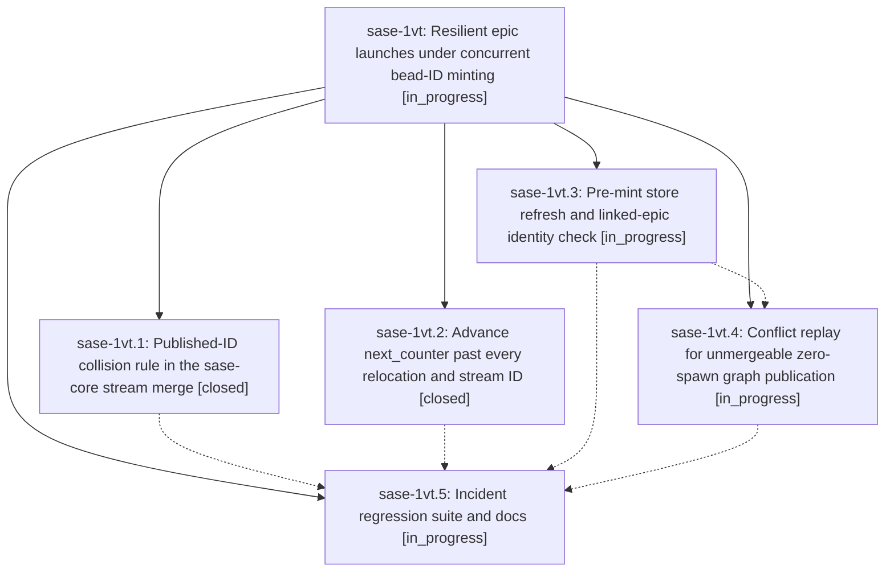

# Bead: sase-1vt — Resilient epic launches under concurrent bead-ID minting

[Bead Pages](../README.md) / sase-1vt

**Status:** ◐ in_progress · **Type:** ▸ plan · **Tier:** epic
**Owner:** `bryanbugyi34@gmail.com` · **Created by:** [bbugyi200.athena.1hj](https://github.com/sase-org/sase--agents/blob/main/sessions/bbugyi200.athena.1hj.md) · **Assignee:** `sase-1vt.land`
**Created:** 2026-11-27 15:24:24 EST
**Plan:** [202611/resilient\_epic\_launch.md](https://github.com/sase-org/sase--plans/blob/main/202611/resilient_epic_launch.md)

<!-- sase:links:start -->

## Links

| Relation | Artifact | Why |
| --- | --- | --- |
| implemented-by | [plan:202611/resilient_epic_launch.md][1] | derived from the plan's `bead_id:` frontmatter field |

_Plus 1 automatic references — see [Referenced By](#referenced-by)._

[1]: https://github.com/sase-org/sase--plans/blob/main/202611/resilient_epic_launch.md

<!-- sase:links:end -->

## Description

Approved epics launch successfully even when another machine or agent mints and publishes beads in the same store at the same time. ID collisions are relocated automatically, removed IDs are never minted again, a launch never reuses another plan's epic, and a graph that cannot be merged is re-minted from the plan instead of wedging the workspace store.

## Phases

| Bead | Title | Status | Size | Created | Agents | Commits |
|---|---|---|---|---|---:|---:|
| [sase-1vt.1](sase-1vt.1.md) | Published-ID collision rule in the sase-core stream merge | ✓ closed | medium | 2026-11-27 | 1 | 1 |
| [sase-1vt.2](sase-1vt.2.md) | Advance next\_counter past every relocation and stream ID | ✓ closed | small | 2026-11-27 | 1 | 0 |
| [sase-1vt.3](sase-1vt.3.md) | Pre-mint store refresh and linked-epic identity check | ◐ in_progress | medium | 2026-11-27 | 1 | 0 |
| [sase-1vt.4](sase-1vt.4.md) | Conflict replay for unmergeable zero-spawn graph publication | ◐ in_progress | medium | 2026-11-27 | 1 | 0 |
| [sase-1vt.5](sase-1vt.5.md) | Incident regression suite and docs | ◐ in_progress | medium | 2026-11-27 | 1 | 0 |

## Lineage

## Agents

| Agent | Bead | Commits |
|---|---|---:|
| [bbugyi200.athena.sase-1vt.1](https://github.com/sase-org/sase--agents/blob/main/agents/bbugyi200.athena.sase-1vt.1/README.md) | [sase-1vt.1](sase-1vt.1.md) | 1 |
| [bbugyi200.athena.sase-1vt.2](https://github.com/sase-org/sase--agents/blob/main/agents/bbugyi200.athena.sase-1vt.2/README.md) | [sase-1vt.2](sase-1vt.2.md) | 0 |
| [bbugyi200.athena.sase-1vt.3](https://github.com/sase-org/sase--agents/blob/main/sessions/bbugyi200.athena.sase-1vt.3.md) | [sase-1vt.3](sase-1vt.3.md) | 0 |
| [bbugyi200.athena.sase-1vt.4](https://github.com/sase-org/sase--agents/blob/main/agents/bbugyi200.athena.sase-1vt.4/README.md) | [sase-1vt.4](sase-1vt.4.md) | 0 |
| [bbugyi200.athena.sase-1vt.5](https://github.com/sase-org/sase--agents/blob/main/agents/bbugyi200.athena.sase-1vt.5/README.md) | [sase-1vt.5](sase-1vt.5.md) | 0 |
| [bbugyi200.athena.sase-1vt.land](https://github.com/sase-org/sase--agents/blob/main/agents/bbugyi200.athena.sase-1vt.land/README.md) | [sase-1vt](README.md) | 0 |

## Commits

| Repo | Commit | Subject | Bead | Committed |
|---|---|---|---|---|
| sase-core | [`sase-core@7e857ed`](https://github.com/sase-org/sase-core/commit/7e857eddded8203f05a42b405f909dc3a5903e92) | fix(bead-merge): relocate published-id reincarnations | [sase-1vt.1](sase-1vt.1.md) | 2026-11-27 16:48:26 EST |

<!-- sase:referenced-by:start -->

## Referenced By

| Relation | Artifact | Why | Uses |
| --- | --- | --- | ---: |
| read-by | [agent:sase-1vt.2][1] | epic context | 1 |

[1]: https://github.com/sase-org/sase--agents/blob/main/agents/bbugyi200.athena.sase-1vt.2/README.md

<!-- sase:referenced-by:end -->
