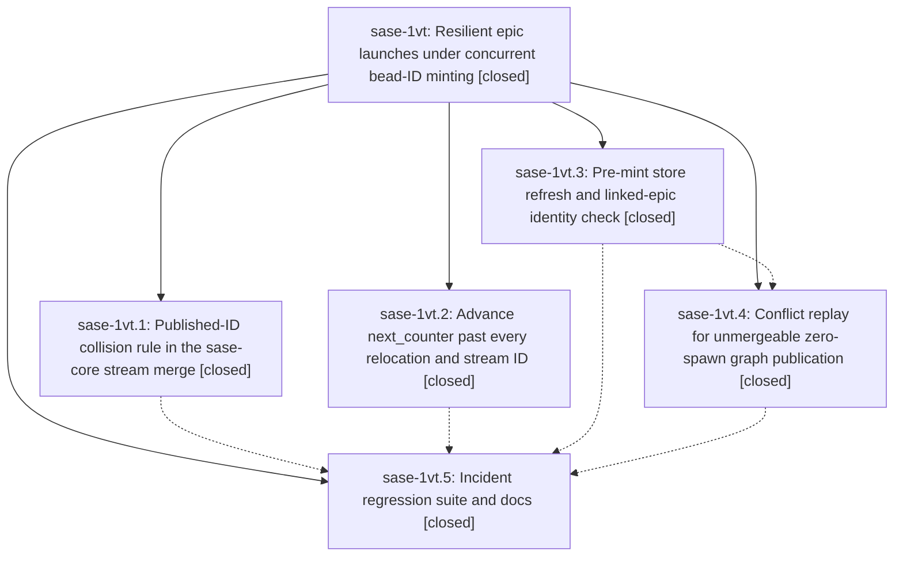

# Bead: sase-1vt — Resilient epic launches under concurrent bead-ID minting

[Bead Pages](../README.md) / sase-1vt

**Status:** ✓ closed · **Resolution:** done · **Type:** ▸ plan · **Tier:** epic
**Owner:** `bryanbugyi34@gmail.com` · **Created by:** [bbugyi200.athena.1hj](https://github.com/sase-org/sase--agents/blob/main/sessions/bbugyi200.athena.1hj.md) · **Assignee:** `sase-1vt.land`
**Created:** 2026-11-27 15:24:24 EST · **Closed:** 2026-11-27 19:07:29 EST
**Plan:** [202611/resilient\_epic\_launch.md](https://github.com/sase-org/sase--plans/blob/main/202611/resilient_epic_launch.md)

<!-- sase:links:start -->

## Links

| Relation | Artifact | Why |
| --- | --- | --- |
| implemented-by | [plan:202611/resilient_epic_launch.md][1] | derived from the plan's `bead_id:` frontmatter field |
| related | [bead:sase-1vu][2] | Proposing epic; its plan's out-of-scope section first recorded this plans-clone conflict during the bob-cli-ra incident |

_Plus 3 automatic references — see [Referenced By](#referenced-by)._

[1]: https://github.com/sase-org/sase--plans/blob/main/202611/resilient_epic_launch.md
[2]: https://github.com/sase-org/sase--beads/blob/main/pages/sase-1vu/README.md

<!-- sase:links:end -->

## Description

Approved epics launch successfully even when another machine or agent mints and publishes beads in the same store at the same time. ID collisions are relocated automatically, removed IDs are never minted again, a launch never reuses another plan's epic, and a graph that cannot be merged is re-minted from the plan instead of wedging the workspace store.

## Notes

[2026-11-27T23:44:29Z · sase-1vt.land] LAND TRIAGE (sase-1vt.land): No child phase recorded a PROPOSED FOLLOW-UP note. Plan out-of-scope 'Plans clone conflict': it recurred (14+ lumberjack-checks pulls of the bob-cli primary plans clone failed on 8304b5da 'Archive approved plan ctrl_jk_section_map', non-bead conflicts remain, latest 18:32:51). Filed as sase-1vu (bug, large, ready), linked related to sase-1vt, sase-n3, and sase-112. It was not caused by this epic. Plan out-of-scope 'Task-bead minting': declined, because it is a deliberate design boundary (task-bead create stays offline-fast) and not a defect. Also declined: cli_work_from_plan_launch.py grew to 894 lines, past the toobig 850 tier, which the toobig_split routine owns. ~105s artifact-link adds observed during landing are already tracked by sase-1vp and are unrelated to this epic. REMAINING EPIC WORK (caused by this epic), planned as a lander tale: (1) _cause_first_integration_error in src/sase/sdd/_repository_integration_repair.py labels every semantic-repair failure, including plans-store 'non-bead conflicts remain', as 'bead-ID collision with concurrently published history'. (2) _replay_publication_conflict skips the plan-required assert_bead_store_write_sandboxed guard before its hard reset. (3) The plan-file section of docs/reference/work-units/bead-work.md still says every publication failure preserves the checkpoint and omits the pre-mint refresh, the linked-epic identity check, and the replay, even though cli-workflows.md links to it. (4) Duplicate HEAD-SHA helper: premint _beads_repo_head_sha vs _sync_git.bead_store_head_sha.

[2026-11-28T00:07:29Z · sase-1vt.land] Land verified: sase-core 7e857edd published-ID collision rule (pinned), counter floor past every stream/relocation ID, pre-mint refresh with transient/conflict policy plus linked-epic identity check, conflict replay with recovery ref, bounded attempts and refusal recovery, three-clone regression and docs. Landing tale fixed: neutral cause-first label for non-bead semantic failures, sandbox guard before the replay reset, bead-work.md plan-file behavior, single bead_store_head_sha helper. Integration since start (8c77e6fa64, 1b461588eb, f6dd22d4dd, sase-core 34461b7f) needed no changes. Follow-ups: sase-1vu filed; other proposals declined (see land triage note).

## Phases

| Bead | Title | Status | Size | Created | Agents | Commits |
|---|---|---|---|---|---:|---:|
| [sase-1vt.1](sase-1vt.1.md) | Published-ID collision rule in the sase-core stream merge | ✓ closed | medium | 2026-11-27 | 1 | 2 |
| [sase-1vt.2](sase-1vt.2.md) | Advance next\_counter past every relocation and stream ID | ✓ closed | small | 2026-11-27 | 1 | 1 |
| [sase-1vt.3](sase-1vt.3.md) | Pre-mint store refresh and linked-epic identity check | ✓ closed | medium | 2026-11-27 | 1 | 1 |
| [sase-1vt.4](sase-1vt.4.md) | Conflict replay for unmergeable zero-spawn graph publication | ✓ closed | medium | 2026-11-27 | 1 | 1 |
| [sase-1vt.5](sase-1vt.5.md) | Incident regression suite and docs | ✓ closed | medium | 2026-11-27 | 1 | 1 |

## Lineage

## Agents

| Agent | Bead | Commits |
|---|---|---:|
| [bbugyi200.athena.sase-1vt.1](https://github.com/sase-org/sase--agents/blob/main/agents/bbugyi200.athena.sase-1vt.1/README.md) | [sase-1vt.1](sase-1vt.1.md) | 2 |
| [bbugyi200.athena.sase-1vt.2](https://github.com/sase-org/sase--agents/blob/main/agents/bbugyi200.athena.sase-1vt.2/README.md) | [sase-1vt.2](sase-1vt.2.md) | 1 |
| [bbugyi200.athena.sase-1vt.3](https://github.com/sase-org/sase--agents/blob/main/sessions/bbugyi200.athena.sase-1vt.3.md) | [sase-1vt.3](sase-1vt.3.md) | 1 |
| [bbugyi200.athena.sase-1vt.4](https://github.com/sase-org/sase--agents/blob/main/agents/bbugyi200.athena.sase-1vt.4/README.md) | [sase-1vt.4](sase-1vt.4.md) | 1 |
| [bbugyi200.athena.sase-1vt.5](https://github.com/sase-org/sase--agents/blob/main/agents/bbugyi200.athena.sase-1vt.5/README.md) | [sase-1vt.5](sase-1vt.5.md) | 1 |
| [bbugyi200.athena.sase-1vt.land](https://github.com/sase-org/sase--agents/blob/main/sessions/bbugyi200.athena.sase-1vt.land.md) | [sase-1vt](README.md) | 2 |

## Commits

| Repo | Commit | Subject | Bead | Committed |
|---|---|---|---|---|
| sase | [`324d63e`](https://github.com/sase-org/sase/commit/324d63e8ef61980edc5d4e7e3dfd33c20042bf64) | fix(bead): advance next\_counter past every relocation and stream ID | [sase-1vt.2](sase-1vt.2.md) | 2026-11-27 16:03:09 EST |
| sase-core | [`sase-core@7e857ed`](https://github.com/sase-org/sase-core/commit/7e857eddded8203f05a42b405f909dc3a5903e92) | fix(bead-merge): relocate published-id reincarnations | [sase-1vt.1](sase-1vt.1.md) | 2026-11-27 16:48:26 EST |
| sase | [`51fc0d8`](https://github.com/sase-org/sase/commit/51fc0d8cb2a8488c792c2a88df2aa127ee45157c) | fix(bead): relocate reincarnated issue creation conflicts | [sase-1vt.1](sase-1vt.1.md) | 2026-11-27 16:49:37 EST |
| sase | [`1cde333`](https://github.com/sase-org/sase/commit/1cde33380898f86324dd520f7d65e8aaedf28a05) | feat(bead): refresh the store before epic mint and reject foreign plan links | [sase-1vt.3](sase-1vt.3.md) | 2026-11-27 16:59:49 EST |
| sase | [`5b184c8`](https://github.com/sase-org/sase/commit/5b184c837cd3f6a3f2aeb476e9696c0ea5969d05) | feat(bead): conflict replay for epic graph publication | [sase-1vt.4](sase-1vt.4.md) | 2026-11-27 17:51:12 EST |
| sase | [`dcd6c72`](https://github.com/sase-org/sase/commit/dcd6c726c39d9e7edb0a673ed98ec39e25533107) | test(bead): add concurrent epic collision regression | [sase-1vt.5](sase-1vt.5.md) | 2026-11-27 18:30:12 EST |
| sase | [`61d9554`](https://github.com/sase-org/sase/commit/61d955445c4bb3662bb2244d29dff0f5ee8fe1e8) | fix(bead): land resilient epic launches with cause-first labels and sandboxed replay | [sase-1vt](README.md) | 2026-11-27 19:10:21 EST |
| sase--plans | [`sase--plans@a8c75d4`](https://github.com/sase-org/sase--plans/commit/a8c75d45dc5f95630095bbc4106170ca221eb2a8) | chore(plans): mark resilient\_epic\_launch plan done | [sase-1vt](README.md) | 2026-11-27 19:11:27 EST |

<!-- sase:referenced-by:start -->

## Referenced By

| Relation | Artifact | Why | Uses |
| --- | --- | --- | ---: |
| read-by | [agent:sase-1vt.1][1] | Need the parent epic plan path and any phase notes/history context | 1 |
| read-by | [agent:sase-1vt.2][2] | epic context | 1 |
| read-by | [agent:sase-1vt.4][3] | Check epic status for replay phase context | 1 |

[1]: https://github.com/sase-org/sase--agents/blob/main/agents/bbugyi200.athena.sase-1vt.1/README.md
[2]: https://github.com/sase-org/sase--agents/blob/main/agents/bbugyi200.athena.sase-1vt.2/README.md
[3]: https://github.com/sase-org/sase--agents/blob/main/agents/bbugyi200.athena.sase-1vt.4/README.md

<!-- sase:referenced-by:end -->
