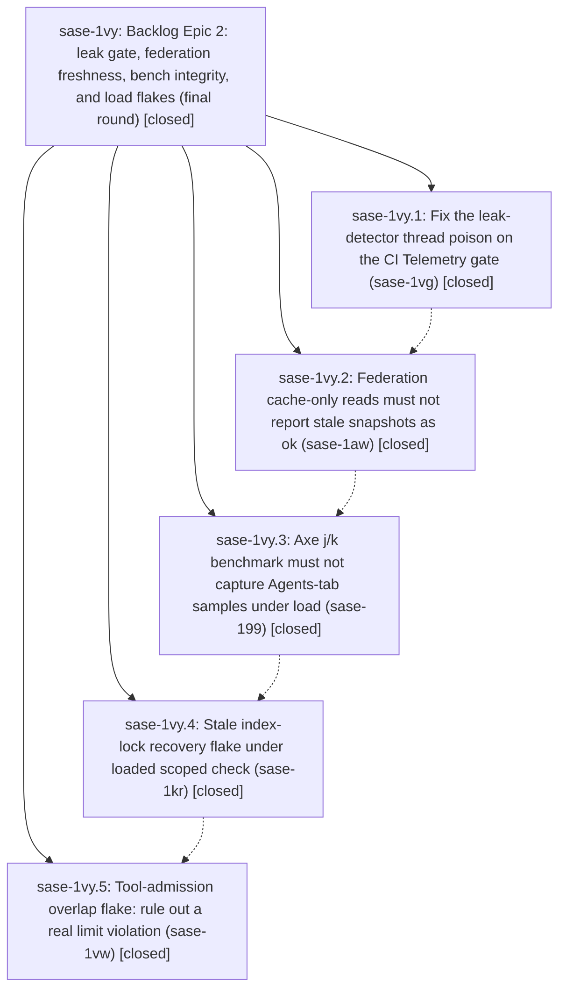

# Bead: sase-1vy — Backlog Epic 2: leak gate, federation freshness, bench integrity, and load flakes (final round)

[Bead Pages](../README.md) / sase-1vy

**Status:** ✓ closed · **Resolution:** done · **Type:** ▸ plan · **Tier:** epic
**Owner:** `bryanbugyi34@gmail.com` · **Created by:** [bbugyi200.athena.sase-1vn.land](https://github.com/sase-org/sase--agents/blob/main/sessions/bbugyi200.athena.sase-1vn.land.md) · **Assignee:** `sase-1vy.land`
**Created:** 2026-11-28 03:14:44 EST · **Closed:** 2026-11-28 08:22:54 EST
**Plan:** [202611/backlog\_epic\_2.md](https://github.com/sase-org/sase--plans/blob/main/202611/backlog_epic_2.md)

<!-- sase:links:start -->

## Links

| Relation | Artifact | Why |
| --- | --- | --- |
| implemented-by | [plan:202611/backlog_epic_2.md][1] | derived from the plan's `bead_id:` frontmatter field |

_Plus 1 automatic references — see [Referenced By](#referenced-by)._

[1]: https://github.com/sase-org/sase--plans/blob/main/202611/backlog_epic_2.md

<!-- sase:links:end -->

## Description

The five most important remaining open task beads are fixed and closed. The land agent verifies, closes this final epic, and stops: the user capped the backlog chain at two rounds, so no Backlog Epic 3 is planned.

## Notes

[2026-11-28T13:22:54Z · sase-1vy.land] Land agent verification (2026-11-28, master 4c9ccea4b2 + landing edits).

VERIFIED: all 5 phases closed. I re-read each diff against its pick.
- .1 (42255c3cce): header resolvers drained before sase-config-token-refresh; the leak detector was not widened. Also fixed the _CommittedSourceFinder meta_path leak that caused 686 Master Gate failures at 4010ecd89a, and the sase-1ve nested-admission wait.
- .2 (sase-core a1b9d8d1, pushed): cache-only federation reads keep last_read_error until a network read succeeds; sase-core check fed32e07 ran on that exact tree.
- .3 (a4bbd29cba): Services j/k sample window isolated.
- .4 (53acb952ef): deterministic owner-probe injection.
- .5 (4c9ccea4b2): semantic startup wait. It was a test race, not an admission violation.
Decisions honored: check-full never run, wrapped check used, no --force. Task beads sase-1vg, sase-1aw, sase-199, sase-1kr and sase-1vw closed with evidence; sase-1ve was already closed by .1; sase-1s4 stays open as a distinct defect.

INTEGRATION: the only non-epic commit since the epic started, 2a57d57e1e (recovery_claims test split), does not overlap. The landing extended phase .4's patch_git_lock_owner_probe to the 8 remaining sibling stale-lock caller nodes with the same host-probe flake shape (5/5 contention repeats, 0 failures). It also fixed epic-caused flake sase-1vz: the nested session in .1's new leak-detector test now disables the session temp-leak guard, as nested sessions sharing the outer TMPDIR do. Red/green proven, then closed. sase tool run check 42060d79 and 9f2a71c8 both green (exit 0). sase-core has no change since a1b9d8d1, and its CI pin is ratcheted automatically (no new binding).

FOLLOW-UP TRIAGE: one PROPOSED FOLLOW-UP (sase-1vy.3 note #1, Services j/k p95 over 16 ms on clean base) was filed as new task sase-1w0 (ci, large), linked to sase-199, sase-1ge and sase-lx. No duplicate or causal active epic. Other phase notes needed no task: the .1 notes were fixed in-commit, and the .4 sase-core 0.45.0-vs-0.44.2 pin diagnostic is expected.

DISCOVERED: Master Gate stays red only on test_coordinated_writers_keep_unique_child_ids. It predates this epic (bfadafb74b) and is owned by active epic sase-1tc, where I recorded the evidence as note #9. No new task.

Epic-symbols: none. Final round, so no further backlog epic is planned.

## Phases

| Bead | Title | Status | Size | Created | Agents | Commits |
|---|---|---|---|---|---:|---:|
| [sase-1vy.1](sase-1vy.1.md) | Fix the leak-detector thread poison on the CI Telemetry gate (sase-1vg) | ✓ closed | large | 2026-11-28 | 1 | 1 |
| [sase-1vy.2](sase-1vy.2.md) | Federation cache-only reads must not report stale snapshots as ok (sase-1aw) | ✓ closed | medium | 2026-11-28 | 1 | 1 |
| [sase-1vy.3](sase-1vy.3.md) | Axe j/k benchmark must not capture Agents-tab samples under load (sase-199) | ✓ closed | large | 2026-11-28 | 1 | 1 |
| [sase-1vy.4](sase-1vy.4.md) | Stale index-lock recovery flake under loaded scoped check (sase-1kr) | ✓ closed | large | 2026-11-28 | 1 | 1 |
| [sase-1vy.5](sase-1vy.5.md) | Tool-admission overlap flake: rule out a real limit violation (sase-1vw) | ✓ closed | large | 2026-11-28 | 1 | 1 |

## Lineage

## Agents

| Agent | Bead | Commits |
|---|---|---:|
| [bbugyi200.athena.sase-1vy.1](https://github.com/sase-org/sase--agents/blob/main/sessions/bbugyi200.athena.sase-1vy.1.md) | [sase-1vy.1](sase-1vy.1.md) | 1 |
| [bbugyi200.athena.sase-1vy.2](https://github.com/sase-org/sase--agents/blob/main/agents/bbugyi200.athena.sase-1vy.2/README.md) | [sase-1vy.2](sase-1vy.2.md) | 1 |
| [bbugyi200.athena.sase-1vy.3](https://github.com/sase-org/sase--agents/blob/main/sessions/bbugyi200.athena.sase-1vy.3.md) | [sase-1vy.3](sase-1vy.3.md) | 1 |
| [bbugyi200.athena.sase-1vy.4](https://github.com/sase-org/sase--agents/blob/main/sessions/bbugyi200.athena.sase-1vy.4.md) | [sase-1vy.4](sase-1vy.4.md) | 1 |
| [bbugyi200.athena.sase-1vy.5](https://github.com/sase-org/sase--agents/blob/main/sessions/bbugyi200.athena.sase-1vy.5.md) | [sase-1vy.5](sase-1vy.5.md) | 1 |
| [bbugyi200.athena.sase-1vy.land](https://github.com/sase-org/sase--agents/blob/main/agents/bbugyi200.athena.sase-1vy.land/README.md) | [sase-1vy](README.md) | 2 |

## Commits

| Repo | Commit | Subject | Bead | Committed |
|---|---|---|---|---|
| sase | [`42255c3`](https://github.com/sase-org/sase/commit/42255c3cce19e85ac18053d9b92921168c67c5c4) | fix(tui): drain header enrichment before config token refresh | [sase-1vy.1](sase-1vy.1.md) | 2026-11-28 05:14:42 EST |
| sase-core | [`sase-core@a1b9d8d`](https://github.com/sase-org/sase-core/commit/a1b9d8d14a7c71b8c8e4921ed414afe1f78f76e6) | fix(federation): preserve cache failures in cache-only reads | [sase-1vy.2](sase-1vy.2.md) | 2026-11-28 05:35:59 EST |
| sase | [`a4bbd29`](https://github.com/sase-org/sase/commit/a4bbd29cba49713c5cefab84029c771142c9a4ce) | fix(bench): isolate Services j/k sample window | [sase-1vy.3](sase-1vy.3.md) | 2026-11-28 06:33:16 EST |
| sase | [`53acb95`](https://github.com/sase-org/sase/commit/53acb952ef758d42bffd592857c76183135d6e5c) | test(git-lock): make stale-lock caller tests deterministic | [sase-1vy.4](sase-1vy.4.md) | 2026-11-28 07:07:56 EST |
| sase | [`4c9ccea`](https://github.com/sase-org/sase/commit/4c9ccea4b2b63d9d7af6aadd3ac751575860c55e) | fix(tool): wait for holder children before measuring admission overlap | [sase-1vy.5](sase-1vy.5.md) | 2026-11-28 07:44:29 EST |
| sase | [`cae7c85`](https://github.com/sase-org/sase/commit/cae7c851c116d0093466c0efc5ce1376b54454a2) | test(landing): finish sase-1vy stale-lock and nested leak-guard coverage | [sase-1vy](README.md) | 2026-11-28 08:25:48 EST |
| sase--plans | [`sase--plans@435489d`](https://github.com/sase-org/sase--plans/commit/435489ddb70ecf45a72b6e16a8ba510fdda9c1df) | chore(plans): mark backlog\_epic\_2 done after sase-1vy landed | [sase-1vy](README.md) | 2026-11-28 08:26:25 EST |

<!-- sase:referenced-by:start -->

## Referenced By

| Relation | Artifact | Why | Uses |
| --- | --- | --- | ---: |
| read-by | [agent:sase-1vy.2][1] | Need the governing epic decisions and plan context for phase sase-1vy.2 | 1 |

[1]: https://github.com/sase-org/sase--agents/blob/main/agents/bbugyi200.athena.sase-1vy.2/README.md

<!-- sase:referenced-by:end -->
